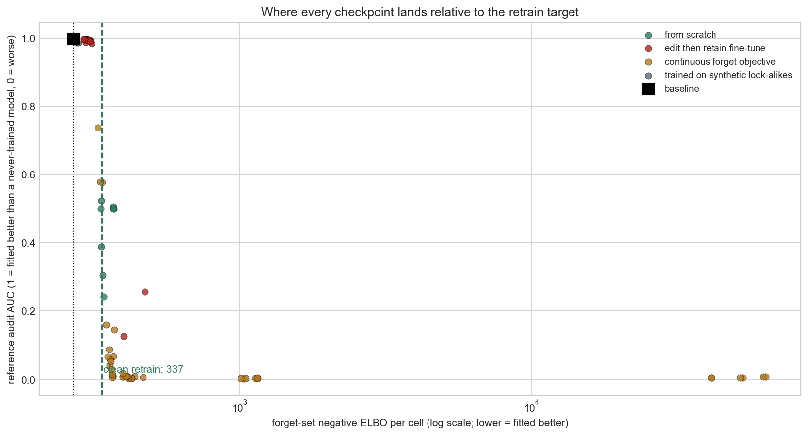
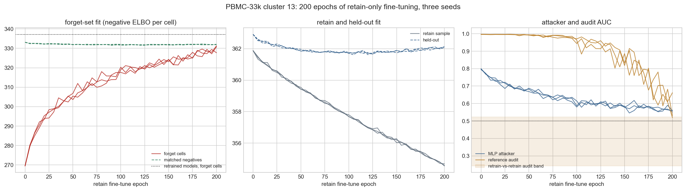
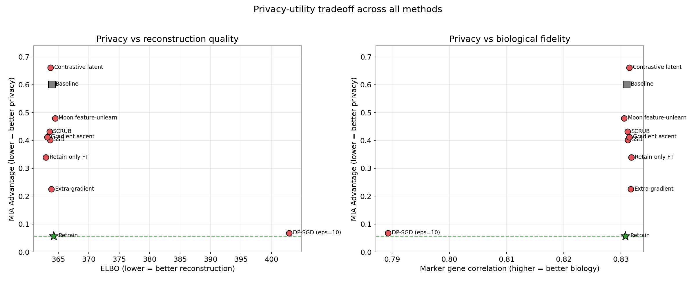
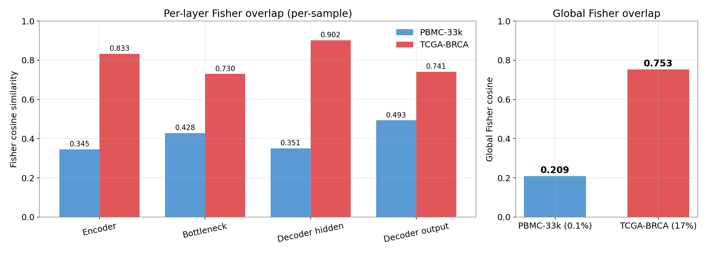
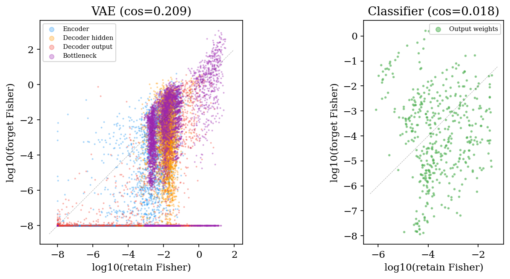
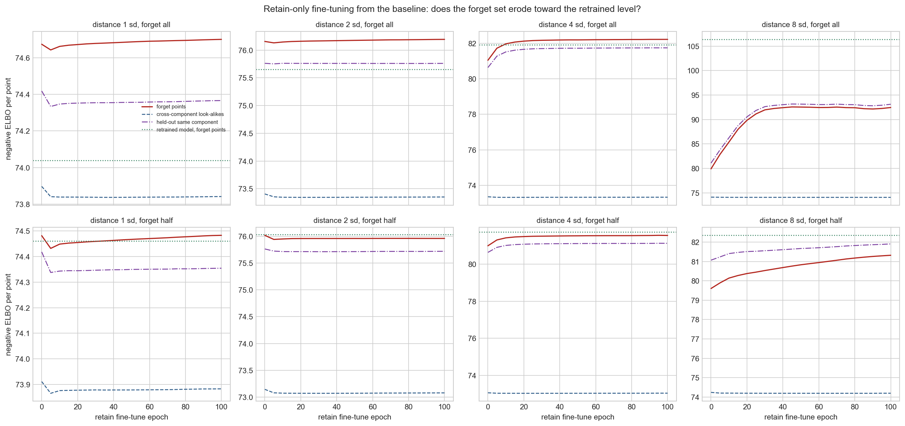
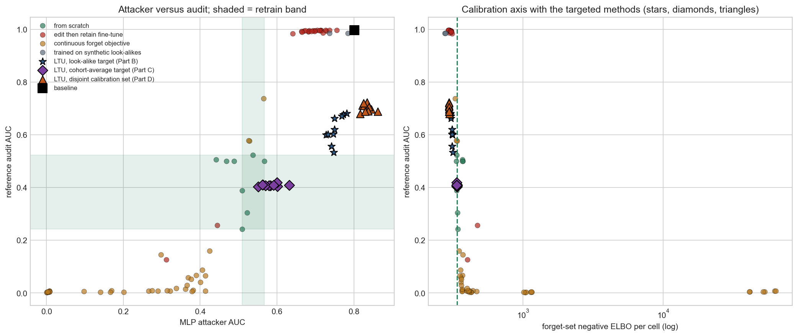

# Fishing for Privacy: Unlearning a Rare Cell Type from a Gene-Expression VAE Is Not Reached, Approached, and Not Verifiable

David Benson, Columbia University

> Markdown mirror of `Writeup.tex`, generated by `scripts/make_md_mirror.py` on 2026-11-01 (every table is produced by `scripts/make_tex_tables.py` from the result files under `outputs/`). The typeset version is [Writeup.pdf](./Writeup.pdf).

# Introduction

Can a gene-expression VAE undergo unlearning without losing utility? Expression profiles carry disease status and genetic predisposition (<span class="nocase">Walker et al.</span> 2024). A data controller who trains a scVI-style variational autoencoder (Lopez et al. 2018) on them, and who is then asked to remove one donor’s cells or one subtype’s patients, would rather edit the trained model than retrain it. The removal that would cost the most is a rare subpopulation, because the model’s representation of it rests on the cells being removed. It is also the removal that matters most. Memorization concentrates in rare subpopulations (Feldman 2020), and a membership inference attack (Shokri et al. 2017; Yeom et al. 2018; Carlini et al. 2022) is most dangerous where memorization is.

The question is put to scVI-style VAEs on four cohorts, PBMC-33k, PBMC-68k, and Tabula Muris (single-cell RNA-seq) and TCGA-BRCA (bulk RNA-seq), with a rare cell type or a molecular subtype as the forget set. Nine post-hoc unlearning methods and DP-SGD are judged against models retrained without the forget set. Success is defined as an adversary would define it. A method has unlearned the forget cells when the strongest membership attack available cannot separate them from cells the model never saw any better than it can on a model retrained without them. Whether the model still represents their type is a separate matter; a model that has learned what a megakaryocyte looks like from other cells is doing its job, and the privacy question concerns the cells. The comparison is paired, on the same cells, against an arm of retrained models, with an equivalence margin of half the smallest excess the original model is shown to have over them.

No method meets the standard at the budget its authors use. On PBMC-68k held-out cells of the forget type make the question one about individual cells. Every method on the larger forget set leaves the cells more identifiable than eight retrained models do, with paired differences of 0.062 to 0.283 in AUC whose intervals exclude zero after a correction for multiplicity. On the smaller set four methods do, two of them after the same correction over the eight arms, and the rest are not resolved. On PBMC-33k only five held-out cells of the forget type exist, too few for a question about individual cells, so the attacker reads the model’s excess fit of the type. There the methods miss the retrained level in two kinds. Those that edit and then fine-tune leave the forget cells more identifiable than the retrained models, fitted as the original model fits them. Those with a continuous forget objective leave them less identifiable, fitted worse than a model that never saw them. The advantage commonly used to report unlearning, twice the attacker’s distance from chance, cannot tell the two apart.

Retain-only fine-tuning run for two hundred epochs, four times the published retain fine-tune’s budget and twenty times the appended fine-tunes’, erodes the memorized fit on the three cohorts where it was run, PBMC-33k, TCGA-BRCA, and PBMC-68k cluster 9. The rate is set by how strongly the retained data act on the forget region. On PBMC-68k cluster 9 it brings the forget cells into the spread of the retrained models, with the type still known and the held-out utility inside its margin. Its paired difference from the retrained arm is 0.008, on an interval of $`-0.062`$ to 0.080 that, like every method arm’s interval on that cohort, is too wide for the design to certify arrival (Section <a href="#sec:measurement" data-reference-type="ref" data-reference="sec:measurement">3</a>). On PBMC-33k, where the design has that power, the level is not reached; the same fine-tune ends 0.039 above the retrained arm, a small resolved excess inside the margin that the test reports as more identifiable than retrained.

Nothing a controller can observe marks arrival. The forget cells’ fit, the fit of their nearest retained neighbors, the retained cells’ fit, the held-out utility, and a calibration on members held back from the deletion all move smoothly through the point where the retrain-based verdict turns. The calibration then rises past the retrained models’ level and keeps rising. The methods do not lack reach or utility. They lack a stopping point that can be identified from the model alone, and an unlearning claim about such a model cannot be verified without a retrained reference.

Two measurements explain the pattern. The first concerns what a retain fine-tune does to an edit. By gradient descent it reverts the part of the edit that lies in the directions the retain data constrain and leaves the rest in the parameters. The forget cells’ fit returns either way, because the fine-tune’s own path through the parameters it reaches compensates for what it does not revert. In a shared decoder almost every direction the forget cells use is one the retain cells use too, so an edit weighted by forget-set importance damages both sets, and the repair of the retain set restores the forget set with it. On PBMC-68k the forget type passes through decoder hidden units the retain set barely uses, and there the same edit outlasts the ten epochs the appended fine-tunes allow, though not fifty. In a classifier the forget class owns its output row, where Proposition <a href="#prop:restoration" data-reference-type="ref" data-reference="prop:restoration">1</a> predicts that most of an edit survives, 0.77 for the whole classifier and 0.85 for that row. No unlearning method was run on a classifier here, so that part is a prediction.

The second measurement concerns the methods that overshoot, whose objectives say nothing about where to stop. A fine-tune given the retrained models’ level matches their mean fit of the forget cells, 336.6 against 337.2, while its own attacker verdict is not resolved. That level is how a model fits a cell type it has never seen, and no held-out neighbor of the forget cells supplies it. In the simulation, matching the level leaves the per-point signal in place in seven of eight configurations. Establishing any of this needed a measurement the evaluation in common use does not make. Scoring the forget cells against cells of other types measures how well the model fits the type, and a model that never saw the forget cells scores as high as the original on three cohorts and at the opposite extreme on a fourth.

**Contributions.**

1.  The answer. At published budgets no method is shown to unlearn a rare cell type from a gene-expression VAE, by a paired comparison with retrained models on the same cells. On PBMC-33k, where the design can certify equivalence, the retrained level is not reached; on PBMC-68k no interval is narrow enough to certify it. The misses come in two kinds that the usual advantage cannot distinguish. Long retain-only fine-tuning approaches the retrained models without a utility cost the margins detect, and the design cannot certify that it arrives. None of the observable quantities tried, including a calibration on held-back members, marks arrival, so the result is not verifiable without a retrained model.

2.  The reasons. A retain fine-tune reverts the part of an edit that lies in the directions the retain data constrain (Proposition <a href="#prop:restoration" data-reference-type="ref" data-reference="prop:restoration">1</a>), so what a retain fine-tune leaves of an edit in the weights is its forget Fisher mass on parameters the retain set does not use. At ten units of the proposition’s own time that share orders the settings, 0.02 in the shared decoder on PBMC-33k, 0.22 where a rare type is routed through hidden units the retain set does not use, and 0.77 in a classifier. The appended fine-tunes’ ten epochs are a fraction of one unit. An intervention that confines an edit to those parameters confirms it under gradient descent, and finds Adam reverting those parameters too. The forget cells’ fit is nonetheless largely restored around an edit that survives. A linear-response calculation (Proposition <a href="#prop:response" data-reference-type="ref" data-reference="prop:response">2</a>) separates reversal of an edit from compensation of its damage. The saved fine-tunes show two routes to compensation, a counterweight the repair builds through parameters the edit did not touch and the retain fine-tune’s own erosion of the forget type. The retain-null mass orders the residual fits without bounding them.

    The level the overshooting methods lack is the fit of a type the model does not know, which targeted fine-tuning shows is not observable. Matching that level is not sufficient either. The per-point signal survives a fine-tune given the oracle level in seven of eight simulation configurations, and on PBMC-33k the attacker verdict for such a fine-tune is not resolved.

3.  The measurement (Figure <a href="#fig:pipeline" data-reference-type="ref" data-reference="fig:pipeline">1</a>). A reference retrained on exactly the retain split, held-out cells of the forget type, an attacker refit on standardized features, and a reference-free likelihood audit, without which an attacker’s score on these data reads biology.

Section <a href="#sec:background" data-reference-type="ref" data-reference="sec:background">2</a> sets the threat model and, in Section <a href="#sec:datasets" data-reference-type="ref" data-reference="sec:datasets">2.1</a>, the cohorts, models, and methods. Section <a href="#sec:measurement" data-reference-type="ref" data-reference="sec:measurement">3</a> states how a method is judged, Section <a href="#sec:results" data-reference-type="ref" data-reference="sec:results">4</a> the results at the published budgets, Section <a href="#sec:beyond" data-reference-type="ref" data-reference="sec:beyond">5</a> what longer budgets and a controller’s observables show, Section <a href="#sec:mechanisms" data-reference-type="ref" data-reference="sec:mechanisms">6</a> the two reasons, and Section <a href="#sec:discussion" data-reference-type="ref" data-reference="sec:discussion">7</a> what follows for a data controller.

<figure id="fig:pipeline" data-latex-placement="t">

<figcaption>Evaluation pipeline. Panel (A) holds four cohorts across two modalities, each with one or two structured forget sets that are rare, biologically coherent subpopulations. Panel (B) is an scVI-style VAE with a shared decoder. Panel (C) is one attacker trained on 70 model-internal features of the baseline’s forget samples against matched negatives and applied to every model, beside the reference-free likelihood audit against the mean of the retrained models. Panel (D) holds nine post-hoc methods, two constructive approaches, a fine-tune with a likelihood target, and DP-SGD, judged against models retrained without the forget set.</figcaption>
</figure>

# Setting

**Unlearning and its standard.** Machine unlearning produces parameters $`\theta'`$ from a trained model, a forget set $`\mathcal{F}`$, and a retain set $`\mathcal{R} = \mathcal{D} \setminus \mathcal{F}`$. The standard of success is the model that training on $`\mathcal{R}`$ alone would have produced (Cao and Yang 2015; Bourtoule et al. 2021). Guarantees exist for restricted model classes (Ginart et al. 2019; Guo et al. 2020; Sekhari et al. 2021; Neel et al. 2021; Izzo et al. 2021) under conditions that deep generative models do not satisfy, so an approximate method is judged empirically, by whether a membership inference attack can tell the forget samples from samples the model never saw (Shokri et al. 2017; Yeom et al. 2018; Carlini et al. 2022). The evaluation in common use scores the forget set against held-out samples drawn from the whole population (Golatkar et al. 2020; Kurmanji et al. 2023; Foster et al. 2024). Hayes et al. (2024) showed that an inexact method can leave the forget samples more detectable than before, and Thudi et al. (2022) argued that unlearning claims are unverifiable without an auditable definition. Leakage is reported as the attacker’s AUC and as the advantage $`2|\mathrm{AUC} - 0.5|`$ (Yeom et al. 2018). The advantage is symmetric because an adversary can flip a prediction, and for the same reason it cannot tell a model that still fits the forget samples too well from one that now fits them too badly.

**Threat model.** The scope is subpopulation unlearning, the removal of a biological group such as a rare cell type or a disease subtype, rather than of arbitrary individual samples. The adversary has query access to the model, obtains its internal quantities for a sample (posterior mean and variance, reconstruction loss, KL term), and trains a dedicated attacker on data it controls. Membership is the quantity measured because it is the precondition for what an adversary does next. For a rare cell type or a subtype, knowing that a record was in the training set already discloses a phenotype, and it is the first step of attribute inference and of the reconstruction attacks that aim at what the model memorized (Yeom et al. 2018; Carlini et al. 2022; Hilprecht et al. 2019; Chen et al. 2020). Unlearning is therefore judged on whether the adversary can still tell the forget cells from cells the model never saw, and not on whether the model has stopped representing their type. The auditor has one thing more, a retrained reference, which a controller who turns to post-hoc unlearning does not have. Poisoning and other write-side attacks are out of scope.

**Related work.** Fisher scrubbing (Golatkar et al. 2020), SSD (Foster et al. 2024), and SCRUB (Kurmanji et al. 2023) assume that the forget set’s influence concentrates in identifiable parameters, an assumption already known to strain in deep networks (Basu et al. 2021). Nasr et al. (2018) and Chavdarova et al. (2019) supply the adversarial and extragradient machinery of extra-gradient co-training, and Abadi et al. (2016) introduced DP-SGD. Moon et al. (2024) fine-tunes a generator’s decoder along a target-feature latent direction, <span class="nocase">Pawelczyk et al.</span> (2025) report that approximate unlearning does not remove data poisoning from classifiers, and Cheng et al. (2026) regularize retain-forget entanglement in classifiers. Work on classifiers has established that a membership score has to be calibrated to how hard a sample is to fit (Watson et al. 2022; Jayaraman et al. 2021; Rezaei and Liu 2021; Carlini et al. 2022). Judging a method against models retrained without the forget set is the standard of the NeurIPS 2023 unlearning competition (Triantafillou et al. 2024), and membership attacks on generative models through reconstruction and likelihood go back to Hilprecht et al. (2019) and Chen et al. (2020). On biological data, <span class="nocase">Walker et al.</span> (2024) showed that single-cell count matrices leak private information through eQTL linkage, and Golob et al. (2026) and <span class="nocase">Ozturk et al.</span> (2026) attack transcriptomic generators through their synthetic output.

## Cohorts, model, and methods

Four cohorts across two modalities are used (Table <a href="#tab:datasets" data-reference-type="ref" data-reference="tab:datasets">1</a>). PBMC-33k consists of 33,088 peripheral blood mononuclear cells from 10x Genomics, preprocessed with Scanpy (Wolf et al. 2018) to 2,000 highly variable genes and 14 Leiden clusters. Its forget set is cluster 13, the 30 megakaryocytes in the training split, with 5 more held out. PBMC-68k (Zheng et al. 2017) is a second donor’s 68,512 cells from the same platform, processed with the same recipe into 10 clusters. Its two rare clusters are the forget sets: 178 megakaryocytes (cluster 9), and 503 cells dominated by plasmacytoid dendritic cell markers with some B and progenitor cells absorbed at this resolution (cluster 8). Each has 40 percent of its cells held out of training so that within-type negatives exist by design.

Tabula Muris (The Tabula Muris Consortium 2018) has 41,647 cells from 12 mouse tissues in 35 clusters, with the 82 cardiac muscle cells of cluster 33 as the forget set. TCGA-BRCA (Cancer Genome Atlas Network 2012) has 1,089 breast cancer patients with PAM50 subtypes, preprocessed by <span class="nocase">Ozturk et al.</span> (2026) to the 978 LINCS L1000 landmark genes (<span class="nocase">Subramanian et al.</span> 2017); the 158 Basal-subtype patients in the training split (17 percent of it) are the forget set, and 30 Basal patients are held out. PBMC-33k cluster 12 (49 cells) is a second rare cluster there. PBMC-33k cluster 7 (80 cells held out) and Tabula Muris cluster 28 (67 held out) are large enough to hold out a within-cluster negative set of useful size. Each cohort is split once into training and held-out sets, and the forget set is removed from the training set to define the retain set.

<div id="tab:datasets">

|  | PBMC-33k | PBMC-68k (cl. 9) | PBMC-68k (cl. 8) | Tabula Muris | TCGA-BRCA |
|:---|:--:|:--:|:--:|:--:|:--:|
| Type | scRNA-seq | scRNA-seq | scRNA-seq | scRNA-seq | bulk RNA-seq |
| Samples | 33,088 cells | 68,512 cells | 68,512 cells | 41,647 cells | 1,089 patients |
| Genes | 2,000 HVG | 2,000 HVG | 2,000 HVG | 2,000 HVG | 978 L1000 |
| Retain / forget / held out | 28,094 / 30 / 4,964 | 57,958 / 107 / 10,447 | 57,763 / 302 / 10,447 | 35,317 / 82 / 6,248 | 767 / 158 / 164 |
| Forget set | cluster 13 (30 megakaryocytes) | cluster 9 (107 megakaryocytes) | cluster 8 (302 pDC) | cluster 33 (82 cardiac muscle) | Basal subtype (158 patients) |
| Forget fraction of training | 0.1% | 0.2% | 0.5% | 0.2% | 17% |
| Cross-type negatives | 194 | 143 | 445 | 135 | 89 |
| Within-type negatives | 5 | 71 | 201 | – | 30 |

Cohorts, splits, forget sets, and negatives. Cross-type matched negatives are the ten nearest held-out samples of each forget sample in the baseline model’s latent space, deduplicated; within-type negatives are the held-out members of the forget set’s own cluster or subtype. Generated from the split and matching files by `scripts/make_tex_tables.py`.

</div>

**Negatives.** Negatives are never-seen samples of two kinds. Cross-type matched negatives are the ten nearest held-out samples of each forget sample in the baseline model’s latent space, deduplicated. This is the matching that the evaluation in common use amounts to when a whole type is forgotten, since the nearest samples of a type that is entirely in the forget set are samples of other types. Within-type negatives are the held-out members of the forget set’s own type.

**Model.** The VAE follows scVI (Lopez et al. 2018). The encoder maps the genes through layers of 1,024, 512, and 128 units to a 32-dimensional latent mean and log-variance, and the decoder mirrors it to a softmax over genes scaled by the library size, with layer normalization and dropout of 0.1 after each hidden layer. The inputs are log-normalized counts, so the reconstruction term is the mean squared error summed over genes, a Gaussian observation model on the transformed counts, and the KL term is summed over latent dimensions. Reweighting one term relative to the other drives the posterior toward collapse, and every objective in the paper was checked for it. Training uses Adam at $`10^{-4}`$ for 100 epochs with a 20-epoch KL warm-up and free bits of 0.03. Every unlearning method starts from the same baseline checkpoint, and every reported score is computed on the CPU (Appendix <a href="#app:utility" data-reference-type="ref" data-reference="app:utility">9</a>).

**Unlearning methods.** Table <a href="#tab:methods" data-reference-type="ref" data-reference="tab:methods">2</a> lists them with the budget each was run at. Six edit the model and then fine-tune it on the retain set. Retain-only fine-tuning runs 50 epochs with patience 10. Gradient ascent takes ten clipped ascent steps and then up to 30 retain epochs with the same patience, and every published run completed the 30. Moon feature unlearning is a 20-epoch decoder fine-tune, and Fisher scrubbing, SSD, and SCRUB append 10 retain epochs to their edit. Three push the forget cells with a continuous objective that has no stopping point, and contrastive latent unlearning appends 10 retain epochs to it. DP-SGD (Abadi et al. 2016), trained from scratch on $`\mathcal{R}`$, is a formal baseline rather than an unlearning method. Extra-gradient co-training frames unlearning as the min-max game $`\min_\theta \max_\psi \mathcal{L}_{\mathrm{VAE}}(\theta; \mathcal{R}) - \lambda \, \mathcal{L}_{\mathrm{att}}(\theta, \psi; \mathcal{F})`$, solved with the extragradient update of Chavdarova et al. (2019) against three critics trained alongside the model.

<div id="tab:methods">

| Method | Family | What it does | Budget |
|:---|:---|:---|:---|
| Retain-only fine-tuning | edit, then fine-tune | continues training on $`\mathcal{R}`$ | 50 epochs (patience 10) |
| Gradient ascent | edit, then fine-tune | ten clipped ascent steps on the forget loss, then retain fine-tune | 10 ascent steps, then up to 30 retain epochs (patience 10) |
| Fisher scrubbing | edit, then fine-tune | step against the forget gradient scaled by the inverse retain Fisher, capped, then retain fine-tune | 100 scrub steps, then 10 retain epochs |
| SSD | edit, then fine-tune | multiplicative dampening by forget-set Fisher importance, then retain fine-tune | one dampening pass, then 10 retain epochs |
| SCRUB | edit, then fine-tune | distills from the baseline, matching it on $`\mathcal{R}`$ and diverging on $`\mathcal{F}`$ | 20 distillation epochs, then 10 retain epochs |
| Moon feature unlearning | edit, then fine-tune | decoder fine-tune with a forget-versus-retain latent direction removed | 20 decoder epochs |
| Contrastive latent | continuous objective | forget posteriors pushed to the prior, retain representations held | 20 epochs, then 10 retain epochs |
| Frozen critics | continuous objective | VAE updated to defeat fixed pre-trained attackers (one or three, two weights) | 50 epochs |
| Extra-gradient co-training | continuous objective | min-max game against three co-trained critics, extragradient updates | 50 passes, $`\lambda = 10`$ (1) |
| Synthetic augmentation | constructive | trains on $`\mathcal{R}`$ plus synthetic forget-type cells from held-out seeds | from scratch |
| Representation alignment | constructive | fine-tunes the baseline until its forget-cell posteriors match a retrained model’s | – |
| DP-SGD | from scratch | trains on $`\mathcal{R}`$ with $`\varepsilon = 10`$ | from scratch |
| Likelihood-targeted fine-tune (Section <a href="#sec:target" data-reference-type="ref" data-reference="sec:target">6.2</a>) | demonstration | retain loss plus a penalty on the gap between each forget cell’s negative ELBO and a target | until the gap stays small |

The methods, grouped by what they do. The budget column gives the budget each method was run with here, including the retain epochs appended to Fisher scrubbing, SSD, SCRUB, and contrastive unlearning, and Table <a href="#tab:hparams" data-reference-type="ref" data-reference="tab:hparams">13</a> gives the rest of the settings. DP-SGD is not post-hoc; the two constructive approaches are reported in Appendix <a href="#app:utility" data-reference-type="ref" data-reference="app:utility">9</a>; the likelihood-targeted fine-tune of Section <a href="#sec:beyond" data-reference-type="ref" data-reference="sec:beyond">5</a> is a demonstration that needs a level only a retrained model supplies.

</div>

# How a method is judged

**The retrained models.** Models retrained on exactly the retain split with the baseline’s recipe are the standard, five on PBMC-33k and eight per forget set on PBMC-68k (Table <a href="#tab:reference" data-reference-type="ref" data-reference="tab:reference">3</a>). Every method is compared with the whole arm of them, never with one, and every model is scored on the same cells, so a difference between a method and the arm is paired on the cells. The retrained models score between 0.509 and 0.567 under the PBMC-33k attacker, near chance. What that chance score means depends on the attacker (Appendix <a href="#app:controls" data-reference-type="ref" data-reference="app:controls">10</a>).

<div id="tab:reference">

| Model | Fit-excess attacker, AUC | Advantage \[nested 95% CI\] | Audit AUC \[95% CI\] |
|:---|:--:|:--:|:--:|
| Clean retrain, five seeds (reference) | 0.509 to 0.567 | 0.057 \[0.02, 0.27\] | 0.17 to 0.83 (every ordered pair of the five retrains) |
| Retrain that drew its own split (superseded) | 0.571 to 0.585 | 0.158 \[0.02, 0.37\] | 0.799 \[0.72, 0.87\] |
| Baseline | 0.801 | 0.601 | 0.996 \[0.99, 1.00\] |
| Refit attacker on the clean retrain (20 x 5-fold) | 0.507 | 0.035 \[-0.03, 0.10\] | – |
| Refit attacker on the baseline (positive control) | 0.797 | 0.594 | – |
| Permutation null of the advantage estimator | – | 0.091 \[0.004, 0.25\] | – |

The retrained models and the controls on PBMC cluster 13. The audit column is the likelihood-ratio audit against a retrained reference; for the clean retrains it is the range over every ordered pair of the five clean retrains, each scored against another (0.17 to 0.83). Generated from `nested_ci_all.json`, `retrain_refit.json`, and `attack_lr_reference.json`.

</div>

**The attacker.** On PBMC-33k the attacker is a multilayer perceptron with two hidden layers of 256 units, spectral normalization, and dropout of 0.3, trained for 50 epochs on 70 features of a sample under the model. The features are its posterior mean and log-variance, its reconstruction loss, KL term, and negative ELBO, the norms of the two posterior vectors, and the mean distance from its latent code to its five nearest neighbors among 5,000 retain cells. It is trained once, on the baseline model’s forget samples against the matched negatives, and applied unchanged to every checkpoint in one pass. A freshly trained instance moves the baseline’s AUC by 0.001 to 0.02, so every number in a table comes from one instance. Because it is trained on the baseline’s forget cells and the matched negatives and then scored on those same cells, its scores are in-sample with respect to the cells. The control of Appendix <a href="#app:controls" data-reference-type="ref" data-reference="app:controls">10</a>, which refits it out of fold, scores the baseline at 0.797 against the transferred 0.801, so the in-sample effect is small.

This attacker takes the features at their raw scale and reads little beyond the reconstruction term, so against cross-type negatives it measures the model’s excess fit of the forget cells over a retrained model’s. A logistic regression on the same 70 features standardized separates the megakaryocytes from their cross-type neighbors at 0.990 on the baseline and 0.984 on a retrained model (Table <a href="#tab:feature_groups" data-reference-type="ref" data-reference="tab:feature_groups">21</a>, 10 fold splits; 0.988 and 0.984 over the 20 splits of Table <a href="#tab:refit_std" data-reference-type="ref" data-reference="tab:refit_std">20</a>). The 32 posterior means alone give the same two values. The encoder places a megakaryocyte in its own region of the latent space whether or not the model trained on one. Where held-out cells of the forget type exist, on PBMC-68k, the instrument is therefore that standardized logistic regression, refit on each model’s own features out of fold and scoring the forget cells against the held-out cells of their type. It asks about the individual cells and not about the type.

**The criterion.** A method has unlearned the forget cells when the attacker, compared with the retrained models on the same cells, identifies them no better and no worse than on those models, to within a margin. The statistic is the attacker’s AUC. The difference is the method arm’s mean minus the retrained arm’s mean, and its 95 percent interval resamples the seeds of each arm and, once for every model, the cells they share. The margin is half the lower end of the interval of the baseline’s own excess over the retrained arm, the smallest excess the data support, so that the margin does not inherit the luck of a point estimate. On PBMC-33k the baseline’s excess is 0.272 (interval 0.214 to 0.334) and the margin 0.107; on PBMC-68k the excess is 0.168 (interval 0.087 to 0.247) on cluster 9 and 0.117 (interval 0.075 to 0.159) on cluster 8, and the margins 0.044 and 0.038. Four verdicts follow. A method is more identifiable than retrained when the interval of the difference lies above zero, less identifiable than retrained when it lies below zero, at the retrained level when the whole interval lies within plus or minus the margin, and not resolved otherwise. The verdicts are read in that order. A difference whose interval excludes zero is reported as more or less identifiable than retrained even when the whole interval lies inside the margin; the verdict at the retrained level is returned only for an interval that includes zero and lies within the margin.

Each reading of the attacker test is a one-sided test at level 0.025, the two sides of the equivalence window included. Its $`p`$-values, and the audit’s two-sided $`p`$-values at 0.05, are Holm-adjusted within families: on PBMC-33k the fourteen published settings, the nine ablations, and the four demonstrations; on PBMC-68k the eight method arms of cluster 9 and the seven of cluster 8. Table <a href="#tab:holm" data-reference-type="ref" data-reference="tab:holm">34</a> of Appendix <a href="#app:tables" data-reference-type="ref" data-reference="app:tables">15</a> collects them, and a verdict that does not survive the adjustment is said so. Body tables that report an attacker’s AUC level also report the advantage $`2|\mathrm{AUC}-0.5|`$; the appendix tables of paired differences omit it, because the sign of a difference of signed AUCs carries what the advantage would fold away.

The rule of half the excess is a convention with a history. Its first form, half the point excess, was fixed before the PBMC-68k scores existed and was carried to PBMC-33k after that cohort’s intervals had been seen. The present form, half the lower bound of the excess on the signed AUC, was adopted after every score on both cohorts existed, when a review found that the point form let a verdict rest on a marginal pass. It is tighter on every cohort, the superseded files are kept beside the current ones, and no positive verdict in the paper rests on a method’s distance from the margin.

**What the design can certify.** The verdict at the retrained level needs the whole interval inside plus or minus the margin, so an interval wider than twice the margin cannot return it whatever the data say. That window is 0.214 on PBMC-33k, 0.087 on cluster 9, and 0.075 on cluster 8 (`equivalence_reachability.json`). The window is twice the unrounded margin, 0.0437 on cluster 9 and 0.0376 on cluster 8, so doubling the margins as printed does not reproduce it. On PBMC-33k 20 of 27 method arms have intervals narrower than the window, so there a not-resolved verdict is a reading of the data for those arms. The seven arms that are too wide are the four frozen-critic arms and the three targeted fine-tunes, among them the one given the retrained models’ level (Section <a href="#sec:beyond" data-reference-type="ref" data-reference="sec:beyond">5</a>).

On PBMC-68k every method arm’s interval is wider than the window, 0.133 to 0.152 on cluster 9 and 0.079 to 0.147 on cluster 8, and so is every fine-tune snapshot of the stopping probe (Appendix <a href="#app:probe" data-reference-type="ref" data-reference="app:probe">12</a>). No method arm at a published budget and no fine-tune snapshot on PBMC-68k could have read at the retrained level, even with a true difference of zero. Only the two largest Fisher caps of the stopping probe on cluster 8 have intervals narrow enough, 0.073 against the window of 0.075, and both read more identifiable than retrained. On that cohort a not-resolved verdict is the design’s resolution for every method arm and every fine-tune snapshot, and not a reading of the data. The paper therefore says that such a method is not certified at the retrained level (the design cannot certify equivalence at this margin), never that it is not at it.

The widths are set by three seeds per method arm against eight retrained models and by the cell counts, 107 against 71 and 302 against 201; the margin is set by the baseline’s excess. For the arms nearest the retrained level, the smallest margin at which the equivalence verdict would have been returned is 0.080 for the 200-epoch fine-tune on cluster 9, against the margin of 0.044. On PBMC-33k it is 0.110 and 0.108 for the Fisher caps of $`2\times 10^{-3}`$ and $`2.5\times 10^{-3}`$, against 0.107, which they miss by location and not by width. The 200-epoch fine-tune on PBMC-33k would read at the retrained level at a margin of 0.074, but its interval excludes zero, and the precedence above reports it as more identifiable than retrained.

**Utility.** Held-out utility is the negative ELBO on the held-out cells, the correlation between observed and reconstructed marker-gene expression, and the adjusted Rand index of a clustering of the latent means against the Leiden labels. Each carries a 95 percent interval from the same shared resampling of the held-out cells and a paired cost against the baseline. A method costs utility when the lower end of its cost interval lies above 1 percent of the baseline’s negative ELBO or above 0.01 in marker correlation (Appendix <a href="#app:utility" data-reference-type="ref" data-reference="app:utility">9</a>).

**The audit.** The audit says what the attacker cannot: whether a method that misses the retrained level does so because the forget cells are still fitted as the baseline fits them, or because they are now fitted worse than a model that never saw them. Each forget cell and each negative is scored by its negative ELBO under the retrained models, averaged over the arm, minus its negative ELBO under the model being audited, so that a cell the audited model fits better than the retrained models do scores positive. The audit AUC is that score’s AUC for the forget cells against the negatives, and each retrained model is audited against the mean of the others. The audit’s difference from the retrained arm carries an interval that resamples the retrained models entering the reference together with the method’s seeds and the shared cells. It is read with the same four verdicts as the criterion, fitted better than retrained, fitted worse than retrained, fitted as retrained, or not resolved. Its margin is built the same way, as half the bound nearer zero of the baseline’s own difference from the retrained arm, and is 0.200 on PBMC-33k, 0.170 on cluster 9, and 0.234 on cluster 8.

Beside the AUC the audit reports the paired gap, the median negative ELBO of the forget cells under the method minus that under the retrained arm, which is the type-level reading (Appendix <a href="#app:reffree" data-reference-type="ref" data-reference="app:reffree">11</a>). The negative ELBO is estimated in evaluation mode from sixteen seeded draws of the latent code, which makes the audit reproducible to the last digit. The audit needs retrained models, so it is an auditor’s instrument, not a controller’s.

**Why the negatives matter.** <a id="sec:confound"></a> Under cross-type matching, a retrained model that never saw the forget set scores far from chance on every forget set but one (Table <a href="#tab:confound" data-reference-type="ref" data-reference="tab:confound">4</a>): as high as the baseline where the retain set covers the forget set’s type, and at the inverted extreme where it does not. On TCGA-BRCA the baseline scores 0.803 and the retrained model 0.830 against cross-subtype negatives, and against the 30 held-out Basal patients the same attacker scores them at 0.580 and 0.572. Tabula Muris cluster 33 scores 0.903 and 0.943, and PBMC-33k cluster 12 scores 0.869 and 0.814. PBMC-33k cluster 7, where 80 held-out cells of the same type are available, gives 0.665 and 0.655 under cross-type negatives and 0.466 and 0.414 within the cluster under an attacker refit for the purpose.

PBMC-68k cluster 9 shows the other face of the same confound. The retrained models score 0.007 to 0.017 against the baseline’s 0.965 under cross-type negatives, because they fit megakaryocytes far worse than the neighboring cells rather than better. On each of these cohorts the cross-type attack measures biology. The within-type attack, where it can be run, finds nothing on baseline and retrained model alike on cluster 7, cluster 28, and the Basal patients (Appendix <a href="#app:controls" data-reference-type="ref" data-reference="app:controls">10</a>). PBMC-33k cluster 13 is the one forget set on which the retrained models score near chance under cross-type negatives, 0.529 against the baseline’s 0.801, and there the separation is the baseline’s better fit of the type it trained on, which the audit reads directly. PBMC-68k is the one cohort on which the question can be put to the cells themselves.

<div id="tab:confound">

| Cohort and forget set | Baseline, cross | Retrained, cross | Baseline, within | Retrained, within |
|:---|:--:|:--:|:--:|:--:|
| PBMC-33k cluster 13 (30 cells; 194 cross) | 0.801 (0.60) | 0.529 (0.06) | – | – |
| PBMC-33k cluster 12 (49 cells; 57 cross) | 0.869 (0.74) | 0.814 (0.63) | – | – |
| PBMC-33k cluster 7 (50 cells; 80 held out within) | 0.665 (0.33) | 0.655 (0.31) | 0.466 (0.07) | 0.414 (0.17) |
| PBMC-68k cluster 9 (107 cells; 143 cross, 71 held out within) | 0.965 (0.93) | 0.011 (0.98) | 0.683 (0.37) | 0.515 (0.03) |
| PBMC-68k cluster 8 (302 cells; 445 cross, 201 held out within) | 0.581 (0.16) | 0.229 (0.54) | 0.603 (0.21) | 0.487 (0.03) |
| Tabula Muris cluster 33 (82 cells; 135 cross) | 0.903 (0.81) | 0.943 (0.89) | – | – |
| Tabula Muris cluster 28 (50 cells; 67 held out within) | 0.400 (0.20) | 0.379 (0.24) | 0.487 (0.03) | 0.550 (0.10) |
| TCGA-BRCA Basal (158 patients; 89 cross, 30 within) | 0.803 (0.61) | 0.830 (0.66) | 0.442 (0.12) | 0.404 (0.19) |

Attacker AUC of the baseline and the retrained model on every cohort, each with its advantage $`2|\mathrm{AUC}-0.5|`$ in parentheses, under cross-type negatives and, where a held-out set of the same type exists, within-type negatives (the standardized logistic refit). An inverted AUC yields a large advantage, which is why the AUC is reported beside it; the retrained models’ large advantages here are their worse fit of the forget type, not leakage. Generated from the per-cohort result files.

</div>

# Results at the published budgets

## PBMC-68k, where the cells can be tested

PBMC-68k applies the protocol to a second donor with within-type negatives of useful size (Table <a href="#tab:pbmc68k_excerpt" data-reference-type="ref" data-reference="tab:pbmc68k_excerpt">5</a>; full tables in Appendix <a href="#app:tables" data-reference-type="ref" data-reference="app:tables">15</a>). Two observations frame it. The first concerns what a retrained model does with a type it cannot learn. The eight clean retrains fit the 107 forget megakaryocytes and their 71 held-out siblings equally badly, at medians of 1,014 to 1,154 against the baseline’s 491. The PBMC-33k retrains, by contrast, fit cluster 13 at the level of the never-seen negatives (means of 334 to 342 against the negatives’ 333). The two forget sets are not the same kind of cell. The PBMC-33k megakaryocytes are gene-rich (a median of 1,573 detected genes and 5,242 counts against the population’s 732 and 1,893), and 582 retain cells express PPBP. The PBMC-68k cluster is a low-complexity, platelet-like profile (315 genes and 776 counts against 525 and 1,292), with 362 PPBP-expressing retain cells among 57,958. How a model fits such cells unseen is not pinned down by the data. The eight seeds disagree among themselves by more than a hundred units, and the cross-type attacker registers the fact by scoring the baseline at 0.965 and the retrained models at 0.007 to 0.017. On this cluster the paired median gap carries the type-level reading.

The second observation is a per-cell signal. The standardized refit against the 71 held-out megakaryocytes finds the cells the baseline trained on at 0.683, against 0.472 to 0.538 for the eight retrained models, an excess of 0.168 (interval 0.087 to 0.247). That signal lives in the reconstruction term and the latent placement together, and the raw-feature attacker does not see it (Appendix <a href="#app:controls" data-reference-type="ref" data-reference="app:controls">10</a>). The baseline therefore carries two things, knowledge of the type and a modest signal about which megakaryocytes it saw, and the adversary’s question concerns the second. The margin is 0.044 on this cluster, and no method arm’s interval is narrow enough for the verdict at the retrained level (Section <a href="#sec:measurement" data-reference-type="ref" data-reference="sec:measurement">3</a>), so not resolved here means that the interval includes zero, and no more.

Four methods leave the cells more identifiable than a retrained model does, two of them after the Holm correction over the eight arms. SSD (0.647, a difference of 0.132, interval 0.057 to 0.204), SCRUB (0.601, 0.086, interval 0.018 to 0.152), and Fisher scrubbing (0.603, 0.088, interval 0.017 to 0.159) are three of them, although for SCRUB and Fisher scrubbing the excess does not survive the correction. Retain-only fine-tuning (0.556), contrastive unlearning (0.558), and gradient ascent (0.582) lower the signal from the baseline’s. Their intervals include zero but reach to 0.137, past the margin, so they are not resolved.

Extra-gradient unlearning, the fourth, moves the cells the wrong way. Its critics distinguish forget cells from retain cells, and the model learns to fit the forget cells as it fits retain cells, at medians of 475 to 489 and better than the baseline did, while the retain fine-tune inside the same loop erodes their held-out siblings. The per-cell refit rises to 0.877, a difference of 0.361 (interval 0.285 to 0.438). The method amplified the per-cell membership signal it was meant to remove. Its critics are an adversary who knows which cells are members, and with that knowledge the adversary has made those cells the best-fitted ones in the model.

None of the methods removes the type. The four methods that edit and then fine-tune leave the forget cells at medians of 572 to 697, fitted far better than any retrained model fits them, and under every method the held-out megakaryocytes move with the forget cells. Fisher scrubbing is the one edit its ten appended retain epochs do not undo here. After those epochs the typical forget cell sits at a median of 814 to 831, and a minority of cells sit far past any retrained model (95th percentile 1,832 to 2,543). The retain gradients reach the parameters the scrub edited more slowly, so ten epochs bring back neither the typical cell nor the tail; run to fifty epochs they do (Section <a href="#sec:mechanisms" data-reference-type="ref" data-reference="sec:mechanisms">6</a>). The paired median gap makes this a test rather than a reading off two ranges. Fisher scrubbing’s forget cells sit $`-251`$ below the retrained arm’s median (interval $`-356`$ to $`-56`$), while its cross-type audit, 0.653 against the arm’s 0.592, is not resolved (difference interval $`-0.07`$ to 0.27), because the eight retrained models disagree about the type.

Cluster 8, whose type the retain set partly covers, has retrained medians of 672 to 684 against the baseline’s 532 and three times the cells, so the per-cell comparison is sharper. The baseline scores 0.603 against 0.450 to 0.503 for the retrained models (an excess of 0.117, interval 0.075 to 0.159, and a margin of 0.038). Every method leaves the cells more identifiable than the retrained models do, every excess surviving a Holm correction. The four methods that edit and then fine-tune sit at 0.548 to 0.573, differences of 0.062 to 0.087 whose intervals begin at 0.022 to 0.044, with the type still known. Fisher scrubbing leaves the cells nearly where the baseline had them (0.589, a difference of 0.102). Its audit, 0.489 against the arm’s 0.510, and its median gap, 60 (interval $`-6`$ to 226), read fitted as retrained and not resolved. The typical cell is near the retrained level with a damaged tail, at a held-out ELBO cost of 9.41 nats, the one utility cost on this cohort. Contrastive unlearning pushes the type past the retrained level (audit 0.011) and leaves the cells more identifiable than retrained at 0.632, since cells fitted worse than their held-out siblings are as recognizable as cells fitted better. Extra-gradient again amplifies the per-cell signal, to 0.769.

<div id="tab:pbmc68k_excerpt">

<table>
<caption>PBMC-68k, the two forget sets, excerpted from the full tables of Appendix <a href="#app:tables" data-reference-type="ref" data-reference="app:tables">15</a>. The forget median is the per-cell negative ELBO’s median over the forget cells, ranged over seeds. The per-cell column is the standardized refit against the within-type negatives, out of fold, with a nested interval over seeds and the shared cells, and the advantage is <span class="math inline">2|AUC − 0.5|</span> of it. The difference column compares each arm with the eight retrained models on those cells, read as Section <a href="#sec:measurement" data-reference-type="ref" data-reference="sec:measurement">3</a> describes at margins of 0.044 and 0.038; no arm’s interval is narrow enough for the verdict at the retrained level. The audit is the reference-free cross-type audit and the Type column its paired median gap. Generated from <code>percell_paired_{mk,pdc}.json</code> and <code>audit_reference_free.json</code>.</caption>
<thead>
<tr>
<th style="text-align: left;">Model</th>
<th style="text-align: center;">Forget median</th>
<th style="text-align: center;">Per-cell AUC [95% CI]</th>
<th style="text-align: center;">Advantage</th>
<th style="text-align: center;">Paired difference [95% CI]</th>
<th style="text-align: left;">Cells</th>
<th style="text-align: center;">Reference-free audit [95% CI]</th>
<th style="text-align: left;">Type</th>
</tr>
</thead>
<tbody>
<tr>
<td colspan="8" style="text-align: left;"><em>Cluster 9, megakaryocytes (107 forget, 71 held out)</em></td>
</tr>
<tr>
<td style="text-align: left;">Baseline (trained on the cells)</td>
<td style="text-align: center;">491</td>
<td style="text-align: center;">0.68 [0.61, 0.76]</td>
<td style="text-align: center;">0.37</td>
<td style="text-align: center;">–</td>
<td style="text-align: left;">trained on the cells</td>
<td style="text-align: center;">1.000 [1.00, 1.00]</td>
<td style="text-align: left;">trained on the cells</td>
</tr>
<tr>
<td style="text-align: left;">Clean retrains (8)</td>
<td style="text-align: center;">1,014 to 1,154</td>
<td style="text-align: center;">0.47 to 0.54 [0.45, 0.57]</td>
<td style="text-align: center;">0.00 to 0.08</td>
<td style="text-align: center;">–</td>
<td style="text-align: left;">reference</td>
<td style="text-align: center;">0.592 [0.41, 0.66]</td>
<td style="text-align: left;">reference</td>
</tr>
<tr>
<td style="text-align: left;">Edit, then fine-tune (4 methods)</td>
<td style="text-align: center;">572 to 697</td>
<td style="text-align: center;">0.54 to 0.66</td>
<td style="text-align: center;">0.08 to 0.33</td>
<td style="text-align: center;">+0.041 to +0.132</td>
<td style="text-align: left;">not resolved (retain-FT, GA); more identifiable (SSD, SCRUB)</td>
<td style="text-align: center;">0.994 to 1.000</td>
<td style="text-align: left;">fitted better</td>
</tr>
<tr>
<td style="text-align: left;">Fisher scrubbing</td>
<td style="text-align: center;">814 to 831</td>
<td style="text-align: center;">0.59 to 0.62 [0.53, 0.68]</td>
<td style="text-align: center;">0.18 to 0.24</td>
<td style="text-align: center;">+0.088 [0.02, 0.16]</td>
<td style="text-align: left;">more identifiable</td>
<td style="text-align: center;">0.653 [0.53, 0.76]</td>
<td style="text-align: left;">fitted better</td>
</tr>
<tr>
<td style="text-align: left;">Contrastive latent</td>
<td style="text-align: center;">663 to 755</td>
<td style="text-align: center;">0.55 to 0.56 [0.48, 0.63]</td>
<td style="text-align: center;">0.10 to 0.13</td>
<td style="text-align: center;">+0.043 [-0.03, 0.11]</td>
<td style="text-align: left;">not resolved</td>
<td style="text-align: center;">0.971 [0.92, 1.00]</td>
<td style="text-align: left;">fitted better</td>
</tr>
<tr>
<td style="text-align: left;">Extra-gradient (<span class="math inline"><em>λ</em> = 10</span>)</td>
<td style="text-align: center;">475 to 489</td>
<td style="text-align: center;">0.84 to 0.91 [0.81, 0.93]</td>
<td style="text-align: center;">0.68 to 0.83</td>
<td style="text-align: center;">+0.361 [0.29, 0.44]</td>
<td style="text-align: left;">more identifiable</td>
<td style="text-align: center;">0.999 [1.00, 1.00]</td>
<td style="text-align: left;">fitted better</td>
</tr>
<tr>
<td style="text-align: left;">Retain-only fine-tune, 200 epochs</td>
<td style="text-align: center;">820 to 846</td>
<td style="text-align: center;">0.51 to 0.54 [0.45, 0.59]</td>
<td style="text-align: center;">0.01 to 0.08</td>
<td style="text-align: center;">+0.008 [-0.06, 0.08]</td>
<td style="text-align: left;">not resolved</td>
<td style="text-align: center;">1.000 [1.00, 1.00]</td>
<td style="text-align: left;">fitted better</td>
</tr>
<tr>
<td colspan="8" style="text-align: left;"><em>Cluster 8, plasmacytoid dendritic cells (302 forget, 201 held out)</em></td>
</tr>
<tr>
<td style="text-align: left;">Baseline (trained on the cells)</td>
<td style="text-align: center;">532</td>
<td style="text-align: center;">0.60 [0.56, 0.65]</td>
<td style="text-align: center;">0.21</td>
<td style="text-align: center;">–</td>
<td style="text-align: left;">trained on the cells</td>
<td style="text-align: center;">0.999 [1.00, 1.00]</td>
<td style="text-align: left;">trained on the cells</td>
</tr>
<tr>
<td style="text-align: left;">Clean retrains (8)</td>
<td style="text-align: center;">672 to 684</td>
<td style="text-align: center;">0.45 to 0.50 [0.45, 0.52]</td>
<td style="text-align: center;">0.01 to 0.10</td>
<td style="text-align: center;">–</td>
<td style="text-align: left;">reference</td>
<td style="text-align: center;">0.510 [0.48, 0.53]</td>
<td style="text-align: left;">reference</td>
</tr>
<tr>
<td style="text-align: left;">Edit, then fine-tune (4 methods)</td>
<td style="text-align: center;">555 to 585</td>
<td style="text-align: center;">0.54 to 0.60</td>
<td style="text-align: center;">0.08 to 0.20</td>
<td style="text-align: center;">+0.062 to +0.087</td>
<td style="text-align: left;">more identifiable (retain-FT, GA, SSD, SCRUB)</td>
<td style="text-align: center;">0.994 to 0.999</td>
<td style="text-align: left;">fitted better</td>
</tr>
<tr>
<td style="text-align: left;">Fisher scrubbing</td>
<td style="text-align: center;">697 to 812</td>
<td style="text-align: center;">0.58 to 0.59 [0.54, 0.63]</td>
<td style="text-align: center;">0.17 to 0.19</td>
<td style="text-align: center;">+0.102 [0.06, 0.14]</td>
<td style="text-align: left;">more identifiable</td>
<td style="text-align: center;">0.489 [0.39, 0.59]</td>
<td style="text-align: left;">not resolved</td>
</tr>
<tr>
<td style="text-align: left;">Contrastive latent</td>
<td style="text-align: center;">747 to 777</td>
<td style="text-align: center;">0.63 [0.58, 0.68]</td>
<td style="text-align: center;">0.26 to 0.27</td>
<td style="text-align: center;">+0.145 [0.10, 0.19]</td>
<td style="text-align: left;">more identifiable</td>
<td style="text-align: center;">0.011 [0.00004, 0.04]</td>
<td style="text-align: left;">fitted worse</td>
</tr>
<tr>
<td style="text-align: left;">Extra-gradient (<span class="math inline"><em>λ</em> = 10</span>)</td>
<td style="text-align: center;">492 to 508</td>
<td style="text-align: center;">0.70 to 0.83 [0.70, 0.83]</td>
<td style="text-align: center;">0.41 to 0.66</td>
<td style="text-align: center;">+0.283 [0.21, 0.35]</td>
<td style="text-align: left;">more identifiable</td>
<td style="text-align: center;">0.929 [0.80, 1.00]</td>
<td style="text-align: left;">fitted better</td>
</tr>
</tbody>
</table>

</div>

## PBMC-33k, where only the type can be tested

On PBMC-33k the 5 held-out megakaryocytes cannot support a per-cell question, and the attacker reads the model’s excess fit of the type over a retrained model’s (Section <a href="#sec:measurement" data-reference-type="ref" data-reference="sec:measurement">3</a>); the verdicts here concern that excess. Table <a href="#tab:main" data-reference-type="ref" data-reference="tab:main">6</a> gives every method, with the baseline’s excess at 0.272 (interval 0.214 to 0.334) and the margin at 0.107. No post-hoc method is at the retrained level, and the failures come in two kinds that a Holm correction over the fourteen published settings leaves intact. Retain-only fine-tuning, gradient ascent, SSD, SCRUB, Moon feature unlearning, and Fisher scrubbing at its default step leave the forget cells more identifiable than retrained. The attacker scores them between 0.669 and 0.740 against the retrained models’ 0.529, and the audit between 0.980 and 0.996, fitted better than retrained, against the baseline’s 0.801 and 0.995. Their forget cells are fitted as well as the baseline fits them, and the small drop in the attacker’s score is the fine-tune’s own drift. Gradient ascent belongs with them because at the paper’s setting its ascent phase does not move the forget loss at all (Section <a href="#sec:beyond" data-reference-type="ref" data-reference="sec:beyond">5</a>).

Extra-gradient at $`\lambda=1`$, contrastive latent unlearning, and the frozen critics leave the forget cells less identifiable than retrained, the attacker between 0.003 and 0.336 and the audit between 0.003 and 0.044, fitted worse than a model that never saw them. Extra-gradient at $`\lambda=10`$ is less identifiable under the attacker (0.411, a difference of $`-0.117`$, interval $`-0.187`$ to $`-0.050`$) while its audit is not resolved, at 0.250 with a difference interval of $`-0.56`$ to 0.42. Its ten seeds split, seven pushed past the retrained models and three still partly fitted as before. DP-SGD, trained from scratch on the retain data, is the one model below the retrained arm without an objective that pushes the forget cells, at 0.466 (a difference of $`-0.063`$, interval $`-0.120`$ to $`-0.011`$, not after the Holm correction). Its audit is 0.533, fitted as retrained (difference interval $`-`$<!-- -->0.12 to 0.19). The two Fisher step caps of the original ablation, one seed each, are both less identifiable than retrained, the larger cap not after the Holm correction over the ablation family.

Neither kind costs utility by the margin of Section <a href="#sec:measurement" data-reference-type="ref" data-reference="sec:measurement">3</a>; the models that cost utility are DP-SGD, the three-critic frozen runs, and the Fisher checkpoint at ten times the default cap (Table <a href="#tab:utility_full" data-reference-type="ref" data-reference="tab:utility_full">14</a>). The first kind is not by itself a privacy failure. It means the model still fits the type as well as before, which is all the attacker can see on this cohort; whether the individual cells remain identifiable is a question PBMC-68k answers and PBMC-33k cannot. The advantage alone would not have told the two kinds apart, since the second kind’s advantages are as large as the first’s. The frozen critics, at 0.985 to 0.995, would rank as the worst methods in the table by advantage, when what they have done is push the forget cells to the least member-like corner of the data. Figure <a href="#fig:axis" data-reference-type="ref" data-reference="fig:axis">2</a> places every checkpoint by the forget cells’ negative ELBO per cell against the audit. The baseline fits the forget cells at a mean of 270 and the retrained models at means of 334 to 342, the level at which the never-seen negatives are fitted (333). The first kind sits at means between 292 and 306, the second from 362 upward, and the frozen critics above 1,000; nothing in any post-hoc objective encodes the level a retrained model reaches.

<div id="tab:main">

| Method | Seeds | Attacker AUC \[nested 95% CI\] | Advantage | Paired difference \[95% CI\] | Attacker | Reference-free audit \[95% CI\] | Audit | ELBO | Marker $`r`$ |
|:---|:--:|:--:|:--:|:--:|:--:|:--:|:--:|:--:|:--:|
| Baseline (no unlearning) | 1 | 0.801 \[0.70, 0.89\] | 0.601 | +0.272 \[0.21, 0.33\] | trained on the cells | 0.995 \[0.99, 1.00\] | trained on the cells | 364.0 | 0.831 |
| Clean retrain | 5 | 0.529 \[0.42, 0.63\] | 0.057 | – | reference | 0.507 \[0.40, 0.60\] | reference | 364.2 | 0.831 |
| Retain-only fine-tune | 5 | 0.669 \[0.56, 0.77\] | 0.339 | +0.141 \[0.10, 0.19\] | more identifiable | 0.988 \[0.93, 1.00\] | fitted better | 363.0 | 0.832 |
| Gradient ascent + fine-tune | 5 | 0.706 \[0.59, 0.81\] | 0.412 | +0.177 \[0.14, 0.22\] | more identifiable | 0.995 \[0.99, 1.00\] | fitted better | 363.2 | 0.831 |
| SSD | 3 | 0.701 \[0.59, 0.80\] | 0.402 | +0.172 \[0.13, 0.22\] | more identifiable | 0.995 \[0.99, 1.00\] | fitted better | 363.6 | 0.831 |
| SCRUB | 3 | 0.716 \[0.60, 0.82\] | 0.431 | +0.187 \[0.14, 0.24\] | more identifiable | 0.980 \[0.92, 1.00\] | fitted better | 363.6 | 0.831 |
| Moon feature unlearning | 3 | 0.740 \[0.63, 0.84\] | 0.480 | +0.211 \[0.16, 0.26\] | more identifiable | 0.996 \[0.99, 1.00\] | fitted better | 364.5 | 0.831 |
| Fisher scrubbing | 3 | 0.673 \[0.56, 0.77\] | 0.345 | +0.144 \[0.10, 0.19\] | more identifiable | 0.992 \[0.98, 1.00\] | fitted better | 363.6 | 0.832 |
| Fisher, step cap $`3\times 10^{-3}`$ | 1 | 0.312 \[0.21, 0.42\] | 0.376 | -0.217 \[-0.30, -0.14\] | less identifiable | 0.141 \[0.03, 0.27\] | fitted worse | 363.8 | 0.831 |
| Fisher, step cap $`10^{-2}`$ | 1 | 0.445 \[0.33, 0.56\] | 0.111 | -0.084 \[-0.14, -0.02\] | less identifiable | 0.288 \[0.15, 0.45\] | fitted worse | 370.8 | 0.830 |
| Extra-gradient ($`\lambda=10`$) | 10 | 0.411 \[0.31, 0.52\] | 0.225 | -0.117 \[-0.19, -0.05\] | less identifiable | 0.250 \[0.001, 0.91\] | not resolved | 363.8 | 0.832 |
| Extra-gradient ($`\lambda=1`$) | 10 | 0.336 \[0.23, 0.44\] | 0.327 | -0.192 \[-0.28, -0.12\] | less identifiable | 0.044 \[0.0003, 0.20\] | fitted worse | 363.2 | 0.831 |
| Contrastive latent | 3 | 0.170 \[0.11, 0.24\] | 0.661 | -0.359 \[-0.44, -0.28\] | less identifiable | 0.003 \[0.00, 0.01\] | fitted worse | 363.7 | 0.831 |
| Frozen critics (4 configurations) | 3 each | 0.003 to 0.008 | 0.985 to 0.995 | -0.526 to -0.521 | less identifiable | 0.003 to 0.006 | fitted worse | 363.7 to 404.4 | 0.831 to 0.832 |
| DP-SGD ($`\varepsilon=10`$, from scratch) | 3 | 0.466 \[0.37, 0.56\] | 0.068 | -0.063 \[-0.12, -0.01\] | less identifiable | 0.533 \[0.43, 0.64\] | as retrained | 402.9 | 0.789 |

Every method on PBMC-33k cluster 13 (30 megakaryocytes against 194 matched negatives). One attacker, trained on the baseline, scores every checkpoint. The paired difference compares each arm with the five retrained models on the shared cells and is read as Section <a href="#sec:measurement" data-reference-type="ref" data-reference="sec:measurement">3</a> describes, at the margin of 0.107. The audit is the reference-free audit against the mean of the retrained models with its paired verdict; ELBO and marker $`r`$ are held-out utility. Intervals resample the cells once for every model and the seeds within each; the two Fisher step caps are one seed each. The advantage is the mean over seeds of each seed’s $`2|\mathrm{AUC}-0.5|`$; for extra-gradient at $`\lambda=10`$ it exceeds $`2|\mathrm{AUC}-0.5|`$ of the arm’s mean AUC because its seeds fall on both sides of 0.5. Generated from `paired_diff_33k.json`, `audit_reference_free.json`, and `utility_intervals.json`.

</div>

<figure id="fig:axis" data-latex-placement="t">

<figcaption>Every checkpoint on PBMC-33k cluster 13 by the forget cells’ negative ELBO per cell (log scale) and the audit AUC. The dashed line is the retrained models’ level. Methods that edit and then fine-tune (red) sit just right of the baseline (black square), still fitted better than a never-trained model fits them; methods with a continuous forget objective (gold) sit past the line; only the models trained from scratch (green) sit on it.</figcaption>
</figure>

# Beyond the published budgets: approached, not verifiable

**The retain fine-tune, run on.** A retain-only fine-tune run to 200 epochs, four times the published retain fine-tune’s budget and twenty times the appended fine-tunes’, erodes the memorized fit at a rate set by what the retain data do to the forget region (Figure <a href="#fig:longft" data-reference-type="ref" data-reference="fig:longft">3</a>; Tables <a href="#tab:longft" data-reference-type="ref" data-reference="tab:longft">36</a> and <a href="#tab:longft68k" data-reference-type="ref" data-reference="tab:longft68k">37</a> in Appendix <a href="#app:tables" data-reference-type="ref" data-reference="app:tables">15</a>). On PBMC-33k the forget cells move from a mean of 270 to means of 328 to 331 across seeds, against the retrained models’ 334 to 342. The canonical attacker of the paired test scores the 200-epoch models at 0.568 against the retrained models’ 0.529, a difference of 0.039 (interval 0.009 to 0.074). That is a small excess, resolved above zero, that lies inside the margin of 0.107; under the precedence of Section <a href="#sec:measurement" data-reference-type="ref" data-reference="sec:measurement">3</a> it reads more identifiable than retrained. The reference-free audit reads 0.688 (interval 0.48 to 0.88), not resolved against the arm. Held-out ELBO and marker correlation stay at the baseline’s values throughout. The retain sample’s fit improves from 361.9 to between 354.5 and 354.7 while the held-out fit moves from 362.9 to 362.1, so the long fine-tune overfits the retain set; whether that raises the retain cells’ exposure was not tested.

On PBMC-68k the megakaryocytes drift from a median of 491 to medians of 820 to 846 over 200 epochs, still short of the retrained models’ 1,014 to 1,154 (a paired median gap of $`-247`$, interval $`-290`$ to $`-205`$), with the type fully known. The per-cell refit ends at 0.524, a difference from the retrained models of 0.008 (interval $`-0.062`$ to 0.080). The interval covers zero and reaches past the margin on both sides, so the fine-tune is not resolved. Its point estimate lies inside the spread of the retrained models, but its interval, 0.143 wide against a window of 0.087, is too wide for the design to certify it at the retrained level (Section <a href="#sec:measurement" data-reference-type="ref" data-reference="sec:measurement">3</a>). The held-out utility cost is 2.19 nats (interval 1.71 to 2.67) and 0.0069 in marker correlation (interval 0.0037 to 0.0099), inside the margins.

On TCGA-BRCA the same fine-tune takes the Basal patients to the retrained model’s level within ten epochs, because nothing in that retain set holds the subtype in place. On cluster 9 a long enough fine-tune brings the per-cell signal into the spread of the retrained models before it removes what the model knows about their kind. The cross-type attacker, which reads the type, passes 0.5 near epoch 100 on PBMC-68k, but the retrained models score 0.007 to 0.017 under it and the audit still reads 1.000 there. A controller who stopped when that attacker reached chance would stop at a model that still knows the type, and the per-cell verdict offers no observable stopping point either (Appendix <a href="#app:probe" data-reference-type="ref" data-reference="app:probe">12</a>).

<figure id="fig:longft" data-latex-placement="t">

<figcaption>Retain-only fine-tuning of the PBMC-33k baseline for 200 epochs, three seeds. Left, the forget cells’ negative ELBO against the matched negatives’ and the retrained models’ level; middle, the retain-sample and held-out fit. Right, the attacker and the audit of the notebook’s own run (its own attacker instance, and the audit against retrain seed 42), with the range the retrained models span shaded.</figcaption>
</figure>

**The Fisher step, swept.** Fisher scrubbing’s step cap is a trust region on the scrub update, rescaled at each of the 100 scrub steps so that its largest per-parameter element is at most the cap; the default is $`10^{-3}`$. The paper’s gradient ascent takes ten ascent steps at $`10^{-5}`$ with the gradient norm clipped to 1.0, which leaves the forget loss unchanged, and raising the step to $`10^{-2}`$ changes nothing (Table <a href="#tab:sweeps" data-reference-type="ref" data-reference="tab:sweeps">7</a>). Ten clipped steps cannot move a model of seven million parameters far enough that up to thirty retain epochs fail to bring it back.

Fisher scrubbing is a different case. Its default cap leaves the forget cells fitted as before, its first ablation at $`3 \times 10^{-3}`$ overshoots, and the caps between them cross the retrained models. At $`1.5 \times 10^{-3}`$ the cells are more identifiable than retrained (0.133, interval 0.086 to 0.184). At $`2 \times 10^{-3}`$ the difference is 0.049 (interval $`-0.011`$ to 0.110) and at $`2.5 \times 10^{-3}`$ it is $`-0.044`$ (interval $`-0.108`$ to 0.019), one interval reaching just past the margin above and the other just past it below, so both are not resolved. Both intervals are narrow enough for the verdict at the retrained level and miss it by location (Section <a href="#sec:measurement" data-reference-type="ref" data-reference="sec:measurement">3</a>). At $`3 \times 10^{-3}`$ the cells are less identifiable than retrained ($`-0.150`$, interval $`-0.243`$ to $`-0.072`$). The forget median moves with the cap, from 296 to 313 at the smallest to 369 to 398 at the largest, through the retrained models’ medians of 311 to 326; what a controller cannot observe is the level at which to stop. At every cap the ten retain epochs restore the retain fit to 362.3 to 362.7 against the baseline’s 363.0, and the held-out ELBO ends at 363.5 to 363.8 with the marker correlation at 0.831. The cap changes how much of the forget cells’ fit the repair brings back, and only an instrument that contains a retrained model measures that.

<div id="tab:sweeps">

| Configuration | Forget median | Audit | In range | Attacker AUC | Advantage | Difference \[95% CI\] | Verdict | ELBO | Marker $`r`$ |
|:---|:--:|:--:|:--:|:--:|:--:|:--:|:--:|:--:|:--:|
| Gradient ascent, ascent step $`10^{-4}`$ | 274 to 275 | 0.994 to 0.996 | 0 of 3 | 0.701 to 0.711 | 0.40 to 0.42 | +0.178 \[0.14, 0.22\] | more identifiable | 363.2 | 0.832 |
| Gradient ascent, ascent step $`10^{-3}`$ | 274 to 275 | 0.994 to 0.995 | 0 of 3 | 0.703 to 0.711 | 0.41 to 0.42 | +0.177 \[0.13, 0.22\] | more identifiable | 363.2 | 0.832 |
| Gradient ascent, ascent step $`10^{-2}`$ | 274 to 276 | 0.994 to 0.995 | 0 of 3 | 0.692 to 0.705 | 0.38 to 0.41 | +0.170 \[0.13, 0.22\] | more identifiable | 363.2 | 0.832 |
| Fisher scrubbing, step cap $`1.5\times 10^{-3}`$ | 296 to 313 | 0.793 to 0.991 | 1 of 3 | 0.641 to 0.677 | 0.28 to 0.35 | +0.133 \[0.09, 0.18\] | more identifiable | 363.5 | 0.831 |
| Fisher scrubbing, step cap $`2\times 10^{-3}`$ | 317 to 335 | 0.474 to 0.751 | 3 of 3 | 0.556 to 0.615 | 0.11 to 0.23 | +0.049 \[-0.01, 0.11\] | not resolved | 363.6 | 0.831 |
| Fisher scrubbing, step cap $`2.5\times 10^{-3}`$ | 339 to 363 | 0.242 to 0.441 | 3 of 3 | 0.461 to 0.520 | 0.04 to 0.08 | -0.044 \[-0.11, 0.02\] | not resolved | 363.7 | 0.831 |
| Fisher scrubbing, step cap $`3\times 10^{-3}`$ | 369 to 398 | 0.141 to 0.196 | 2 of 3 | 0.324 to 0.435 | 0.13 to 0.35 | -0.150 \[-0.24, -0.07\] | less identifiable | 363.8 | 0.831 |
| Baseline | 247 | 0.995 | – | 0.801 | 0.60 | +0.272 \[0.21, 0.33\] | trained on the cells | 364.0 | 0.831 |
| Clean retrains (leave-one-out) | 311 to 326 | 0.243 to 0.741 | – | 0.509 to 0.567 | 0.02 to 0.13 | – | reference | 364.2 | 0.831 |

Gradient ascent with a larger ascent step and Fisher scrubbing with a step cap between the default and the first ablation, three seeds each on PBMC-33k cluster 13. The audit uses the mean of the five clean retrains as the reference, and the column beside it, labeled in range, counts, of the three seeds, those whose audit lies inside the range spanned by every ordered pair of the five clean retrains (0.17 to 0.83, Table <a href="#tab:reference" data-reference-type="ref" data-reference="tab:reference">3</a>). The forget median is the per-cell negative ELBO’s median over the forget cells. The attacker is the canonical instance of Table <a href="#tab:main" data-reference-type="ref" data-reference="tab:main">6</a>, with the advantage $`2|\mathrm{AUC}-0.5|`$ and the paired difference from the retrained models with its verdict at the margin of 0.107. The baseline row, the positive control, is one model labeled trained on the cells, and the retrained row is the five clean retrains. Held-out ELBO and marker $`r`$ come from `utility_intervals.json`, the source of Table <a href="#tab:main" data-reference-type="ref" data-reference="tab:main">6</a>. Generated from `sweep_scores.json`, `paired_diff_33k.json`, and `utility_intervals.json`.

</div>

**A fine-tune given the level.** Every method of the second kind pushes the forget cells with an objective that has no stopping point: a critic to defeat, a prior to reach, or a divergence to enlarge. Giving the objective the level a retrained model reaches is the obvious remedy, and a targeted fine-tune tests it. It adds to the retain loss a two-sided penalty on the gap between each forget cell’s negative ELBO and a target, stops when the gap has stayed small for three epochs, and keeps the checkpoint with the smallest gap. Three targets were tried, ten seeds each (Table <a href="#tab:ltu" data-reference-type="ref" data-reference="tab:ltu">8</a>; Figure <a href="#fig:ltu" data-reference-type="ref" data-reference="fig:ltu">8</a>). The first is the model’s own fit of each forget cell’s ten nearest matched negatives, the never-seen cells the evaluation itself uses. The second is the model’s fit averaged over all 194 matched negatives, a level a controller can compute, which on this cohort happens to coincide with the retrained models’ level. The third is the model’s fit of 88 held-out neighbors of the forget cells that the evaluation never uses.

Given the retrained models’ level, the forget cells end at a mean of 336.6, matching the retrained models’ mean fit of 337.2, while the attacker verdict is not resolved (0.580, a difference of 0.052, interval $`-0.066`$ to 0.174). That interval, 0.241 wide, exceeds the window of 0.214, so this not-resolved verdict is the design’s resolution too (Section <a href="#sec:measurement" data-reference-type="ref" data-reference="sec:measurement">3</a>). The reference-free audit reads 0.416, not resolved, and held-out utility stays inside its margin. Given either level a controller can observe, the fine-tune lands short, at means of 309 with the nearest negatives and 296 with the disjoint neighbors, more identifiable than retrained (0.223, interval 0.118 to 0.334, and 0.306, interval 0.196 to 0.421). The reason is that the retrained models fit the forget megakaryocytes at means of 334 to 342 and their nearest never-seen neighbors at 298 to 301, better than the forget cells but worse than the baseline’s 287 (Table <a href="#tab:levels" data-reference-type="ref" data-reference="tab:levels">38</a>). A model without the subpopulation fits an unseen member of it worse than that member’s nearest known-type neighbors, so no cell the model knows supplies the retrained models’ level, which is the fit of a type the model does not know.

Matching that level may also leave a residual that this cohort cannot resolve. The models given it still score 0.580 under the attacker against the retrained models’ 0.529, a difference the test leaves not resolved and the audit does not see. The attacker reads seventy features of a cell, most of them its latent placement, and matching the likelihood leaves the encoder’s placement of the forget cells where the baseline put it. Where the per-cell question can be asked, in the simulation, a model given the retrained level keeps the per-point signal. The within-component attacker scores such models at 0.59 to 0.84 in seven configurations and 0.49 in the eighth, against 0.45 to 0.55 on retrained ones (Table <a href="#tab:sim" data-reference-type="ref" data-reference="tab:sim">39</a>, Appendix <a href="#app:simulation" data-reference-type="ref" data-reference="app:simulation">14</a>).

<div id="tab:ltu">

| Model | Forget fit | AUC | Advantage \[95% CI\] | Difference \[95% CI\] | Verdict | Audit \[95% CI\] | Verdict | ELBO | Marker $`r`$ |
|:---|:--:|:--:|:--:|:--:|:--:|:--:|:--:|:--:|:--:|
| Baseline | 269.5 | 0.801 | 0.601 | +0.272 \[0.21, 0.33\] | trained on the cells | 0.995 \[0.99, 1.00\] | trained on the cells | 364.0 | 0.831 |
| Clean retrains (five seeds) | 337.2 | 0.529 | 0.057 \[0.02, 0.27\] | – | reference | 0.507 \[0.40, 0.60\] | reference | 364.2 | 0.831 |
| Target: ten nearest negatives | 308.7 | 0.752 | 0.503 \[0.38, 0.62\] | +0.223 \[0.12, 0.33\] | more identifiable | 0.672 \[0.48, 0.84\] | not resolved | 364.8 | 0.830 |
| Target: mean over the 194 negatives (retrained level) | 336.6 | 0.580 | 0.161 \[0.05, 0.29\] | +0.052 \[-0.07, 0.17\] | not resolved | 0.416 \[0.24, 0.60\] | not resolved | 365.0 | 0.830 |
| Target: 88 disjoint held-out neighbors | 295.7 | 0.834 | 0.669 \[0.57, 0.76\] | +0.306 \[0.20, 0.42\] | more identifiable | 0.744 \[0.58, 0.89\] | fitted better | 364.8 | 0.830 |

Likelihood-targeted unlearning on PBMC-33k cluster 13 with three targets, ten seeds each, alongside the baseline and the retrained models. The forget fit is the mean negative ELBO over the forget cells. The AUC, advantage and paired difference come from the canonical attacker of Table <a href="#tab:main" data-reference-type="ref" data-reference="tab:main">6</a>, with the attacker’s verdict beside them; the audit is the reference-free audit against the mean of the five clean retrains, with its interval and paired verdict (Appendix <a href="#app:reffree" data-reference-type="ref" data-reference="app:reffree">11</a>). The second target is the mean over the 194 matched negatives, which coincides with the retrained models’ level; the third is 88 held-out neighbors the evaluation never uses. Held-out ELBO and marker $`r`$ come from `utility_intervals.json`, the source of Table <a href="#tab:main" data-reference-type="ref" data-reference="tab:main">6</a>. Generated from `targeted_unlearning.json`, `paired_diff_33k.json`, `audit_reference_free.json`, `utility_intervals.json`, and `calibration_levels.json`.

</div>

**What a controller can observe.** Two probes ask whether any quantity a controller can compute without a retrained model changes where the retrain-based verdict changes (Appendix <a href="#app:probe" data-reference-type="ref" data-reference="app:probe">12</a>). On PBMC-68k the Fisher cap has no working setting at all. The published cap leaves the cells more identifiable than retrained on both clusters, and every larger cap takes the forget cells to medians from 700 to 166,282 across seeds and the held-out ELBO from 484 to between 504 and 1,750, which a controller can see. The route that exists on PBMC-33k, a cap between too little and too much, does not exist where the decoder-output overlap is near zero (Section <a href="#sec:mechanisms" data-reference-type="ref" data-reference="sec:mechanisms">6</a>). Along the fine-tune (the probe’s own run of it; Appendix <a href="#app:probe" data-reference-type="ref" data-reference="app:probe">12</a>) the per-cell verdict moves from more identifiable than retrained to not resolved between 25 and 50 epochs on cluster 9 and between 100 and 150 on cluster 8, and stays there. The verdict at the retrained level is out of the design’s reach at every epoch (Section <a href="#sec:measurement" data-reference-type="ref" data-reference="sec:measurement">3</a>). The forget cells’ fit, the fit of their nearest retained neighbors, the retain sample’s fit, the cross-type negatives’ fit, and the held-out utility all move smoothly and in one direction through that point.

With a fifth of the forget cells held back as members the controller knows, the natural calibration, the attacker refit on the deleted cells against the held-back members, has no fixed point. It passes the retrained models’ level between 25 and 50 epochs and keeps rising, to 0.99 on cluster 9 and 0.80 on cluster 8 at 200 epochs, because the fine-tune keeps fitting the kept members better while the deleted cells drift the other way. It tells a controller that the deletion is working, not when to stop. The one observable marker that appears in that design is a plateau in the deleted cells’ own fit, at the level the retrained models give them, and it appears only because the retain set then holds members of the type. It is type-level, and the per-cell test stays unresolved after it.

# Why the methods miss in two ways

## An edit is not selective, and the retain fine-tune restores what it does not revert

Fisher scrubbing, SSD, and SCRUB edit the parameters the forget set’s diagonal Fisher information marks as important, on the assumption that those parameters are not also the ones the retain set depends on, and Table <a href="#tab:fisher" data-reference-type="ref" data-reference="tab:fisher">9</a> measures that assumption directly. Every Fisher quantity here is the empirical Fisher, the mean of per-cell squared gradients of the loss at the observed data. It is what the methods themselves compute, it can differ from the model’s Fisher information (Kunstner et al. 2019), and the overlaps therefore describe the importance weights the methods act on. Forget-set and retain-set Fisher information overlap at every layer of the VAE, with cosines from 0.35 in the encoder to 0.49 in the decoder output, against 0.018 for the class-specific output weights of a linear classifier trained on the same cells (Figure <a href="#fig:fisher_scatter" data-reference-type="ref" data-reference="fig:fisher_scatter">6</a>). The contrast is architectural, not a matter of degree. A deep classifier with the same hidden layers as the encoder has an overlap of 0.53 in its shared layers, as high as any VAE layer, and 0.006 only in its class-specific outputs. What the VAE lacks is a parameter that belongs to one subpopulation, not a lower overlap in comparable layers. Nor is the overlap a matter of capacity. A VAE with an eight-dimensional latent space has a higher overlap than the 32-dimensional one, and a conditional VAE with cluster-specific decoder columns drives the overlap of those columns to zero while its encoder stays at 0.62 and it still does not unlearn (Appendix <a href="#app:fisher" data-reference-type="ref" data-reference="app:fisher">13</a>).

<div id="tab:fisher">

| Parameter group | Parameters | Forget–retain Fisher cosine |
|:---|---:|:--:|
| VAE encoder | 2,642,816 | 0.345 |
| VAE bottleneck | 8,256 | 0.428 |
| VAE decoder hidden | 598,912 | 0.351 |
| VAE decoder output | 4,100,000 | 0.493 |
| VAE, all parameters | 7,349,984 | 0.209 |
| Linear classifier, 14 classes (class-specific output weights) | 462 | 0.018 |
| Deep MLP classifier, shared hidden layers | 1,091,456 | 0.527 |
| Deep MLP classifier, class-specific output | 1,806 | 0.006 |
| VAE with $`z=8`$, all parameters | 7,340,720 | 0.348 |
| Conditional VAE, cluster-specific output columns | – | 0.000 |
| Conditional VAE, encoder | 2,642,816 | 0.617 |
| TCGA-BRCA VAE, all parameters | 4,208,356 | 0.753 |

Forget-retain Fisher cosine by parameter group, per-sample diagonal Fisher on PBMC-33k cluster 13 against the retain set, with the classifier and architecture controls. Generated from the NB26 to NB29 and NB35 result files.

</div>

What the retain fine-tune then does to an edit has a closed form in the quadratic approximation around the baseline, and it explains the three outcomes above.

<div id="prop:restoration" class="proposition">

**Proposition 1** (Restoration). *Let $`\theta^*`$ minimize the retain loss $`\mathcal{L}_{\mathcal{R}}`$ and be a stationary point of the forget loss $`\mathcal{L}_{\mathcal{F}}`$, and near $`\theta^*`$ let both be quadratic with diagonal curvatures $`F^{\mathcal{R}}_j`$ and $`F^{\mathcal{F}}_j`$, the diagonal Fisher information of the two sets. An edit moves the parameters to $`\theta^* + \delta`$. Gradient descent on $`\mathcal{L}_{\mathcal{R}}`$ from $`\theta^* + \delta`$ with step $`\eta < 1/\max_j F^{\mathcal{R}}_j`$ leaves after $`T`$ steps the residual $`\delta_j(T) = \delta_j (1 - \eta F^{\mathcal{R}}_j)^T`$, and the forget loss stays above its value at $`\theta^*`$ by
``` math
\begin{equation}
\Delta \mathcal{L}_{\mathcal{F}}(T) = \tfrac{1}{2} \sum_j F^{\mathcal{F}}_j\, \delta_j^2\, (1 - \eta F^{\mathcal{R}}_j)^{2T}.
\label{eq:restoration}
\end{equation}
```*

</div>

*Proof.* The retain gradient at $`\theta^* + \delta`$ is $`F^{\mathcal{R}}_j \delta_j`$ in coordinate $`j`$, so one step multiplies $`\delta_j`$ by $`1 - \eta F^{\mathcal{R}}_j`$, and the forget loss of a residual $`\delta(T)`$ is its quadratic form under $`F^{\mathcal{F}}`$.$`\square`$

In this model every coordinate the retain data constrain decays geometrically at a rate set by its retain Fisher, and every coordinate they do not constrain, $`F^{\mathcal{R}}_j = 0`$, keeps its edit for ever. By <a href="#eq:restoration" data-reference-type="eqref" data-reference="eq:restoration">[eq:restoration]</a>, what survives a fine-tune in the weights is the forget Fisher mass on the parameters the retain set does not use. For a hypothetical edit of equal squared displacement on every coordinate, so that its damage is spread in proportion to the forget Fisher, the share that survives $`T`$ steps is the survival $`S(t) = \sum_j F^{\mathcal{F}}_j e^{-t F^{\mathcal{R}}_j / \bar F^{\mathcal{R}}} / \sum_j F^{\mathcal{F}}_j`$. Here $`t = 2\eta T \bar F^{\mathcal{R}}`$ is the fine-tuning time in units in which a typical retain coordinate decays by $`e^{-1}`$. A Fisher-damped scrub puts its displacement where the retain Fisher is small, so its own survival exceeds $`S(t)`$ at every $`t`$. At the step of the gradient-descent arms below, $`10^{-3}`$, ten retain epochs are $`t = 0.065`$ on PBMC-33k and $`t = 0.12`$ on cluster 9, and $`t = 10`$ is reached after 1,540 and 821 epochs.

<div id="cor:classifier" class="corollary">

**Corollary 1** (Selective parameters). *A parameter that only the forget samples exercise has $`F^{\mathcal{R}}_j = 0`$ and keeps any edit under retain fine-tuning; a parameter both sets exercise loses it. A classifier’s output row for the forget class is of the first kind. A shared decoder has no parameter of the first kind unless the forget type is routed through hidden units the retain set does not use. For the decoder’s output layer this is exact in the hidden-unit factor. The per-cell Fisher entry of output weight $`W_{dh}`$ is $`c_d^2 h_h^2`$, with $`h_h`$ the activation of hidden unit $`h`$ and $`c_d`$ the loss gradient at the layer’s pre-activation output. That gradient is $`2 e_d`$ for a linear head with residual $`e_d`$, and $`2 L s_d (e_d - \sum_k s_k e_k)`$ for the softmax head used here with library size $`L`$ and softmax output $`s`$. Its mean over a set is therefore near zero for every gene whenever the cells of that set barely activate unit $`h`$; the retain-null coordinates of that layer are the columns of such units.*

</div>

Table <a href="#tab:retain_null" data-reference-type="ref" data-reference="tab:retain_null">11</a> measures the survival on the four settings, with the retain Fisher from the scrub’s own cache and the forget Fisher from the same estimator. On PBMC-33k the share of the forget cells’ Fisher mass that ten units of the proposition’s time leave uncorrected is 0.019 for the whole model and 0.011 at the decoder output. At ten epochs of that gradient descent, a fraction of one unit, the same model leaves 0.48 on PBMC-33k and 0.66 on cluster 9. The survival therefore states an ordering of the settings and a limit, not what ten epochs do. The phase audit below finds the forget fit restored within those ten epochs, faster than the diagonal rate allows; the rate is taken up at the end of this section.

On PBMC-68k cluster 8 the share is 0.056. On cluster 9 it is 0.225 for the whole model and 0.324 at the decoder output, where 0.427 of the forget cells’ output-layer mass sits on the 5 percent of hidden units the retain set uses least, against 0.011 on PBMC-33k and 0.136 on cluster 8. That is where the Fisher scrub survives its ten retain epochs (Section <a href="#sec:pbmc68k" data-reference-type="ref" data-reference="sec:pbmc68k">4.1</a>). For the linear classifier on the same cells the survival is 0.768, and on the forget class’s own output row, which carries 0.888 of the forget mass, 0.853. The overlap cosines of Table <a href="#tab:fisher" data-reference-type="ref" data-reference="tab:fisher">9</a> are a coarser reading of the same quantity. On cluster 9 the retain-null mass of the output layer is carried by five hidden units that the retain set ranks 976th to 1014th of its 1,024 (Appendix <a href="#app:fisher" data-reference-type="ref" data-reference="app:fisher">13</a>).

The proposition also predicts what an intervention should show, and Table <a href="#tab:restricted" data-reference-type="ref" data-reference="tab:restricted">12</a> runs it. From the baseline, three edits of matched damage to the forget cells’ fit are each followed by the methods’ Adam fine-tune on the retain set for 10, 50 and 200 epochs, beside the same fine-tune with no edit. The edits are the published Fisher scrub, the same scrub confined to the directions the retain set constrains, and the same scrub confined to the retain-null directions (retain Fisher below one hundredth of its mean, 4,984,190 of 7,349,984 parameters on PBMC-33k and 4,975,282 on cluster 9). Each is run at the published scrub’s damage and at a moderate damage of twice the starting forget loss. On PBMC-33k the retain-null edit is the one that costs nothing observable, since it moves the held-out fit from 362.9 to 363.3 where the retain-active edit of the same damage takes it to 405.8, and it is the one the fine-tune undoes least. At moderate damage the published and the retain-active edits take the forget cells to 572 and 582, and ten retain epochs bring them back to 292 and 290, against 284 for the fine-tune with no edit. The retain-null edit goes from 549 to 431 after ten epochs, 405 after fifty and 387 after 200, still above the retrained models’ mean fit of 334 to 342, with the audit at 0.075 against 0.973 after fifty epochs. At the published scrub’s damage the same holds, 426 against 309 after fifty epochs.

On PBMC-68k cluster 9 the intervention shows that the Fisher scrub’s survival of its ten retain epochs (Section <a href="#sec:pbmc68k" data-reference-type="ref" data-reference="sec:pbmc68k">4.1</a>) is a slower restoration. Every edit is restored onto the trajectory of the fine-tune with no edit, which by itself takes the forget cells from 488 to 540, 689 and 800 after 10, 50 and 200 epochs. At moderate damage the three edits sit at 542, 541 and 551 after ten epochs and at 801, 799 and 801 after 200. At the published scrub’s damage, where the edits take the forget cells to between 49,000 and 61,000, the published and the retain-active edits are back on the trajectory by fifty epochs, 679 and 681 against 689, while the retain-null edit is only part of the way, at 911. After 200 epochs the three sit at 804, 804 and 797 against 800.

After ten epochs the same three edits read 971, 832 and 4,652. Those published-damage values at ten and fifty epochs are run-dependent, differing between MPS runs by up to 3,285 nats, while every moderate-damage arm and every PBMC-33k arm agrees to within 17 nats. What the paper’s tables show for Fisher scrubbing on this cluster, forget medians of 814 to 831 after the method’s ten epochs against 572 to 697 for the other edits, is therefore a slower restoration and not a permanent one. That is what a survival of 0.225 rather than 0.019 predicts.

The proposition’s rates are those of gradient descent. The methods fine-tune with Adam, whose normalization of each coordinate’s step removes the dependence on the size of the retain curvature and keeps only the distinction between zero and non-zero. A shared decoder has no exactly-null coordinate. So on the VAE the proposition predicts slower restoration where the retain-null mass is larger and a permanently surviving edit nowhere, which is what both cohorts show. The classifier’s forget-class row is the exactly-null case (Corollary <a href="#cor:classifier" data-reference-type="ref" data-reference="cor:classifier">1</a>).

The rate statement is tested directly by running the fine-tune both ways from the same saved edits (Tables <a href="#tab:restricted_opt" data-reference-type="ref" data-reference="tab:restricted_opt">28</a> and <a href="#tab:restricted_rho" data-reference-type="ref" data-reference="tab:restricted_rho">29</a> in Appendix <a href="#app:fisher" data-reference-type="ref" data-reference="app:fisher">13</a>). The two fine-tunes are Adam at the methods’ step and plain gradient descent at $`10^{-3}`$, the largest step one retain epoch from the baseline leaves without a held-out cost. Both run for 10, 50 and 200 epochs beside a fine-tune with no edit. Two quantities are read at each epoch: the forget cells’ fit against the no-edit fine-tune’s at the same epoch, and the share $`\rho`$ of the edit vector still in the parameters. That share is the projection of the displacement from the baseline onto the edit, with the no-edit fine-tune’s own projection subtracted. In the parameters the proposition’s ordering holds under gradient descent. The retain-null part of every edit stays, 0.91 to 0.98 of it after 200 epochs on PBMC-33k at both damage levels and 0.65 to 0.82 on cluster 9. The retain-active part is reverted, to 0.34 to 0.43 at moderate damage on both cohorts. At the published damage on PBMC-33k it is reverted past the baseline, to $`-0.25`$ to $`-0.30`$, while the retain set is still being repaired. Adam reverts both parts, leaving 0.74 to 0.77 of the retain-null edit on PBMC-33k and 0.41 to 0.53 on cluster 9. That is the zero against non-zero distinction stated above, measured.

The fit of the forget cells does not follow the edit. Under gradient descent the moderate-damage scrub’s forget cells are back on the no-edit trajectory by 50 epochs, 292 against 282 on PBMC-33k and 530 against 499 on cluster 9, with 0.46 to 0.56 of the edit still in the parameters. The retain-null edit, 0.97 of which remains after 200 epochs on PBMC-33k, has lost half of its damage to the forget fit, at 429 against the no-edit 296 from a damage of 280. On cluster 9 the same edit keeps 0.82 of its coordinates and 0.06 of its damage. The retain-null edit is always the last to come back. On PBMC-33k it sits at 387 to 429 after 200 epochs against 298 to 332 for the other two edits. On cluster 9 under gradient descent it sits at 595 to 1,273 against 536 to 664, where Adam has all three edits on its trajectory at 797 to 804. So the retain-null mass of Table <a href="#tab:retain_null" data-reference-type="ref" data-reference="tab:retain_null">11</a> predicts which part of an edit survives in the weights and orders the residual fits; it does not bound how much of the forget fit stays removed.

The proposition’s rates are those of a diagonal curvature at a stationary point, and neither holds on the VAE. The baseline is early-stopped, so the retain gradient at it is not zero and a fine-tune with no edit moves too. The forget gradient is not zero either, since 28 of the moderate scrub’s 302-nat damage on PBMC-33k and 16 of 613 on cluster 9 lie in its linear term. And the retain Fisher has off-diagonal entries that a scrub direction, built from forget gradients that overlap the retain gradients, is aligned with. What a fine-tune does to an edit under a general curvature has the same closed form, and it separates two quantities the diagonal model conflates.

<div id="prop:response" class="proposition">

**Proposition 2** (Linear response of the fine-tune). *Let the retain loss near the baseline $`\theta_0`$ be $`\mathcal{L}_{\mathcal{R}}(\theta_0 + x) = \mathcal{L}_{\mathcal{R}}(\theta_0) + g^\top x + \tfrac12 x^\top K x`$ with gradient $`g`$ and a symmetric positive semidefinite curvature $`K`$, and let the forget loss near $`\theta_0`$ have gradient $`g_{\mathcal{F}}`$ and curvature $`K_{\mathcal{F}}`$. Gradient descent on $`\mathcal{L}_{\mathcal{R}}`$ with step $`\eta < 2/\lambda_{\max}(K)`$ reaches after $`T`$ steps from $`\theta_0 + \delta`$ the point $`\theta_0 + \Delta_T + \delta_T`$, where $`\Delta_T`$ is the trajectory from $`\theta_0`$ with no edit and
``` math
\begin{equation}
\delta_T = (I - \eta K)^T \delta .
\label{eq:response}
\end{equation}
```
Along an eigenvector of $`K`$ with eigenvalue $`\lambda`$ the edit is multiplied by $`(1 - \eta\lambda)^T`$, and the part of $`\delta`$ in the kernel of $`K`$ survives for ever, so $`\delta_T \to P_0 \delta`$, the projection of the edit onto $`\ker K`$. The forget loss of the edited model exceeds that of the no-edit model after $`T`$ steps by
``` math
\begin{equation}
E_T = g_{\mathcal{F}}^\top \delta_T + \tfrac12\, \delta_T^\top K_{\mathcal{F}}\, \delta_T + \delta_T^\top K_{\mathcal{F}}\, \Delta_T
\label{eq:excess}
\end{equation}
```
to second order in the two displacements jointly.*

</div>

*Proof.* Gradient descent on a quadratic is affine, $`x_{t+1} = x_t - \eta (g + K x_t)`$, so the difference $`d_t`$ between the trajectories from $`\theta_0 + \delta`$ and from $`\theta_0`$ obeys $`d_{t+1} = (I - \eta K) d_t`$ with $`d_0 = \delta`$, which gives <a href="#eq:response" data-reference-type="eqref" data-reference="eq:response">[eq:response]</a>; the step bound keeps every factor $`1 - \eta\lambda`$ in $`(-1, 1]`$. Expanding $`\mathcal{L}_{\mathcal{F}}(\theta_0 + \Delta_T + \delta_T) - \mathcal{L}_{\mathcal{F}}(\theta_0 + \Delta_T)`$ to second order in both displacements jointly gives <a href="#eq:excess" data-reference-type="eqref" data-reference="eq:excess">[eq:excess]</a>; the remainder is third order in $`(\Delta_T, \delta_T)`$, so the equation describes the first epochs unless the forget loss is quadratic along the whole path.$`\square`$

Proposition <a href="#prop:restoration" data-reference-type="ref" data-reference="prop:restoration">1</a> is the case of a diagonal $`K`$ at a point where $`g = 0`$ and $`g_{\mathcal{F}} = 0`$, so that $`\Delta_T = 0`$ and the linear term of <a href="#eq:excess" data-reference-type="eqref" data-reference="eq:excess">[eq:excess]</a> drops. Two consequences differ from it.

<div id="cor:compensation" class="corollary">

**Corollary 2** (Reversal and compensation are different quantities). *(i) The share of the edit left in the parameters, $`\rho_T = \delta^\top \delta_T / \|\delta\|^2 = \sum_\lambda w_\lambda (1 - \eta\lambda)^T`$ with $`w_\lambda`$ the spectral weight of $`\delta`$ on the eigenvalue $`\lambda`$ of $`K`$, is set by where the edit sits in the spectrum of $`K`$, not by the diagonal of $`K`$. The quadratic form $`\delta^\top K \delta`$ differs from $`\sum_j K_{jj} \delta_j^2`$ by the off-diagonal sum $`\sum_{i \neq j} K_{ij}\, \delta_i \delta_j`$, which vanishes for every $`\delta`$ only when $`K`$ is diagonal.*

*(ii) The damage left in the forget fit, $`E_T`$, is a quadratic form of the residual $`\delta_T`$ under the forget curvature and not the forget Fisher mass on the surviving coordinates. In the diagonal model each coordinate of $`\delta`$ decays on its own, so $`\delta_T`$ keeps the coordinate support of $`\delta`$ and the damage is a sum over the surviving coordinates, $`\tfrac12 \sum_j F^{\mathcal{F}}_j \delta_j(T)^2`$. Under a general $`K`$ the residual $`(I - \eta K)^T \delta`$ is a multiple of $`\delta`$ only when $`\delta`$ is an eigenvector of $`K`$, and in general it acquires components on coordinates the edit never touched. Its damage is the quadratic form $`\delta_T^\top K_{\mathcal{F}}\, \delta_T`$, whose cross terms the diagonal sum omits. The retain descent removes the part of the edit the retain cells see through whatever parameter directions carry it, and the residual it leaves can have $`\rho_T`$ well above zero while $`K_{\mathcal{F}}\, \delta_T`$ is small, which is restoration of the forget fit without reversal of the edit.*

*(iii) An edit in $`\ker K`$ is neither reverted nor compensated in this model: $`\rho_T = 1`$, $`\Delta_T`$ is unchanged by it, and its damage changes only through the coupling $`\delta^\top K_{\mathcal{F}} \Delta_T`$ of the no-edit path to the edit.*

</div>

*Proof.* (i) and (ii) read off <a href="#eq:response" data-reference-type="eqref" data-reference="eq:response">[eq:response]</a> and <a href="#eq:excess" data-reference-type="eqref" data-reference="eq:excess">[eq:excess]</a> in the eigenbasis of $`K`$. (iii) For $`K\delta = 0`$ the retain gradient at $`\theta_0 + \delta + x`$ equals that at $`\theta_0 + x`$ for every $`x`$, so the trajectories differ by the constant $`\delta`$.$`\square`$

Table <a href="#tab:edit_curvature" data-reference-type="ref" data-reference="tab:edit_curvature">30</a> measures the curvature along the saved moderate-damage edits, on 10,000 retain cells, for the diagonal the proposition uses, for the empirical Fisher with its off-diagonal part, and for the Hessian (Appendix <a href="#app:fisher" data-reference-type="ref" data-reference="app:fisher">13</a>). Along the published scrub’s direction on PBMC-33k the retain Fisher’s quadratic form is 23.2 and the Hessian’s 46.2, against 0.0045 for the diagonal. The diagonal is wrong by a factor of five thousand. A Fisher-weighted scrub direction is built from forget gradients that overlap the retain gradients, so it lies along the retain curvature, not across it. Along the retain-null edit all three are small, 0.10, 0.11 and 0.0044 over a squared norm of 39, with the diagonal still some 25 times below the other two. On cluster 9, where the edits sit at the decoder output, the Fisher exceeds the diagonal by 459 and 425 times along the published scrub and the retain-active edit, and the Hessian by 220 and 193 times. The forget curvature along an edit exceeds its diagonal by the same orders, 1,086 and 545 against 0.067 on PBMC-33k, so the forget Fisher mass of an edit is not its damage either.

The quadratic model’s own prediction with the full curvature, $`\delta_T = (I - \eta K)^T\delta`$, is computed by a Lanczos iteration for two matrices: the empirical Fisher the methods use, and the generalized Gauss–Newton matrix, which is the model’s Fisher information on the reconstruction term. The iteration is run to a depth at which its lower and upper bounds on $`\hat\rho`$ agree to 0.002 (Table <a href="#tab:lanczos_convergence" data-reference-type="ref" data-reference="tab:lanczos_convergence">32</a>). With the empirical Fisher of a 5,000-cell sample the published scrub on PBMC-33k splits in two. A part on eigenvalues above 1, 0.19 of its squared norm, is gone within the first epochs. A part in the matrix’s kernel, $`\hat\rho = 0.80`$, is never touched and carries 0.42 of the damage. The measured fine-tune goes far past that. The share $`\rho`$ falls to 0.60, 0.46 and 0.36 at 10, 50 and 200 epochs, and the damage left to 0.07, 0.03 and 0.01. On cluster 9 the empirical Fisher at the baseline predicts no change at all, $`\hat\rho = 0.998`$ with 0.97 of the damage kept, for edits whose measured $`\rho`$ is 0.75, 0.56 and 0.46 with 0.20, 0.05 and 0.01 of the damage left.

The kernel is the estimator’s, not the point’s. The empirical Fisher of 5,000 cells has rank at most 5,000 in 7.3 million dimensions. The Gauss–Newton matrix at the same baseline puts none of the scrub on zero, and 0.54 of its squared norm on eigenvalues below 0.01 on PBMC-33k and 0.73 on cluster 9, curvature that only a long fine-tune resolves. With it the quadratic model does far better on the retain-active edits, and errs in one direction. On PBMC-33k it predicts $`\hat\rho`$ of 0.66, 0.57 and 0.51 against the measured 0.60, 0.46 and 0.36. Its residual applied to the baseline carries 0.17, 0.10 and 0.07 of the damage, where the measured residual carries 0.10, 0.05 and 0.03. Added to the no-edit state, which is the model’s prediction of the measured excess, it carries 0.14, 0.08 and 0.05 against the measured 0.07, 0.03 and 0.01.

On cluster 9 it predicts 0.89, 0.75 and 0.71 against 0.75, 0.56 and 0.46; 0.53, 0.25 and 0.20 of the damage at the baseline against the residual’s 0.24, 0.08 and 0.04; and 0.43, 0.16 and 0.08 on the no-edit state against the measured 0.20, 0.05 and 0.01. So the reversal of a retain-active edit and the first half of the restoration of its damage are properties of the curvature at the baseline, once the whole of it is used rather than its diagonal. The measured fine-tune reverts more of the edit than the model says at every epoch, restores the fit about twice as fast at ten epochs, and keeps restoring it where the model’s restoration stalls on curvature it has not resolved. The retain-null edits the model leaves in place, predicting $`\hat\rho`$ of 0.99 on PBMC-33k with 0.95 of the damage and 0.94 on cluster 9 with 0.54, against the measured 0.97 with 0.51 and 0.82 with 0.13 (the residual applied to the baseline, Table <a href="#tab:compensation" data-reference-type="ref" data-reference="tab:compensation">31</a>). On the no-edit state it predicts 1.02 and 0.36 of the damage against 0.47 and 0.06. Those two cases are taken up below.

The quadratic model is also local. On PBMC-33k the published scrub raises the squared norm of the retain gradient from 558 to 176,000 at the edited point, a change of which 67,600 is beyond the linear response. A fine-tune that moves 46 units of squared norm in 200 epochs, eighty times the edit’s squared norm, does not stay in the quadratic basin of the point it started from.

Table <a href="#tab:compensation" data-reference-type="ref" data-reference="tab:compensation">31</a> reads the saved states of the gradient-descent arms and says what the fine-tune does instead, which differs between the cohorts. On PBMC-33k the edited run’s path is the no-edit path plus a residual. The part of the path orthogonal to the edit has cosine 0.92 to 0.997 with the no-edit path, and the residual $`r - \Delta_T`$, with 0.60 of the edit along $`\delta`$ and a squared norm of 0.34 against the edit’s 0.58, is what the edit became. Applied to the baseline on its own, that residual fits the forget cells at 301 after ten epochs and 277 after 200, where the surviving edit $`\rho\,\delta`$ alone fits them at 454 and 358 and the no-edit fine-tune at 273 and 296. Its orthogonal part, a quarter of the edit’s squared norm at ten epochs, is a counterweight that cancels the forget-output effect of the surviving edit. The two are bound together. Removing the whole edit from the fine-tuned model while keeping the counterweight makes the fit worse, 325 against 297 on the forget cells and 382 against 362 held-out. Removing only the surviving part $`\rho\,\delta`$ leaves the forget fit at 298 and still costs the held-out fit, 370 against 362.

The retain-null edit on PBMC-33k is the extreme case. Its residual is the edit itself, cosine 0.99 and squared norm 38 of the edit’s 39. Yet applied to the baseline the residual fits the forget cells at 414, where the edit alone fits them at 544. The difference is a counterweight of squared norm 0.90, a fortieth of the edit, of which 0.84 lies in the encoder; it grows with the fine-tune from 0.07 at ten epochs, and it lies nowhere near the linear-response direction. The input of the first edited layer is the data, so this is not an upstream re-routing. It is the retain repair acting through parameters the edit did not touch, which Corollary <a href="#cor:compensation" data-reference-type="ref" data-reference="cor:compensation">2</a>(ii) permits and the diagonal model cannot express. The quadratic model at the baseline does not produce it either, for an edit that changes the retain gradient by 135 of 558 in squared norm, 72 of it beyond the linear response.

On cluster 9 the route is different. The published scrub changes the retain gradient by 1.84 of 909, and the edited run’s path is the no-edit path to a part in five hundred. Removing the surviving edit from the fine-tuned model lands on the no-edit trajectory to within a nat, 488.5 against 488.3 after ten epochs and 535.2 against 534.2 after 200. The surviving edit is reverted along its own direction, and what remains does less harm along the path than at the baseline, 0.028 of the damage against 0.076 after 200 epochs. The reason is that the retain fine-tune turns the megakaryocyte units down on its own. With no edit at all it takes the forget cells from 488 to 534. An edit on those units’ output columns loses its effect as the units lose theirs.

That has the sign and part of the size of the coupling term of Proposition <a href="#prop:response" data-reference-type="ref" data-reference="prop:response">2</a>. With the Hessian and the measured $`\rho`$, $`\rho\,\delta^\top K_{\mathcal{F}} \Delta_T`$ is $`-11.5`$ nats of the $`-30`$ by which the surviving edit does less harm on the no-edit state than at the baseline after 200 epochs. The rest is beyond second order, as is the damage itself on this cluster, where the quadratic model along the edit gives 105 of the 613 nats measured at the baseline; the mechanism here rests on the path and removal measurements, not on <a href="#eq:excess" data-reference-type="eqref" data-reference="eq:excess">[eq:excess]</a>. The retain-null edit there keeps 0.82 of its coordinates and 0.06 of its damage by the same route, and removing it from the fine-tuned model leaves 543 against 534.

What the retain-null mass predicts is therefore the part of an edit that survives in the weights under gradient descent, and it orders the residual fits, the retain-null edit always the last to come back. The fit of a retain-active edit is restored as the model’s own curvature at the baseline predicts over the first epochs and faster thereafter, and well ahead of the edit’s reversal. The fit of a retain-null edit is restored by a counterweight where the edit disturbs the retain gradient, and along with the retain fine-tune’s own erosion of the forget type where it does not. Neither route is more than partly in a quadratic model at the baseline, and neither reverts the edit.

Table <a href="#tab:phase" data-reference-type="ref" data-reference="tab:phase">10</a> records what happens on PBMC-33k, where the fine-tune does reach the edit. The Fisher scrub at the default step raises the forget cells’ negative ELBO from 270 to 5,569, a factor of twenty, and the retain and held-out cells’ from 363 to 1,250 and 1,284. The ten retain epochs that repair the retain set to 362 bring the forget cells back to 308, 38 above where they started and 26 to 34 below the retrained models’ mean fit of 334 to 342. The edit is undone by the repair, through the parameters the two sets share. At ten times the step the repair restores the retain set but cannot bring the forget cells back, and the model ends with them fitted worse than a retrained model fits them, at 723. The gradient-ascent phase at the paper’s setting does not move the forget cells at all, and its retain fine-tune leaves them at 296, 27 above the start and 38 to 46 below the retrained models’, so that method is the retain fine-tune under another name.

<div id="tab:phase">

| Stage | Forget, mean | Retain, mean | Held out, mean | Fit-excess attacker, AUC | Advantage | Audit AUC \[95% CI\] |
|:---|:--:|:--:|:--:|:--:|:--:|:--:|
| Baseline | 269.5 | 363.0 | 362.9 | 0.793 | 0.59 | 0.996 \[0.99, 1.00\] |
| Fisher scrub, default step, after scrub | 5569.4 | 1250.1 | 1284.1 | 0.016 | 0.97 | 0.015 \[0.003, 0.03\] |
| Fisher scrub, default step, after retain fine-tune | 307.6 | 362.4 | 362.4 | 0.666 | 0.33 | 0.987 \[0.97, 1.00\] |
| Fisher scrub, ten times the step, after scrub | 216483.8 | 173734.5 | 171780.9 | 0.487 | 0.03 | 0.418 \[0.34, 0.50\] |
| Fisher scrub, ten times the step, after retain fine-tune | 723.2 | 370.2 | 369.2 | 0.376 | 0.25 | 0.155 \[0.05, 0.28\] |
| Gradient ascent, after retain fine-tune | 296.3 | 361.6 | 362.2 | 0.716 | 0.43 | 0.996 \[0.99, 1.00\] |

Mean negative ELBO per cell for the forget, retain, and held-out cells, with the attacker’s AUC and advantage and the audit AUC, after each phase of Fisher scrubbing at two step caps and of gradient ascent; the full phase table is Table <a href="#tab:phase_full" data-reference-type="ref" data-reference="tab:phase_full">35</a> in Appendix <a href="#app:tables" data-reference-type="ref" data-reference="app:tables">15</a>. An inverted AUC yields a large advantage, which is why the AUC is reported beside it; the large advantages after a scrub are forget cells fitted far worse than their negatives, not leakage. Generated from `phase_audit.json`.

</div>

<div id="tab:retain_null">

<table>
<caption>Survival of the forget Fisher mass under retain fine-tuning, by setting and parameter group (Proposition <a href="#prop:restoration" data-reference-type="ref" data-reference="prop:restoration">1</a>). <span class="math inline"><em>S</em>(<em>t</em>)</span> is the share of the forget set’s diagonal Fisher mass on coordinates whose retain Fisher would leave it uncorrected after <span class="math inline"><em>t</em></span> units of fine-tuning time; <span class="math inline"><em>N</em>(<em>τ</em>)</span> is the share on coordinates whose retain Fisher is below <span class="math inline"><em>τ</em></span> times the mean. Per-sample diagonal Fisher, damping 0, the retain Fisher from the scrub caches; the classifier is the linear control of Table <a href="#tab:fisher" data-reference-type="ref" data-reference="tab:fisher">9</a> on the PBMC-33k latents. Generated from <code>retain_null_mass.json</code>.</caption>
<thead>
<tr>
<th style="text-align: left;">Parameter group</th>
<th style="text-align: center;">Share of forget mass</th>
<th style="text-align: center;">Cosine</th>
<th style="text-align: center;"><span class="math inline"><em>S</em>(1)</span></th>
<th style="text-align: center;"><span class="math inline"><em>S</em>(10)</span></th>
<th style="text-align: center;"><span class="math inline"><em>S</em>(100)</span></th>
<th style="text-align: center;"><span class="math inline"><em>N</em>(10<sup>−2</sup>)</span></th>
<th style="text-align: center;"><span class="math inline"><em>N</em>(10<sup>−1</sup>)</span></th>
</tr>
</thead>
<tbody>
<tr>
<td colspan="8" style="text-align: left;"><em>PBMC-33k cluster 13</em></td>
</tr>
<tr>
<td style="text-align: left;">Encoder</td>
<td style="text-align: center;">0.178</td>
<td style="text-align: center;">0.345</td>
<td style="text-align: center;">0.404</td>
<td style="text-align: center;">0.056</td>
<td style="text-align: center;">0.009</td>
<td style="text-align: center;">0.010</td>
<td style="text-align: center;">0.054</td>
</tr>
<tr>
<td style="text-align: left;">Bottleneck</td>
<td style="text-align: center;">0.133</td>
<td style="text-align: center;">0.428</td>
<td style="text-align: center;">0.006</td>
<td style="text-align: center;">0.000</td>
<td style="text-align: center;">0.000</td>
<td style="text-align: center;">0.000</td>
<td style="text-align: center;">0.000</td>
</tr>
<tr>
<td style="text-align: left;">Decoder hidden</td>
<td style="text-align: center;">0.112</td>
<td style="text-align: center;">0.351</td>
<td style="text-align: center;">0.455</td>
<td style="text-align: center;">0.028</td>
<td style="text-align: center;">0.000</td>
<td style="text-align: center;">0.000</td>
<td style="text-align: center;">0.017</td>
</tr>
<tr>
<td style="text-align: left;">Decoder output</td>
<td style="text-align: center;">0.577</td>
<td style="text-align: center;">0.493</td>
<td style="text-align: center;">0.030</td>
<td style="text-align: center;">0.011</td>
<td style="text-align: center;">0.008</td>
<td style="text-align: center;">0.009</td>
<td style="text-align: center;">0.011</td>
</tr>
<tr>
<td style="text-align: left;">Whole model</td>
<td style="text-align: center;">1.000</td>
<td style="text-align: center;">0.209</td>
<td style="text-align: center;">0.141</td>
<td style="text-align: center;">0.019</td>
<td style="text-align: center;">0.006</td>
<td style="text-align: center;">0.007</td>
<td style="text-align: center;">0.018</td>
</tr>
<tr>
<td colspan="8" style="text-align: left;"><em>PBMC-68k cluster 8</em></td>
</tr>
<tr>
<td style="text-align: left;">Encoder</td>
<td style="text-align: center;">0.190</td>
<td style="text-align: center;">0.546</td>
<td style="text-align: center;">0.395</td>
<td style="text-align: center;">0.067</td>
<td style="text-align: center;">0.016</td>
<td style="text-align: center;">0.018</td>
<td style="text-align: center;">0.068</td>
</tr>
<tr>
<td style="text-align: left;">Bottleneck</td>
<td style="text-align: center;">0.097</td>
<td style="text-align: center;">0.604</td>
<td style="text-align: center;">0.001</td>
<td style="text-align: center;">0.000</td>
<td style="text-align: center;">0.000</td>
<td style="text-align: center;">0.000</td>
<td style="text-align: center;">0.000</td>
</tr>
<tr>
<td style="text-align: left;">Decoder hidden</td>
<td style="text-align: center;">0.126</td>
<td style="text-align: center;">0.478</td>
<td style="text-align: center;">0.357</td>
<td style="text-align: center;">0.026</td>
<td style="text-align: center;">0.001</td>
<td style="text-align: center;">0.001</td>
<td style="text-align: center;">0.024</td>
</tr>
<tr>
<td style="text-align: left;">Decoder output</td>
<td style="text-align: center;">0.587</td>
<td style="text-align: center;">0.128</td>
<td style="text-align: center;">0.177</td>
<td style="text-align: center;">0.068</td>
<td style="text-align: center;">0.024</td>
<td style="text-align: center;">0.027</td>
<td style="text-align: center;">0.073</td>
</tr>
<tr>
<td style="text-align: left;">Whole model</td>
<td style="text-align: center;">1.000</td>
<td style="text-align: center;">0.285</td>
<td style="text-align: center;">0.224</td>
<td style="text-align: center;">0.056</td>
<td style="text-align: center;">0.017</td>
<td style="text-align: center;">0.020</td>
<td style="text-align: center;">0.059</td>
</tr>
<tr>
<td colspan="8" style="text-align: left;"><em>PBMC-68k cluster 9</em></td>
</tr>
<tr>
<td style="text-align: left;">Encoder</td>
<td style="text-align: center;">0.149</td>
<td style="text-align: center;">0.289</td>
<td style="text-align: center;">0.451</td>
<td style="text-align: center;">0.147</td>
<td style="text-align: center;">0.044</td>
<td style="text-align: center;">0.050</td>
<td style="text-align: center;">0.164</td>
</tr>
<tr>
<td style="text-align: left;">Bottleneck</td>
<td style="text-align: center;">0.121</td>
<td style="text-align: center;">0.502</td>
<td style="text-align: center;">0.003</td>
<td style="text-align: center;">0.000</td>
<td style="text-align: center;">0.000</td>
<td style="text-align: center;">0.000</td>
<td style="text-align: center;">0.000</td>
</tr>
<tr>
<td style="text-align: left;">Decoder hidden</td>
<td style="text-align: center;">0.129</td>
<td style="text-align: center;">0.439</td>
<td style="text-align: center;">0.363</td>
<td style="text-align: center;">0.062</td>
<td style="text-align: center;">0.015</td>
<td style="text-align: center;">0.017</td>
<td style="text-align: center;">0.069</td>
</tr>
<tr>
<td style="text-align: left;">Decoder output</td>
<td style="text-align: center;">0.602</td>
<td style="text-align: center;">0.020</td>
<td style="text-align: center;">0.529</td>
<td style="text-align: center;">0.324</td>
<td style="text-align: center;">0.152</td>
<td style="text-align: center;">0.176</td>
<td style="text-align: center;">0.366</td>
</tr>
<tr>
<td style="text-align: left;">Whole model</td>
<td style="text-align: center;">1.000</td>
<td style="text-align: center;">0.164</td>
<td style="text-align: center;">0.432</td>
<td style="text-align: center;">0.225</td>
<td style="text-align: center;">0.100</td>
<td style="text-align: center;">0.116</td>
<td style="text-align: center;">0.254</td>
</tr>
<tr>
<td colspan="8" style="text-align: left;"><em>Linear classifier (33k latents)</em></td>
</tr>
<tr>
<td style="text-align: left;">Forget-class output row</td>
<td style="text-align: center;">0.888</td>
<td style="text-align: center;">0.780</td>
<td style="text-align: center;">0.984</td>
<td style="text-align: center;">0.853</td>
<td style="text-align: center;">0.301</td>
<td style="text-align: center;">0.222</td>
<td style="text-align: center;">1.000</td>
</tr>
<tr>
<td style="text-align: left;">Other output rows</td>
<td style="text-align: center;">0.112</td>
<td style="text-align: center;">0.283</td>
<td style="text-align: center;">0.353</td>
<td style="text-align: center;">0.096</td>
<td style="text-align: center;">0.010</td>
<td style="text-align: center;">0.006</td>
<td style="text-align: center;">0.127</td>
</tr>
<tr>
<td style="text-align: left;">Whole classifier</td>
<td style="text-align: center;">1.000</td>
<td style="text-align: center;">0.017</td>
<td style="text-align: center;">0.913</td>
<td style="text-align: center;">0.768</td>
<td style="text-align: center;">0.268</td>
<td style="text-align: center;">0.198</td>
<td style="text-align: center;">0.902</td>
</tr>
</tbody>
</table>

</div>

<div id="tab:restricted">

<table>
<caption>The restoration intervention. From the baseline, the published Fisher scrub and the same scrub confined to the retain-active or the retain-null directions (retain Fisher below one hundredth of its mean) are run to matched damage of the forget cells’ fit. The two damage levels are the published scrub’s and a moderate one of twice the starting forget loss. Each is followed by the methods’ Adam fine-tune at <span class="math inline">10<sup>−4</sup></span> on the retain set for 10, 50 and 200 epochs, beside the same fine-tune with no edit. These are the Adam arms of the rerun from the saved edits (Table <a href="#tab:restricted_opt" data-reference-type="ref" data-reference="tab:restricted_opt">28</a>). The columns give the scrub steps, the forget and held-out fit after the edit, the forget fit after 10, 50 and 200 Adam epochs, the held-out fit after 200, and the audit after 50 and 200. Fits are the mean negative ELBO per cell on the forget cells and a held-out sample; the audit is the reference-free audit point. Generated from <code>restricted_scrub_test.json</code>, arms <code>edits_x2_opt</code> and <code>edits_opt</code>.</caption>
<thead>
<tr>
<th style="text-align: left;">Edit</th>
<th style="text-align: center;">Steps</th>
<th style="text-align: center;">Forget, edit</th>
<th style="text-align: center;">Held-out, edit</th>
<th style="text-align: center;">Forget 10</th>
<th style="text-align: center;">Forget 50</th>
<th style="text-align: center;">Forget 200</th>
<th style="text-align: center;">Held-out 200</th>
<th style="text-align: center;">Audit 50</th>
<th style="text-align: center;">Audit 200</th>
</tr>
</thead>
<tbody>
<tr>
<td colspan="10" style="text-align: left;"><em>PBMC-33k cluster 13: baseline forget 269, retain 363, held-out 363 (mean negative ELBO per cell); 4,984,190 retain-null of 7,349,984 parameters</em></td>
</tr>
<tr>
<td style="text-align: left;">No edit</td>
<td style="text-align: center;">0</td>
<td style="text-align: center;">269</td>
<td style="text-align: center;">363</td>
<td style="text-align: center;">284</td>
<td style="text-align: center;">306</td>
<td style="text-align: center;">329</td>
<td style="text-align: center;">362</td>
<td style="text-align: center;">0.974</td>
<td style="text-align: center;">0.760</td>
</tr>
<tr>
<td style="text-align: left;">Published scrub, published damage</td>
<td style="text-align: center;">100</td>
<td style="text-align: center;">5,601</td>
<td style="text-align: center;">1,271</td>
<td style="text-align: center;">298</td>
<td style="text-align: center;">309</td>
<td style="text-align: center;">331</td>
<td style="text-align: center;">362</td>
<td style="text-align: center;">0.985</td>
<td style="text-align: center;">0.648</td>
</tr>
<tr>
<td style="text-align: left;">Retain-active directions</td>
<td style="text-align: center;">86</td>
<td style="text-align: center;">5,684</td>
<td style="text-align: center;">1,343</td>
<td style="text-align: center;">294</td>
<td style="text-align: center;">308</td>
<td style="text-align: center;">331</td>
<td style="text-align: center;">362</td>
<td style="text-align: center;">0.985</td>
<td style="text-align: center;">0.664</td>
</tr>
<tr>
<td style="text-align: left;">Retain-null directions</td>
<td style="text-align: center;">268</td>
<td style="text-align: center;">6,239</td>
<td style="text-align: center;">371</td>
<td style="text-align: center;">540</td>
<td style="text-align: center;">426</td>
<td style="text-align: center;">404</td>
<td style="text-align: center;">362</td>
<td style="text-align: center;">0.074</td>
<td style="text-align: center;">0.066</td>
</tr>
<tr>
<td style="text-align: left;">Published scrub, moderate damage</td>
<td style="text-align: center;">26</td>
<td style="text-align: center;">572</td>
<td style="text-align: center;">402</td>
<td style="text-align: center;">292</td>
<td style="text-align: center;">312</td>
<td style="text-align: center;">332</td>
<td style="text-align: center;">362</td>
<td style="text-align: center;">0.973</td>
<td style="text-align: center;">0.615</td>
</tr>
<tr>
<td style="text-align: left;">Retain-active directions</td>
<td style="text-align: center;">26</td>
<td style="text-align: center;">582</td>
<td style="text-align: center;">406</td>
<td style="text-align: center;">290</td>
<td style="text-align: center;">310</td>
<td style="text-align: center;">332</td>
<td style="text-align: center;">362</td>
<td style="text-align: center;">0.984</td>
<td style="text-align: center;">0.640</td>
</tr>
<tr>
<td style="text-align: left;">Retain-null directions</td>
<td style="text-align: center;">124</td>
<td style="text-align: center;">549</td>
<td style="text-align: center;">363</td>
<td style="text-align: center;">431</td>
<td style="text-align: center;">405</td>
<td style="text-align: center;">387</td>
<td style="text-align: center;">362</td>
<td style="text-align: center;">0.075</td>
<td style="text-align: center;">0.067</td>
</tr>
<tr>
<td colspan="10" style="text-align: left;"><em>PBMC-68k cluster 9: baseline forget 488, retain 481, held-out 479 (mean negative ELBO per cell); 4,975,282 retain-null of 7,349,984 parameters</em></td>
</tr>
<tr>
<td style="text-align: left;">No edit</td>
<td style="text-align: center;">0</td>
<td style="text-align: center;">488</td>
<td style="text-align: center;">479</td>
<td style="text-align: center;">540</td>
<td style="text-align: center;">689</td>
<td style="text-align: center;">800</td>
<td style="text-align: center;">481</td>
<td style="text-align: center;">1.000</td>
<td style="text-align: center;">1.000</td>
</tr>
<tr>
<td style="text-align: left;">Published scrub, published damage</td>
<td style="text-align: center;">100</td>
<td style="text-align: center;">49,193</td>
<td style="text-align: center;">671</td>
<td style="text-align: center;">971</td>
<td style="text-align: center;">679</td>
<td style="text-align: center;">804</td>
<td style="text-align: center;">481</td>
<td style="text-align: center;">1.000</td>
<td style="text-align: center;">1.000</td>
</tr>
<tr>
<td style="text-align: left;">Retain-active directions</td>
<td style="text-align: center;">128</td>
<td style="text-align: center;">48,945</td>
<td style="text-align: center;">702</td>
<td style="text-align: center;">832</td>
<td style="text-align: center;">681</td>
<td style="text-align: center;">804</td>
<td style="text-align: center;">481</td>
<td style="text-align: center;">1.000</td>
<td style="text-align: center;">1.000</td>
</tr>
<tr>
<td style="text-align: left;">Retain-null directions</td>
<td style="text-align: center;">25</td>
<td style="text-align: center;">60,925</td>
<td style="text-align: center;">668</td>
<td style="text-align: center;">4,652</td>
<td style="text-align: center;">911</td>
<td style="text-align: center;">797</td>
<td style="text-align: center;">481</td>
<td style="text-align: center;">0.813</td>
<td style="text-align: center;">1.000</td>
</tr>
<tr>
<td style="text-align: left;">Published scrub, moderate damage</td>
<td style="text-align: center;">40</td>
<td style="text-align: center;">1,106</td>
<td style="text-align: center;">481</td>
<td style="text-align: center;">542</td>
<td style="text-align: center;">682</td>
<td style="text-align: center;">801</td>
<td style="text-align: center;">481</td>
<td style="text-align: center;">1.000</td>
<td style="text-align: center;">1.000</td>
</tr>
<tr>
<td style="text-align: left;">Retain-active directions</td>
<td style="text-align: center;">50</td>
<td style="text-align: center;">1,038</td>
<td style="text-align: center;">481</td>
<td style="text-align: center;">541</td>
<td style="text-align: center;">684</td>
<td style="text-align: center;">799</td>
<td style="text-align: center;">481</td>
<td style="text-align: center;">1.000</td>
<td style="text-align: center;">1.000</td>
</tr>
<tr>
<td style="text-align: left;">Retain-null directions</td>
<td style="text-align: center;">9</td>
<td style="text-align: center;">1,483</td>
<td style="text-align: center;">482</td>
<td style="text-align: center;">551</td>
<td style="text-align: center;">678</td>
<td style="text-align: center;">801</td>
<td style="text-align: center;">481</td>
<td style="text-align: center;">1.000</td>
<td style="text-align: center;">1.000</td>
</tr>
</tbody>
</table>

</div>

## The second group has no target, and the target is not observable

Every method of the second kind pushes the forget cells with an objective that has no stopping point, and Section <a href="#sec:beyond" data-reference-type="ref" data-reference="sec:beyond">5</a> shows what happens when the objective is given the level a retrained model reaches. The overshoot comes from a missing level rather than from an unremovable signature, since a fine-tune given that level matches the retrained models’ mean fit of the forget cells, 336.6 against 337.2. The level is not observable, since the retrained models fit an unseen member of the type worse than that member’s nearest known-type neighbors and no cell the model knows supplies it. The level is also not sufficient. The attacker reads the latent placement of a cell as well as its likelihood, and a fine-tune that matches the likelihood leaves the placement where the baseline put it. On PBMC-33k that fine-tune’s attacker verdict is not resolved, and in the simulation the per-point signal survives the oracle level in seven of eight configurations (Table <a href="#tab:sim" data-reference-type="ref" data-reference="tab:sim">39</a>). Two quantities have to be moved, and each instrument sees only one of them.

Where the retain set does not hold the forget type in place, the same edits move the forget cells to the retrained level on their own. On TCGA-BRCA the baseline fits the Basal patients better than the retrained model does, with the audit at 0.833 (interval 0.77 to 0.89). The four methods that edit and then fine-tune, and contrastive unlearning, bring the patients’ fit to the retrained model’s by the audit, between 0.40 and 0.53 against a single reference with no retrained-versus-retrained range. Gradient ascent’s interval, 0.32 to 0.47, lies below 0.5, so that arm is fitted worse than the reference rather than at its level. Fisher scrubbing pushes the patients well past the level (0.19), and on Tabula Muris it does the same (0.35 against the baseline’s 0.88). The difference from PBMC-33k lies in what the retain set holds. A simulation sets the rare component’s distance from the common data and the fraction of it forgotten by hand, and reproduces both mechanisms. A group signal in the likelihood exists only when the retain set cannot stand in for the group, and a per-point signal in the latent placement survives every post-hoc method tried (Appendix <a href="#app:simulation" data-reference-type="ref" data-reference="app:simulation">14</a>).

# Discussion

**What a data controller can do.** None of the methods answers the adversary’s question at its published budget. On the cohort where the cells can be tested, every method on the larger forget set leaves the cells more identifiable than a retrained model does. On the smaller set four do, two of them after a Holm correction, one of those more identifiable than the original, and the rest are not resolved. On the cohort where only the type can be tested, every method is either more or less identifiable than retrained, and the only models near the retrained arm were trained from scratch on the retain data.

The methods can be pushed further. A retain fine-tune of two hundred epochs, four times the published retain fine-tune’s budget and twenty times the appended fine-tunes’, moves the forget cells’ fit toward the retrained models’ without removing the model’s knowledge of the type. On PBMC-68k cluster 9 it lands inside their spread, at a held-out cost of 2.19 nats and 0.0069 in marker correlation that is measurable and inside the margins; on PBMC-33k it ends 0.039 above the retrained arm. Fisher step caps between the default and its first ablation land the fit on either side of the retrained models’. But the design cannot certify that either has arrived, and on PBMC-68k it could not have. The point a fine-tune has reached is invisible to a controller without a retrained model, and the calibration a controller can compute on held-back members has no fixed point. The long fine-tune also leaves the retain cells fitted better while the held-out fit does not move, and no attack on those cells was run to say what that costs them. The methods lack a stopping point that can be identified from the model alone, and a controller who cannot retrain therefore cannot verify. An unlearning claim about a subpopulation in such a model should be treated as unverified until a retrained reference has been run against it.

The knowledge of the type that remains is not the failure; a model that learned megakaryocytes from other cells would carry it too. Where a retrained model exists the audit is cheap, and the results here argue for three reporting practices. The first is the audit beside the attacker. The second is the attacker’s AUC rather than its advantage, since the advantage ranked the frozen critics as the worst methods in the study for having done the most. The third is negatives chosen to fit the question. On PBMC-68k cluster 9 the method nearest chance under cross-type negatives, extra-gradient at 0.506 to 0.669 against the retrained models’ 0.007 to 0.017, was the one that had amplified the per-cell signal.

**Limitations.** One cohort carries a large signal, and its forget set has thirty cells with a within-cluster control of five that resolves nothing. PBMC-68k supplies the within-type negatives, but its per-cell signal is modest, and the per-cell readings rest on differences of about a tenth in AUC with 107 cells against 71 and 302 against 201. The equivalence margin is a convention, half the smallest excess the baseline is shown to have over the retrained models, and at that margin no configuration is certified at the retrained level. On PBMC-68k no method arm or fine-tune snapshot could have been, since each of their intervals is wider than twice the margin (Section <a href="#sec:measurement" data-reference-type="ref" data-reference="sec:measurement">3</a>); more method seeds or more cells of the forget type would be needed to put that verdict in reach.

The membership signal appears only where the forget set is megakaryocytes or the mixed cluster 8, and the two megakaryocyte sets differ in library complexity; whether the findings extend to other rare types is untested. The fine-tune given the retrained models’ level is a demonstration and not a method. The stopping probe’s calibration statistic has no fixed point, and the one observable marker it finds, a plateau in the deleted cells’ fit, is type-level and appears only when the retain set holds members of the type. Unlearning was tested on scVI-style VAEs, on a conditional VAE with cluster-specific decoder columns (Appendix <a href="#app:fisher" data-reference-type="ref" data-reference="app:fisher">13</a>), and on Gaussian VAEs in the simulation, with the Fisher overlap measured on linear and deep classifiers and a smaller-latent VAE besides; no other generative architecture was tried. Tabula Muris carries a tissue-of-origin signal that no held-out set of cardiac muscle cells separates from membership, and the absence of a per-patient signal on TCGA-BRCA holds under the attacks tried here. A freshly trained attacker instance moves the baseline’s AUC by up to 0.02, which is why every table is one instance and why differences smaller than that between tables should not be read.

# Conclusion

No tested method is shown to unlearn a rare cell type from a gene-expression VAE at the budget its authors use. At their published budgets the methods that edit and then fine-tune leave the forget cells more identifiable than a retrained model does wherever the test resolves them, fitted much as the original model fits them on PBMC-33k and far better than any retrained model fits them on PBMC-68k cluster 9. The methods with a continuous forget objective leave them less identifiable on PBMC-33k, fitted worse than a model that never saw them wherever the audit resolves them, while on cluster 9 they too still fit the cells better than any retrained model does. Where individual cells can be tested, every method on the larger forget set and four on the smaller, two of the four after a Holm correction, leave the cells more identifiable than eight retrained models do.

Retain-only fine-tuning run to four times the published retain fine-tune’s budget erodes the memorized fit. On PBMC-68k cluster 9, where the cells can be tested, it reaches the spread of the retrained models at a utility cost inside the margins, on an interval too wide for the design to certify arrival; on PBMC-33k it stays above the retrained arm, an excess the test resolves. Nothing a controller can observe marks the point: not the fit of the forget cells, not the fit of their look-alikes, not the utility, and not a calibration on members held back from the deletion, which rises past the retrained level and keeps rising.

The reasons are measurable. The retain fine-tune reverts the part of an edit that lies in the directions the retain data constrain, which in the shared decoder on PBMC-33k is almost all of it, and restores the forget cells’ fit around what it does not revert. Proposition <a href="#prop:restoration" data-reference-type="ref" data-reference="prop:restoration">1</a> predicts the opposite for a classifier’s class-specific weights, a prediction no unlearning method here tested. The level a retrained model gives the forget cells is the fit of a type it has never seen, which no cell the model knows supplies. Establishing any of this needed a reference retrained on exactly the retain split and held-out cells of the forget type, because the evaluation in common use measures how well a model fits the type.

### Acknowledgments

**Funding.** No external funding was received for this work.

**Competing interests.** The authors declare no competing interests.

**Code.** The codebase, pretrained checkpoints, and experiment scripts are available at <https://github.com/db-d2/Machine_Unlearning>.

# Settings, utility, forget-set size, and the remaining cohorts

Table <a href="#tab:hparams" data-reference-type="ref" data-reference="tab:hparams">13</a> lists every setting. Fisher scrubbing, SSD, SCRUB and contrastive unlearning are run as their authors describe them and then given the same ten retain epochs. SSD, which is training-free as published, and Fisher scrubbing, which as published has no retain phase, are therefore compared here with a fine-tune appended, which is stated wherever they are named. The retain-only fine-tune runs 50 epochs at $`10^{-4}`$ with early stopping at patience 10, and every one of its eleven published runs, five on PBMC-33k and three on each PBMC-68k forget set, completed the 50. Gradient ascent takes ten ascent steps and then up to 30 retain epochs with patience 10, and every one of its eleven published runs completed the 30; Moon feature unlearning fine-tunes the decoder for 20 epochs.

<div id="tab:hparams">

| Method | Settings |
|:---|:---|
| Baseline and clean retrains | Adam $`10^{-4}`$, 100 epochs, batch 256, KL warm-up 20 epochs, free bits 0.03, early stopping patience 10 (PBMC-68k: selection on the full-weight objective, patience counted after the warm-up) |
| Retain-only fine-tuning | Adam $`10^{-4}`$, 50 epochs on $`\mathcal{R}`$ with patience 10 (the methods’ own fine-tune phase: 10 epochs at $`10^{-4}`$) |
| Gradient ascent | 10 ascent steps on $`\mathcal{F}`$ at $`10^{-5}`$ with the gradient norm clipped to 1.0, then 30 retain epochs at $`10^{-4}`$ with patience 10 (sweep of the ascent step in Section <a href="#sec:beyond" data-reference-type="ref" data-reference="sec:beyond">5</a>) |
| Fisher scrubbing | per-sample diagonal retain Fisher, relative damping 0.1, 100 scrub steps at $`10^{-4}`$ with the step capped at $`10^{-3}`$ per parameter (ablation $`3 \times 10^{-3}`$ and $`10^{-2}`$; sweep in Section <a href="#sec:beyond" data-reference-type="ref" data-reference="sec:beyond">5</a>), then 10 retain epochs at $`10^{-4}`$ |
| SSD | multiplicative dampening by forget-set Fisher importance, $`\alpha = 1`$, threshold 0, damping $`10^{-5}`$, then 10 retain epochs at $`10^{-4}`$ (the published method has no fine-tune) |
| SCRUB | 20 epochs of 5 forget steps (maximize the KL to the teacher, weight 1) and retain steps (match the teacher, weight 1, plus the ELBO) at $`10^{-4}`$, then 10 retain epochs at $`10^{-4}`$ |
| Moon feature unlearning | 20 decoder epochs with the forget-versus-retain latent direction removed, encoder frozen |
| Contrastive latent | 20 epochs, $`\gamma = 1`$, $`\lambda = 1`$, $`10^{-4}`$, then 10 retain epochs at $`10^{-4}`$ |
| Frozen critics | one or three pre-trained critics, $`\lambda \in \{5, 10\}`$, VAE at $`10^{-4}`$, 50 epochs |
| Extra-gradient co-training | $`\lambda \in \{10, 1\}`$, 50 passes over $`\mathcal{R}`$, VAE at $`10^{-4}`$, three critics at $`10^{-5}`$ with two critic steps per VAE step, ExtraAdam; critics pre-trained on the cohort’s baseline (forget versus retain, 100 epochs) |
| DP-SGD | from scratch on $`\mathcal{R}`$, $`\varepsilon = 10`$, $`\delta = 10^{-5}`$, gradient norm clipped to 1.0, noise calibrated by Opacus, 50 epochs at $`10^{-3}`$, patience 15 |
| Likelihood-targeted fine-tune | retain loss plus $`\lambda = 1`$ times the mean absolute gap to the target, Adam $`10^{-4}`$, stop when the mean gap stays within 5 units for 3 epochs |
| Attacker | MLP \[256, 256\], spectral normalization, dropout 0.3, 50 epochs, Adam $`10^{-3}`$, batch 128, 80/20 split, 70 features |

Settings of every method and of the attacker. Generated by `scripts/make_tex_tables.py` from the driver scripts’ values.

</div>

**Forget-set size and the constructive approaches.** Two further sets of results change what is measured more than they change the outcome. Structured forget sets of 10, 50, and 100 cells, the larger two spanning several clusters, each have their own retrained references, and extra-gradient pushes the forget cells past them at every size (audit 0.12 to 0.19). Scattered forget sets of 10 to 500 random cells carry nothing the attacker can find, while the audit sees a weak per-cell signal in the baseline (0.69 to 0.79 for thirty cells and more) that Fisher scrubbing reduces only in part. The two constructive approaches fail in the two modes. Synthetic augmentation is scored as a memorizer for the reason given in Section <a href="#sec:confound" data-reference-type="ref" data-reference="sec:confound">[sec:confound]</a>. Representation alignment, which matches the retrained model’s posteriors on the forget cells, pushes their likelihood past the retrained model anyway (audit 0.007 to 0.018), a first sign that the two instruments measure different quantities.

Held-out utility for every checkpoint carries a 95 percent interval and a paired cost against the baseline (Table <a href="#tab:utility_full" data-reference-type="ref" data-reference="tab:utility_full">14</a> for PBMC-33k, Table <a href="#tab:pbmc68k_utility" data-reference-type="ref" data-reference="tab:pbmc68k_utility">15</a> for PBMC-68k; `scripts/utility_intervals.py`). The negative ELBO on the held-out cells is the deterministic estimator of Section <a href="#sec:measurement" data-reference-type="ref" data-reference="sec:measurement">3</a>, the marker-gene correlation is kept per cell at $`z=\mu`$, and ARI is the adjusted Rand index of a k-means clustering of the latent means against the Leiden labels. One multinomial draw of the held-out cells is shared by every checkpoint, seeds are resampled within an arm, and the cost is the arm’s mean minus the baseline’s, positive when worse, so the comparison is paired on the cells. The margins are 1 percent of the baseline’s held-out negative ELBO (3.64 nats on PBMC-33k) and 0.01 in marker $`r`$. An arm has no cost when the upper end of its cost interval lies below the margin, costs utility when the lower end lies above it, and is not resolved otherwise. Every row carries its interval so that any other margin can be read off.

On PBMC-33k every post-hoc method at its published setting except the two three-critic frozen runs, every step of the Fisher and gradient-ascent sweeps, the three likelihood-targeted variants, and the 200-epoch fine-tune have no cost. The arms that cost utility are DP-SGD (38.9 nats, interval 37.6 to 40.4; marker $`r`$ 0.042) and the Fisher checkpoint at ten times the default cap (6.82 nats, interval 6.68 to 6.97; Figure <a href="#fig:tradeoff" data-reference-type="ref" data-reference="fig:tradeoff">4</a>). So do the two three-critic frozen runs, at 40.3 and 40.4 nats, with intervals of 7.3 to 85.3 and 7.3 to 86.0 that are wide because the three seeds disagree. On PBMC-68k, where the margin is 4.84 nats on the 10,447 held-out cells, every method at its published setting has no cost on cluster 9, the 200-epoch fine-tune included (ELBO cost 2.19, interval 1.71 to 2.67; marker $`r`$ cost 0.0069, interval 0.0037 to 0.0099, inside the 0.01 margin). On cluster 8 the one cost is Fisher scrubbing (9.41 nats, interval 5.69 to 13.45), the cost of not fitting the 201 held-out cells of the cluster. The clean retrains, which never saw the forget type, pay 3.49 and 2.20 nats on the held-out cells of the two clusters, inside the margin, and on cluster 8 their marker $`r`$ cost (0.0066, interval 0.0029 to 0.0105) is not resolved at it.

<div id="tab:utility_full">

| Model | Seeds | Held-out ELBO \[95% CI\] | ELBO cost \[95% CI\] | Marker $`r`$ | Marker cost \[95% CI\] | ARI | Verdict |
|:---|:--:|:--:|:--:|:--:|:--:|:--:|:--:|
| Baseline (no unlearning) | 1 | 364.0 \[361.4, 366.4\] | – | 0.831 | – | 0.468 | reference |
| Clean retrain | 5 | 364.2 \[361.7, 366.7\] | +0.22 \[+0.07, +0.37\] | 0.831 | +0.0003 \[-0.0006, +0.0011\] | 0.481 | no cost |
| Retain-only fine-tune | 5 | 363.0 \[360.5, 365.4\] | -0.99 \[-1.07, -0.89\] | 0.832 | -0.0008 \[-0.0014, -0.0001\] | 0.451 | no cost |
| Gradient ascent + fine-tune | 5 | 363.2 \[360.7, 365.7\] | -0.77 \[-0.84, -0.70\] | 0.831 | -0.0005 \[-0.0011, +0.0001\] | 0.463 | no cost |
| SSD | 3 | 363.6 \[361.1, 366.1\] | -0.34 \[-0.43, -0.22\] | 0.831 | -0.0002 \[-0.0006, +0.0003\] | 0.475 | no cost |
| SCRUB | 3 | 363.6 \[361.0, 366.0\] | -0.41 \[-0.51, -0.29\] | 0.831 | -0.0002 \[-0.0006, +0.0004\] | 0.461 | no cost |
| Moon feature unlearning | 3 | 364.5 \[361.9, 366.9\] | +0.48 \[+0.44, +0.53\] | 0.831 | +0.0005 \[+0.0001, +0.0008\] | 0.468 | no cost |
| Fisher scrubbing | 3 | 363.6 \[361.0, 366.0\] | -0.42 \[-0.50, -0.33\] | 0.832 | -0.0005 \[-0.0009, -0.0001\] | 0.470 | no cost |
| Fisher, step cap $`3\times 10^{-3}`$ | 1 | 363.8 \[361.2, 366.2\] | -0.20 \[-0.30, -0.09\] | 0.831 | +0.0003 \[-0.0001, +0.0007\] | 0.467 | no cost |
| Fisher, step cap $`10^{-2}`$ | 1 | 370.8 \[368.3, 373.3\] | +6.82 \[+6.68, +6.97\] | 0.830 | +0.0014 \[+0.0002, +0.0026\] | 0.517 | costs utility (ELBO) |
| Extra-gradient ($`\lambda=10`$) | 10 | 363.8 \[361.3, 366.3\] | -0.16 \[-0.45, +0.27\] | 0.832 | -0.0007 \[-0.0013, -0.0002\] | 0.470 | no cost |
| Extra-gradient ($`\lambda=1`$) | 10 | 363.2 \[360.7, 365.6\] | -0.74 \[-1.00, -0.32\] | 0.831 | -0.0004 \[-0.0010, +0.0002\] | 0.464 | no cost |
| Contrastive latent | 3 | 363.7 \[361.2, 366.2\] | -0.24 \[-0.36, -0.08\] | 0.831 | -0.0004 \[-0.0010, +0.0001\] | 0.465 | no cost |
| Frozen critics, one critic, $`\lambda=5`$ | 3 | 363.9 \[361.2, 366.3\] | -0.09 \[-0.65, +0.63\] | 0.831 | -0.0005 \[-0.0012, +0.0003\] | 0.456 | no cost |
| Frozen critics, one critic, $`\lambda=10`$ | 3 | 363.7 \[361.1, 366.2\] | -0.23 \[-0.70, +0.35\] | 0.831 | -0.0004 \[-0.0012, +0.0004\] | 0.451 | no cost |
| Frozen critics, three critics, $`\lambda=5`$ | 3 | 404.2 \[370.4, 449.8\] | +40.26 \[+7.35, +85.35\] | 0.832 | -0.0006 \[-0.0015, +0.0004\] | 0.463 | costs utility (ELBO) |
| Frozen critics, three critics, $`\lambda=10`$ | 3 | 404.4 \[370.1, 450.3\] | +40.42 \[+7.30, +85.99\] | 0.832 | -0.0006 \[-0.0014, +0.0004\] | 0.459 | costs utility (ELBO) |
| DP-SGD ($`\varepsilon=10`$, from scratch) | 3 | 402.9 \[399.8, 405.9\] | +38.94 \[+37.58, +40.40\] | 0.789 | +0.0417 \[+0.0378, +0.0456\] | 0.500 | costs utility (ELBO and marker) |
| Fisher, step cap $`1.5\times 10^{-3}`$ | 3 | 363.5 \[361.0, 366.0\] | -0.42 \[-0.49, -0.35\] | 0.831 | -0.0003 \[-0.0007, +0.0002\] | 0.462 | no cost |
| Fisher, step cap $`2\times 10^{-3}`$ | 3 | 363.6 \[361.1, 366.0\] | -0.37 \[-0.44, -0.30\] | 0.831 | -0.0002 \[-0.0007, +0.0003\] | 0.469 | no cost |
| Fisher, step cap $`2.5\times 10^{-3}`$ | 3 | 363.7 \[361.1, 366.1\] | -0.31 \[-0.39, -0.21\] | 0.831 | -0.0002 \[-0.0006, +0.0003\] | 0.468 | no cost |
| Fisher, step cap $`3\times 10^{-3}`$ (sweep) | 3 | 363.8 \[361.2, 366.2\] | -0.21 \[-0.30, -0.10\] | 0.831 | -0.0001 \[-0.0006, +0.0004\] | 0.459 | no cost |
| Gradient ascent, lr $`10^{-4}`$ | 3 | 363.2 \[360.7, 365.7\] | -0.77 \[-0.85, -0.68\] | 0.832 | -0.0005 \[-0.0012, +0.0002\] | 0.451 | no cost |
| Gradient ascent, lr $`10^{-3}`$ | 3 | 363.2 \[360.7, 365.7\] | -0.77 \[-0.86, -0.69\] | 0.832 | -0.0005 \[-0.0012, +0.0002\] | 0.453 | no cost |
| Gradient ascent, lr $`10^{-2}`$ | 3 | 363.2 \[360.7, 365.7\] | -0.76 \[-0.84, -0.68\] | 0.832 | -0.0005 \[-0.0012, +0.0003\] | 0.465 | no cost |
| Likelihood-targeted, look-alike level | 10 | 364.8 \[362.2, 367.3\] | +0.79 \[+0.54, +1.08\] | 0.830 | +0.0008 \[+0.0003, +0.0013\] | 0.483 | no cost |
| Likelihood-targeted, retrained level | 10 | 365.0 \[362.5, 367.5\] | +1.08 \[+0.82, +1.34\] | 0.830 | +0.0008 \[+0.0003, +0.0014\] | 0.484 | no cost |
| Likelihood-targeted, disjoint look-alikes | 10 | 364.8 \[362.2, 367.2\] | +0.80 \[+0.67, +0.94\] | 0.830 | +0.0008 \[+0.0003, +0.0013\] | 0.485 | no cost |
| Retain-only fine-tune, 200 epochs | 3 | 363.2 \[360.6, 365.7\] | -0.79 \[-0.93, -0.66\] | 0.832 | -0.0010 \[-0.0022, +0.0002\] | 0.418 | no cost |
| Leaky retrain (superseded) | 5 | 361.9 \[359.4, 364.3\] | -2.06 \[-2.38, -1.75\] | 0.834 | -0.0026 \[-0.0035, -0.0017\] | 0.460 | no cost |

Held-out utility on the 4,964 held-out PBMC-33k cells with 95 percent intervals and paired costs against the baseline (positive is worse; margins 1 percent of the baseline’s ELBO and 0.01 in marker $`r`$). Below the rule, the sweep, likelihood-targeted, and 200-epoch fine-tune checkpoints and the superseded leaky retrain. Generated from `utility_intervals.json`.

</div>

<div id="tab:pbmc68k_utility">

<table>
<caption>Held-out utility on the 10,447 held-out PBMC-68k cells with 95 percent intervals and paired costs against the baseline (positive is worse; margins 1 percent of the baseline’s ELBO, 4.84 nats, and 0.01 in marker <span class="math inline"><em>r</em></span>). Generated from <code>utility_intervals.json</code>.</caption>
<thead>
<tr>
<th style="text-align: left;">Model</th>
<th style="text-align: center;">Seeds</th>
<th style="text-align: center;">Held-out ELBO [95% CI]</th>
<th style="text-align: center;">ELBO cost [95% CI]</th>
<th style="text-align: center;">Marker <span class="math inline"><em>r</em></span></th>
<th style="text-align: center;">Marker cost [95% CI]</th>
<th style="text-align: center;">ARI</th>
<th style="text-align: center;">Verdict</th>
</tr>
</thead>
<tbody>
<tr>
<td colspan="8" style="text-align: left;"><em>Cluster 9, megakaryocytes</em></td>
</tr>
<tr>
<td style="text-align: left;">Baseline (no unlearning)</td>
<td style="text-align: center;">1</td>
<td style="text-align: center;">484.5 [482.8, 486.2]</td>
<td style="text-align: center;">–</td>
<td style="text-align: center;">0.762</td>
<td style="text-align: center;">–</td>
<td style="text-align: center;">0.474</td>
<td style="text-align: center;">reference</td>
</tr>
<tr>
<td style="text-align: left;">Clean retrain</td>
<td style="text-align: center;">8</td>
<td style="text-align: center;">488.0 [486.1, 489.9]</td>
<td style="text-align: center;">+3.49 [+2.63, +4.37]</td>
<td style="text-align: center;">0.761</td>
<td style="text-align: center;">+0.0010 [-0.0022, +0.0040]</td>
<td style="text-align: center;">0.482</td>
<td style="text-align: center;">no cost</td>
</tr>
<tr>
<td style="text-align: left;">Retain-only fine-tune</td>
<td style="text-align: center;">3</td>
<td style="text-align: center;">484.9 [483.2, 486.7]</td>
<td style="text-align: center;">+0.43 [+0.15, +0.72]</td>
<td style="text-align: center;">0.761</td>
<td style="text-align: center;">+0.0011 [-0.0006, +0.0031]</td>
<td style="text-align: center;">0.443</td>
<td style="text-align: center;">no cost</td>
</tr>
<tr>
<td style="text-align: left;">Gradient ascent + fine-tune</td>
<td style="text-align: center;">3</td>
<td style="text-align: center;">484.6 [482.9, 486.4]</td>
<td style="text-align: center;">+0.15 [-0.02, +0.33]</td>
<td style="text-align: center;">0.762</td>
<td style="text-align: center;">+0.0004 [-0.0010, +0.0018]</td>
<td style="text-align: center;">0.469</td>
<td style="text-align: center;">no cost</td>
</tr>
<tr>
<td style="text-align: left;">SSD</td>
<td style="text-align: center;">3</td>
<td style="text-align: center;">484.8 [483.1, 486.5]</td>
<td style="text-align: center;">+0.30 [+0.14, +0.47]</td>
<td style="text-align: center;">0.761</td>
<td style="text-align: center;">+0.0014 [+0.0003, +0.0025]</td>
<td style="text-align: center;">0.457</td>
<td style="text-align: center;">no cost</td>
</tr>
<tr>
<td style="text-align: left;">SCRUB</td>
<td style="text-align: center;">3</td>
<td style="text-align: center;">484.8 [483.1, 486.6]</td>
<td style="text-align: center;">+0.34 [+0.12, +0.62]</td>
<td style="text-align: center;">0.762</td>
<td style="text-align: center;">+0.0002 [-0.0008, +0.0013]</td>
<td style="text-align: center;">0.470</td>
<td style="text-align: center;">no cost</td>
</tr>
<tr>
<td style="text-align: left;">Fisher scrubbing</td>
<td style="text-align: center;">3</td>
<td style="text-align: center;">487.0 [485.1, 489.0]</td>
<td style="text-align: center;">+2.47 [+1.56, +3.52]</td>
<td style="text-align: center;">0.762</td>
<td style="text-align: center;">+0.0008 [-0.0008, +0.0026]</td>
<td style="text-align: center;">0.435</td>
<td style="text-align: center;">no cost</td>
</tr>
<tr>
<td style="text-align: left;">Extra-gradient (<span class="math inline"><em>λ</em> = 10</span>)</td>
<td style="text-align: center;">3</td>
<td style="text-align: center;">486.0 [484.1, 488.1]</td>
<td style="text-align: center;">+1.56 [+0.68, +2.78]</td>
<td style="text-align: center;">0.762</td>
<td style="text-align: center;">+0.0002 [-0.0012, +0.0015]</td>
<td style="text-align: center;">0.474</td>
<td style="text-align: center;">no cost</td>
</tr>
<tr>
<td style="text-align: left;">Contrastive latent</td>
<td style="text-align: center;">3</td>
<td style="text-align: center;">485.7 [483.9, 487.5]</td>
<td style="text-align: center;">+1.21 [+0.75, +1.72]</td>
<td style="text-align: center;">0.761</td>
<td style="text-align: center;">+0.0011 [-0.0001, +0.0022]</td>
<td style="text-align: center;">0.480</td>
<td style="text-align: center;">no cost</td>
</tr>
<tr>
<td style="text-align: left;">Retain-only fine-tune, 200 epochs</td>
<td style="text-align: center;">3</td>
<td style="text-align: center;">486.7 [484.9, 488.5]</td>
<td style="text-align: center;">+2.19 [+1.71, +2.67]</td>
<td style="text-align: center;">0.756</td>
<td style="text-align: center;">+0.0069 [+0.0037, +0.0099]</td>
<td style="text-align: center;">0.438</td>
<td style="text-align: center;">no cost</td>
</tr>
<tr>
<td colspan="8" style="text-align: left;"><em>Cluster 8, plasmacytoid dendritic cells</em></td>
</tr>
<tr>
<td style="text-align: left;">Baseline (no unlearning)</td>
<td style="text-align: center;">1</td>
<td style="text-align: center;">484.5 [482.8, 486.2]</td>
<td style="text-align: center;">–</td>
<td style="text-align: center;">0.762</td>
<td style="text-align: center;">–</td>
<td style="text-align: center;">0.474</td>
<td style="text-align: center;">reference</td>
</tr>
<tr>
<td style="text-align: left;">Clean retrain</td>
<td style="text-align: center;">8</td>
<td style="text-align: center;">486.7 [484.9, 488.5]</td>
<td style="text-align: center;">+2.20 [+1.80, +2.63]</td>
<td style="text-align: center;">0.756</td>
<td style="text-align: center;">+0.0066 [+0.0029, +0.0105]</td>
<td style="text-align: center;">0.470</td>
<td style="text-align: center;">not resolved</td>
</tr>
<tr>
<td style="text-align: left;">Retain-only fine-tune</td>
<td style="text-align: center;">3</td>
<td style="text-align: center;">484.7 [483.0, 486.5]</td>
<td style="text-align: center;">+0.25 [+0.13, +0.38]</td>
<td style="text-align: center;">0.760</td>
<td style="text-align: center;">+0.0025 [+0.0011, +0.0040]</td>
<td style="text-align: center;">0.468</td>
<td style="text-align: center;">no cost</td>
</tr>
<tr>
<td style="text-align: left;">Gradient ascent + fine-tune</td>
<td style="text-align: center;">3</td>
<td style="text-align: center;">484.6 [482.9, 486.3]</td>
<td style="text-align: center;">+0.08 [-0.02, +0.19]</td>
<td style="text-align: center;">0.760</td>
<td style="text-align: center;">+0.0021 [+0.0006, +0.0036]</td>
<td style="text-align: center;">0.491</td>
<td style="text-align: center;">no cost</td>
</tr>
<tr>
<td style="text-align: left;">SSD</td>
<td style="text-align: center;">3</td>
<td style="text-align: center;">484.7 [482.9, 486.4]</td>
<td style="text-align: center;">+0.19 [+0.07, +0.31]</td>
<td style="text-align: center;">0.761</td>
<td style="text-align: center;">+0.0018 [+0.0008, +0.0028]</td>
<td style="text-align: center;">0.451</td>
<td style="text-align: center;">no cost</td>
</tr>
<tr>
<td style="text-align: left;">SCRUB</td>
<td style="text-align: center;">3</td>
<td style="text-align: center;">484.5 [482.8, 486.2]</td>
<td style="text-align: center;">+0.03 [-0.05, +0.11]</td>
<td style="text-align: center;">0.762</td>
<td style="text-align: center;">+0.0009 [-0.0006, +0.0025]</td>
<td style="text-align: center;">0.475</td>
<td style="text-align: center;">no cost</td>
</tr>
<tr>
<td style="text-align: left;">Fisher scrubbing</td>
<td style="text-align: center;">3</td>
<td style="text-align: center;">493.9 [489.8, 498.5]</td>
<td style="text-align: center;">+9.41 [+5.69, +13.45]</td>
<td style="text-align: center;">0.761</td>
<td style="text-align: center;">+0.0013 [+0.0000, +0.0025]</td>
<td style="text-align: center;">0.453</td>
<td style="text-align: center;">costs utility (ELBO)</td>
</tr>
<tr>
<td style="text-align: left;">Extra-gradient (<span class="math inline"><em>λ</em> = 10</span>)</td>
<td style="text-align: center;">3</td>
<td style="text-align: center;">486.4 [484.7, 488.1]</td>
<td style="text-align: center;">+1.88 [+1.53, +2.21]</td>
<td style="text-align: center;">0.762</td>
<td style="text-align: center;">+0.0003 [-0.0017, +0.0022]</td>
<td style="text-align: center;">0.481</td>
<td style="text-align: center;">no cost</td>
</tr>
<tr>
<td style="text-align: left;">Contrastive latent</td>
<td style="text-align: center;">3</td>
<td style="text-align: center;">487.9 [486.0, 489.8]</td>
<td style="text-align: center;">+3.39 [+2.82, +4.02]</td>
<td style="text-align: center;">0.760</td>
<td style="text-align: center;">+0.0026 [+0.0008, +0.0046]</td>
<td style="text-align: center;">0.441</td>
<td style="text-align: center;">no cost</td>
</tr>
</tbody>
</table>

</div>

<figure id="fig:tradeoff" data-latex-placement="h">

<figcaption>Advantage against held-out ELBO (left) and marker-gene correlation (right) for every method on PBMC-33k cluster 13. Every post-hoc method sits at the baseline’s utility; DP-SGD is the one model that pays in utility, and the retrained models reach the target at the baseline’s. Generated from the canonical result files by <code>figures/make_result_figures.py</code>.</figcaption>
</figure>

Structured forget sets of 10, 50, and 100 cells (ten cells of cluster 13; its 30 cells with 20 of cluster 12; and its 30 cells with all 49 of cluster 12 and 21 of cluster 11) each have three clean retrained references trained on their own retain split. Those references score 0.454, 0.565, and 0.668 under the attacker, so the multi-cluster sets are confound-affected in the way cluster 12 is, and extra-gradient at $`\lambda = 10`$ is run with three seeds (Table <a href="#tab:size_structured" data-reference-type="ref" data-reference="tab:size_structured">16</a>). Scattered forget sets of 10 to 500 random cells have three references each and Fisher scrubbing with ten seeds. The baseline, the retrained models, and Fisher scrubbing coincide within 0.02 under the attacker at every size, while the audit sees a weak per-cell signal in the baseline that Fisher scrubbing reduces to between 0.59 and 0.65 for thirty cells and more (0.44 at ten; Table <a href="#tab:size_scattered" data-reference-type="ref" data-reference="tab:size_scattered">17</a>). One fresh attacker per size scores every model; the audit column is the likelihood-ratio AUC against the first reference.

<div id="tab:size_structured">

| Forget cells | Negatives | Baseline AUC (audit) | Retrained AUC, advantage (audit) | Extra-gradient AUC, advantage \[CI\] (audit) |
|:---|:--:|:--:|:--:|:--:|
| 10 | 18 | 0.567 (0.87) | 0.454, 0.107 (0.32) | 0.326, 0.348 \[0.14, 0.63\] (0.19) |
| 50 | 46 | 0.713 (0.91) | 0.565, 0.130 (0.60) | 0.374, 0.251 \[0.11, 0.41\] (0.12) |
| 100 | 64 | 0.764 (0.87) | 0.668, 0.335 (0.56) | 0.411, 0.178 \[0.07, 0.32\] (0.13) |

Structured forget sets with per-size retrained references. Generated from `size_ablations_v2.json`; the forget sets are those of `split_structured_n{10,50,100}.json` under `outputs/p4/extragradient_size/splits`.

</div>

<div id="tab:size_scattered">

| Forget cells | Negatives | Baseline AUC (audit) | Retrained AUC (audit) | Fisher AUC \[advantage CI\] (audit) |
|:---|:--:|:--:|:--:|:--:|
| 10 | 99 | 0.554 (0.76) | 0.555 (0.68) | 0.543 \[0.10, 0.26\] (0.44) |
| 30 | 281 | 0.588 (0.79) | 0.581 (0.53) | 0.585 \[0.12, 0.24\] (0.63) |
| 50 | 449 | 0.574 (0.70) | 0.568 (0.50) | 0.570 \[0.10, 0.19\] (0.59) |
| 100 | 818 | 0.550 (0.69) | 0.543 (0.50) | 0.547 \[0.06, 0.13\] (0.61) |
| 500 | 2449 | 0.517 (0.71) | 0.510 (0.51) | 0.515 \[0.02, 0.05\] (0.65) |

Scattered forget sets with per-size retrained references. Generated from `size_ablations_v2.json`.

</div>

The two constructive approaches are scored against the 5 held-out megakaryocytes as well. Synthetic augmentation’s two models score 0.827 and 1.000 there, worse than the baseline’s 0.607, and representation alignment achieves its match (the posterior divergence falls from 180 to below 0.25 at every weight) with the attacker at 0.28 to 0.35 against the retrained model’s 0.548. Table <a href="#tab:crossdataset" data-reference-type="ref" data-reference="tab:crossdataset">18</a> gives Tabula Muris cluster 33 and TCGA-BRCA Basal under the cross-type attacker, the within-subtype attacker where one exists, and the audit against each cohort’s single retrained model, with cell-bootstrap intervals; no retrained-versus-retrained range is available on these cohorts. PBMC-33k cluster 12, the second rare cluster, repeats cluster 13’s pattern against a confound-affected reference (baseline 0.869, retrained 0.814), with retain-only fine-tuning and Fisher scrubbing leaving the attacker at 0.867 and 0.858 and extra-gradient dropping it to 0.41.

<div id="tab:crossdataset">

| Model | TM attacker (cross) | TM audit \[95% CI\] | TCGA attacker (cross) | TCGA attacker (within) | TCGA audit \[95% CI\] |
|:---|:--:|:--:|:--:|:--:|:--:|
| Baseline | 0.903 | 0.877 \[0.82, 0.93\] | 0.803 | 0.580 | 0.833 \[0.77, 0.89\] |
| Retrained model | 0.943 | – | 0.830 | 0.572 | – |
| Retain-only fine-tune | – | – | 0.830 | 0.572 | 0.457 \[0.38, 0.53\] |
| Gradient ascent + fine-tune | – | – | 0.830 | 0.571 | 0.397 \[0.32, 0.47\] |
| SSD | – | – | 0.830 | 0.571 | 0.454 \[0.38, 0.53\] |
| SCRUB | – | – | 0.829 | 0.572 | 0.533 \[0.46, 0.61\] |
| Contrastive latent | – | – | 0.831 | 0.572 | 0.519 \[0.44, 0.60\] |
| Fisher scrubbing | 0.944 | 0.346 \[0.25, 0.44\] | 0.784 | 0.543 | 0.191 \[0.13, 0.25\] |
| Extra-gradient | 0.723 | 0.947 \[0.92, 0.97\] | – | – | – |

Attacker and audit AUCs on Tabula Muris and TCGA-BRCA. Generated from the cohort result files and `attack_lr_reference_multi.json`.

</div>

# Attacker controls

The attacker of Section <a href="#sec:measurement" data-reference-type="ref" data-reference="sec:measurement">3</a> is trained once on the baseline’s features and applied unchanged to every model, which could understate leakage if a decision rule fitted to one model misses signal that an adversary fitting the target model would find. The first control trains a fresh attacker of the same architecture on each model’s own forget-versus-negative features and scores it out of fold, with stratified five-fold cross-validation repeated over 20 random fold splits and the attacker re-seeded per split and fold (Table <a href="#tab:refit" data-reference-type="ref" data-reference="tab:refit">19</a>). On the baseline it recovers the transferred attacker’s score, and on the five retrained models it lands near chance.

That reading is a property of the architecture and not of the models. The 70 features enter it at their raw scale, with the likelihood terms in the hundreds and the posterior coordinates near unity, and an MLP under spectral normalization on such inputs uses little beyond the large terms. Standardizing the features and refitting, with a logistic regression and with the same MLP, separates the 30 megakaryocytes from their 194 cross-type neighbors at 0.98 to 0.99 on the baseline and on a clean retrain alike (Table <a href="#tab:refit_std" data-reference-type="ref" data-reference="tab:refit_std">20</a>). Table <a href="#tab:feature_groups" data-reference-type="ref" data-reference="tab:feature_groups">21</a> locates the separation in the posterior mean, which alone gives 0.990 on the baseline and 0.984 on the retrained model; the encoder places a megakaryocyte in its own region whether or not it trained on one. The reconstruction term alone gives 0.769 on the baseline and 0.423 on the retrained model, which is what the raw-feature attacker reads and why it scores the retrained models near chance. The control therefore does not show that the retrained models carry no signal for a dedicated adversary. It shows that against cross-type negatives a dedicated adversary reads cell type on every model, that the transferred attacker’s excess on the baseline is the baseline’s better fit of the forget cells, and that a chance score against cross-type negatives never certifies the absence of a signal.

The same standardized refit on the within-type controls of Section <a href="#sec:confound" data-reference-type="ref" data-reference="sec:confound">[sec:confound]</a> finds no separation it can resolve on baseline or retrained model (0.40 to 0.55 on cluster 7, cluster 28, and the Basal patients, sets of 30 to 158 cells a side). On the two PBMC-68k forget sets it finds a per-cell signal on the baseline that the retrained models lack, in the reconstruction term and the latent placement together. Every within-type number in the paper is reported from this instrument. Its resolution on PBMC-68k comes from a label-permutation null computed on each model’s own features, with the whole out-of-fold procedure refit under 1,000 permutations of the labels. The 97.5th percentiles lie between 0.590 and 0.606 at 107 against 71 cells and between 0.555 and 0.563 at 302 against 201, which is why sub-chance values are read as no signal. The null says how far from 0.5 a model without a per-cell signal can score. It is not an acceptance threshold, and each method is compared with the retrained models directly, paired on the cells they share (Section <a href="#sec:pbmc68k" data-reference-type="ref" data-reference="sec:pbmc68k">4.1</a>).

Four training-free attacks (Table <a href="#tab:attacks" data-reference-type="ref" data-reference="tab:attacks">22</a>) show the same division of labor among the features. A threshold on the reconstruction loss scores the baseline at 0.780 and the retrained model at 0.537, so it reads the fit excess. Thresholds on the KL term and on the ELBO, and a nearest-neighbor attack in latent space, score the retrained model far from chance (0.130, 0.129, and 0.019), so what they separate is cell type.

<div id="tab:refit">

| Model | Out-of-fold AUC | Out-of-fold advantage | In-sample AUC |
|:---|:--:|:--:|:--:|
| Baseline (positive control) | 0.797 | 0.594 | 0.813 |
| Clean retrain, seed 42 | 0.536 | 0.072 | 0.545 |
| Clean retrain, seed 43 | 0.507 | 0.013 | 0.507 |
| Clean retrain, seed 44 | 0.499 | 0.009 | 0.493 |
| Clean retrain, seed 45 | 0.518 | 0.035 | 0.519 |
| Clean retrain, seed 46 | 0.478 | 0.045 | 0.481 |
| Clean retrains, mean \[nested 95% CI\] | 0.507 \[0.45, 0.56\] | 0.035 \[0.00, 0.10\] | 0.509 |

The paper’s attacker architecture refit on each model’s own raw features, out of fold over 20 random five-fold splits, with the in-sample upper bound. Generated from `retrain_refit.json`.

</div>

<div id="tab:refit_std">

| Forget cells vs negatives, model | Logistic, standardized | MLP, standardized | MLP, raw (the paper’s attacker) |
|:---|:--:|:--:|:--:|
| PBMC-33k cluster 13, 30 vs 194 cross-type, baseline | 0.988 $`\pm`$ 0.002 | 0.990 $`\pm`$ 0.001 | 0.799 $`\pm`$ 0.013 |
| PBMC-33k cluster 13, 30 vs 194 cross-type, clean retrain | 0.984 $`\pm`$ 0.002 | 0.984 $`\pm`$ 0.001 | 0.541 $`\pm`$ 0.006 |
| PBMC-33k cluster 7, 50 vs 80 within, baseline | 0.466 $`\pm`$ 0.033 | 0.415 $`\pm`$ 0.051 | 0.516 $`\pm`$ 0.006 |
| PBMC-33k cluster 7, 50 vs 80 within, retrained | 0.414 $`\pm`$ 0.032 | 0.425 $`\pm`$ 0.050 | 0.514 $`\pm`$ 0.007 |
| PBMC-33k cluster 7, 100 vs 80 within, baseline | 0.468 $`\pm`$ 0.025 | 0.445 $`\pm`$ 0.030 | 0.480 $`\pm`$ 0.010 |
| PBMC-33k cluster 7, 100 vs 80 within, retrained | 0.434 $`\pm`$ 0.037 | 0.475 $`\pm`$ 0.032 | 0.489 $`\pm`$ 0.009 |
| Tabula Muris cluster 28, 50 vs 67 within, baseline | 0.487 $`\pm`$ 0.035 | 0.505 $`\pm`$ 0.042 | 0.527 $`\pm`$ 0.019 |
| Tabula Muris cluster 28, 50 vs 67 within, retrained | 0.550 $`\pm`$ 0.033 | 0.504 $`\pm`$ 0.030 | 0.521 $`\pm`$ 0.017 |
| Tabula Muris cluster 28, 100 vs 67 within, baseline | 0.536 $`\pm`$ 0.028 | 0.550 $`\pm`$ 0.023 | 0.480 $`\pm`$ 0.029 |
| Tabula Muris cluster 28, 100 vs 67 within, retrained | 0.449 $`\pm`$ 0.035 | 0.461 $`\pm`$ 0.035 | 0.488 $`\pm`$ 0.020 |
| TCGA-BRCA Basal, 158 vs 30 within, baseline | 0.442 $`\pm`$ 0.034 | 0.436 $`\pm`$ 0.034 | 0.566 $`\pm`$ 0.013 |
| TCGA-BRCA Basal, 158 vs 30 within, retrained | 0.404 $`\pm`$ 0.040 | 0.424 $`\pm`$ 0.038 | 0.556 $`\pm`$ 0.015 |
| PBMC-68k cluster 9, 107 vs 71 within, baseline | 0.683 $`\pm`$ 0.022 | – | 0.452 $`\pm`$ 0.020 |
| PBMC-68k cluster 9, 107 vs 71 within, clean retrains (8) | 0.472 to 0.538 | – | 0.491 to 0.504 |
| PBMC-68k cluster 8, 302 vs 201 within, baseline | 0.603 $`\pm`$ 0.013 | – | 0.473 $`\pm`$ 0.011 |
| PBMC-68k cluster 8, 302 vs 201 within, clean retrains (8) | 0.450 to 0.503 | – | 0.502 to 0.508 |

Out-of-fold refit AUC (mean $`\pm`$ standard deviation over fold splits) with a logistic regression on standardized features, the paper’s MLP on standardized features, and the paper’s MLP on raw features, for PBMC-33k cluster 13 against its cross-type negatives and for every within-type control. Generated from `within_type_standardized_check.json` and the PBMC-68k result files.

</div>

<div id="tab:feature_groups">

| Forget cells vs negatives, model | All 70 | Latent mean | Latent log-var | Likelihood terms | Reconstruction | kNN distance |
|:---|:--:|:--:|:--:|:--:|:--:|:--:|
| PBMC-33k cluster 13 vs 194 cross-type, baseline | 0.990 | 0.990 | 0.988 | 0.921 | 0.769 | 0.628 |
| PBMC-33k cluster 13 vs 194 cross-type, clean retrain | 0.984 | 0.984 | 0.985 | 0.878 | 0.423 | 0.605 |
| PBMC-68k cluster 9 vs 71 within-type, baseline | 0.668 | 0.545 | 0.573 | 0.594 | 0.609 | 0.450 |
| PBMC-68k cluster 9 vs 71 within-type, clean retrain | 0.495 | 0.518 | 0.515 | 0.515 | 0.439 | 0.474 |
| PBMC-68k cluster 8 vs 201 within-type, baseline | 0.589 | 0.537 | 0.533 | 0.521 | 0.542 | 0.480 |
| PBMC-68k cluster 8 vs 201 within-type, clean retrain | 0.487 | 0.485 | 0.497 | 0.531 | 0.459 | 0.483 |

Out-of-fold AUC of a standardized logistic regression restricted to one feature group (10 fold splits). Generated from `feature_group_check.json`.

</div>

<div id="tab:attacks">

| Attack | Baseline | Clean retrain | Extra-gradient | Fisher scrubbing |
|:---|:--:|:--:|:--:|:--:|
| Reconstruction threshold | 0.780 (0.56) | 0.537 (0.07) | 0.301 (0.40) | 0.688 (0.38) |
| KL threshold | 0.073 (0.85) | 0.130 (0.74) | 0.441 (0.12) | 0.079 (0.84) |
| ELBO threshold | 0.073 (0.85) | 0.129 (0.74) | 0.439 (0.12) | 0.079 (0.84) |
| k-NN in latent space | 0.009 (0.98) | 0.019 (0.96) | 0.159 (0.68) | 0.010 (0.98) |

Training-free attacks on PBMC-33k cluster 13, AUC (advantage). The retrained model is the clean retrain of seed 42, and the two unlearned models are single seeds of extra-gradient and Fisher scrubbing. Generated from `attack_suite_results.json`.

</div>

# Reference-free audit and paired type-level verdict

The audit of Section <a href="#sec:measurement" data-reference-type="ref" data-reference="sec:measurement">3</a> is defined here in full, with the seed-42 form it replaced kept in the tables of Appendix <a href="#app:tables" data-reference-type="ref" data-reference="app:tables">15</a> for comparison. The construction is that of `scripts/audit_reference_free.py` and `src/audit_stats.py`. The reference is the mean over every clean retrain of each cell’s negative ELBO, and the audit AUC is that of the score reference minus target, forget cells against negatives, as before. The retrained arm is scored leave-one-out, each retrained model against the mean of the others. The interval of a method resamples, in one draw, the method’s seeds, the retrained models that enter the reference (with replacement), and the cells, through multinomial weights shared by every arm of a cohort. The difference between a method and the retrained arm is therefore paired on the cells and on the reference draw. Two-sided $`p`$-values from the draws are Holm-adjusted within the families of the attacker test (published settings, ablations, demonstrations; on PBMC-68k every method arm is one family; Table <a href="#tab:holm" data-reference-type="ref" data-reference="tab:holm">34</a> collects them).

The type-level reading is the gap, the median over the forget cells of the method’s negative ELBO minus the retrained arm’s, with the same interval; positive is fitted worse than retrained. Because a model that fits everything worse, such as DP-SGD, shows a positive gap for that reason alone, the gap is also given relative to the cross-type negatives’ gap, which cancels a global shift. On PBMC-68k the same score is computed against the within-type negatives, raw and as the per-cell z-score of a LiRA-style audit (mean minus target over the standard deviation across retrained models, per cell), which is the likelihood-only counterpart of the per-cell refit attacker.

On PBMC-33k (Table <a href="#tab:reffree_33k" data-reference-type="ref" data-reference="tab:reffree_33k">23</a>) the retrained arm sits at 0.507 with an interval of 0.40 to 0.60, the five leave-one-out values ranging from 0.24 to 0.74. Every method that edits and then fine-tunes is fitted better than retrained, with Holm-adjusted $`p`$ of 0.014, and contrastive unlearning, extra-gradient at $`\lambda=1`$, and Fisher scrubbing at the $`3\times 10^{-3}`$ cap are fitted worse. DP-SGD (0.533, interval $`-`$<!-- -->0.12 to 0.19) is fitted as retrained; extra-gradient at $`\lambda=10`$ (difference interval $`-`$<!-- -->0.56 to 0.42), the Fisher caps of $`2\times 10^{-3}`$ and $`2.5\times 10^{-3}`$, the fine-tune given the retrained level, and the 200-epoch fine-tune are not resolved. DP-SGD’s raw median gap is +37 (interval 21 to 49) because it fits every cell worse; relative to the negatives it is $`-1`$ (interval $`-`$<!-- -->19 to 16). The Fisher checkpoint at the $`10^{-2}`$ cap, inside the retrained range under the seed-42 audit, falls below the arm here (difference $`-0.22`$, interval $`-`$<!-- -->0.39 to $`-`$<!-- -->0.03, Holm-adjusted $`p=0.10`$), and the superseded leaky retrain is detected as fitted better (difference 0.34, interval 0.16 to 0.49).

On PBMC-68k (Tables <a href="#tab:reffree_68k" data-reference-type="ref" data-reference="tab:reffree_68k">24</a> and <a href="#tab:reffree_68k_within" data-reference-type="ref" data-reference="tab:reffree_68k_within">25</a>) the cross-type arm on cluster 9 is 0.592 with an interval of 0.41 to 0.66 and leave-one-out values from 0.04 to 0.95, so the audit resolves little there. The paired median gap carries the type-level reading, every method being fitted better than retrained, Fisher scrubbing by $`-251`$ (interval $`-`$<!-- -->356 to $`-`$<!-- -->56) and the 200-epoch fine-tune by $`-247`$ (interval $`-`$<!-- -->290 to $`-`$<!-- -->205). On cluster 8 the arm is 0.510 (interval 0.48 to 0.53), the four edit-then-fine-tune methods are fitted better, contrastive unlearning worse, and Fisher scrubbing’s audit reads fitted as retrained (0.489) while its gap is not resolved (+60, interval $`-`$<!-- -->6 to 226). Within type, the likelihood audit finds the baseline’s cells only at the edge on cluster 9 (raw 0.574, interval $`-`$<!-- -->0.003 to 0.16; z-scored 0.652, interval 0.02 to 0.23) and clearly on cluster 8 (0.607, interval 0.05 to 0.16). It finds extra-gradient’s amplified signal on both (0.674 and 0.738), and contrastive unlearning’s over-corrected cells on cluster 8 in the other direction (0.406, interval $`-`$<!-- -->0.15 to $`-`$<!-- -->0.04). Gradient ascent, SSD, SCRUB, and Fisher scrubbing on cluster 8 sit just above the arm (0.556 to 0.572, Holm-adjusted $`p`$ of 0.06 to 0.09), where the refit attacker of Section <a href="#sec:pbmc68k" data-reference-type="ref" data-reference="sec:pbmc68k">4.1</a> separates them; the likelihood alone is the weaker per-cell instrument, which is the simulation’s finding on real data.

<div id="tab:reffree_33k">

| Model | Seeds | Audit, mean-of-retrains reference \[95% CI\] | Difference from the retrained arm \[95% CI\] | Audit verdict | Forget median | Gap, median \[95% CI\] | Gap relative to the negatives \[95% CI\] | Fit verdict |
|:---|:--:|:--:|:--:|:--:|:--:|:--:|:--:|:--:|
| Clean retrains (leave-one-out) | 5 | 0.507 \[0.40, 0.60\]; per seed 0.24 to 0.74 | – | reference | 317 (311 to 326) | – | – | – |
| Baseline (no unlearning) | 1 | 0.995 \[0.99, 1.00\] | +0.488 \[0.40, 0.59\] | fitted better | 247 | -69.7 \[-85.4, -58.8\] | -69.7 \[-85.6, -58.4\] | fitted better |
| Retain-only fine-tune | 5 | 0.988 \[0.93, 1.00\] | +0.481 \[0.38, 0.59\] | fitted better | 282 | -35.1 \[-45.0, -21.8\] | -34.3 \[-44.1, -20.9\] | fitted better |
| Gradient ascent + fine-tune | 5 | 0.995 \[0.99, 1.00\] | +0.488 \[0.40, 0.59\] | fitted better | 274 | -42.9 \[-52.2, -31.2\] | -41.8 \[-51.8, -30.1\] | fitted better |
| SSD | 3 | 0.995 \[0.99, 1.00\] | +0.488 \[0.40, 0.59\] | fitted better | 274 | -43.2 \[-54.6, -30.3\] | -42.5 \[-54.8, -29.6\] | fitted better |
| SCRUB | 3 | 0.980 \[0.92, 1.00\] | +0.473 \[0.37, 0.58\] | fitted better | 274 | -43.1 \[-56.2, -28.8\] | -42.4 \[-55.8, -28.0\] | fitted better |
| Moon feature unlearning | 3 | 0.996 \[0.99, 1.00\] | +0.488 \[0.40, 0.59\] | fitted better | 272 | -45.3 \[-58.9, -35.7\] | -45.6 \[-59.2, -35.6\] | fitted better |
| Fisher scrubbing | 3 | 0.992 \[0.98, 1.00\] | +0.484 \[0.39, 0.59\] | fitted better | 289 | -27.9 \[-43.0, -17.3\] | -27.1 \[-42.7, -16.4\] | fitted better |
| Fisher, step cap $`3\times 10^{-3}`$ | 1 | 0.141 \[0.03, 0.27\] | -0.367 \[-0.52, -0.20\] | fitted worse | 398 | +80.6 \[+30.5, +102.5\] | +80.8 \[+30.8, +102.8\] | fitted worse |
| Fisher, step cap $`10^{-2}`$ | 1 | 0.288 \[0.15, 0.45\] | -0.219 \[-0.39, -0.03\] | fitted worse | 360 | +42.9 \[+5.47, +83.2\] | +36.6 \[-2.44, +76.4\] | not resolved |
| Extra-gradient ($`\lambda=10`$) | 10 | 0.250 \[0.001, 0.91\] | -0.257 \[-0.56, 0.42\] | not resolved | 346 | +28.9 \[-24.8, +77.2\] | +28.6 \[-25.4, +76.1\] | not resolved |
| Extra-gradient ($`\lambda=1`$) | 10 | 0.044 \[0.0003, 0.20\] | -0.463 \[-0.57, -0.28\] | fitted worse | 364 | +47.5 \[+6.16, +137.5\] | +47.4 \[+5.90, +135.0\] | fitted worse |
| Contrastive latent | 3 | 0.003 \[0.00, 0.01\] | -0.504 \[-0.59, -0.40\] | fitted worse | 409 | +92.5 \[+67.1, +106.9\] | +91.3 \[+66.1, +105.9\] | fitted worse |
| Frozen critics, one critic, $`\lambda=5`$ | 3 | 0.004 \[0.00, 0.01\] | -0.503 \[-0.59, -0.40\] | fitted worse | 1170 | +852.6 \[+716.4, +896.0\] | +851.3 \[+715.3, +894.5\] | fitted worse |
| Frozen critics, one critic, $`\lambda=10`$ | 3 | 0.003 \[0.00, 0.01\] | -0.505 \[-0.59, -0.40\] | fitted worse | 1035 | +717.9 \[+628.9, +779.0\] | +716.6 \[+628.2, +777.8\] | fitted worse |
| Frozen critics, three critics, $`\lambda=5`$ | 3 | 0.006 \[0.00, 0.01\] | -0.501 \[-0.59, -0.40\] | fitted worse | 54015 | +53697.7 \[+38245.0, +68509.4\] | +53696.0 \[+38244.2, +68507.7\] | fitted worse |
| Frozen critics, three critics, $`\lambda=10`$ | 3 | 0.005 \[0.00, 0.01\] | -0.502 \[-0.59, -0.40\] | fitted worse | 54080 | +53763.5 \[+39142.7, +66659.7\] | +53761.9 \[+39140.6, +66655.9\] | fitted worse |
| DP-SGD ($`\varepsilon=10`$, from scratch) | 3 | 0.533 \[0.43, 0.64\] | +0.025 \[-0.12, 0.19\] | as retrained | 354 | +36.9 \[+20.7, +48.9\] | -0.94 \[-18.7, +15.6\] | as retrained |
| Fisher, step cap $`1.5\times 10^{-3}`$ | 3 | 0.887 \[0.69, 1.00\] | +0.380 \[0.16, 0.55\] | fitted better | 305 | -11.9 \[-37.3, +6.76\] | -11.0 \[-37.3, +7.41\] | not resolved |
| Fisher, step cap $`2\times 10^{-3}`$ | 3 | 0.610 \[0.35, 0.85\] | +0.103 \[-0.17, 0.37\] | not resolved | 326 | +9.35 \[-27.6, +32.7\] | +10.2 \[-26.9, +33.5\] | not resolved |
| Fisher, step cap $`2.5\times 10^{-3}`$ | 3 | 0.312 \[0.13, 0.57\] | -0.196 \[-0.40, 0.10\] | not resolved | 352 | +35.5 \[-10.1, +66.3\] | +36.2 \[-9.75, +67.2\] | not resolved |
| Fisher, step cap $`3\times 10^{-3}`$ (sweep) | 3 | 0.168 \[0.04, 0.32\] | -0.339 \[-0.50, -0.15\] | fitted worse | 388 | +71.0 \[+22.8, +117.0\] | +71.4 \[+23.8, +116.8\] | fitted worse |
| Gradient ascent, lr $`10^{-4}`$ | 3 | 0.995 \[0.99, 1.00\] | +0.488 \[0.40, 0.59\] | fitted better | 274 | -42.4 \[-51.2, -32.0\] | -41.5 \[-51.0, -31.0\] | fitted better |
| Gradient ascent, lr $`10^{-3}`$ | 3 | 0.995 \[0.99, 1.00\] | +0.487 \[0.40, 0.59\] | fitted better | 274 | -42.5 \[-51.5, -31.8\] | -41.6 \[-51.3, -30.2\] | fitted better |
| Gradient ascent, lr $`10^{-2}`$ | 3 | 0.995 \[0.98, 1.00\] | +0.488 \[0.40, 0.59\] | fitted better | 275 | -41.8 \[-50.9, -30.9\] | -40.9 \[-50.5, -29.9\] | fitted better |
| Likelihood-targeted, look-alike level | 10 | 0.672 \[0.48, 0.84\] | +0.165 \[-0.05, 0.37\] | not resolved | 306 | -10.7 \[-49.9, +4.84\] | -10.9 \[-50.4, +4.38\] | not resolved |
| Likelihood-targeted, retrained level | 10 | 0.416 \[0.24, 0.60\] | -0.091 \[-0.28, 0.12\] | not resolved | 337 | +20.1 \[-20.5, +35.4\] | +18.9 \[-22.8, +33.7\] | not resolved |
| Likelihood-targeted, disjoint look-alikes | 10 | 0.744 \[0.58, 0.89\] | +0.237 \[0.05, 0.42\] | fitted better | 296 | -20.8 \[-61.8, -5.59\] | -21.1 \[-62.1, -5.68\] | fitted better |
| Retain-only fine-tune, 200 epochs | 3 | 0.688 \[0.48, 0.88\] | +0.181 \[-0.05, 0.40\] | not resolved | 311 | -5.46 \[-19.8, +8.36\] | -4.78 \[-19.4, +9.60\] | as retrained |
| Leaky retrain (superseded) | 5 | 0.849 \[0.69, 0.96\] | +0.342 \[0.16, 0.49\] | fitted better | 304 | -13.1 \[-27.6, -2.18\] | -12.3 \[-26.6, -1.01\] | fitted better |

Reference-free audit on PBMC-33k cluster 13. The reference is the mean over the five clean retrains; the retrained arm is leave-one-out; intervals resample the method’s seeds, the reference retrains, and the shared cells. The gap is the median forget-cell negative ELBO minus the retrained arm’s (positive is fitted worse), and the relative gap subtracts the same gap on the 194 negatives. Below the rule, the sweeps, the likelihood-targeted variants, the 200-epoch fine-tune, and the superseded leaky retrain. Generated from `audit_reference_free.json`.

</div>

<div id="tab:reffree_68k">

<table>
<caption>Reference-free cross-type audit and paired median gap on PBMC-68k, against the eight clean retrains of each forget set. Generated from <code>audit_reference_free.json</code>.</caption>
<thead>
<tr>
<th style="text-align: left;">Model</th>
<th style="text-align: center;">Seeds</th>
<th style="text-align: center;">Audit, mean-of-retrains reference [95% CI]</th>
<th style="text-align: center;">Difference from the retrained arm [95% CI]</th>
<th style="text-align: center;">Audit verdict</th>
<th style="text-align: center;">Forget median</th>
<th style="text-align: center;">Gap, median [95% CI]</th>
<th style="text-align: center;">Gap relative to the negatives [95% CI]</th>
<th style="text-align: center;">Fit verdict</th>
</tr>
</thead>
<tbody>
<tr>
<td colspan="9" style="text-align: left;"><em>Cluster 9, megakaryocytes</em></td>
</tr>
<tr>
<td style="text-align: left;">Clean retrains (leave-one-out)</td>
<td style="text-align: center;">8</td>
<td style="text-align: center;">0.592 [0.41, 0.66]; per seed 0.04 to 0.95</td>
<td style="text-align: center;">–</td>
<td style="text-align: center;">reference</td>
<td style="text-align: center;">1076 (1014 to 1154)</td>
<td style="text-align: center;">–</td>
<td style="text-align: center;">–</td>
<td style="text-align: center;">–</td>
</tr>
<tr>
<td style="text-align: left;">Baseline (no unlearning)</td>
<td style="text-align: center;">1</td>
<td style="text-align: center;">1.000 [1.00, 1.00]</td>
<td style="text-align: center;">+0.408 [0.34, 0.59]</td>
<td style="text-align: center;">fitted better</td>
<td style="text-align: center;">491</td>
<td style="text-align: center;">-584.9 [-627.8, -548.2]</td>
<td style="text-align: center;">-585.0 [-629.6, -550.6]</td>
<td style="text-align: center;">fitted better</td>
</tr>
<tr>
<td style="text-align: left;">Retain-only fine-tune</td>
<td style="text-align: center;">3</td>
<td style="text-align: center;">1.000 [1.00, 1.00]</td>
<td style="text-align: center;">+0.408 [0.34, 0.59]</td>
<td style="text-align: center;">fitted better</td>
<td style="text-align: center;">681</td>
<td style="text-align: center;">-394.8 [-440.9, -354.0]</td>
<td style="text-align: center;">-395.4 [-440.4, -355.1]</td>
<td style="text-align: center;">fitted better</td>
</tr>
<tr>
<td style="text-align: left;">Gradient ascent + fine-tune</td>
<td style="text-align: center;">3</td>
<td style="text-align: center;">1.000 [1.00, 1.00]</td>
<td style="text-align: center;">+0.408 [0.34, 0.59]</td>
<td style="text-align: center;">fitted better</td>
<td style="text-align: center;">624</td>
<td style="text-align: center;">-451.8 [-495.8, -414.7]</td>
<td style="text-align: center;">-451.6 [-495.7, -414.6]</td>
<td style="text-align: center;">fitted better</td>
</tr>
<tr>
<td style="text-align: left;">SSD</td>
<td style="text-align: center;">3</td>
<td style="text-align: center;">1.000 [1.00, 1.00]</td>
<td style="text-align: center;">+0.408 [0.34, 0.59]</td>
<td style="text-align: center;">fitted better</td>
<td style="text-align: center;">611</td>
<td style="text-align: center;">-464.5 [-503.2, -430.8]</td>
<td style="text-align: center;">-463.8 [-505.1, -431.7]</td>
<td style="text-align: center;">fitted better</td>
</tr>
<tr>
<td style="text-align: left;">SCRUB</td>
<td style="text-align: center;">3</td>
<td style="text-align: center;">0.994 [0.97, 1.00]</td>
<td style="text-align: center;">+0.403 [0.34, 0.59]</td>
<td style="text-align: center;">fitted better</td>
<td style="text-align: center;">596</td>
<td style="text-align: center;">-479.8 [-529.7, -424.4]</td>
<td style="text-align: center;">-479.9 [-530.9, -425.7]</td>
<td style="text-align: center;">fitted better</td>
</tr>
<tr>
<td style="text-align: left;">Fisher scrubbing</td>
<td style="text-align: center;">3</td>
<td style="text-align: center;">0.653 [0.53, 0.76]</td>
<td style="text-align: center;">+0.062 [-0.07, 0.27]</td>
<td style="text-align: center;">not resolved</td>
<td style="text-align: center;">824</td>
<td style="text-align: center;">-251.1 [-356.0, -56.3]</td>
<td style="text-align: center;">-251.2 [-355.8, -58.8]</td>
<td style="text-align: center;">fitted better</td>
</tr>
<tr>
<td style="text-align: left;">Extra-gradient (<span class="math inline"><em>λ</em> = 10</span>)</td>
<td style="text-align: center;">3</td>
<td style="text-align: center;">0.999 [1.00, 1.00]</td>
<td style="text-align: center;">+0.408 [0.34, 0.59]</td>
<td style="text-align: center;">fitted better</td>
<td style="text-align: center;">482</td>
<td style="text-align: center;">-593.7 [-635.5, -556.4]</td>
<td style="text-align: center;">-596.2 [-637.5, -559.3]</td>
<td style="text-align: center;">fitted better</td>
</tr>
<tr>
<td style="text-align: left;">Contrastive latent</td>
<td style="text-align: center;">3</td>
<td style="text-align: center;">0.971 [0.92, 1.00]</td>
<td style="text-align: center;">+0.379 [0.30, 0.57]</td>
<td style="text-align: center;">fitted better</td>
<td style="text-align: center;">711</td>
<td style="text-align: center;">-364.7 [-444.1, -294.7]</td>
<td style="text-align: center;">-364.8 [-445.6, -295.0]</td>
<td style="text-align: center;">fitted better</td>
</tr>
<tr>
<td style="text-align: left;">Retain-only fine-tune, 200 epochs</td>
<td style="text-align: center;">3</td>
<td style="text-align: center;">1.000 [1.00, 1.00]</td>
<td style="text-align: center;">+0.408 [0.34, 0.59]</td>
<td style="text-align: center;">fitted better</td>
<td style="text-align: center;">829</td>
<td style="text-align: center;">-246.5 [-289.7, -205.4]</td>
<td style="text-align: center;">-250.5 [-292.6, -207.1]</td>
<td style="text-align: center;">fitted better</td>
</tr>
<tr>
<td colspan="9" style="text-align: left;"><em>Cluster 8, plasmacytoid dendritic cells</em></td>
</tr>
<tr>
<td style="text-align: left;">Clean retrains (leave-one-out)</td>
<td style="text-align: center;">8</td>
<td style="text-align: center;">0.510 [0.48, 0.53]; per seed 0.31 to 0.66</td>
<td style="text-align: center;">–</td>
<td style="text-align: center;">reference</td>
<td style="text-align: center;">680 (672 to 684)</td>
<td style="text-align: center;">–</td>
<td style="text-align: center;">–</td>
<td style="text-align: center;">–</td>
</tr>
<tr>
<td style="text-align: left;">Baseline (no unlearning)</td>
<td style="text-align: center;">1</td>
<td style="text-align: center;">0.999 [1.00, 1.00]</td>
<td style="text-align: center;">+0.489 [0.47, 0.52]</td>
<td style="text-align: center;">fitted better</td>
<td style="text-align: center;">532</td>
<td style="text-align: center;">-147.8 [-160.2, -131.1]</td>
<td style="text-align: center;">-146.2 [-159.2, -128.9]</td>
<td style="text-align: center;">fitted better</td>
</tr>
<tr>
<td style="text-align: left;">Retain-only fine-tune</td>
<td style="text-align: center;">3</td>
<td style="text-align: center;">0.994 [0.99, 1.00]</td>
<td style="text-align: center;">+0.484 [0.46, 0.52]</td>
<td style="text-align: center;">fitted better</td>
<td style="text-align: center;">583</td>
<td style="text-align: center;">-96.7 [-112.9, -84.1]</td>
<td style="text-align: center;">-94.5 [-111.2, -80.6]</td>
<td style="text-align: center;">fitted better</td>
</tr>
<tr>
<td style="text-align: left;">Gradient ascent + fine-tune</td>
<td style="text-align: center;">3</td>
<td style="text-align: center;">0.997 [0.99, 1.00]</td>
<td style="text-align: center;">+0.487 [0.47, 0.52]</td>
<td style="text-align: center;">fitted better</td>
<td style="text-align: center;">570</td>
<td style="text-align: center;">-109.6 [-123.5, -96.5]</td>
<td style="text-align: center;">-107.3 [-122.7, -93.5]</td>
<td style="text-align: center;">fitted better</td>
</tr>
<tr>
<td style="text-align: left;">SSD</td>
<td style="text-align: center;">3</td>
<td style="text-align: center;">0.999 [1.00, 1.00]</td>
<td style="text-align: center;">+0.489 [0.47, 0.52]</td>
<td style="text-align: center;">fitted better</td>
<td style="text-align: center;">567</td>
<td style="text-align: center;">-112.1 [-130.3, -99.3]</td>
<td style="text-align: center;">-110.7 [-129.7, -96.8]</td>
<td style="text-align: center;">fitted better</td>
</tr>
<tr>
<td style="text-align: left;">SCRUB</td>
<td style="text-align: center;">3</td>
<td style="text-align: center;">0.999 [1.00, 1.00]</td>
<td style="text-align: center;">+0.489 [0.47, 0.52]</td>
<td style="text-align: center;">fitted better</td>
<td style="text-align: center;">556</td>
<td style="text-align: center;">-123.5 [-137.5, -111.3]</td>
<td style="text-align: center;">-122.4 [-136.5, -109.2]</td>
<td style="text-align: center;">fitted better</td>
</tr>
<tr>
<td style="text-align: left;">Fisher scrubbing</td>
<td style="text-align: center;">3</td>
<td style="text-align: center;">0.489 [0.39, 0.59]</td>
<td style="text-align: center;">-0.021 [-0.12, 0.08]</td>
<td style="text-align: center;">as retrained</td>
<td style="text-align: center;">740</td>
<td style="text-align: center;">+60.3 [-6.26, +226.3]</td>
<td style="text-align: center;">+62.2 [-4.49, +227.4]</td>
<td style="text-align: center;">not resolved</td>
</tr>
<tr>
<td style="text-align: left;">Extra-gradient (<span class="math inline"><em>λ</em> = 10</span>)</td>
<td style="text-align: center;">3</td>
<td style="text-align: center;">0.929 [0.80, 1.00]</td>
<td style="text-align: center;">+0.419 [0.29, 0.50]</td>
<td style="text-align: center;">fitted better</td>
<td style="text-align: center;">499</td>
<td style="text-align: center;">-180.5 [-196.1, -160.5]</td>
<td style="text-align: center;">-180.9 [-197.2, -160.5]</td>
<td style="text-align: center;">fitted better</td>
</tr>
<tr>
<td style="text-align: left;">Contrastive latent</td>
<td style="text-align: center;">3</td>
<td style="text-align: center;">0.011 [0.00004, 0.04]</td>
<td style="text-align: center;">-0.498 [-0.52, -0.46]</td>
<td style="text-align: center;">fitted worse</td>
<td style="text-align: center;">767</td>
<td style="text-align: center;">+87.5 [+61.4, +105.9]</td>
<td style="text-align: center;">+88.1 [+61.2, +107.4]</td>
<td style="text-align: center;">fitted worse</td>
</tr>
</tbody>
</table>

</div>

<div id="tab:reffree_68k_within">

<table>
<caption>Within-type likelihood audit on PBMC-68k, forget cells against the held-out cells of their type, raw and as the per-cell z-score across the retrained models, each with its paired difference from the leave-one-out retrained arm. Generated from <code>audit_reference_free.json</code>.</caption>
<thead>
<tr>
<th style="text-align: left;">Model</th>
<th style="text-align: center;">Seeds</th>
<th style="text-align: center;">Within-type audit [95% CI]</th>
<th style="text-align: center;">Difference [95% CI]</th>
<th style="text-align: center;">Verdict</th>
<th style="text-align: center;">Per-cell z-scored audit [95% CI]</th>
<th style="text-align: center;">Difference [95% CI]</th>
<th style="text-align: center;">Verdict</th>
</tr>
</thead>
<tbody>
<tr>
<td colspan="8" style="text-align: left;"><em>Cluster 9, megakaryocytes</em></td>
</tr>
<tr>
<td style="text-align: left;">Clean retrains (leave-one-out)</td>
<td style="text-align: center;">8</td>
<td style="text-align: center;">0.495 [0.48, 0.51]</td>
<td style="text-align: center;">–</td>
<td style="text-align: center;">reference</td>
<td style="text-align: center;">0.500 [0.48, 0.53]</td>
<td style="text-align: center;">–</td>
<td style="text-align: center;">reference</td>
</tr>
<tr>
<td style="text-align: left;">Baseline (no unlearning)</td>
<td style="text-align: center;">1</td>
<td style="text-align: center;">0.574 [0.49, 0.66]</td>
<td style="text-align: center;">+0.078 [-0.003, 0.16]</td>
<td style="text-align: center;">not resolved</td>
<td style="text-align: center;">0.652 [0.52, 0.73]</td>
<td style="text-align: center;">+0.152 [0.02, 0.23]</td>
<td style="text-align: center;">fitted better</td>
</tr>
<tr>
<td style="text-align: left;">Retain-only fine-tune</td>
<td style="text-align: center;">3</td>
<td style="text-align: center;">0.483 [0.40, 0.57]</td>
<td style="text-align: center;">-0.012 [-0.10, 0.07]</td>
<td style="text-align: center;">not resolved</td>
<td style="text-align: center;">0.546 [0.43, 0.64]</td>
<td style="text-align: center;">+0.045 [-0.07, 0.14]</td>
<td style="text-align: center;">not resolved</td>
</tr>
<tr>
<td style="text-align: left;">Gradient ascent + fine-tune</td>
<td style="text-align: center;">3</td>
<td style="text-align: center;">0.509 [0.42, 0.59]</td>
<td style="text-align: center;">+0.014 [-0.07, 0.10]</td>
<td style="text-align: center;">not resolved</td>
<td style="text-align: center;">0.577 [0.46, 0.67]</td>
<td style="text-align: center;">+0.076 [-0.05, 0.17]</td>
<td style="text-align: center;">not resolved</td>
</tr>
<tr>
<td style="text-align: left;">SSD</td>
<td style="text-align: center;">3</td>
<td style="text-align: center;">0.516 [0.43, 0.60]</td>
<td style="text-align: center;">+0.021 [-0.06, 0.10]</td>
<td style="text-align: center;">not resolved</td>
<td style="text-align: center;">0.591 [0.46, 0.68]</td>
<td style="text-align: center;">+0.090 [-0.04, 0.18]</td>
<td style="text-align: center;">not resolved</td>
</tr>
<tr>
<td style="text-align: left;">SCRUB</td>
<td style="text-align: center;">3</td>
<td style="text-align: center;">0.501 [0.40, 0.60]</td>
<td style="text-align: center;">+0.006 [-0.09, 0.11]</td>
<td style="text-align: center;">not resolved</td>
<td style="text-align: center;">0.569 [0.44, 0.67]</td>
<td style="text-align: center;">+0.068 [-0.06, 0.17]</td>
<td style="text-align: center;">not resolved</td>
</tr>
<tr>
<td style="text-align: left;">Fisher scrubbing</td>
<td style="text-align: center;">3</td>
<td style="text-align: center;">0.478 [0.39, 0.56]</td>
<td style="text-align: center;">-0.017 [-0.10, 0.07]</td>
<td style="text-align: center;">not resolved</td>
<td style="text-align: center;">0.501 [0.42, 0.58]</td>
<td style="text-align: center;">+0.000 [-0.09, 0.09]</td>
<td style="text-align: center;">not resolved</td>
</tr>
<tr>
<td style="text-align: left;">Extra-gradient (<span class="math inline"><em>λ</em> = 10</span>)</td>
<td style="text-align: center;">3</td>
<td style="text-align: center;">0.674 [0.59, 0.76]</td>
<td style="text-align: center;">+0.178 [0.09, 0.26]</td>
<td style="text-align: center;">fitted better</td>
<td style="text-align: center;">0.773 [0.63, 0.83]</td>
<td style="text-align: center;">+0.272 [0.13, 0.33]</td>
<td style="text-align: center;">fitted better</td>
</tr>
<tr>
<td style="text-align: left;">Contrastive latent</td>
<td style="text-align: center;">3</td>
<td style="text-align: center;">0.526 [0.44, 0.61]</td>
<td style="text-align: center;">+0.030 [-0.05, 0.11]</td>
<td style="text-align: center;">not resolved</td>
<td style="text-align: center;">0.521 [0.42, 0.61]</td>
<td style="text-align: center;">+0.021 [-0.09, 0.12]</td>
<td style="text-align: center;">not resolved</td>
</tr>
<tr>
<td style="text-align: left;">Retain-only fine-tune, 200 epochs</td>
<td style="text-align: center;">3</td>
<td style="text-align: center;">0.477 [0.39, 0.56]</td>
<td style="text-align: center;">-0.019 [-0.10, 0.07]</td>
<td style="text-align: center;">not resolved</td>
<td style="text-align: center;">0.525 [0.43, 0.63]</td>
<td style="text-align: center;">+0.025 [-0.08, 0.13]</td>
<td style="text-align: center;">not resolved</td>
</tr>
<tr>
<td colspan="8" style="text-align: left;"><em>Cluster 8, plasmacytoid dendritic cells</em></td>
</tr>
<tr>
<td style="text-align: left;">Clean retrains (leave-one-out)</td>
<td style="text-align: center;">8</td>
<td style="text-align: center;">0.498 [0.49, 0.51]</td>
<td style="text-align: center;">–</td>
<td style="text-align: center;">reference</td>
<td style="text-align: center;">0.498 [0.49, 0.51]</td>
<td style="text-align: center;">–</td>
<td style="text-align: center;">reference</td>
</tr>
<tr>
<td style="text-align: left;">Baseline (no unlearning)</td>
<td style="text-align: center;">1</td>
<td style="text-align: center;">0.607 [0.55, 0.66]</td>
<td style="text-align: center;">+0.110 [0.05, 0.16]</td>
<td style="text-align: center;">fitted better</td>
<td style="text-align: center;">0.592 [0.53, 0.64]</td>
<td style="text-align: center;">+0.094 [0.03, 0.14]</td>
<td style="text-align: center;">fitted better</td>
</tr>
<tr>
<td style="text-align: left;">Retain-only fine-tune</td>
<td style="text-align: center;">3</td>
<td style="text-align: center;">0.552 [0.50, 0.60]</td>
<td style="text-align: center;">+0.054 [-0.002, 0.10]</td>
<td style="text-align: center;">not resolved</td>
<td style="text-align: center;">0.559 [0.50, 0.61]</td>
<td style="text-align: center;">+0.061 [-0.002, 0.11]</td>
<td style="text-align: center;">not resolved</td>
</tr>
<tr>
<td style="text-align: left;">Gradient ascent + fine-tune</td>
<td style="text-align: center;">3</td>
<td style="text-align: center;">0.564 [0.51, 0.62]</td>
<td style="text-align: center;">+0.067 [0.01, 0.12]</td>
<td style="text-align: center;">fitted better</td>
<td style="text-align: center;">0.568 [0.51, 0.62]</td>
<td style="text-align: center;">+0.070 [0.01, 0.12]</td>
<td style="text-align: center;">fitted better</td>
</tr>
<tr>
<td style="text-align: left;">SSD</td>
<td style="text-align: center;">3</td>
<td style="text-align: center;">0.564 [0.51, 0.62]</td>
<td style="text-align: center;">+0.066 [0.01, 0.12]</td>
<td style="text-align: center;">fitted better</td>
<td style="text-align: center;">0.565 [0.50, 0.61]</td>
<td style="text-align: center;">+0.067 [0.002, 0.12]</td>
<td style="text-align: center;">fitted better</td>
</tr>
<tr>
<td style="text-align: left;">SCRUB</td>
<td style="text-align: center;">3</td>
<td style="text-align: center;">0.572 [0.52, 0.63]</td>
<td style="text-align: center;">+0.075 [0.02, 0.13]</td>
<td style="text-align: center;">fitted better</td>
<td style="text-align: center;">0.574 [0.51, 0.62]</td>
<td style="text-align: center;">+0.076 [0.01, 0.13]</td>
<td style="text-align: center;">fitted better</td>
</tr>
<tr>
<td style="text-align: left;">Fisher scrubbing</td>
<td style="text-align: center;">3</td>
<td style="text-align: center;">0.556 [0.50, 0.61]</td>
<td style="text-align: center;">+0.058 [0.003, 0.11]</td>
<td style="text-align: center;">fitted better</td>
<td style="text-align: center;">0.552 [0.50, 0.61]</td>
<td style="text-align: center;">+0.054 [-0.004, 0.11]</td>
<td style="text-align: center;">not resolved</td>
</tr>
<tr>
<td style="text-align: left;">Extra-gradient (<span class="math inline"><em>λ</em> = 10</span>)</td>
<td style="text-align: center;">3</td>
<td style="text-align: center;">0.738 [0.68, 0.80]</td>
<td style="text-align: center;">+0.240 [0.18, 0.30]</td>
<td style="text-align: center;">fitted better</td>
<td style="text-align: center;">0.723 [0.63, 0.77]</td>
<td style="text-align: center;">+0.226 [0.13, 0.27]</td>
<td style="text-align: center;">fitted better</td>
</tr>
<tr>
<td style="text-align: left;">Contrastive latent</td>
<td style="text-align: center;">3</td>
<td style="text-align: center;">0.406 [0.35, 0.46]</td>
<td style="text-align: center;">-0.092 [-0.15, -0.04]</td>
<td style="text-align: center;">fitted worse</td>
<td style="text-align: center;">0.414 [0.36, 0.47]</td>
<td style="text-align: center;">-0.084 [-0.14, -0.03]</td>
<td style="text-align: center;">fitted worse</td>
</tr>
</tbody>
</table>

</div>

# A retrain-free stopping probe

The probe asks whether any quantity a controller can observe without a retrained model picks the setting of a method’s knob that the retrain-based verdict picks. The first half of it is the knob grid on the standard split (`scripts/stopping_probe_68k_train.py`, `stopping_probe_68k.py`). On both PBMC-68k forget sets, three seeds each and all descending from the 68k baseline, the Fisher scrub was run at step caps of $`2\times 10^{-3}`$, $`3\times 10^{-3}`$, $`5\times 10^{-3}`$, and $`10^{-2}`$ beside the published $`10^{-3}`$. The retain-only fine-tune was saved at 10, 25, 50, 100, 150, and 200 epochs. Every checkpoint is scored with the instruments of Section <a href="#sec:pbmc68k" data-reference-type="ref" data-reference="sec:pbmc68k">4.1</a>: the per-cell refit paired against the eight retrained models on the shared cells with the margin of Table <a href="#tab:pbmc68k" data-reference-type="ref" data-reference="tab:pbmc68k">33</a>, the cross-type audit, and the forget-cell median against the retrained medians. The baseline reproduces its published row to the last digit. Beside them stand the quantities a controller can observe. These are the forget cells’ fit, the fit of their look-alikes, the fit of a fixed sample of 2,000 retain cells, the fit of the cross-type negatives, and the held-out utility of Appendix <a href="#app:utility" data-reference-type="ref" data-reference="app:utility">9</a>. The look-alikes are the ten nearest retain cells of each forget cell in the baseline’s latent space, over a pool of 10,000.

The grid answers the weaker question, whether an observable changes where the verdict changes (Table <a href="#tab:probe" data-reference-type="ref" data-reference="tab:probe">27</a>). The full design, a split that withholds a fifth of the forget set from the deletion so that a controller has cells of known membership to calibrate on, is run below (Table <a href="#tab:probe80" data-reference-type="ref" data-reference="tab:probe80">26</a>).

The Fisher cap has no working setting on this cohort. At the published cap the cells are more identifiable than retrained on both clusters (differences of 0.088 and 0.102) and the forget cells sit at medians of 814 to 831 and 697 to 812 across seeds. At every larger cap the scrub takes the forget cells to medians between 700 and 166,282 and the ten retain epochs do not bring them back, and the held-out ELBO rises from 484.5 to between 504.1 and 1,750.3. The cells stay more identifiable than retrained at every cap on cluster 8 (at the $`10^{-2}`$ cap by a lower bound of 0.004) and at all but the two largest on cluster 9. There the $`5\times 10^{-3}`$ cap (0.047, interval $`-0.023`$ to 0.118) and the $`10^{-2}`$ cap ($`-0.010`$, interval $`-0.081`$ to 0.061) are not resolved, on models whose forget cells are fitted at medians of 116,634 to 149,565 and 5,059 to 29,373 against the retrained models’ 1,014 to 1,154. The route that exists on PBMC-33k, a cap between too little and too much, does not exist where the decoder-output overlap is near zero (Section <a href="#sec:mechanisms" data-reference-type="ref" data-reference="sec:mechanisms">6</a>); here the held-out utility, which a controller can observe, flags every cap but the one that leaves the cells more identifiable than retrained.

Along the fine-tune the verdict changes and no observable does. On cluster 9 the cells are more identifiable at 10 and 25 epochs, not resolved from 50 to 200 epochs; on cluster 8 they are more identifiable from 10 to 100 epochs, not resolved at 150 and 200 epochs. No snapshot is certified at the retrained level on either cluster, and none could be. The probe’s intervals are 0.073 to 0.163 wide against windows of 0.087 and 0.075 (Section <a href="#sec:measurement" data-reference-type="ref" data-reference="sec:measurement">3</a>), and only the two largest Fisher caps on cluster 8 are narrow enough, both reading more identifiable. The 200-epoch differences are $`-0.006`$, interval $`-0.087`$ to 0.075 on cluster 9 and 0.039, interval $`-0.002`$ to 0.081 on cluster 8, with the cluster-9 point estimate (0.509) inside the retrained models’ spread of 0.472 to 0.538 and the cluster-8 one (0.525) above its spread of 0.450 to 0.503. The 200-epoch snapshot on cluster 9 is a second run of the configuration of Section <a href="#sec:beyond" data-reference-type="ref" data-reference="sec:beyond">5</a>, trained and scored the same way, and its $`-0.006`$ (interval $`-0.087`$ to 0.075) stands beside that run’s $`+0.008`$ (interval $`-0.062`$ to 0.080).

Every observable moves smoothly and in one direction through the point where the verdict moves. On cluster 9 the forget median, pooled over the three seeds, rises from 550 to 828 (retrained models 1,014 to 1,154), and the look-alikes’ fit improves from 509 to 498 and the retain sample’s from 481 to 474 as the fine-tune overfits the retain set. The cross-type negatives drift from 524 to 528, and the held-out ELBO cost grows from -0.05 to 2.10 nats with the marker cost from 0.0000 to 0.0070; cluster 8 runs the same course (550 to 625 against retrained medians of 672 to 684). The held-out cells of the forget type, which a controller does not have, move with the forget cells at every epoch (medians within 29 of each other), so the per-cell verdict turns while the type is still fitted better than any retrained model fits it. The one observable rule the data suggest, fine-tuning until the utility cost reaches its margin, does not track the verdict either. On cluster 8 the marker cost reaches the margin’s edge at 150 epochs, where the verdict moves from more identifiable to not resolved. On cluster 9 it has not reached it at 200 epochs, a hundred and fifty epochs after the verdict moved; the agreement on one cluster is a coincidence, not a signal.

**The full design: held-back members.** On each forget set a seeded fifth of the forget cells (21 megakaryocytes, 60 cells of cluster 8) is held back as members the controller knows and kept in the retain set, and the rest (86 and 242) is deleted. Eight clean retrains are trained on the new retain set (`scripts/stopping_probe_80_20_train.py`, `stopping_probe_80_20_score.py`). The retain-only fine-tune of the baseline is saved at the same six epoch counts and the Fisher scrub run at caps of $`10^{-3}`$ and $`2\times 10^{-3}`$, three seeds each. The retrain-based verdict is the per-cell refit of the deleted cells against the held-out cells of their type, paired against the eight retrains with the margin of Section <a href="#sec:measurement" data-reference-type="ref" data-reference="sec:measurement">3</a> built on this split (0.048 and 0.023). The observable calibration statistic is the same refit of the deleted cells against the held-back members, both of known membership; it sits near 0.5 on the baseline (0.597 and 0.482; both groups are members, so chance is the expected value) and rises as the deletion takes effect. The held-back members change the reference. Retrained models that learn the type from 21 kept megakaryocytes fit the deleted ones at a median of 595, against 1,014 to 1,154 when none were kept, and separate them from the members at 0.889 (cluster 8: 585 and 0.587).

The calibration statistic has no fixed point. On cluster 9 it passes the retrained models’ level between 25 and 50 epochs (0.804 to 0.931) and keeps rising to 0.986 at 200; on cluster 8 it passes it at 50 (0.612 against the retrains’ 0.587) and reaches 0.801. The cause is that the fine-tune keeps fitting the kept members better (their median falls from 460 to 329 on cluster 9) while the deleted cells drift the other way. The statistic measures the members’ growing exposure as much as the deleted cells’ erosion, and it tells a controller that the deletion is working but not when to stop.

The retrain-based verdict moves elsewhere. On cluster 9 the deleted cells are more identifiable at 10 and 25 epochs (at 25 by a lower bound of 0.004), not resolved from 50 to 200 epochs (differences of +0.016 to +0.054 from 50 epochs on, at a margin of 0.048 with 86 cells). On cluster 8 they are more identifiable at 10 and 25 epochs, not resolved from 50 to 200 epochs ($`-0.000`$, interval $`-0.043`$ to 0.043 at 200, margin 0.023). No snapshot of this design is narrow enough for the verdict at the retrained level either; the intervals are 0.079 to 0.185 wide against windows of 0.095 and 0.046.

One observable does carry a marker in this design, and it is not the calibration statistic. The deleted cells’ own median fit rises from 528 at 10 epochs to 585 at 100 and then stops (585, 587). That is the level the retrained models give them (595) and the level at which the model fits the held-out cells of the type (570), where the reference-free audit’s difference from the retrained arm covers zero (0.539 at 100 epochs). With members of the type in the retain set the fine-tune’s asymptote for the deleted cells is the fit the retain data give the type, which is the retrained level by construction, and a plateau in the deleted cells’ fit marks the type-level convergence. On the standard split the same quantity was still moving at 200 epochs because the retrained level lay far above. The marker is type-level and conservative. On cluster 8 the plateau is not yet clean at 200 (573 then 577, retrained 585, audit 0.687) while the per-cell verdict has already turned, and on cluster 9 the per-cell test stays not resolved after the plateau, so the per-cell question, the adversary’s, is not what the plateau answers. Both Fisher caps leave the deleted cells more identifiable than retrained on both clusters.

<div id="tab:probe80">

<table>
<caption>The full stopping probe on PBMC-68k, 80 percent of the forget cells deleted and 20 percent held back as known members, with eight clean retrains on the new retain set. The per-cell AUC of the deleted cells against the held-out cells of their type, its paired difference from the eight retrains, and the verdict are the retrain-based reading. The deleted-versus-kept-members AUC is the calibration statistic a controller can compute, with its interval, and the kept-members-versus-held-out column is the same refit of the kept members against the held-out cells. The deleted and kept-member medians are negative ELBO per cell, the gap is the deleted median minus the kept-member median, and held-out ELBO and marker <span class="math inline"><em>r</em></span> are the utility of Appendix <a href="#app:utility" data-reference-type="ref" data-reference="app:utility">9</a>. Generated from <code>stopping_probe80_mk.json</code> and <code>stopping_probe80_pdc.json</code>.</caption>
<thead>
<tr>
<th style="text-align: left;">Setting</th>
<th style="text-align: center;">Deleted vs held-out, per-cell AUC [nested 95% CI]</th>
<th style="text-align: center;">Paired difference [95% CI]</th>
<th style="text-align: center;">Verdict</th>
<th style="text-align: center;">Deleted vs kept members (observable) [95% CI]</th>
<th style="text-align: center;">Kept members vs held-out</th>
<th style="text-align: center;">Deleted median</th>
<th style="text-align: center;">Kept-member median</th>
<th style="text-align: center;">Gap</th>
<th style="text-align: center;">Held-out ELBO</th>
<th style="text-align: center;">Marker <span class="math inline"><em>r</em></span></th>
</tr>
</thead>
<tbody>
<tr>
<td colspan="11" style="text-align: left;"><em>Cluster 9, megakaryocytes: 86 deleted, 21 held back; retrained per-cell arm 0.494, margin 0.048</em></td>
</tr>
<tr>
<td style="text-align: left;">Clean retrains (8)</td>
<td style="text-align: center;">0.494 [0.43, 0.56]</td>
<td style="text-align: center;">–</td>
<td style="text-align: center;">reference</td>
<td style="text-align: center;">0.889 [0.82, 0.94]</td>
<td style="text-align: center;">0.845</td>
<td style="text-align: center;">595</td>
<td style="text-align: center;">478</td>
<td style="text-align: center;">+117</td>
<td style="text-align: center;">484.7</td>
<td style="text-align: center;">0.763</td>
</tr>
<tr>
<td style="text-align: left;">Baseline</td>
<td style="text-align: center;">0.680 [0.60, 0.76]</td>
<td style="text-align: center;">–</td>
<td style="text-align: center;">trained on the cells</td>
<td style="text-align: center;">0.597 [0.47, 0.72]</td>
<td style="text-align: center;">0.685</td>
<td style="text-align: center;">496</td>
<td style="text-align: center;">460</td>
<td style="text-align: center;">+36</td>
<td style="text-align: center;">484.5</td>
<td style="text-align: center;">0.762</td>
</tr>
<tr>
<td style="text-align: left;">Fisher, cap <span class="math inline">10<sup>−3</sup></span></td>
<td style="text-align: center;">0.624 [0.55, 0.70]</td>
<td style="text-align: center;">+0.130 [0.05, 0.21]</td>
<td style="text-align: center;">more identifiable</td>
<td style="text-align: center;">0.637 [0.50, 0.77]</td>
<td style="text-align: center;">0.665</td>
<td style="text-align: center;">581</td>
<td style="text-align: center;">524</td>
<td style="text-align: center;">+57</td>
<td style="text-align: center;">484.6</td>
<td style="text-align: center;">0.762</td>
</tr>
<tr>
<td style="text-align: left;">Fisher, cap <span class="math inline">2 × 10<sup>−3</sup></span></td>
<td style="text-align: center;">0.601 [0.52, 0.68]</td>
<td style="text-align: center;">+0.107 [0.03, 0.19]</td>
<td style="text-align: center;">more identifiable</td>
<td style="text-align: center;">0.623 [0.50, 0.74]</td>
<td style="text-align: center;">0.625</td>
<td style="text-align: center;">768</td>
<td style="text-align: center;">708</td>
<td style="text-align: center;">+60</td>
<td style="text-align: center;">485.8</td>
<td style="text-align: center;">0.761</td>
</tr>
<tr>
<td style="text-align: left;">Retain fine-tune, 10 epochs</td>
<td style="text-align: center;">0.645 [0.57, 0.72]</td>
<td style="text-align: center;">+0.152 [0.06, 0.24]</td>
<td style="text-align: center;">more identifiable</td>
<td style="text-align: center;">0.720 [0.59, 0.84]</td>
<td style="text-align: center;">0.801</td>
<td style="text-align: center;">528</td>
<td style="text-align: center;">438</td>
<td style="text-align: center;">+90</td>
<td style="text-align: center;">484.3</td>
<td style="text-align: center;">0.762</td>
</tr>
<tr>
<td style="text-align: left;">Retain fine-tune, 25 epochs</td>
<td style="text-align: center;">0.589 [0.51, 0.67]</td>
<td style="text-align: center;">+0.095 [0.004, 0.18]</td>
<td style="text-align: center;">more identifiable</td>
<td style="text-align: center;">0.804 [0.70, 0.89]</td>
<td style="text-align: center;">0.863</td>
<td style="text-align: center;">547</td>
<td style="text-align: center;">426</td>
<td style="text-align: center;">+121</td>
<td style="text-align: center;">484.2</td>
<td style="text-align: center;">0.762</td>
</tr>
<tr>
<td style="text-align: left;">Retain fine-tune, 50 epochs</td>
<td style="text-align: center;">0.548 [0.47, 0.62]</td>
<td style="text-align: center;">+0.054 [-0.03, 0.14]</td>
<td style="text-align: center;">not resolved</td>
<td style="text-align: center;">0.931 [0.86, 0.98]</td>
<td style="text-align: center;">0.934</td>
<td style="text-align: center;">563</td>
<td style="text-align: center;">408</td>
<td style="text-align: center;">+155</td>
<td style="text-align: center;">484.2</td>
<td style="text-align: center;">0.761</td>
</tr>
<tr>
<td style="text-align: left;">Retain fine-tune, 100 epochs</td>
<td style="text-align: center;">0.510 [0.42, 0.60]</td>
<td style="text-align: center;">+0.016 [-0.08, 0.11]</td>
<td style="text-align: center;">not resolved</td>
<td style="text-align: center;">0.957 [0.89, 0.99]</td>
<td style="text-align: center;">0.951</td>
<td style="text-align: center;">585</td>
<td style="text-align: center;">377</td>
<td style="text-align: center;">+209</td>
<td style="text-align: center;">484.4</td>
<td style="text-align: center;">0.760</td>
</tr>
<tr>
<td style="text-align: left;">Retain fine-tune, 150 epochs</td>
<td style="text-align: center;">0.511 [0.43, 0.59]</td>
<td style="text-align: center;">+0.017 [-0.06, 0.10]</td>
<td style="text-align: center;">not resolved</td>
<td style="text-align: center;">0.977 [0.93, 1.00]</td>
<td style="text-align: center;">0.964</td>
<td style="text-align: center;">585</td>
<td style="text-align: center;">348</td>
<td style="text-align: center;">+237</td>
<td style="text-align: center;">484.7</td>
<td style="text-align: center;">0.758</td>
</tr>
<tr>
<td style="text-align: left;">Retain fine-tune, 200 epochs</td>
<td style="text-align: center;">0.522 [0.44, 0.60]</td>
<td style="text-align: center;">+0.029 [-0.05, 0.11]</td>
<td style="text-align: center;">not resolved</td>
<td style="text-align: center;">0.986 [0.96, 1.00]</td>
<td style="text-align: center;">0.968</td>
<td style="text-align: center;">587</td>
<td style="text-align: center;">329</td>
<td style="text-align: center;">+259</td>
<td style="text-align: center;">485.0</td>
<td style="text-align: center;">0.757</td>
</tr>
<tr>
<td colspan="11" style="text-align: left;"><em>Cluster 8, plasmacytoid dendritic cells: 242 deleted, 60 held back; retrained per-cell arm 0.478, margin 0.023</em></td>
</tr>
<tr>
<td style="text-align: left;">Clean retrains (8)</td>
<td style="text-align: center;">0.478 [0.44, 0.52]</td>
<td style="text-align: center;">–</td>
<td style="text-align: center;">reference</td>
<td style="text-align: center;">0.587 [0.52, 0.65]</td>
<td style="text-align: center;">0.581</td>
<td style="text-align: center;">585</td>
<td style="text-align: center;">539</td>
<td style="text-align: center;">+46</td>
<td style="text-align: center;">484.9</td>
<td style="text-align: center;">0.764</td>
</tr>
<tr>
<td style="text-align: left;">Baseline</td>
<td style="text-align: center;">0.570 [0.52, 0.62]</td>
<td style="text-align: center;">–</td>
<td style="text-align: center;">trained on the cells</td>
<td style="text-align: center;">0.482 [0.41, 0.55]</td>
<td style="text-align: center;">0.593</td>
<td style="text-align: center;">534</td>
<td style="text-align: center;">523</td>
<td style="text-align: center;">+11</td>
<td style="text-align: center;">484.5</td>
<td style="text-align: center;">0.762</td>
</tr>
<tr>
<td style="text-align: left;">Fisher, cap <span class="math inline">10<sup>−3</sup></span></td>
<td style="text-align: center;">0.538 [0.49, 0.59]</td>
<td style="text-align: center;">+0.059 [0.02, 0.10]</td>
<td style="text-align: center;">more identifiable</td>
<td style="text-align: center;">0.536 [0.46, 0.61]</td>
<td style="text-align: center;">0.583</td>
<td style="text-align: center;">717</td>
<td style="text-align: center;">690</td>
<td style="text-align: center;">+27</td>
<td style="text-align: center;">487.7</td>
<td style="text-align: center;">0.752</td>
</tr>
<tr>
<td style="text-align: left;">Fisher, cap <span class="math inline">2 × 10<sup>−3</sup></span></td>
<td style="text-align: center;">0.529 [0.48, 0.58]</td>
<td style="text-align: center;">+0.051 [0.01, 0.09]</td>
<td style="text-align: center;">more identifiable</td>
<td style="text-align: center;">0.476 [0.41, 0.54]</td>
<td style="text-align: center;">0.527</td>
<td style="text-align: center;">761</td>
<td style="text-align: center;">739</td>
<td style="text-align: center;">+22</td>
<td style="text-align: center;">489.1</td>
<td style="text-align: center;">0.746</td>
</tr>
<tr>
<td style="text-align: left;">Retain fine-tune, 10 epochs</td>
<td style="text-align: center;">0.553 [0.50, 0.60]</td>
<td style="text-align: center;">+0.075 [0.03, 0.12]</td>
<td style="text-align: center;">more identifiable</td>
<td style="text-align: center;">0.498 [0.42, 0.57]</td>
<td style="text-align: center;">0.604</td>
<td style="text-align: center;">544</td>
<td style="text-align: center;">514</td>
<td style="text-align: center;">+30</td>
<td style="text-align: center;">484.3</td>
<td style="text-align: center;">0.762</td>
</tr>
<tr>
<td style="text-align: left;">Retain fine-tune, 25 epochs</td>
<td style="text-align: center;">0.548 [0.49, 0.60]</td>
<td style="text-align: center;">+0.070 [0.02, 0.12]</td>
<td style="text-align: center;">more identifiable</td>
<td style="text-align: center;">0.505 [0.43, 0.58]</td>
<td style="text-align: center;">0.620</td>
<td style="text-align: center;">550</td>
<td style="text-align: center;">509</td>
<td style="text-align: center;">+41</td>
<td style="text-align: center;">484.2</td>
<td style="text-align: center;">0.760</td>
</tr>
<tr>
<td style="text-align: left;">Retain fine-tune, 50 epochs</td>
<td style="text-align: center;">0.517 [0.47, 0.57]</td>
<td style="text-align: center;">+0.038 [-0.01, 0.08]</td>
<td style="text-align: center;">not resolved</td>
<td style="text-align: center;">0.612 [0.54, 0.68]</td>
<td style="text-align: center;">0.697</td>
<td style="text-align: center;">557</td>
<td style="text-align: center;">501</td>
<td style="text-align: center;">+56</td>
<td style="text-align: center;">484.3</td>
<td style="text-align: center;">0.761</td>
</tr>
<tr>
<td style="text-align: left;">Retain fine-tune, 100 epochs</td>
<td style="text-align: center;">0.519 [0.47, 0.57]</td>
<td style="text-align: center;">+0.041 [-0.01, 0.09]</td>
<td style="text-align: center;">not resolved</td>
<td style="text-align: center;">0.714 [0.64, 0.79]</td>
<td style="text-align: center;">0.754</td>
<td style="text-align: center;">565</td>
<td style="text-align: center;">490</td>
<td style="text-align: center;">+76</td>
<td style="text-align: center;">484.5</td>
<td style="text-align: center;">0.759</td>
</tr>
<tr>
<td style="text-align: left;">Retain fine-tune, 150 epochs</td>
<td style="text-align: center;">0.498 [0.45, 0.55]</td>
<td style="text-align: center;">+0.020 [-0.02, 0.06]</td>
<td style="text-align: center;">not resolved</td>
<td style="text-align: center;">0.760 [0.69, 0.83]</td>
<td style="text-align: center;">0.793</td>
<td style="text-align: center;">573</td>
<td style="text-align: center;">482</td>
<td style="text-align: center;">+91</td>
<td style="text-align: center;">484.9</td>
<td style="text-align: center;">0.759</td>
</tr>
<tr>
<td style="text-align: left;">Retain fine-tune, 200 epochs</td>
<td style="text-align: center;">0.478 [0.43, 0.53]</td>
<td style="text-align: center;">-0.000 [-0.04, 0.04]</td>
<td style="text-align: center;">not resolved</td>
<td style="text-align: center;">0.801 [0.73, 0.86]</td>
<td style="text-align: center;">0.821</td>
<td style="text-align: center;">577</td>
<td style="text-align: center;">475</td>
<td style="text-align: center;">+102</td>
<td style="text-align: center;">485.4</td>
<td style="text-align: center;">0.757</td>
</tr>
</tbody>
</table>

</div>

<div id="tab:probe">

<table>
<caption>Stopping probe on PBMC-68k. Per-cell AUC is the standardized within-type refit with its nested interval and paired difference from the eight retrained models (margin of Table <a href="#tab:pbmc68k" data-reference-type="ref" data-reference="tab:pbmc68k">33</a>); the audit is the cross-type audit against seed 42; the forget median is ranged over seeds and read against the retrained medians (type). Look-alikes, retain sample, and cross negatives are mean negative ELBO per cell of sets a controller can observe; held-out ELBO and marker <span class="math inline"><em>r</em></span> are the utility of Appendix <a href="#app:utility" data-reference-type="ref" data-reference="app:utility">9</a>. Generated from <code>stopping_probe_mk.json</code> and <code>stopping_probe_pdc.json</code>.</caption>
<thead>
<tr>
<th style="text-align: left;">Setting</th>
<th style="text-align: center;">Per-cell AUC [nested 95% CI]</th>
<th style="text-align: center;">Paired difference [95% CI]</th>
<th style="text-align: center;">Per-cell verdict</th>
<th style="text-align: center;">Audit</th>
<th style="text-align: center;">Forget median</th>
<th style="text-align: center;">Type</th>
<th style="text-align: center;">Look-alikes, mean</th>
<th style="text-align: center;">Retain sample, mean</th>
<th style="text-align: center;">Cross negatives, mean</th>
<th style="text-align: center;">Held-out ELBO</th>
<th style="text-align: center;">Marker <span class="math inline"><em>r</em></span></th>
</tr>
</thead>
<tbody>
<tr>
<td colspan="12" style="text-align: left;"><em>Cluster 9, megakaryocytes: retrained per-cell arm 0.515, margin 0.044, retrained forget medians 1,014 to 1,154</em></td>
</tr>
<tr>
<td style="text-align: left;">Baseline</td>
<td style="text-align: center;">0.683 [0.61, 0.76]</td>
<td style="text-align: center;">–</td>
<td style="text-align: center;">trained on the cells</td>
<td style="text-align: center;">1.000</td>
<td style="text-align: center;">491</td>
<td style="text-align: center;">better</td>
<td style="text-align: center;">511</td>
<td style="text-align: center;">481</td>
<td style="text-align: center;">525</td>
<td style="text-align: center;">484.5</td>
<td style="text-align: center;">0.762</td>
</tr>
<tr>
<td style="text-align: left;">Fisher, cap <span class="math inline">10<sup>−3</sup></span> (published)</td>
<td style="text-align: center;">0.603 [0.53, 0.68]</td>
<td style="text-align: center;">+0.088 [0.02, 0.16]</td>
<td style="text-align: center;">more identifiable</td>
<td style="text-align: center;">0.642</td>
<td style="text-align: center;">814 to 831</td>
<td style="text-align: center;">better</td>
<td style="text-align: center;">510</td>
<td style="text-align: center;">481</td>
<td style="text-align: center;">524</td>
<td style="text-align: center;">487.0</td>
<td style="text-align: center;">0.762</td>
</tr>
<tr>
<td style="text-align: left;">Fisher, cap <span class="math inline">2 × 10<sup>−3</sup></span></td>
<td style="text-align: center;">0.630 [0.55, 0.70]</td>
<td style="text-align: center;">+0.115 [0.04, 0.19]</td>
<td style="text-align: center;">more identifiable</td>
<td style="text-align: center;">0.174</td>
<td style="text-align: center;">23,751 to 50,426</td>
<td style="text-align: center;">worse</td>
<td style="text-align: center;">510</td>
<td style="text-align: center;">481</td>
<td style="text-align: center;">524</td>
<td style="text-align: center;">766.4</td>
<td style="text-align: center;">0.762</td>
</tr>
<tr>
<td style="text-align: left;">Fisher, cap <span class="math inline">3 × 10<sup>−3</sup></span></td>
<td style="text-align: center;">0.625 [0.55, 0.70]</td>
<td style="text-align: center;">+0.110 [0.03, 0.18]</td>
<td style="text-align: center;">more identifiable</td>
<td style="text-align: center;">0.085</td>
<td style="text-align: center;">141,436 to 166,282</td>
<td style="text-align: center;">worse</td>
<td style="text-align: center;">512</td>
<td style="text-align: center;">481</td>
<td style="text-align: center;">526</td>
<td style="text-align: center;">1605.4</td>
<td style="text-align: center;">0.762</td>
</tr>
<tr>
<td style="text-align: left;">Fisher, cap <span class="math inline">5 × 10<sup>−3</sup></span></td>
<td style="text-align: center;">0.562 [0.49, 0.63]</td>
<td style="text-align: center;">+0.047 [-0.02, 0.12]</td>
<td style="text-align: center;">not resolved</td>
<td style="text-align: center;">0.019</td>
<td style="text-align: center;">116,634 to 149,565</td>
<td style="text-align: center;">worse</td>
<td style="text-align: center;">517</td>
<td style="text-align: center;">482</td>
<td style="text-align: center;">536</td>
<td style="text-align: center;">1444.4</td>
<td style="text-align: center;">0.762</td>
</tr>
<tr>
<td style="text-align: left;">Fisher, cap <span class="math inline">10<sup>−2</sup></span></td>
<td style="text-align: center;">0.505 [0.43, 0.58]</td>
<td style="text-align: center;">-0.010 [-0.08, 0.06]</td>
<td style="text-align: center;">not resolved</td>
<td style="text-align: center;">0.009</td>
<td style="text-align: center;">5,059 to 29,373</td>
<td style="text-align: center;">worse</td>
<td style="text-align: center;">523</td>
<td style="text-align: center;">485</td>
<td style="text-align: center;">534</td>
<td style="text-align: center;">612.4</td>
<td style="text-align: center;">0.759</td>
</tr>
<tr>
<td style="text-align: left;">Retain fine-tune, 50 epochs (published)</td>
<td style="text-align: center;">0.556 [0.48, 0.63]</td>
<td style="text-align: center;">+0.041 [-0.03, 0.11]</td>
<td style="text-align: center;">not resolved</td>
<td style="text-align: center;">1.000</td>
<td style="text-align: center;">665 to 697</td>
<td style="text-align: center;">better</td>
<td style="text-align: center;">506</td>
<td style="text-align: center;">479</td>
<td style="text-align: center;">524</td>
<td style="text-align: center;">484.9</td>
<td style="text-align: center;">0.761</td>
</tr>
<tr>
<td style="text-align: left;">Retain fine-tune, 10 epochs</td>
<td style="text-align: center;">0.645 [0.57, 0.72]</td>
<td style="text-align: center;">+0.130 [0.05, 0.21]</td>
<td style="text-align: center;">more identifiable</td>
<td style="text-align: center;">1.000</td>
<td style="text-align: center;">543 to 555</td>
<td style="text-align: center;">better</td>
<td style="text-align: center;">509</td>
<td style="text-align: center;">481</td>
<td style="text-align: center;">524</td>
<td style="text-align: center;">484.4</td>
<td style="text-align: center;">0.762</td>
</tr>
<tr>
<td style="text-align: left;">Retain fine-tune, 25 epochs</td>
<td style="text-align: center;">0.611 [0.53, 0.68]</td>
<td style="text-align: center;">+0.095 [0.03, 0.16]</td>
<td style="text-align: center;">more identifiable</td>
<td style="text-align: center;">1.000</td>
<td style="text-align: center;">607 to 611</td>
<td style="text-align: center;">better</td>
<td style="text-align: center;">508</td>
<td style="text-align: center;">480</td>
<td style="text-align: center;">524</td>
<td style="text-align: center;">484.6</td>
<td style="text-align: center;">0.762</td>
</tr>
<tr>
<td style="text-align: left;">Retain fine-tune, 50 epochs</td>
<td style="text-align: center;">0.554 [0.48, 0.62]</td>
<td style="text-align: center;">+0.039 [-0.03, 0.11]</td>
<td style="text-align: center;">not resolved</td>
<td style="text-align: center;">1.000</td>
<td style="text-align: center;">688 to 700</td>
<td style="text-align: center;">better</td>
<td style="text-align: center;">506</td>
<td style="text-align: center;">479</td>
<td style="text-align: center;">524</td>
<td style="text-align: center;">484.9</td>
<td style="text-align: center;">0.762</td>
</tr>
<tr>
<td style="text-align: left;">Retain fine-tune, 100 epochs</td>
<td style="text-align: center;">0.560 [0.48, 0.64]</td>
<td style="text-align: center;">+0.045 [-0.04, 0.13]</td>
<td style="text-align: center;">not resolved</td>
<td style="text-align: center;">1.000</td>
<td style="text-align: center;">754 to 774</td>
<td style="text-align: center;">better</td>
<td style="text-align: center;">503</td>
<td style="text-align: center;">477</td>
<td style="text-align: center;">525</td>
<td style="text-align: center;">485.5</td>
<td style="text-align: center;">0.759</td>
</tr>
<tr>
<td style="text-align: left;">Retain fine-tune, 150 epochs</td>
<td style="text-align: center;">0.579 [0.51, 0.65]</td>
<td style="text-align: center;">+0.064 [-0.01, 0.14]</td>
<td style="text-align: center;">not resolved</td>
<td style="text-align: center;">1.000</td>
<td style="text-align: center;">785 to 795</td>
<td style="text-align: center;">better</td>
<td style="text-align: center;">500</td>
<td style="text-align: center;">476</td>
<td style="text-align: center;">526</td>
<td style="text-align: center;">485.9</td>
<td style="text-align: center;">0.756</td>
</tr>
<tr>
<td style="text-align: left;">Retain fine-tune, 200 epochs</td>
<td style="text-align: center;">0.509 [0.43, 0.59]</td>
<td style="text-align: center;">-0.006 [-0.09, 0.08]</td>
<td style="text-align: center;">not resolved</td>
<td style="text-align: center;">1.000</td>
<td style="text-align: center;">811 to 848</td>
<td style="text-align: center;">better</td>
<td style="text-align: center;">498</td>
<td style="text-align: center;">474</td>
<td style="text-align: center;">528</td>
<td style="text-align: center;">486.6</td>
<td style="text-align: center;">0.755</td>
</tr>
<tr>
<td colspan="12" style="text-align: left;"><em>Cluster 8, plasmacytoid dendritic cells: retrained per-cell arm 0.487, margin 0.038, retrained forget medians 672 to 684</em></td>
</tr>
<tr>
<td style="text-align: left;">Baseline</td>
<td style="text-align: center;">0.603 [0.56, 0.65]</td>
<td style="text-align: center;">–</td>
<td style="text-align: center;">trained on the cells</td>
<td style="text-align: center;">0.999</td>
<td style="text-align: center;">532</td>
<td style="text-align: center;">better</td>
<td style="text-align: center;">465</td>
<td style="text-align: center;">480</td>
<td style="text-align: center;">472</td>
<td style="text-align: center;">484.5</td>
<td style="text-align: center;">0.762</td>
</tr>
<tr>
<td style="text-align: left;">Fisher, cap <span class="math inline">10<sup>−3</sup></span> (published)</td>
<td style="text-align: center;">0.589 [0.54, 0.63]</td>
<td style="text-align: center;">+0.102 [0.06, 0.14]</td>
<td style="text-align: center;">more identifiable</td>
<td style="text-align: center;">0.484</td>
<td style="text-align: center;">697 to 812</td>
<td style="text-align: center;">worse</td>
<td style="text-align: center;">464</td>
<td style="text-align: center;">479</td>
<td style="text-align: center;">472</td>
<td style="text-align: center;">493.9</td>
<td style="text-align: center;">0.761</td>
</tr>
<tr>
<td style="text-align: left;">Fisher, cap <span class="math inline">2 × 10<sup>−3</sup></span></td>
<td style="text-align: center;">0.572 [0.53, 0.62]</td>
<td style="text-align: center;">+0.085 [0.04, 0.13]</td>
<td style="text-align: center;">more identifiable</td>
<td style="text-align: center;">0.360</td>
<td style="text-align: center;">700 to 27,813</td>
<td style="text-align: center;">worse</td>
<td style="text-align: center;">467</td>
<td style="text-align: center;">480</td>
<td style="text-align: center;">474</td>
<td style="text-align: center;">1262.4</td>
<td style="text-align: center;">0.757</td>
</tr>
<tr>
<td style="text-align: left;">Fisher, cap <span class="math inline">3 × 10<sup>−3</sup></span></td>
<td style="text-align: center;">0.553 [0.51, 0.60]</td>
<td style="text-align: center;">+0.066 [0.03, 0.11]</td>
<td style="text-align: center;">more identifiable</td>
<td style="text-align: center;">0.281</td>
<td style="text-align: center;">721 to 100,925</td>
<td style="text-align: center;">worse</td>
<td style="text-align: center;">471</td>
<td style="text-align: center;">481</td>
<td style="text-align: center;">479</td>
<td style="text-align: center;">1750.3</td>
<td style="text-align: center;">0.752</td>
</tr>
<tr>
<td style="text-align: left;">Fisher, cap <span class="math inline">5 × 10<sup>−3</sup></span></td>
<td style="text-align: center;">0.535 [0.49, 0.58]</td>
<td style="text-align: center;">+0.048 [0.01, 0.08]</td>
<td style="text-align: center;">more identifiable</td>
<td style="text-align: center;">0.110</td>
<td style="text-align: center;">1,784 to 2,768</td>
<td style="text-align: center;">worse</td>
<td style="text-align: center;">475</td>
<td style="text-align: center;">483</td>
<td style="text-align: center;">479</td>
<td style="text-align: center;">740.5</td>
<td style="text-align: center;">0.755</td>
</tr>
<tr>
<td style="text-align: left;">Fisher, cap <span class="math inline">10<sup>−2</sup></span></td>
<td style="text-align: center;">0.527 [0.48, 0.57]</td>
<td style="text-align: center;">+0.041 [0.004, 0.08]</td>
<td style="text-align: center;">more identifiable</td>
<td style="text-align: center;">0.069</td>
<td style="text-align: center;">1,345 to 1,707</td>
<td style="text-align: center;">worse</td>
<td style="text-align: center;">480</td>
<td style="text-align: center;">485</td>
<td style="text-align: center;">483</td>
<td style="text-align: center;">504.1</td>
<td style="text-align: center;">0.749</td>
</tr>
<tr>
<td style="text-align: left;">Retain fine-tune, 50 epochs (published)</td>
<td style="text-align: center;">0.548 [0.50, 0.59]</td>
<td style="text-align: center;">+0.062 [0.02, 0.10]</td>
<td style="text-align: center;">more identifiable</td>
<td style="text-align: center;">0.995</td>
<td style="text-align: center;">580 to 585</td>
<td style="text-align: center;">better</td>
<td style="text-align: center;">461</td>
<td style="text-align: center;">478</td>
<td style="text-align: center;">471</td>
<td style="text-align: center;">484.7</td>
<td style="text-align: center;">0.760</td>
</tr>
<tr>
<td style="text-align: left;">Retain fine-tune, 10 epochs</td>
<td style="text-align: center;">0.570 [0.52, 0.62]</td>
<td style="text-align: center;">+0.083 [0.04, 0.13]</td>
<td style="text-align: center;">more identifiable</td>
<td style="text-align: center;">0.999</td>
<td style="text-align: center;">548 to 552</td>
<td style="text-align: center;">better</td>
<td style="text-align: center;">464</td>
<td style="text-align: center;">479</td>
<td style="text-align: center;">471</td>
<td style="text-align: center;">484.4</td>
<td style="text-align: center;">0.761</td>
</tr>
<tr>
<td style="text-align: left;">Retain fine-tune, 25 epochs</td>
<td style="text-align: center;">0.582 [0.54, 0.63]</td>
<td style="text-align: center;">+0.095 [0.05, 0.14]</td>
<td style="text-align: center;">more identifiable</td>
<td style="text-align: center;">0.998</td>
<td style="text-align: center;">561 to 569</td>
<td style="text-align: center;">better</td>
<td style="text-align: center;">463</td>
<td style="text-align: center;">479</td>
<td style="text-align: center;">471</td>
<td style="text-align: center;">484.5</td>
<td style="text-align: center;">0.761</td>
</tr>
<tr>
<td style="text-align: left;">Retain fine-tune, 50 epochs</td>
<td style="text-align: center;">0.559 [0.51, 0.60]</td>
<td style="text-align: center;">+0.073 [0.03, 0.11]</td>
<td style="text-align: center;">more identifiable</td>
<td style="text-align: center;">0.986</td>
<td style="text-align: center;">582 to 586</td>
<td style="text-align: center;">better</td>
<td style="text-align: center;">461</td>
<td style="text-align: center;">478</td>
<td style="text-align: center;">471</td>
<td style="text-align: center;">484.8</td>
<td style="text-align: center;">0.760</td>
</tr>
<tr>
<td style="text-align: left;">Retain fine-tune, 100 epochs</td>
<td style="text-align: center;">0.531 [0.49, 0.57]</td>
<td style="text-align: center;">+0.045 [0.01, 0.09]</td>
<td style="text-align: center;">more identifiable</td>
<td style="text-align: center;">0.961</td>
<td style="text-align: center;">608 to 609</td>
<td style="text-align: center;">better</td>
<td style="text-align: center;">458</td>
<td style="text-align: center;">476</td>
<td style="text-align: center;">472</td>
<td style="text-align: center;">485.3</td>
<td style="text-align: center;">0.756</td>
</tr>
<tr>
<td style="text-align: left;">Retain fine-tune, 150 epochs</td>
<td style="text-align: center;">0.504 [0.46, 0.55]</td>
<td style="text-align: center;">+0.018 [-0.02, 0.06]</td>
<td style="text-align: center;">not resolved</td>
<td style="text-align: center;">0.954</td>
<td style="text-align: center;">613 to 618</td>
<td style="text-align: center;">better</td>
<td style="text-align: center;">454</td>
<td style="text-align: center;">474</td>
<td style="text-align: center;">472</td>
<td style="text-align: center;">485.7</td>
<td style="text-align: center;">0.754</td>
</tr>
<tr>
<td style="text-align: left;">Retain fine-tune, 200 epochs</td>
<td style="text-align: center;">0.525 [0.48, 0.57]</td>
<td style="text-align: center;">+0.039 [-0.002, 0.08]</td>
<td style="text-align: center;">not resolved</td>
<td style="text-align: center;">0.928</td>
<td style="text-align: center;">622 to 629</td>
<td style="text-align: center;">better</td>
<td style="text-align: center;">452</td>
<td style="text-align: center;">472</td>
<td style="text-align: center;">473</td>
<td style="text-align: center;">486.3</td>
<td style="text-align: center;">0.753</td>
</tr>
</tbody>
</table>

</div>

# Fisher overlap

**Cluster-conditional decoder.** A conditional VAE receives, at its mean output layer, the final hidden representation concatenated with a 14-dimensional one-hot cluster label, so the output weight matrix has 1,024 shared columns and 14 cluster-specific columns. The cluster-specific columns have a forget-retain Fisher cosine of $`0.000`$, the near-orthogonality of a classifier’s output weights, and the shared columns $`0.379`$. The overlap persists through the rest of the network, with an encoder cosine of $`0.617`$, a bottleneck cosine of $`0.653`$, and a decoder-hidden cosine of $`0.508`$. Under that notebook’s own attacker the conditional baseline has advantage $`0.759`$ and Fisher scrubbing with the standard settings reduces it to $`0.709`$, since the attacker draws 64 of its 70 features from the encoder, whose overlap the conditioning does not touch.

**Across datasets.** Figure <a href="#fig:fisher_crossdataset" data-reference-type="ref" data-reference="fig:fisher_crossdataset">5</a> compares the overlap on PBMC-33k, whose forget set is 0.1 percent of training, and TCGA-BRCA, whose forget set is 17 percent; the TCGA-BRCA overlap is higher at every layer, with a larger forget set and fewer output dimensions. On PBMC-68k cluster 9, with the same estimator against the 57,958 retain cells, the overlap is 0.289 in the encoder, 0.502 at the bottleneck, 0.439 in the decoder’s hidden layers, and 0.020 at the decoder output, the last as low as a classifier’s class-specific weights. The megakaryocytes are routed through hidden units the retain set does not use (Table <a href="#tab:retain_null" data-reference-type="ref" data-reference="tab:retain_null">11</a>). The hidden-unit profile of the forget set’s output-layer Fisher, its column sums, puts 90 percent of its squared mass on five units. The retain set’s profile ranks those five 976th, 997th, 1004th, 1012th and 1014th of its 1,024 and spreads the same share over 282 units (`proposition_test.json`, key `nu_shared_support`). On cluster 8, whose type the retain set partly covers, the output overlap is 0.128 and the encoder’s 0.547.

<figure id="fig:fisher_crossdataset" data-latex-placement="h">

<figcaption>Fisher overlap on PBMC-33k and TCGA-BRCA, per layer (left) and over all parameters (right). Generated from the two Fisher result files.</figcaption>
</figure>

<figure id="fig:fisher_scatter" data-latex-placement="h">

<figcaption>Per-parameter Fisher magnitude (log scale) for the forget and retain sets. Left, the VAE’s parameters are correlated (log-Fisher correlation 0.71), so the same parameters matter for both sets. Right, the classifier’s parameters are not (cosine 0.018), with the forget-set Fisher concentrated in a few class-specific weights.</figcaption>
</figure>

**Optimizer arms of the intervention.** Tables <a href="#tab:restricted_opt" data-reference-type="ref" data-reference="tab:restricted_opt">28</a> and <a href="#tab:restricted_rho" data-reference-type="ref" data-reference="tab:restricted_rho">29</a> rerun the restoration intervention of Section <a href="#sec:mechanisms" data-reference-type="ref" data-reference="sec:mechanisms">6</a> with the fine-tune under Adam and under plain gradient descent from the same saved edit, the first reading the forget and held-out fits and the second the edit vector itself.

<div id="tab:restricted_opt">

<table>
<caption>The restoration intervention with the fine-tune run both ways from the same saved edit. From the baseline, the published Fisher scrub and the same scrub confined to the retain-active or the retain-null directions are run at the moderate and at the published damage. Each is followed by the methods’ Adam fine-tune at <span class="math inline">10<sup>−4</sup></span> and by plain gradient descent at <span class="math inline">10<sup>−3</sup></span>, the largest step one retain epoch from the baseline leaves without a held-out cost, for 10, 50 and 200 epochs. The no-edit row is each optimizer’s own trajectory from the baseline. Mean negative ELBO per cell on the forget cells and a held-out sample. The Adam arms are the fits Section <a href="#sec:mechanisms" data-reference-type="ref" data-reference="sec:mechanisms">6</a> and Table <a href="#tab:restricted" data-reference-type="ref" data-reference="tab:restricted">12</a> quote. At the published damage on PBMC-33k gradient descent has not finished repairing the retain set after 200 epochs (held-out 371 against 362). Generated from <code>restricted_scrub_test.json</code>, arms <code>edits_x2_opt</code> and <code>edits_opt</code>.</caption>
<thead>
<tr>
<th style="text-align: left;">Edit</th>
<th style="text-align: center;">Scrub steps</th>
<th style="text-align: center;">Forget after edit</th>
<th style="text-align: center;">Held-out after edit</th>
<th style="text-align: center;">Adam, 10</th>
<th style="text-align: center;">Adam, 50</th>
<th style="text-align: center;">Adam, 200</th>
<th style="text-align: center;">SGD, 10</th>
<th style="text-align: center;">SGD, 50</th>
<th style="text-align: center;">SGD, 200</th>
<th style="text-align: center;">Held-out, Adam 200</th>
<th style="text-align: center;">Held-out, SGD 200</th>
</tr>
</thead>
<tbody>
<tr>
<td colspan="12" style="text-align: left;"><em>PBMC-33k cluster 13: baseline forget 269, held-out 363 (mean negative ELBO per cell)</em></td>
</tr>
<tr>
<td style="text-align: left;">No edit</td>
<td style="text-align: center;">0</td>
<td style="text-align: center;">269</td>
<td style="text-align: center;">363</td>
<td style="text-align: center;">284</td>
<td style="text-align: center;">306</td>
<td style="text-align: center;">329</td>
<td style="text-align: center;">273</td>
<td style="text-align: center;">282</td>
<td style="text-align: center;">296</td>
<td style="text-align: center;">362</td>
<td style="text-align: center;">362</td>
</tr>
<tr>
<td style="text-align: left;">Published scrub (moderate damage, twice the starting forget loss)</td>
<td style="text-align: center;">26</td>
<td style="text-align: center;">572</td>
<td style="text-align: center;">402</td>
<td style="text-align: center;">292</td>
<td style="text-align: center;">312</td>
<td style="text-align: center;">332</td>
<td style="text-align: center;">296</td>
<td style="text-align: center;">292</td>
<td style="text-align: center;">299</td>
<td style="text-align: center;">362</td>
<td style="text-align: center;">362</td>
</tr>
<tr>
<td style="text-align: left;">Retain-active directions</td>
<td style="text-align: center;">26</td>
<td style="text-align: center;">582</td>
<td style="text-align: center;">406</td>
<td style="text-align: center;">290</td>
<td style="text-align: center;">310</td>
<td style="text-align: center;">332</td>
<td style="text-align: center;">292</td>
<td style="text-align: center;">289</td>
<td style="text-align: center;">298</td>
<td style="text-align: center;">362</td>
<td style="text-align: center;">362</td>
</tr>
<tr>
<td style="text-align: left;">Retain-null directions</td>
<td style="text-align: center;">124</td>
<td style="text-align: center;">549</td>
<td style="text-align: center;">363</td>
<td style="text-align: center;">431</td>
<td style="text-align: center;">405</td>
<td style="text-align: center;">387</td>
<td style="text-align: center;">467</td>
<td style="text-align: center;">438</td>
<td style="text-align: center;">429</td>
<td style="text-align: center;">362</td>
<td style="text-align: center;">362</td>
</tr>
<tr>
<td style="text-align: left;">Published scrub (damage of the published scrub)</td>
<td style="text-align: center;">100</td>
<td style="text-align: center;">5,601</td>
<td style="text-align: center;">1,271</td>
<td style="text-align: center;">298</td>
<td style="text-align: center;">309</td>
<td style="text-align: center;">331</td>
<td style="text-align: center;">321</td>
<td style="text-align: center;">316</td>
<td style="text-align: center;">309</td>
<td style="text-align: center;">362</td>
<td style="text-align: center;">371</td>
</tr>
<tr>
<td style="text-align: left;">Retain-active directions</td>
<td style="text-align: center;">86</td>
<td style="text-align: center;">5,684</td>
<td style="text-align: center;">1,343</td>
<td style="text-align: center;">294</td>
<td style="text-align: center;">308</td>
<td style="text-align: center;">331</td>
<td style="text-align: center;">321</td>
<td style="text-align: center;">304</td>
<td style="text-align: center;">308</td>
<td style="text-align: center;">362</td>
<td style="text-align: center;">371</td>
</tr>
<tr>
<td style="text-align: left;">Retain-null directions</td>
<td style="text-align: center;">268</td>
<td style="text-align: center;">6,239</td>
<td style="text-align: center;">371</td>
<td style="text-align: center;">540</td>
<td style="text-align: center;">426</td>
<td style="text-align: center;">404</td>
<td style="text-align: center;">556</td>
<td style="text-align: center;">440</td>
<td style="text-align: center;">399</td>
<td style="text-align: center;">362</td>
<td style="text-align: center;">362</td>
</tr>
<tr>
<td colspan="12" style="text-align: left;"><em>PBMC-68k cluster 9: baseline forget 488, held-out 479 (mean negative ELBO per cell)</em></td>
</tr>
<tr>
<td style="text-align: left;">No edit</td>
<td style="text-align: center;">0</td>
<td style="text-align: center;">488</td>
<td style="text-align: center;">479</td>
<td style="text-align: center;">540</td>
<td style="text-align: center;">689</td>
<td style="text-align: center;">800</td>
<td style="text-align: center;">488</td>
<td style="text-align: center;">499</td>
<td style="text-align: center;">534</td>
<td style="text-align: center;">481</td>
<td style="text-align: center;">479</td>
</tr>
<tr>
<td style="text-align: left;">Published scrub (moderate damage, twice the starting forget loss)</td>
<td style="text-align: center;">40</td>
<td style="text-align: center;">1,106</td>
<td style="text-align: center;">481</td>
<td style="text-align: center;">542</td>
<td style="text-align: center;">682</td>
<td style="text-align: center;">801</td>
<td style="text-align: center;">611</td>
<td style="text-align: center;">530</td>
<td style="text-align: center;">541</td>
<td style="text-align: center;">481</td>
<td style="text-align: center;">479</td>
</tr>
<tr>
<td style="text-align: left;">Retain-active directions</td>
<td style="text-align: center;">50</td>
<td style="text-align: center;">1,038</td>
<td style="text-align: center;">481</td>
<td style="text-align: center;">541</td>
<td style="text-align: center;">684</td>
<td style="text-align: center;">799</td>
<td style="text-align: center;">570</td>
<td style="text-align: center;">514</td>
<td style="text-align: center;">536</td>
<td style="text-align: center;">481</td>
<td style="text-align: center;">479</td>
</tr>
<tr>
<td style="text-align: left;">Retain-null directions</td>
<td style="text-align: center;">9</td>
<td style="text-align: center;">1,483</td>
<td style="text-align: center;">482</td>
<td style="text-align: center;">551</td>
<td style="text-align: center;">678</td>
<td style="text-align: center;">801</td>
<td style="text-align: center;">1,015</td>
<td style="text-align: center;">757</td>
<td style="text-align: center;">595</td>
<td style="text-align: center;">481</td>
<td style="text-align: center;">479</td>
</tr>
<tr>
<td style="text-align: left;">Published scrub (damage of the published scrub)</td>
<td style="text-align: center;">100</td>
<td style="text-align: center;">49,193</td>
<td style="text-align: center;">671</td>
<td style="text-align: center;">971</td>
<td style="text-align: center;">679</td>
<td style="text-align: center;">804</td>
<td style="text-align: center;">3,039</td>
<td style="text-align: center;">1,123</td>
<td style="text-align: center;">664</td>
<td style="text-align: center;">481</td>
<td style="text-align: center;">479</td>
</tr>
<tr>
<td style="text-align: left;">Retain-active directions</td>
<td style="text-align: center;">128</td>
<td style="text-align: center;">48,945</td>
<td style="text-align: center;">702</td>
<td style="text-align: center;">832</td>
<td style="text-align: center;">681</td>
<td style="text-align: center;">804</td>
<td style="text-align: center;">1,740</td>
<td style="text-align: center;">689</td>
<td style="text-align: center;">576</td>
<td style="text-align: center;">481</td>
<td style="text-align: center;">479</td>
</tr>
<tr>
<td style="text-align: left;">Retain-null directions</td>
<td style="text-align: center;">25</td>
<td style="text-align: center;">60,925</td>
<td style="text-align: center;">668</td>
<td style="text-align: center;">4,652</td>
<td style="text-align: center;">911</td>
<td style="text-align: center;">797</td>
<td style="text-align: center;">13,204</td>
<td style="text-align: center;">6,960</td>
<td style="text-align: center;">1,273</td>
<td style="text-align: center;">481</td>
<td style="text-align: center;">480</td>
</tr>
</tbody>
</table>

</div>

<div id="tab:restricted_rho">

<table>
<caption>The share of each edit still in the parameters after the fine-tune, <span class="math inline"><em>ρ</em> = ⟨<em>θ</em> − <em>θ</em><sub>base</sub>, <em>δ</em>⟩/∥<em>δ</em>∥<sup>2</sup></span> with the no-edit fine-tune’s own projection at the same epoch subtracted, overall and on the retain-null and retain-active coordinates. Beside it, the proposition’s prediction for <span class="math inline"><em>ρ</em></span> under gradient descent from the edit itself and the retain Fisher, <span class="math inline">∑<sub><em>j</em></sub><em>δ</em><sub><em>j</em></sub><sup>2</sup>(1 − <em>η</em><em>F</em><sub><em>j</em></sub><sup>ℛ</sup>)<sup><em>T</em></sup>/∑<sub><em>j</em></sub><em>δ</em><sub><em>j</em></sub><sup>2</sup></span>, and the forget fit of the edited and of the no-edit fine-tune at 200 epochs. A negative <span class="math inline"><em>ρ</em></span> is a fine-tune that has moved past the baseline along the edit’s direction. A dash marks a quantity the row does not have, since an edit confined to one set of coordinates has no share on the other and the proposition predicts <span class="math inline"><em>ρ</em></span> for gradient descent only. Generated from <code>restricted_scrub_test.json</code>.</caption>
<thead>
<tr>
<th style="text-align: left;">Edit</th>
<th style="text-align: left;">Fine-tune</th>
<th style="text-align: center;">Forget after edit</th>
<th style="text-align: center;"><span class="math inline"><em>ρ</em></span>, 10</th>
<th style="text-align: center;"><span class="math inline"><em>ρ</em></span>, 50</th>
<th style="text-align: center;"><span class="math inline"><em>ρ</em></span>, 200</th>
<th style="text-align: center;"><span class="math inline"><em>ρ</em></span> null, 200</th>
<th style="text-align: center;"><span class="math inline"><em>ρ</em></span> active, 200</th>
<th style="text-align: center;">Predicted <span class="math inline"><em>ρ</em></span>, 200</th>
<th style="text-align: center;">Forget, 200</th>
<th style="text-align: center;">No edit, 200</th>
</tr>
</thead>
<tbody>
<tr>
<td colspan="11" style="text-align: left;"><em>PBMC-33k cluster 13 (fits are the mean negative ELBO per cell)</em></td>
</tr>
<tr>
<td style="text-align: left;">Published scrub (moderate damage)</td>
<td style="text-align: left;">Adam <span class="math inline">10<sup>−4</sup></span></td>
<td style="text-align: center;">572</td>
<td style="text-align: center;">0.297</td>
<td style="text-align: center;">0.168</td>
<td style="text-align: center;">0.134</td>
<td style="text-align: center;">0.277</td>
<td style="text-align: center;">0.126</td>
<td style="text-align: center;">–</td>
<td style="text-align: center;">332</td>
<td style="text-align: center;">329</td>
</tr>
<tr>
<td style="text-align: left;">Published scrub (moderate damage)</td>
<td style="text-align: left;">SGD <span class="math inline">10<sup>−3</sup></span></td>
<td style="text-align: center;">572</td>
<td style="text-align: center;">0.599</td>
<td style="text-align: center;">0.465</td>
<td style="text-align: center;">0.365</td>
<td style="text-align: center;">0.909</td>
<td style="text-align: center;">0.332</td>
<td style="text-align: center;">0.865</td>
<td style="text-align: center;">299</td>
<td style="text-align: center;">296</td>
</tr>
<tr>
<td style="text-align: left;">Retain-active (moderate damage)</td>
<td style="text-align: left;">Adam <span class="math inline">10<sup>−4</sup></span></td>
<td style="text-align: center;">582</td>
<td style="text-align: center;">0.298</td>
<td style="text-align: center;">0.177</td>
<td style="text-align: center;">0.132</td>
<td style="text-align: center;">–</td>
<td style="text-align: center;">0.132</td>
<td style="text-align: center;">–</td>
<td style="text-align: center;">332</td>
<td style="text-align: center;">329</td>
</tr>
<tr>
<td style="text-align: left;">Retain-active (moderate damage)</td>
<td style="text-align: left;">SGD <span class="math inline">10<sup>−3</sup></span></td>
<td style="text-align: center;">582</td>
<td style="text-align: center;">0.578</td>
<td style="text-align: center;">0.439</td>
<td style="text-align: center;">0.336</td>
<td style="text-align: center;">–</td>
<td style="text-align: center;">0.336</td>
<td style="text-align: center;">0.857</td>
<td style="text-align: center;">298</td>
<td style="text-align: center;">296</td>
</tr>
<tr>
<td style="text-align: left;">Retain-null (moderate damage)</td>
<td style="text-align: left;">Adam <span class="math inline">10<sup>−4</sup></span></td>
<td style="text-align: center;">549</td>
<td style="text-align: center;">0.941</td>
<td style="text-align: center;">0.842</td>
<td style="text-align: center;">0.743</td>
<td style="text-align: center;">0.743</td>
<td style="text-align: center;">–</td>
<td style="text-align: center;">–</td>
<td style="text-align: center;">387</td>
<td style="text-align: center;">329</td>
</tr>
<tr>
<td style="text-align: left;">Retain-null (moderate damage)</td>
<td style="text-align: left;">SGD <span class="math inline">10<sup>−3</sup></span></td>
<td style="text-align: center;">549</td>
<td style="text-align: center;">0.996</td>
<td style="text-align: center;">0.988</td>
<td style="text-align: center;">0.973</td>
<td style="text-align: center;">0.973</td>
<td style="text-align: center;">–</td>
<td style="text-align: center;">0.998</td>
<td style="text-align: center;">429</td>
<td style="text-align: center;">296</td>
</tr>
<tr>
<td style="text-align: left;">Published scrub (published damage)</td>
<td style="text-align: left;">Adam <span class="math inline">10<sup>−4</sup></span></td>
<td style="text-align: center;">5,601</td>
<td style="text-align: center;">0.507</td>
<td style="text-align: center;">0.226</td>
<td style="text-align: center;">0.165</td>
<td style="text-align: center;">0.198</td>
<td style="text-align: center;">0.163</td>
<td style="text-align: center;">–</td>
<td style="text-align: center;">331</td>
<td style="text-align: center;">329</td>
</tr>
<tr>
<td style="text-align: left;">Published scrub (published damage)</td>
<td style="text-align: left;">SGD <span class="math inline">10<sup>−3</sup></span></td>
<td style="text-align: center;">5,601</td>
<td style="text-align: center;">-0.452</td>
<td style="text-align: center;">-0.297</td>
<td style="text-align: center;">-0.211</td>
<td style="text-align: center;">0.921</td>
<td style="text-align: center;">-0.253</td>
<td style="text-align: center;">0.866</td>
<td style="text-align: center;">309</td>
<td style="text-align: center;">296</td>
</tr>
<tr>
<td style="text-align: left;">Retain-active (published damage)</td>
<td style="text-align: left;">Adam <span class="math inline">10<sup>−4</sup></span></td>
<td style="text-align: center;">5,684</td>
<td style="text-align: center;">0.514</td>
<td style="text-align: center;">0.230</td>
<td style="text-align: center;">0.161</td>
<td style="text-align: center;">–</td>
<td style="text-align: center;">0.161</td>
<td style="text-align: center;">–</td>
<td style="text-align: center;">331</td>
<td style="text-align: center;">329</td>
</tr>
<tr>
<td style="text-align: left;">Retain-active (published damage)</td>
<td style="text-align: left;">SGD <span class="math inline">10<sup>−3</sup></span></td>
<td style="text-align: center;">5,684</td>
<td style="text-align: center;">-0.590</td>
<td style="text-align: center;">-0.475</td>
<td style="text-align: center;">-0.295</td>
<td style="text-align: center;">–</td>
<td style="text-align: center;">-0.295</td>
<td style="text-align: center;">0.861</td>
<td style="text-align: center;">308</td>
<td style="text-align: center;">296</td>
</tr>
<tr>
<td style="text-align: left;">Retain-null (published damage)</td>
<td style="text-align: left;">Adam <span class="math inline">10<sup>−4</sup></span></td>
<td style="text-align: center;">6,239</td>
<td style="text-align: center;">0.953</td>
<td style="text-align: center;">0.866</td>
<td style="text-align: center;">0.769</td>
<td style="text-align: center;">0.769</td>
<td style="text-align: center;">–</td>
<td style="text-align: center;">–</td>
<td style="text-align: center;">404</td>
<td style="text-align: center;">329</td>
</tr>
<tr>
<td style="text-align: left;">Retain-null (published damage)</td>
<td style="text-align: left;">SGD <span class="math inline">10<sup>−3</sup></span></td>
<td style="text-align: center;">6,239</td>
<td style="text-align: center;">0.996</td>
<td style="text-align: center;">0.991</td>
<td style="text-align: center;">0.981</td>
<td style="text-align: center;">0.981</td>
<td style="text-align: center;">–</td>
<td style="text-align: center;">0.998</td>
<td style="text-align: center;">399</td>
<td style="text-align: center;">296</td>
</tr>
<tr>
<td colspan="11" style="text-align: left;"><em>PBMC-68k cluster 9 (fits are the mean negative ELBO per cell)</em></td>
</tr>
<tr>
<td style="text-align: left;">Published scrub (moderate damage)</td>
<td style="text-align: left;">Adam <span class="math inline">10<sup>−4</sup></span></td>
<td style="text-align: center;">1,106</td>
<td style="text-align: center;">0.450</td>
<td style="text-align: center;">0.240</td>
<td style="text-align: center;">0.185</td>
<td style="text-align: center;">0.180</td>
<td style="text-align: center;">0.187</td>
<td style="text-align: center;">–</td>
<td style="text-align: center;">801</td>
<td style="text-align: center;">800</td>
</tr>
<tr>
<td style="text-align: left;">Published scrub (moderate damage)</td>
<td style="text-align: left;">SGD <span class="math inline">10<sup>−3</sup></span></td>
<td style="text-align: center;">1,106</td>
<td style="text-align: center;">0.749</td>
<td style="text-align: center;">0.564</td>
<td style="text-align: center;">0.460</td>
<td style="text-align: center;">0.703</td>
<td style="text-align: center;">0.356</td>
<td style="text-align: center;">0.955</td>
<td style="text-align: center;">541</td>
<td style="text-align: center;">534</td>
</tr>
<tr>
<td style="text-align: left;">Retain-active (moderate damage)</td>
<td style="text-align: left;">Adam <span class="math inline">10<sup>−4</sup></span></td>
<td style="text-align: center;">1,038</td>
<td style="text-align: center;">0.512</td>
<td style="text-align: center;">0.336</td>
<td style="text-align: center;">0.245</td>
<td style="text-align: center;">–</td>
<td style="text-align: center;">0.245</td>
<td style="text-align: center;">–</td>
<td style="text-align: center;">799</td>
<td style="text-align: center;">800</td>
</tr>
<tr>
<td style="text-align: left;">Retain-active (moderate damage)</td>
<td style="text-align: left;">SGD <span class="math inline">10<sup>−3</sup></span></td>
<td style="text-align: center;">1,038</td>
<td style="text-align: center;">0.717</td>
<td style="text-align: center;">0.517</td>
<td style="text-align: center;">0.435</td>
<td style="text-align: center;">–</td>
<td style="text-align: center;">0.435</td>
<td style="text-align: center;">0.937</td>
<td style="text-align: center;">536</td>
<td style="text-align: center;">534</td>
</tr>
<tr>
<td style="text-align: left;">Retain-null (moderate damage)</td>
<td style="text-align: left;">Adam <span class="math inline">10<sup>−4</sup></span></td>
<td style="text-align: center;">1,483</td>
<td style="text-align: center;">0.747</td>
<td style="text-align: center;">0.588</td>
<td style="text-align: center;">0.410</td>
<td style="text-align: center;">0.410</td>
<td style="text-align: center;">–</td>
<td style="text-align: center;">–</td>
<td style="text-align: center;">801</td>
<td style="text-align: center;">800</td>
</tr>
<tr>
<td style="text-align: left;">Retain-null (moderate damage)</td>
<td style="text-align: left;">SGD <span class="math inline">10<sup>−3</sup></span></td>
<td style="text-align: center;">1,483</td>
<td style="text-align: center;">0.966</td>
<td style="text-align: center;">0.914</td>
<td style="text-align: center;">0.825</td>
<td style="text-align: center;">0.825</td>
<td style="text-align: center;">–</td>
<td style="text-align: center;">0.996</td>
<td style="text-align: center;">595</td>
<td style="text-align: center;">534</td>
</tr>
<tr>
<td style="text-align: left;">Published scrub (published damage)</td>
<td style="text-align: left;">Adam <span class="math inline">10<sup>−4</sup></span></td>
<td style="text-align: center;">49,193</td>
<td style="text-align: center;">0.600</td>
<td style="text-align: center;">0.338</td>
<td style="text-align: center;">0.178</td>
<td style="text-align: center;">0.170</td>
<td style="text-align: center;">0.182</td>
<td style="text-align: center;">–</td>
<td style="text-align: center;">804</td>
<td style="text-align: center;">800</td>
</tr>
<tr>
<td style="text-align: left;">Published scrub (published damage)</td>
<td style="text-align: left;">SGD <span class="math inline">10<sup>−3</sup></span></td>
<td style="text-align: center;">49,193</td>
<td style="text-align: center;">0.650</td>
<td style="text-align: center;">0.524</td>
<td style="text-align: center;">0.428</td>
<td style="text-align: center;">0.651</td>
<td style="text-align: center;">0.328</td>
<td style="text-align: center;">0.956</td>
<td style="text-align: center;">664</td>
<td style="text-align: center;">534</td>
</tr>
<tr>
<td style="text-align: left;">Retain-active (published damage)</td>
<td style="text-align: left;">Adam <span class="math inline">10<sup>−4</sup></span></td>
<td style="text-align: center;">48,945</td>
<td style="text-align: center;">0.670</td>
<td style="text-align: center;">0.432</td>
<td style="text-align: center;">0.294</td>
<td style="text-align: center;">–</td>
<td style="text-align: center;">0.294</td>
<td style="text-align: center;">–</td>
<td style="text-align: center;">804</td>
<td style="text-align: center;">800</td>
</tr>
<tr>
<td style="text-align: left;">Retain-active (published damage)</td>
<td style="text-align: left;">SGD <span class="math inline">10<sup>−3</sup></span></td>
<td style="text-align: center;">48,945</td>
<td style="text-align: center;">0.625</td>
<td style="text-align: center;">0.486</td>
<td style="text-align: center;">0.420</td>
<td style="text-align: center;">–</td>
<td style="text-align: center;">0.420</td>
<td style="text-align: center;">0.939</td>
<td style="text-align: center;">576</td>
<td style="text-align: center;">534</td>
</tr>
<tr>
<td style="text-align: left;">Retain-null (published damage)</td>
<td style="text-align: left;">Adam <span class="math inline">10<sup>−4</sup></span></td>
<td style="text-align: center;">60,925</td>
<td style="text-align: center;">0.898</td>
<td style="text-align: center;">0.741</td>
<td style="text-align: center;">0.528</td>
<td style="text-align: center;">0.528</td>
<td style="text-align: center;">–</td>
<td style="text-align: center;">–</td>
<td style="text-align: center;">797</td>
<td style="text-align: center;">800</td>
</tr>
<tr>
<td style="text-align: left;">Retain-null (published damage)</td>
<td style="text-align: left;">SGD <span class="math inline">10<sup>−3</sup></span></td>
<td style="text-align: center;">60,925</td>
<td style="text-align: center;">0.926</td>
<td style="text-align: center;">0.857</td>
<td style="text-align: center;">0.751</td>
<td style="text-align: center;">0.751</td>
<td style="text-align: center;">–</td>
<td style="text-align: center;">0.996</td>
<td style="text-align: center;">1,273</td>
<td style="text-align: center;">534</td>
</tr>
</tbody>
</table>

</div>

**Curvature along the edits and the linear-response test.** Tables <a href="#tab:edit_curvature" data-reference-type="ref" data-reference="tab:edit_curvature">30</a> and <a href="#tab:compensation" data-reference-type="ref" data-reference="tab:compensation">31</a> test Proposition <a href="#prop:response" data-reference-type="ref" data-reference="prop:response">2</a> on the saved moderate-damage edits, on the CPU in double precision (`scripts/edit_compensation_test.py`, `edit_compensation_states.py`, `edit_lanczos_prediction.py`; `edit_compensation.json`). The per-cell loss is the one of the Fisher caches, in evaluation mode with the latent code at its mean; fits are the deterministic estimator of Section <a href="#sec:measurement" data-reference-type="ref" data-reference="sec:measurement">3</a>. The quadratic forms along an edit, $`\delta^\top K \delta`$, are taken for three matrices $`K`$ on a sample of 10,000 retain cells and on the forget cells. They are the diagonal empirical Fisher of the caches, $`\sum_j F_{jj}\,\delta_j^2`$; the empirical Fisher with its off-diagonal part, $`\mathrm{mean}_n (g_n^\top \delta)^2`$ from per-cell directional derivatives by central differences; and the Hessian, by a central second difference of the mean loss.

The quadratic model’s own residual $`\delta_T = (I - \eta K)^T\delta`$ is computed by a Lanczos iteration of 120 steps with full reorthogonalization on $`K`$-vector products over 5,000 retain cells, for two choices of $`K`$. The first is the empirical Fisher, whose product with a vector is one backward pass of the directional-derivative-weighted sum of per-cell losses. The second is the generalized Gauss–Newton matrix of the retain loss, $`2 J_{\mathrm{mean}}^\top J_{\mathrm{mean}} + J_{\mu}^\top J_{\mu} + \tfrac12 J_{\log\sigma^2}^\top \mathrm{diag}(\sigma^2) J_{\log\sigma^2}`$ averaged over cells, whose product is one forward-mode and one reverse-mode pass. On the reconstruction term this matrix is the Fisher information of the Gaussian observation model, and on the KL term the Hessian in $`(\mu, \log\sigma^2)`$. It is positive semidefinite where the Hessian of the retain loss at the early-stopped baseline is not, since an iteration on the Hessian diverges on its negative eigenvalues, so it stands in for the curvature gradient descent follows.

The $`m`$-step recurrence is the $`m`$-point Gauss rule for the spectral measure of $`\delta`$ on $`K`$, and $`\hat\rho_T`$ is that rule applied to $`(1 - \eta\lambda)^T`$. That function’s even derivatives are positive on the spectrum, so the Gauss rule is a lower bound on the quadratic model’s $`\hat\rho_T`$ and the Gauss–Radau rule with a node fixed at $`\lambda = 0`$ an upper bound. Both are reported at every depth from 20 to 120 in Table <a href="#tab:lanczos_convergence" data-reference-type="ref" data-reference="tab:lanczos_convergence">32</a>, and the tables quote the bracket wherever the two differ. The predicted residual is applied to the baseline and the forget cells’ fit read off the real network, which tests the first two terms of <a href="#eq:excess" data-reference-type="eqref" data-reference="eq:excess">[eq:excess]</a>. It is also added to the saved no-edit state of the same epoch, which tests the whole of <a href="#eq:excess" data-reference-type="eqref" data-reference="eq:excess">[eq:excess]</a> against the measured excess of the edited fine-tune over the no-edit one.

The measured residual is read from the saved states of the gradient-descent arms (`restricted_scrub_test.py --save_states`, re-run from the same saved edits and reproducing the arms’ fits). With $`r = \theta_T - \theta_0`$ and $`\Delta_T`$ the no-edit state at the same epoch, $`\rho_T = \langle r - \Delta_T, \delta\rangle / \|\delta\|^2`$. The residual $`r - \Delta_T`$ is applied to the baseline on its own, the surviving edit $`\rho_T \delta`$ likewise, and the no-edit state is evaluated with the surviving edit added (superposition). Both arms are seeded alike and see the same batch sequence, so in the quadratic model $`r - \Delta_T`$ is the residual with the product of per-batch factors $`\prod_t (I - \eta K_{b_t})`$ in place of $`(I - \eta K)^T`$. The retain gradient at the edited point is compared with its linear prediction $`g + K\delta`$, and the input activation of every edited layer is read on the forget cells under the baseline, the no-edit state and the edited state, giving the perturbation $`\|\delta W\, a(x) + \delta b\|^2`$ the surviving edit inflicts on that layer’s output.

<div id="tab:edit_curvature">

<table>
<caption>Curvature along the saved moderate-damage edits and the linear-response test. Quadratic forms <span class="math inline"><em>δ</em><sup>⊤</sup><em>K</em><em>δ</em></span> of the retain loss (10,000 retain cells) and of the forget loss along each edit for three matrices <span class="math inline"><em>K</em></span>: the diagonal empirical Fisher of the methods’ caches, the empirical Fisher with its off-diagonal part, and the Hessian. <span class="math inline"><em>ρ</em><sub><em>T</em></sub></span> is the measured share of the edit left in the parameters after <span class="math inline"><em>T</em></span> epochs of gradient descent, read relative to the no-edit fine-tune. <span class="math inline"><em>ρ̂</em><sub><em>T</em></sub></span> is the quadratic model’s prediction <span class="math inline"><em>δ</em><sup>⊤</sup>(<em>I</em> − <em>η</em><em>K</em>)<sup><em>T</em></sup><em>δ</em>/∥<em>δ</em>∥<sup>2</sup></span> with <span class="math inline"><em>K</em></span> the empirical Fisher (<span class="math inline"><em>F</em></span>) or the generalized Gauss–Newton matrix (<span class="math inline"><em>G</em></span>), by a 120-step Lanczos iteration. Where the Gauss lower bound and the Radau upper bound differ at the second decimal the bracket gives both. Generated from <code>edit_compensation.json</code>.</caption>
<thead>
<tr>
<th style="text-align: left;">Edit</th>
<th style="text-align: center;"><span class="math inline">∥<em>δ</em>∥<sup>2</sup></span></th>
<th style="text-align: center;">Retain diag.</th>
<th style="text-align: center;">Retain Fisher</th>
<th style="text-align: center;">Retain Hessian</th>
<th style="text-align: center;">Forget diag.</th>
<th style="text-align: center;">Forget Fisher</th>
<th style="text-align: center;">Forget Hessian</th>
<th style="text-align: center;"><span class="math inline"><em>ρ</em><sub>10</sub></span></th>
<th style="text-align: center;"><span class="math inline"><em>ρ</em><sub>50</sub></span></th>
<th style="text-align: center;"><span class="math inline"><em>ρ</em><sub>200</sub></span></th>
<th style="text-align: center;"><span class="math inline"><em>ρ̂</em><sub>10</sub><sup><em>F</em></sup></span></th>
<th style="text-align: center;"><span class="math inline"><em>ρ̂</em><sub>200</sub><sup><em>F</em></sup></span></th>
<th style="text-align: center;"><span class="math inline"><em>ρ̂</em><sub>10</sub><sup><em>G</em></sup></span></th>
<th style="text-align: center;"><span class="math inline"><em>ρ̂</em><sub>200</sub><sup><em>G</em></sup></span></th>
</tr>
</thead>
<tbody>
<tr>
<td colspan="15" style="text-align: left;"><em>PBMC-33k cluster 13</em></td>
</tr>
<tr>
<td style="text-align: left;">Published scrub (moderate damage)</td>
<td style="text-align: center;">0.578</td>
<td style="text-align: center;"><span class="math inline">4.49 × 10<sup>−3</sup></span></td>
<td style="text-align: center;">23.2</td>
<td style="text-align: center;">46.2</td>
<td style="text-align: center;">0.067</td>
<td style="text-align: center;">1,086</td>
<td style="text-align: center;">545</td>
<td style="text-align: center;">0.60</td>
<td style="text-align: center;">0.46</td>
<td style="text-align: center;">0.36</td>
<td style="text-align: center;">0.81</td>
<td style="text-align: center;">0.80</td>
<td style="text-align: center;">0.66</td>
<td style="text-align: center;">0.51</td>
</tr>
<tr>
<td style="text-align: left;">Retain-active (moderate damage)</td>
<td style="text-align: center;">0.591</td>
<td style="text-align: center;"><span class="math inline">4.89 × 10<sup>−3</sup></span></td>
<td style="text-align: center;">24.9</td>
<td style="text-align: center;">49.7</td>
<td style="text-align: center;">0.0688</td>
<td style="text-align: center;">1,111</td>
<td style="text-align: center;">568</td>
<td style="text-align: center;">0.58</td>
<td style="text-align: center;">0.44</td>
<td style="text-align: center;">0.34</td>
<td style="text-align: center;">0.80</td>
<td style="text-align: center;">0.79</td>
<td style="text-align: center;">0.64</td>
<td style="text-align: center;">0.48</td>
</tr>
<tr>
<td style="text-align: left;">Retain-null (moderate damage)</td>
<td style="text-align: center;">39.2</td>
<td style="text-align: center;"><span class="math inline">4.40 × 10<sup>−3</sup></span></td>
<td style="text-align: center;">0.104</td>
<td style="text-align: center;">0.109</td>
<td style="text-align: center;">3.39</td>
<td style="text-align: center;">340</td>
<td style="text-align: center;">291</td>
<td style="text-align: center;">1.00</td>
<td style="text-align: center;">0.99</td>
<td style="text-align: center;">0.97</td>
<td style="text-align: center;">1.00</td>
<td style="text-align: center;">1.00</td>
<td style="text-align: center;">1.00</td>
<td style="text-align: center;">0.99</td>
</tr>
<tr>
<td colspan="15" style="text-align: left;"><em>PBMC-68k cluster 9</em></td>
</tr>
<tr>
<td style="text-align: left;">Published scrub (moderate damage)</td>
<td style="text-align: center;">0.0197</td>
<td style="text-align: center;"><span class="math inline">2.11 × 10<sup>−5</sup></span></td>
<td style="text-align: center;"><span class="math inline">9.70 × 10<sup>−3</sup></span></td>
<td style="text-align: center;"><span class="math inline">4.64 × 10<sup>−3</sup></span></td>
<td style="text-align: center;">5.11</td>
<td style="text-align: center;">511</td>
<td style="text-align: center;">177</td>
<td style="text-align: center;">0.75</td>
<td style="text-align: center;">0.56</td>
<td style="text-align: center;">0.46</td>
<td style="text-align: center;">1.00</td>
<td style="text-align: center;">1.00</td>
<td style="text-align: center;">0.89</td>
<td style="text-align: center;">0.71</td>
</tr>
<tr>
<td style="text-align: left;">Retain-active (moderate damage)</td>
<td style="text-align: center;">0.0218</td>
<td style="text-align: center;"><span class="math inline">3.31 × 10<sup>−5</sup></span></td>
<td style="text-align: center;">0.0141</td>
<td style="text-align: center;"><span class="math inline">6.37 × 10<sup>−3</sup></span></td>
<td style="text-align: center;">7.42</td>
<td style="text-align: center;">509</td>
<td style="text-align: center;">174</td>
<td style="text-align: center;">0.72</td>
<td style="text-align: center;">0.52</td>
<td style="text-align: center;">0.43</td>
<td style="text-align: center;">1.00</td>
<td style="text-align: center;">1.00</td>
<td style="text-align: center;">0.86</td>
<td style="text-align: center;">0.67</td>
</tr>
<tr>
<td style="text-align: left;">Retain-null (moderate damage)</td>
<td style="text-align: center;">0.211</td>
<td style="text-align: center;"><span class="math inline">2.03 × 10<sup>−5</sup></span></td>
<td style="text-align: center;"><span class="math inline">2.46 × 10<sup>−3</sup></span></td>
<td style="text-align: center;"><span class="math inline">1.20 × 10<sup>−3</sup></span></td>
<td style="text-align: center;">16.9</td>
<td style="text-align: center;">1,280</td>
<td style="text-align: center;">320</td>
<td style="text-align: center;">0.97</td>
<td style="text-align: center;">0.91</td>
<td style="text-align: center;">0.82</td>
<td style="text-align: center;">1.00</td>
<td style="text-align: center;">1.00</td>
<td style="text-align: center;">0.99</td>
<td style="text-align: center;">0.94</td>
</tr>
</tbody>
</table>

</div>

<div id="tab:compensation">

<table>
<caption>Where the forget damage of an edit goes under gradient descent, after 10 and after 200 retain epochs, as shares of the damage the edit did at the baseline. Left: the excess of the edited over the no-edit fine-tune, measured. Superposed: the no-edit state with the surviving share <span class="math inline"><em>ρ</em><sub><em>T</em></sub></span> of the edit added. Edit alone: the surviving edit <span class="math inline"><em>ρ</em><sub><em>T</em></sub><em>δ</em></span> applied to the baseline. Residual: the fine-tune’s displacement with the no-edit path subtracted, <span class="math inline"><em>r</em> − <em>Δ</em><sub><em>T</em></sub></span>, applied to the baseline. Quadratic: the residual the quadratic model predicts with the empirical Fisher (<span class="math inline"><em>F</em></span>) or the generalized Gauss–Newton matrix (<span class="math inline"><em>G</em></span>), applied to the baseline, which tests the first two terms of <a href="#eq:excess" data-reference-type="eqref" data-reference="eq:excess">[eq:excess]</a>. Quad. <span class="math inline"><em>G</em></span> sup.: the same residual added to the no-edit state, the model’s prediction of the Left column. Brackets give the Gauss and Radau values where they differ. Generated from <code>edit_compensation.json</code>.</caption>
<thead>
<tr>
<th style="text-align: left;">Edit</th>
<th style="text-align: center;">Damage</th>
<th style="text-align: center;">Left (10)</th>
<th style="text-align: center;">Superposed (10)</th>
<th style="text-align: center;">Edit alone (10)</th>
<th style="text-align: center;">Residual (10)</th>
<th style="text-align: center;">Quad. <span class="math inline"><em>F</em></span> (10)</th>
<th style="text-align: center;">Quad. <span class="math inline"><em>G</em></span> (10)</th>
<th style="text-align: center;">Quad. <span class="math inline"><em>G</em></span> sup. (10)</th>
<th style="text-align: center;">Left (200)</th>
<th style="text-align: center;">Superposed (200)</th>
<th style="text-align: center;">Edit alone (200)</th>
<th style="text-align: center;">Residual (200)</th>
<th style="text-align: center;">Quad. <span class="math inline"><em>F</em></span> (200)</th>
<th style="text-align: center;">Quad. <span class="math inline"><em>G</em></span> (200)</th>
<th style="text-align: center;">Quad. <span class="math inline"><em>G</em></span> sup. (200)</th>
</tr>
</thead>
<tbody>
<tr>
<td colspan="16" style="text-align: left;"><em>PBMC-33k cluster 13</em></td>
</tr>
<tr>
<td style="text-align: left;">Published scrub (moderate damage)</td>
<td style="text-align: center;">302</td>
<td style="text-align: center;">0.07</td>
<td style="text-align: center;">0.59</td>
<td style="text-align: center;">0.61</td>
<td style="text-align: center;">0.10</td>
<td style="text-align: center;">0.43</td>
<td style="text-align: center;">0.17</td>
<td style="text-align: center;">0.14</td>
<td style="text-align: center;">0.01</td>
<td style="text-align: center;">0.24</td>
<td style="text-align: center;">0.29</td>
<td style="text-align: center;">0.03</td>
<td style="text-align: center;">0.42</td>
<td style="text-align: center;">0.07</td>
<td style="text-align: center;">0.05</td>
</tr>
<tr>
<td style="text-align: left;">Retain-active (moderate damage)</td>
<td style="text-align: center;">311</td>
<td style="text-align: center;">0.06</td>
<td style="text-align: center;">0.56</td>
<td style="text-align: center;">0.58</td>
<td style="text-align: center;">0.09</td>
<td style="text-align: center;">0.41</td>
<td style="text-align: center;">0.15</td>
<td style="text-align: center;">0.12</td>
<td style="text-align: center;">0.01</td>
<td style="text-align: center;">0.20</td>
<td style="text-align: center;">0.25</td>
<td style="text-align: center;">0.02</td>
<td style="text-align: center;">0.40</td>
<td style="text-align: center;">0.06</td>
<td style="text-align: center;">0.04</td>
</tr>
<tr>
<td style="text-align: left;">Retain-null (moderate damage)</td>
<td style="text-align: center;">281</td>
<td style="text-align: center;">0.69</td>
<td style="text-align: center;">1.00</td>
<td style="text-align: center;">1.00</td>
<td style="text-align: center;">0.70</td>
<td style="text-align: center;">0.98</td>
<td style="text-align: center;">0.97</td>
<td style="text-align: center;">0.97</td>
<td style="text-align: center;">0.47</td>
<td style="text-align: center;">1.05</td>
<td style="text-align: center;">0.98</td>
<td style="text-align: center;">0.51</td>
<td style="text-align: center;">0.98</td>
<td style="text-align: center;">0.95</td>
<td style="text-align: center;">1.02</td>
</tr>
<tr>
<td colspan="16" style="text-align: left;"><em>PBMC-68k cluster 9</em></td>
</tr>
<tr>
<td style="text-align: left;">Published scrub (moderate damage)</td>
<td style="text-align: center;">613</td>
<td style="text-align: center;">0.20</td>
<td style="text-align: center;">0.27</td>
<td style="text-align: center;">0.33</td>
<td style="text-align: center;">0.24</td>
<td style="text-align: center;">0.97</td>
<td style="text-align: center;">0.53</td>
<td style="text-align: center;">0.43</td>
<td style="text-align: center;">0.01</td>
<td style="text-align: center;">0.03</td>
<td style="text-align: center;">0.08</td>
<td style="text-align: center;">0.04</td>
<td style="text-align: center;">0.97</td>
<td style="text-align: center;">0.20</td>
<td style="text-align: center;">0.08</td>
</tr>
<tr>
<td style="text-align: left;">Retain-active (moderate damage)</td>
<td style="text-align: center;">547</td>
<td style="text-align: center;">0.15</td>
<td style="text-align: center;">0.23</td>
<td style="text-align: center;">0.30</td>
<td style="text-align: center;">0.19</td>
<td style="text-align: center;">0.97</td>
<td style="text-align: center;">0.48</td>
<td style="text-align: center;">0.36</td>
<td style="text-align: center;">0.00</td>
<td style="text-align: center;">0.02</td>
<td style="text-align: center;">0.07</td>
<td style="text-align: center;">0.03</td>
<td style="text-align: center;">0.97</td>
<td style="text-align: center;">0.16</td>
<td style="text-align: center;">0.05</td>
</tr>
<tr>
<td style="text-align: left;">Retain-null (moderate damage)</td>
<td style="text-align: center;">983</td>
<td style="text-align: center;">0.54</td>
<td style="text-align: center;">0.86</td>
<td style="text-align: center;">0.88</td>
<td style="text-align: center;">0.53</td>
<td style="text-align: center;">0.99</td>
<td style="text-align: center;">0.87</td>
<td style="text-align: center;">0.85</td>
<td style="text-align: center;">0.06</td>
<td style="text-align: center;">0.29</td>
<td style="text-align: center;">0.49</td>
<td style="text-align: center;">0.13</td>
<td style="text-align: center;">0.99</td>
<td style="text-align: center;">0.54</td>
<td style="text-align: center;">0.36</td>
</tr>
</tbody>
</table>

</div>

<div id="tab:lanczos_convergence">

<table>
<caption>Convergence of the Lanczos prediction with the Krylov depth <span class="math inline"><em>m</em></span>, for the published scrub at moderate damage on each cohort and each curvature. The columns give the lowest Ritz value and its spectral weight, and <span class="math inline"><em>ρ̂</em><sub><em>T</em></sub></span> by the <span class="math inline"><em>m</em></span>-point Gauss rule (a lower bound) and by the Gauss–Radau rule with a node at zero (an upper bound) after 10, 50 and 200 epochs. The Radau rule is omitted where the Gauss rule already holds a node at zero. Generated from <code>edit_compensation.json</code>.</caption>
<thead>
<tr>
<th style="text-align: left;"><span class="math inline"><em>m</em></span></th>
<th style="text-align: center;"><span class="math inline"><em>λ</em><sub>min</sub></span></th>
<th style="text-align: center;"><span class="math inline"><em>w</em><sub>min</sub></span></th>
<th style="text-align: center;"><span class="math inline"><em>ρ̂</em><sub>10</sub></span></th>
<th style="text-align: center;"><span class="math inline"><em>ρ̂</em><sub>50</sub></span></th>
<th style="text-align: center;"><span class="math inline"><em>ρ̂</em><sub>200</sub></span></th>
</tr>
</thead>
<tbody>
<tr>
<td colspan="6" style="text-align: left;"><em>PBMC-33k cluster 13, empirical Fisher</em></td>
</tr>
<tr>
<td style="text-align: left;">20</td>
<td style="text-align: center;">0</td>
<td style="text-align: center;">0.835</td>
<td style="text-align: center;">0.835</td>
<td style="text-align: center;">0.835</td>
<td style="text-align: center;">0.835</td>
</tr>
<tr>
<td style="text-align: left;">40</td>
<td style="text-align: center;">0</td>
<td style="text-align: center;">0.809</td>
<td style="text-align: center;">0.810</td>
<td style="text-align: center;">0.809</td>
<td style="text-align: center;">0.809</td>
</tr>
<tr>
<td style="text-align: left;">60</td>
<td style="text-align: center;">0</td>
<td style="text-align: center;">0.803</td>
<td style="text-align: center;">0.807</td>
<td style="text-align: center;">0.803</td>
<td style="text-align: center;">0.803</td>
</tr>
<tr>
<td style="text-align: left;">80</td>
<td style="text-align: center;">0</td>
<td style="text-align: center;">0.802</td>
<td style="text-align: center;">0.807</td>
<td style="text-align: center;">0.802</td>
<td style="text-align: center;">0.802</td>
</tr>
<tr>
<td style="text-align: left;">100</td>
<td style="text-align: center;">0</td>
<td style="text-align: center;">0.802</td>
<td style="text-align: center;">0.807</td>
<td style="text-align: center;">0.802</td>
<td style="text-align: center;">0.802</td>
</tr>
<tr>
<td style="text-align: left;">120</td>
<td style="text-align: center;">0</td>
<td style="text-align: center;">0.802</td>
<td style="text-align: center;">0.807</td>
<td style="text-align: center;">0.802</td>
<td style="text-align: center;">0.802</td>
</tr>
<tr>
<td colspan="6" style="text-align: left;"><em>PBMC-33k cluster 13, Gauss–Newton</em></td>
</tr>
<tr>
<td style="text-align: left;">20</td>
<td style="text-align: center;">0.203</td>
<td style="text-align: center;">0.775</td>
<td style="text-align: center;">[0.620, 0.689]</td>
<td style="text-align: center;">[0.254, 0.686]</td>
<td style="text-align: center;">[0.009, 0.686]</td>
</tr>
<tr>
<td style="text-align: left;">40</td>
<td style="text-align: center;">0.0508</td>
<td style="text-align: center;">0.690</td>
<td style="text-align: center;">0.662</td>
<td style="text-align: center;">[0.522, 0.602]</td>
<td style="text-align: center;">[0.226, 0.600]</td>
</tr>
<tr>
<td style="text-align: left;">60</td>
<td style="text-align: center;">0.0201</td>
<td style="text-align: center;">0.633</td>
<td style="text-align: center;">0.662</td>
<td style="text-align: center;">[0.568, 0.575]</td>
<td style="text-align: center;">[0.407, 0.551]</td>
</tr>
<tr>
<td style="text-align: left;">80</td>
<td style="text-align: center;"><span class="math inline">9.71 × 10<sup>−3</sup></span></td>
<td style="text-align: center;">0.592</td>
<td style="text-align: center;">0.662</td>
<td style="text-align: center;">0.572</td>
<td style="text-align: center;">[0.478, 0.524]</td>
</tr>
<tr>
<td style="text-align: left;">100</td>
<td style="text-align: center;"><span class="math inline">5.42 × 10<sup>−3</sup></span></td>
<td style="text-align: center;">0.563</td>
<td style="text-align: center;">0.662</td>
<td style="text-align: center;">0.572</td>
<td style="text-align: center;">[0.500, 0.512]</td>
</tr>
<tr>
<td style="text-align: left;">120</td>
<td style="text-align: center;"><span class="math inline">3.39 × 10<sup>−3</sup></span></td>
<td style="text-align: center;">0.543</td>
<td style="text-align: center;">0.662</td>
<td style="text-align: center;">0.572</td>
<td style="text-align: center;">[0.506, 0.508]</td>
</tr>
<tr>
<td colspan="6" style="text-align: left;"><em>PBMC-68k cluster 9, empirical Fisher</em></td>
</tr>
<tr>
<td style="text-align: left;">20</td>
<td style="text-align: center;">0</td>
<td style="text-align: center;">0.998</td>
<td style="text-align: center;">0.998</td>
<td style="text-align: center;">0.998</td>
<td style="text-align: center;">0.998</td>
</tr>
<tr>
<td style="text-align: left;">40</td>
<td style="text-align: center;">0</td>
<td style="text-align: center;">0.998</td>
<td style="text-align: center;">0.998</td>
<td style="text-align: center;">0.998</td>
<td style="text-align: center;">0.998</td>
</tr>
<tr>
<td style="text-align: left;">60</td>
<td style="text-align: center;">0</td>
<td style="text-align: center;">0.998</td>
<td style="text-align: center;">0.998</td>
<td style="text-align: center;">0.998</td>
<td style="text-align: center;">0.998</td>
</tr>
<tr>
<td style="text-align: left;">80</td>
<td style="text-align: center;">0</td>
<td style="text-align: center;">0.998</td>
<td style="text-align: center;">0.998</td>
<td style="text-align: center;">0.998</td>
<td style="text-align: center;">0.998</td>
</tr>
<tr>
<td style="text-align: left;">100</td>
<td style="text-align: center;">0</td>
<td style="text-align: center;">0.998</td>
<td style="text-align: center;">0.998</td>
<td style="text-align: center;">0.998</td>
<td style="text-align: center;">0.998</td>
</tr>
<tr>
<td style="text-align: left;">120</td>
<td style="text-align: center;">0</td>
<td style="text-align: center;">0.998</td>
<td style="text-align: center;">0.998</td>
<td style="text-align: center;">0.998</td>
<td style="text-align: center;">0.998</td>
</tr>
<tr>
<td colspan="6" style="text-align: left;"><em>PBMC-68k cluster 9, Gauss–Newton</em></td>
</tr>
<tr>
<td style="text-align: left;">20</td>
<td style="text-align: center;">0.0547</td>
<td style="text-align: center;">0.990</td>
<td style="text-align: center;">[0.875, 0.891]</td>
<td style="text-align: center;">[0.532, 0.815]</td>
<td style="text-align: center;">[0.083, 0.812]</td>
</tr>
<tr>
<td style="text-align: left;">40</td>
<td style="text-align: center;">0.0178</td>
<td style="text-align: center;">0.868</td>
<td style="text-align: center;">0.886</td>
<td style="text-align: center;">[0.711, 0.762]</td>
<td style="text-align: center;">[0.387, 0.749]</td>
</tr>
<tr>
<td style="text-align: left;">60</td>
<td style="text-align: center;"><span class="math inline">4.27 × 10<sup>−3</sup></span></td>
<td style="text-align: center;">0.776</td>
<td style="text-align: center;">0.886</td>
<td style="text-align: center;">[0.749, 0.754]</td>
<td style="text-align: center;">[0.639, 0.733]</td>
</tr>
<tr>
<td style="text-align: left;">80</td>
<td style="text-align: center;"><span class="math inline">2.00 × 10<sup>−3</sup></span></td>
<td style="text-align: center;">0.753</td>
<td style="text-align: center;">0.886</td>
<td style="text-align: center;">0.752</td>
<td style="text-align: center;">[0.688, 0.720]</td>
</tr>
<tr>
<td style="text-align: left;">100</td>
<td style="text-align: center;"><span class="math inline">1.26 × 10<sup>−3</sup></span></td>
<td style="text-align: center;">0.742</td>
<td style="text-align: center;">0.886</td>
<td style="text-align: center;">0.752</td>
<td style="text-align: center;">[0.701, 0.711]</td>
</tr>
<tr>
<td style="text-align: left;">120</td>
<td style="text-align: center;"><span class="math inline">9.01 × 10<sup>−4</sup></span></td>
<td style="text-align: center;">0.734</td>
<td style="text-align: center;">0.886</td>
<td style="text-align: center;">0.752</td>
<td style="text-align: center;">[0.705, 0.707]</td>
</tr>
</tbody>
</table>

</div>

# The same two mechanisms where the generating process is known

A simulation in which the rare component’s distance from the common data and the fraction of it forgotten are set by hand shows both mechanisms outside gene expression (Figure <a href="#fig:erosion" data-reference-type="ref" data-reference="fig:erosion">7</a>; Tables <a href="#tab:sim" data-reference-type="ref" data-reference="tab:sim">39</a>, <a href="#tab:mog08" data-reference-type="ref" data-reference="tab:mog08">40</a> and <a href="#tab:sim_full" data-reference-type="ref" data-reference="tab:sim_full">41</a> in Appendix <a href="#app:tables" data-reference-type="ref" data-reference="app:tables">15</a>). Ten common Gaussian components in fifty dimensions and a rare component of one hundred points, sixty in training, are modeled by a Gaussian VAE. The rare component is placed 1, 2, 4, or 8 standard deviations from its nearest common component, either all sixty or thirty of its training points are forgotten, and the instruments are the paper’s. The cross-component audit detects a group signal, the retrained models fitting the whole forgotten component worse than the baseline does. That signal exists only when the retain set cannot stand in for the forget set, when the whole component is forgotten and it sits 4 or 8 standard deviations away (audit 0.71 and 1.00). Otherwise the retrained models fit the forget points as well as the baseline does.

The within-component attacker finds a per-point signal in the latent features in every configuration, 0.90 for the baseline where the rare component overlaps the common data and 0.70 where it is isolated, against 0.42 to 0.57 for retrained models, while the within-component audit stays near chance; the training points are placed differently from held-out members of their own component rather than fitted better. Retain-only fine-tuning erodes the group signal within ten epochs where the retain gradient reclaims the region and over the whole hundred where nothing acts on it, and erodes the per-point signal slowly everywhere; no post-hoc method removes it. The continuous objective drives the audit to between 0.00 and 0.19 in every configuration and leaves a latent artifact that the cross-component attacker detects.

Given the retrained model’s level, the targeted fine-tune matches the retrained models’ fit of the forget points. Its audit of 0.46 to 0.65 lies inside the range the three retrained models span against one another in seven of the eight configurations and 0.01 above it in the eighth, and the attackers still separate the forget points. Given either level a controller could observe, it moves them the wrong way or not at all. That range is as reference-dependent here as on the real data (against one seed it can sit entirely below 0.5), so the appendix tables report it over every ordered pair.

<figure id="fig:erosion" data-latex-placement="t">

<figcaption>Retain-only fine-tuning in the simulation, by the rare component’s distance from the common data (columns) and forgotten fraction (rows). Forget points (red), their nearest held-out points of other components (blue), the held-out members of the component (purple), and the retrained models’ level (dotted).</figcaption>
</figure>

# Additional tables

<div id="tab:pbmc68k">

<table>
<caption>Every method on the two PBMC-68k forget sets. One cross-type attacker, trained on the baseline, scores every checkpoint in one CPU pass. The forget-cell fit is the negative ELBO per cell, ranged over seeds. The audit is the cross-type likelihood-ratio AUC against clean retrain seed 42 with a nested interval, the reference row being the range the other seven seeds span. The per-cell columns are the standardized logistic refit against the within-type negatives, out of fold, with a nested interval over seeds and the shared cells, and its difference from the eight retrained models paired on those cells. The status applies the criterion of Table <a href="#tab:pbmc68k_excerpt" data-reference-type="ref" data-reference="tab:pbmc68k_excerpt">5</a>. Generated from <code>results_mk.json</code>, <code>results_pdc.json</code>, and <code>percell_paired_{mk,pdc}.json</code>.</caption>
<thead>
<tr>
<th style="text-align: left;">Method</th>
<th style="text-align: center;">Seeds</th>
<th style="text-align: center;">Forget median</th>
<th style="text-align: center;">Per-cell AUC, within [nested 95% CI]</th>
<th style="text-align: center;">Paired difference [95% CI]</th>
<th style="text-align: center;">Cells</th>
<th style="text-align: center;">Reference-free audit [95% CI]</th>
<th style="text-align: center;">Median gap [95% CI]</th>
<th style="text-align: center;">Type</th>
<th style="text-align: center;">ELBO</th>
<th style="text-align: center;">Marker <span class="math inline"><em>r</em></span></th>
</tr>
</thead>
<tbody>
<tr>
<td colspan="11" style="text-align: left;"><em>Cluster 9, megakaryocytes (107 forget cells, 71 within-type and 143 cross-type negatives; margin 0.044)</em></td>
</tr>
<tr>
<td style="text-align: left;">Baseline (no unlearning)</td>
<td style="text-align: center;">1</td>
<td style="text-align: center;">491</td>
<td style="text-align: center;">0.683 [0.61, 0.76]</td>
<td style="text-align: center;">–</td>
<td style="text-align: center;">trained on the cells</td>
<td style="text-align: center;">1.000 [1.00, 1.00]</td>
<td style="text-align: center;">-585 [-628, -548]</td>
<td style="text-align: center;">trained on the cells</td>
<td style="text-align: center;">484.5</td>
<td style="text-align: center;">0.762</td>
</tr>
<tr>
<td style="text-align: left;">Clean retrain</td>
<td style="text-align: center;">8</td>
<td style="text-align: center;">1,014 to 1,154</td>
<td style="text-align: center;">0.472 to 0.538 [0.45, 0.57]</td>
<td style="text-align: center;">–</td>
<td style="text-align: center;">reference</td>
<td style="text-align: center;">0.592 [0.41, 0.66]</td>
<td style="text-align: center;">–</td>
<td style="text-align: center;">reference</td>
<td style="text-align: center;">488.0</td>
<td style="text-align: center;">0.761</td>
</tr>
<tr>
<td style="text-align: left;">Retain-only fine-tune</td>
<td style="text-align: center;">3</td>
<td style="text-align: center;">665 to 697</td>
<td style="text-align: center;">0.542 to 0.564 [0.48, 0.63]</td>
<td style="text-align: center;">+0.041 [-0.03, 0.11]</td>
<td style="text-align: center;">not resolved</td>
<td style="text-align: center;">1.000 [1.00, 1.00]</td>
<td style="text-align: center;">-395 [-441, -354]</td>
<td style="text-align: center;">fitted better</td>
<td style="text-align: center;">484.9</td>
<td style="text-align: center;">0.761</td>
</tr>
<tr>
<td style="text-align: left;">Gradient ascent + fine-tune</td>
<td style="text-align: center;">3</td>
<td style="text-align: center;">615 to 634</td>
<td style="text-align: center;">0.568 to 0.606 [0.51, 0.65]</td>
<td style="text-align: center;">+0.066 [-0.01, 0.14]</td>
<td style="text-align: center;">not resolved</td>
<td style="text-align: center;">1.000 [1.00, 1.00]</td>
<td style="text-align: center;">-452 [-496, -415]</td>
<td style="text-align: center;">fitted better</td>
<td style="text-align: center;">484.6</td>
<td style="text-align: center;">0.762</td>
</tr>
<tr>
<td style="text-align: left;">SSD</td>
<td style="text-align: center;">3</td>
<td style="text-align: center;">607 to 614</td>
<td style="text-align: center;">0.635 to 0.664 [0.57, 0.72]</td>
<td style="text-align: center;">+0.132 [0.06, 0.20]</td>
<td style="text-align: center;">more identifiable</td>
<td style="text-align: center;">1.000 [1.00, 1.00]</td>
<td style="text-align: center;">-464 [-503, -431]</td>
<td style="text-align: center;">fitted better</td>
<td style="text-align: center;">484.8</td>
<td style="text-align: center;">0.761</td>
</tr>
<tr>
<td style="text-align: left;">SCRUB</td>
<td style="text-align: center;">3</td>
<td style="text-align: center;">572 to 622</td>
<td style="text-align: center;">0.596 to 0.609 [0.53, 0.67]</td>
<td style="text-align: center;">+0.086 [0.02, 0.15]</td>
<td style="text-align: center;">more identifiable</td>
<td style="text-align: center;">0.994 [0.97, 1.00]</td>
<td style="text-align: center;">-480 [-530, -424]</td>
<td style="text-align: center;">fitted better</td>
<td style="text-align: center;">484.8</td>
<td style="text-align: center;">0.762</td>
</tr>
<tr>
<td style="text-align: left;">Fisher scrubbing</td>
<td style="text-align: center;">3</td>
<td style="text-align: center;">814 to 831</td>
<td style="text-align: center;">0.591 to 0.622 [0.53, 0.68]</td>
<td style="text-align: center;">+0.088 [0.02, 0.16]</td>
<td style="text-align: center;">more identifiable</td>
<td style="text-align: center;">0.653 [0.53, 0.76]</td>
<td style="text-align: center;">-251 [-356, -56]</td>
<td style="text-align: center;">fitted better</td>
<td style="text-align: center;">487.0</td>
<td style="text-align: center;">0.762</td>
</tr>
<tr>
<td style="text-align: left;">Extra-gradient (<span class="math inline"><em>λ</em> = 10</span>)</td>
<td style="text-align: center;">3</td>
<td style="text-align: center;">475 to 489</td>
<td style="text-align: center;">0.840 to 0.914 [0.81, 0.93]</td>
<td style="text-align: center;">+0.361 [0.29, 0.44]</td>
<td style="text-align: center;">more identifiable</td>
<td style="text-align: center;">0.999 [1.00, 1.00]</td>
<td style="text-align: center;">-594 [-635, -556]</td>
<td style="text-align: center;">fitted better</td>
<td style="text-align: center;">486.0</td>
<td style="text-align: center;">0.762</td>
</tr>
<tr>
<td style="text-align: left;">Contrastive latent</td>
<td style="text-align: center;">3</td>
<td style="text-align: center;">663 to 755</td>
<td style="text-align: center;">0.549 to 0.564 [0.48, 0.63]</td>
<td style="text-align: center;">+0.043 [-0.03, 0.11]</td>
<td style="text-align: center;">not resolved</td>
<td style="text-align: center;">0.971 [0.92, 1.00]</td>
<td style="text-align: center;">-365 [-444, -295]</td>
<td style="text-align: center;">fitted better</td>
<td style="text-align: center;">485.7</td>
<td style="text-align: center;">0.761</td>
</tr>
<tr>
<td style="text-align: left;">Retain-only fine-tune, 200 epochs</td>
<td style="text-align: center;">3</td>
<td style="text-align: center;">820 to 846</td>
<td style="text-align: center;">0.506 to 0.539 [0.45, 0.59]</td>
<td style="text-align: center;">+0.008 [-0.06, 0.08]</td>
<td style="text-align: center;">not resolved</td>
<td style="text-align: center;">1.000 [1.00, 1.00]</td>
<td style="text-align: center;">-247 [-290, -205]</td>
<td style="text-align: center;">fitted better</td>
<td style="text-align: center;">486.7</td>
<td style="text-align: center;">0.756</td>
</tr>
<tr>
<td colspan="11" style="text-align: left;"><em>Cluster 8, plasmacytoid dendritic cells (302 forget cells, 201 within-type and 445 cross-type negatives; margin 0.038)</em></td>
</tr>
<tr>
<td style="text-align: left;">Baseline (no unlearning)</td>
<td style="text-align: center;">1</td>
<td style="text-align: center;">532</td>
<td style="text-align: center;">0.603 [0.56, 0.65]</td>
<td style="text-align: center;">–</td>
<td style="text-align: center;">trained on the cells</td>
<td style="text-align: center;">0.999 [1.00, 1.00]</td>
<td style="text-align: center;">-148 [-160, -131]</td>
<td style="text-align: center;">trained on the cells</td>
<td style="text-align: center;">484.5</td>
<td style="text-align: center;">0.762</td>
</tr>
<tr>
<td style="text-align: left;">Clean retrain</td>
<td style="text-align: center;">8</td>
<td style="text-align: center;">672 to 684</td>
<td style="text-align: center;">0.450 to 0.503 [0.45, 0.52]</td>
<td style="text-align: center;">–</td>
<td style="text-align: center;">reference</td>
<td style="text-align: center;">0.510 [0.48, 0.53]</td>
<td style="text-align: center;">–</td>
<td style="text-align: center;">reference</td>
<td style="text-align: center;">486.7</td>
<td style="text-align: center;">0.756</td>
</tr>
<tr>
<td style="text-align: left;">Retain-only fine-tune</td>
<td style="text-align: center;">3</td>
<td style="text-align: center;">580 to 585</td>
<td style="text-align: center;">0.542 to 0.558 [0.50, 0.59]</td>
<td style="text-align: center;">+0.062 [0.02, 0.10]</td>
<td style="text-align: center;">more identifiable</td>
<td style="text-align: center;">0.994 [0.99, 1.00]</td>
<td style="text-align: center;">-97 [-113, -84]</td>
<td style="text-align: center;">fitted better</td>
<td style="text-align: center;">484.7</td>
<td style="text-align: center;">0.760</td>
</tr>
<tr>
<td style="text-align: left;">Gradient ascent + fine-tune</td>
<td style="text-align: center;">3</td>
<td style="text-align: center;">568 to 571</td>
<td style="text-align: center;">0.550 to 0.584 [0.52, 0.61]</td>
<td style="text-align: center;">+0.079 [0.04, 0.12]</td>
<td style="text-align: center;">more identifiable</td>
<td style="text-align: center;">0.997 [0.99, 1.00]</td>
<td style="text-align: center;">-110 [-123, -96]</td>
<td style="text-align: center;">fitted better</td>
<td style="text-align: center;">484.6</td>
<td style="text-align: center;">0.760</td>
</tr>
<tr>
<td style="text-align: left;">SSD</td>
<td style="text-align: center;">3</td>
<td style="text-align: center;">561 to 572</td>
<td style="text-align: center;">0.560 to 0.582 [0.53, 0.62]</td>
<td style="text-align: center;">+0.087 [0.04, 0.13]</td>
<td style="text-align: center;">more identifiable</td>
<td style="text-align: center;">0.999 [1.00, 1.00]</td>
<td style="text-align: center;">-112 [-130, -99]</td>
<td style="text-align: center;">fitted better</td>
<td style="text-align: center;">484.7</td>
<td style="text-align: center;">0.761</td>
</tr>
<tr>
<td style="text-align: left;">SCRUB</td>
<td style="text-align: center;">3</td>
<td style="text-align: center;">555 to 557</td>
<td style="text-align: center;">0.540 to 0.602 [0.52, 0.62]</td>
<td style="text-align: center;">+0.084 [0.03, 0.13]</td>
<td style="text-align: center;">more identifiable</td>
<td style="text-align: center;">0.999 [1.00, 1.00]</td>
<td style="text-align: center;">-124 [-137, -111]</td>
<td style="text-align: center;">fitted better</td>
<td style="text-align: center;">484.5</td>
<td style="text-align: center;">0.762</td>
</tr>
<tr>
<td style="text-align: left;">Fisher scrubbing</td>
<td style="text-align: center;">3</td>
<td style="text-align: center;">697 to 812</td>
<td style="text-align: center;">0.583 to 0.593 [0.54, 0.63]</td>
<td style="text-align: center;">+0.102 [0.06, 0.14]</td>
<td style="text-align: center;">more identifiable</td>
<td style="text-align: center;">0.489 [0.39, 0.59]</td>
<td style="text-align: center;">+60 [-6, +226]</td>
<td style="text-align: center;">not resolved</td>
<td style="text-align: center;">493.9</td>
<td style="text-align: center;">0.761</td>
</tr>
<tr>
<td style="text-align: left;">Extra-gradient (<span class="math inline"><em>λ</em> = 10</span>)</td>
<td style="text-align: center;">3</td>
<td style="text-align: center;">492 to 508</td>
<td style="text-align: center;">0.703 to 0.828 [0.70, 0.83]</td>
<td style="text-align: center;">+0.283 [0.21, 0.35]</td>
<td style="text-align: center;">more identifiable</td>
<td style="text-align: center;">0.929 [0.80, 1.00]</td>
<td style="text-align: center;">-180 [-196, -160]</td>
<td style="text-align: center;">fitted better</td>
<td style="text-align: center;">486.4</td>
<td style="text-align: center;">0.762</td>
</tr>
<tr>
<td style="text-align: left;">Contrastive latent</td>
<td style="text-align: center;">3</td>
<td style="text-align: center;">747 to 777</td>
<td style="text-align: center;">0.630 to 0.633 [0.58, 0.68]</td>
<td style="text-align: center;">+0.145 [0.10, 0.19]</td>
<td style="text-align: center;">more identifiable</td>
<td style="text-align: center;">0.011 [0.00004, 0.04]</td>
<td style="text-align: center;">+87 [+61, +106]</td>
<td style="text-align: center;">fitted worse</td>
<td style="text-align: center;">487.9</td>
<td style="text-align: center;">0.760</td>
</tr>
</tbody>
</table>

</div>

<div id="tab:holm">

<table>
<caption>Multiplicity. For every arm of the attacker test, the three one-sided bootstrap <span class="math inline"><em>p</em></span>-values of the paired difference from the retrained arm, raw and Holm-adjusted within the arm’s family, with the verdict each set gives. They are <span class="math inline"><em>p</em><sub>&gt;</sub></span> for a difference above zero, <span class="math inline"><em>p</em><sub>&lt;</sub></span> for one below zero, and <span class="math inline"><em>p</em><sub>≈</sub></span> for the two one-sided tests of equivalence within the margin, each read at 0.025. The Type columns give the two-sided <span class="math inline"><em>p</em></span>-value of the type-level instrument, raw and Holm-adjusted within the same family, with its verdict; the instrument is the reference-free cross-type audit on PBMC-33k and the paired median gap relative to the negatives on PBMC-68k. Generated from <code>paired_diff_33k.json</code>, <code>percell_paired_{mk,pdc}.json</code>, and <code>audit_reference_free.json</code>.</caption>
<thead>
<tr>
<th style="text-align: left;">Method</th>
<th style="text-align: center;">Paired difference [95% CI]</th>
<th style="text-align: center;"><span class="math inline"><em>p</em><sub>&gt;</sub></span></th>
<th style="text-align: center;"><span class="math inline"><em>p</em><sub>&lt;</sub></span></th>
<th style="text-align: center;"><span class="math inline"><em>p</em><sub>≈</sub></span></th>
<th style="text-align: center;">Verdict</th>
<th style="text-align: center;">Holm <span class="math inline"><em>p</em><sub>&gt;</sub></span></th>
<th style="text-align: center;">Holm <span class="math inline"><em>p</em><sub>&lt;</sub></span></th>
<th style="text-align: center;">Holm <span class="math inline"><em>p</em><sub>≈</sub></span></th>
<th style="text-align: center;">Holm verdict</th>
<th style="text-align: center;">Type <span class="math inline"><em>p</em></span> (raw / Holm)</th>
<th style="text-align: center;">Type verdict</th>
</tr>
</thead>
<tbody>
<tr>
<td colspan="12" style="text-align: left;"><em>PBMC-33k cluster 13, transferred attacker, published settings (14 arms), margin 0.107</em></td>
</tr>
<tr>
<td style="text-align: left;">Retain-only fine-tune</td>
<td style="text-align: center;">+0.141 [0.10, 0.19]</td>
<td style="text-align: center;"><span class="math inline">&lt;</span>0.001</td>
<td style="text-align: center;">1.000</td>
<td style="text-align: center;">0.953</td>
<td style="text-align: center;">more identifiable</td>
<td style="text-align: center;">0.001</td>
<td style="text-align: center;">1.000</td>
<td style="text-align: center;">1.000</td>
<td style="text-align: center;">more identifiable</td>
<td style="text-align: center;"><span class="math inline">&lt;</span>0.001 / 0.014</td>
<td style="text-align: center;">fitted better</td>
</tr>
<tr>
<td style="text-align: left;">Gradient ascent + fine-tune</td>
<td style="text-align: center;">+0.177 [0.14, 0.22]</td>
<td style="text-align: center;"><span class="math inline">&lt;</span>0.001</td>
<td style="text-align: center;">1.000</td>
<td style="text-align: center;">1.000</td>
<td style="text-align: center;">more identifiable</td>
<td style="text-align: center;">0.001</td>
<td style="text-align: center;">1.000</td>
<td style="text-align: center;">1.000</td>
<td style="text-align: center;">more identifiable</td>
<td style="text-align: center;"><span class="math inline">&lt;</span>0.001 / 0.014</td>
<td style="text-align: center;">fitted better</td>
</tr>
<tr>
<td style="text-align: left;">SSD</td>
<td style="text-align: center;">+0.172 [0.13, 0.22]</td>
<td style="text-align: center;"><span class="math inline">&lt;</span>0.001</td>
<td style="text-align: center;">1.000</td>
<td style="text-align: center;">0.999</td>
<td style="text-align: center;">more identifiable</td>
<td style="text-align: center;">0.001</td>
<td style="text-align: center;">1.000</td>
<td style="text-align: center;">1.000</td>
<td style="text-align: center;">more identifiable</td>
<td style="text-align: center;"><span class="math inline">&lt;</span>0.001 / 0.014</td>
<td style="text-align: center;">fitted better</td>
</tr>
<tr>
<td style="text-align: left;">SCRUB</td>
<td style="text-align: center;">+0.187 [0.14, 0.24]</td>
<td style="text-align: center;"><span class="math inline">&lt;</span>0.001</td>
<td style="text-align: center;">1.000</td>
<td style="text-align: center;">0.999</td>
<td style="text-align: center;">more identifiable</td>
<td style="text-align: center;">0.001</td>
<td style="text-align: center;">1.000</td>
<td style="text-align: center;">1.000</td>
<td style="text-align: center;">more identifiable</td>
<td style="text-align: center;"><span class="math inline">&lt;</span>0.001 / 0.014</td>
<td style="text-align: center;">fitted better</td>
</tr>
<tr>
<td style="text-align: left;">Moon feature unlearning</td>
<td style="text-align: center;">+0.211 [0.16, 0.26]</td>
<td style="text-align: center;"><span class="math inline">&lt;</span>0.001</td>
<td style="text-align: center;">1.000</td>
<td style="text-align: center;">1.000</td>
<td style="text-align: center;">more identifiable</td>
<td style="text-align: center;">0.001</td>
<td style="text-align: center;">1.000</td>
<td style="text-align: center;">1.000</td>
<td style="text-align: center;">more identifiable</td>
<td style="text-align: center;"><span class="math inline">&lt;</span>0.001 / 0.014</td>
<td style="text-align: center;">fitted better</td>
</tr>
<tr>
<td style="text-align: left;">Fisher scrubbing</td>
<td style="text-align: center;">+0.144 [0.10, 0.19]</td>
<td style="text-align: center;"><span class="math inline">&lt;</span>0.001</td>
<td style="text-align: center;">1.000</td>
<td style="text-align: center;">0.941</td>
<td style="text-align: center;">more identifiable</td>
<td style="text-align: center;">0.001</td>
<td style="text-align: center;">1.000</td>
<td style="text-align: center;">1.000</td>
<td style="text-align: center;">more identifiable</td>
<td style="text-align: center;"><span class="math inline">&lt;</span>0.001 / 0.014</td>
<td style="text-align: center;">fitted better</td>
</tr>
<tr>
<td style="text-align: left;">Extra-gradient (<span class="math inline"><em>λ</em> = 10</span>)</td>
<td style="text-align: center;">-0.117 [-0.19, -0.05]</td>
<td style="text-align: center;">1.000</td>
<td style="text-align: center;"><span class="math inline">&lt;</span>0.001</td>
<td style="text-align: center;">0.618</td>
<td style="text-align: center;">less identifiable</td>
<td style="text-align: center;">1.000</td>
<td style="text-align: center;">0.004</td>
<td style="text-align: center;">1.000</td>
<td style="text-align: center;">less identifiable</td>
<td style="text-align: center;">0.583 / 1.000</td>
<td style="text-align: center;">not resolved</td>
</tr>
<tr>
<td style="text-align: left;">Extra-gradient (<span class="math inline"><em>λ</em> = 1</span>)</td>
<td style="text-align: center;">-0.192 [-0.28, -0.12]</td>
<td style="text-align: center;">1.000</td>
<td style="text-align: center;"><span class="math inline">&lt;</span>0.001</td>
<td style="text-align: center;">0.995</td>
<td style="text-align: center;">less identifiable</td>
<td style="text-align: center;">1.000</td>
<td style="text-align: center;">0.001</td>
<td style="text-align: center;">1.000</td>
<td style="text-align: center;">less identifiable</td>
<td style="text-align: center;"><span class="math inline">&lt;</span>0.001 / 0.014</td>
<td style="text-align: center;">fitted worse</td>
</tr>
<tr>
<td style="text-align: left;">Contrastive latent</td>
<td style="text-align: center;">-0.359 [-0.44, -0.28]</td>
<td style="text-align: center;">1.000</td>
<td style="text-align: center;"><span class="math inline">&lt;</span>0.001</td>
<td style="text-align: center;">1.000</td>
<td style="text-align: center;">less identifiable</td>
<td style="text-align: center;">1.000</td>
<td style="text-align: center;">0.001</td>
<td style="text-align: center;">1.000</td>
<td style="text-align: center;">less identifiable</td>
<td style="text-align: center;"><span class="math inline">&lt;</span>0.001 / 0.014</td>
<td style="text-align: center;">fitted worse</td>
</tr>
<tr>
<td style="text-align: left;">Frozen critics, one critic, <span class="math inline"><em>λ</em> = 5</span></td>
<td style="text-align: center;">-0.526 [-0.63, -0.42]</td>
<td style="text-align: center;">1.000</td>
<td style="text-align: center;"><span class="math inline">&lt;</span>0.001</td>
<td style="text-align: center;">1.000</td>
<td style="text-align: center;">less identifiable</td>
<td style="text-align: center;">1.000</td>
<td style="text-align: center;">0.001</td>
<td style="text-align: center;">1.000</td>
<td style="text-align: center;">less identifiable</td>
<td style="text-align: center;"><span class="math inline">&lt;</span>0.001 / 0.014</td>
<td style="text-align: center;">fitted worse</td>
</tr>
<tr>
<td style="text-align: left;">Frozen critics, one critic, <span class="math inline"><em>λ</em> = 10</span></td>
<td style="text-align: center;">-0.526 [-0.63, -0.41]</td>
<td style="text-align: center;">1.000</td>
<td style="text-align: center;"><span class="math inline">&lt;</span>0.001</td>
<td style="text-align: center;">1.000</td>
<td style="text-align: center;">less identifiable</td>
<td style="text-align: center;">1.000</td>
<td style="text-align: center;">0.001</td>
<td style="text-align: center;">1.000</td>
<td style="text-align: center;">less identifiable</td>
<td style="text-align: center;"><span class="math inline">&lt;</span>0.001 / 0.014</td>
<td style="text-align: center;">fitted worse</td>
</tr>
<tr>
<td style="text-align: left;">Frozen critics, three critics, <span class="math inline"><em>λ</em> = 5</span></td>
<td style="text-align: center;">-0.521 [-0.63, -0.41]</td>
<td style="text-align: center;">1.000</td>
<td style="text-align: center;"><span class="math inline">&lt;</span>0.001</td>
<td style="text-align: center;">1.000</td>
<td style="text-align: center;">less identifiable</td>
<td style="text-align: center;">1.000</td>
<td style="text-align: center;">0.001</td>
<td style="text-align: center;">1.000</td>
<td style="text-align: center;">less identifiable</td>
<td style="text-align: center;"><span class="math inline">&lt;</span>0.001 / 0.014</td>
<td style="text-align: center;">fitted worse</td>
</tr>
<tr>
<td style="text-align: left;">Frozen critics, three critics, <span class="math inline"><em>λ</em> = 10</span></td>
<td style="text-align: center;">-0.521 [-0.63, -0.41]</td>
<td style="text-align: center;">1.000</td>
<td style="text-align: center;"><span class="math inline">&lt;</span>0.001</td>
<td style="text-align: center;">1.000</td>
<td style="text-align: center;">less identifiable</td>
<td style="text-align: center;">1.000</td>
<td style="text-align: center;">0.001</td>
<td style="text-align: center;">1.000</td>
<td style="text-align: center;">less identifiable</td>
<td style="text-align: center;"><span class="math inline">&lt;</span>0.001 / 0.014</td>
<td style="text-align: center;">fitted worse</td>
</tr>
<tr>
<td style="text-align: left;">DP-SGD (<span class="math inline"><em>ε</em> = 10</span>, from scratch)</td>
<td style="text-align: center;">-0.063 [-0.12, -0.01]</td>
<td style="text-align: center;">0.990</td>
<td style="text-align: center;">0.010</td>
<td style="text-align: center;">0.062</td>
<td style="text-align: center;">less identifiable</td>
<td style="text-align: center;">1.000</td>
<td style="text-align: center;">0.069</td>
<td style="text-align: center;">0.867</td>
<td style="text-align: center;">not resolved</td>
<td style="text-align: center;">0.636 / 1.000</td>
<td style="text-align: center;">as retrained</td>
</tr>
<tr>
<td colspan="12" style="text-align: left;"><em>PBMC-33k cluster 13, transferred attacker, step and cap ablations (9 arms), margin 0.107</em></td>
</tr>
<tr>
<td style="text-align: left;">Fisher, step cap <span class="math inline">3 × 10<sup>−3</sup></span></td>
<td style="text-align: center;">-0.217 [-0.30, -0.14]</td>
<td style="text-align: center;">1.000</td>
<td style="text-align: center;"><span class="math inline">&lt;</span>0.001</td>
<td style="text-align: center;">0.997</td>
<td style="text-align: center;">less identifiable</td>
<td style="text-align: center;">1.000</td>
<td style="text-align: center;"><span class="math inline">&lt;</span>0.001</td>
<td style="text-align: center;">1.000</td>
<td style="text-align: center;">less identifiable</td>
<td style="text-align: center;"><span class="math inline">&lt;</span>0.001 / 0.009</td>
<td style="text-align: center;">fitted worse</td>
</tr>
<tr>
<td style="text-align: left;">Fisher, step cap <span class="math inline">10<sup>−2</sup></span></td>
<td style="text-align: center;">-0.084 [-0.14, -0.02]</td>
<td style="text-align: center;">0.997</td>
<td style="text-align: center;">0.004</td>
<td style="text-align: center;">0.228</td>
<td style="text-align: center;">less identifiable</td>
<td style="text-align: center;">1.000</td>
<td style="text-align: center;">0.025</td>
<td style="text-align: center;">1.000</td>
<td style="text-align: center;">not resolved</td>
<td style="text-align: center;">0.034 / 0.102</td>
<td style="text-align: center;">fitted worse</td>
</tr>
<tr>
<td style="text-align: left;">Fisher, step cap <span class="math inline">1.5 × 10<sup>−3</sup></span></td>
<td style="text-align: center;">+0.133 [0.09, 0.18]</td>
<td style="text-align: center;"><span class="math inline">&lt;</span>0.001</td>
<td style="text-align: center;">1.000</td>
<td style="text-align: center;">0.855</td>
<td style="text-align: center;">more identifiable</td>
<td style="text-align: center;"><span class="math inline">&lt;</span>0.001</td>
<td style="text-align: center;">1.000</td>
<td style="text-align: center;">1.000</td>
<td style="text-align: center;">more identifiable</td>
<td style="text-align: center;">0.002 / 0.010</td>
<td style="text-align: center;">fitted better</td>
</tr>
<tr>
<td style="text-align: left;">Fisher, step cap <span class="math inline">2 × 10<sup>−3</sup></span></td>
<td style="text-align: center;">+0.049 [-0.01, 0.11]</td>
<td style="text-align: center;">0.054</td>
<td style="text-align: center;">0.946</td>
<td style="text-align: center;">0.030</td>
<td style="text-align: center;">not resolved</td>
<td style="text-align: center;">0.272</td>
<td style="text-align: center;">1.000</td>
<td style="text-align: center;">0.246</td>
<td style="text-align: center;">not resolved</td>
<td style="text-align: center;">0.542 / 0.542</td>
<td style="text-align: center;">not resolved</td>
</tr>
<tr>
<td style="text-align: left;">Fisher, step cap <span class="math inline">2.5 × 10<sup>−3</sup></span></td>
<td style="text-align: center;">-0.044 [-0.11, 0.02]</td>
<td style="text-align: center;">0.914</td>
<td style="text-align: center;">0.086</td>
<td style="text-align: center;">0.027</td>
<td style="text-align: center;">not resolved</td>
<td style="text-align: center;">1.000</td>
<td style="text-align: center;">0.518</td>
<td style="text-align: center;">0.246</td>
<td style="text-align: center;">not resolved</td>
<td style="text-align: center;">0.197 / 0.394</td>
<td style="text-align: center;">not resolved</td>
</tr>
<tr>
<td style="text-align: left;">Fisher, step cap <span class="math inline">3 × 10<sup>−3</sup></span> (sweep)</td>
<td style="text-align: center;">-0.150 [-0.24, -0.07]</td>
<td style="text-align: center;">1.000</td>
<td style="text-align: center;"><span class="math inline">&lt;</span>0.001</td>
<td style="text-align: center;">0.845</td>
<td style="text-align: center;">less identifiable</td>
<td style="text-align: center;">1.000</td>
<td style="text-align: center;"><span class="math inline">&lt;</span>0.001</td>
<td style="text-align: center;">1.000</td>
<td style="text-align: center;">less identifiable</td>
<td style="text-align: center;">0.003 / 0.012</td>
<td style="text-align: center;">fitted worse</td>
</tr>
<tr>
<td style="text-align: left;">Gradient ascent, lr <span class="math inline">10<sup>−4</sup></span></td>
<td style="text-align: center;">+0.178 [0.14, 0.22]</td>
<td style="text-align: center;"><span class="math inline">&lt;</span>0.001</td>
<td style="text-align: center;">1.000</td>
<td style="text-align: center;">1.000</td>
<td style="text-align: center;">more identifiable</td>
<td style="text-align: center;"><span class="math inline">&lt;</span>0.001</td>
<td style="text-align: center;">1.000</td>
<td style="text-align: center;">1.000</td>
<td style="text-align: center;">more identifiable</td>
<td style="text-align: center;"><span class="math inline">&lt;</span>0.001 / 0.009</td>
<td style="text-align: center;">fitted better</td>
</tr>
<tr>
<td style="text-align: left;">Gradient ascent, lr <span class="math inline">10<sup>−3</sup></span></td>
<td style="text-align: center;">+0.177 [0.13, 0.22]</td>
<td style="text-align: center;"><span class="math inline">&lt;</span>0.001</td>
<td style="text-align: center;">1.000</td>
<td style="text-align: center;">0.999</td>
<td style="text-align: center;">more identifiable</td>
<td style="text-align: center;"><span class="math inline">&lt;</span>0.001</td>
<td style="text-align: center;">1.000</td>
<td style="text-align: center;">1.000</td>
<td style="text-align: center;">more identifiable</td>
<td style="text-align: center;"><span class="math inline">&lt;</span>0.001 / 0.009</td>
<td style="text-align: center;">fitted better</td>
</tr>
<tr>
<td style="text-align: left;">Gradient ascent, lr <span class="math inline">10<sup>−2</sup></span></td>
<td style="text-align: center;">+0.170 [0.13, 0.22]</td>
<td style="text-align: center;"><span class="math inline">&lt;</span>0.001</td>
<td style="text-align: center;">1.000</td>
<td style="text-align: center;">0.999</td>
<td style="text-align: center;">more identifiable</td>
<td style="text-align: center;"><span class="math inline">&lt;</span>0.001</td>
<td style="text-align: center;">1.000</td>
<td style="text-align: center;">1.000</td>
<td style="text-align: center;">more identifiable</td>
<td style="text-align: center;"><span class="math inline">&lt;</span>0.001 / 0.009</td>
<td style="text-align: center;">fitted better</td>
</tr>
<tr>
<td colspan="12" style="text-align: left;"><em>PBMC-33k cluster 13, transferred attacker, targeted and long fine-tunes (4 arms), margin 0.107</em></td>
</tr>
<tr>
<td style="text-align: left;">Likelihood-targeted, look-alike level</td>
<td style="text-align: center;">+0.223 [0.12, 0.33]</td>
<td style="text-align: center;"><span class="math inline">&lt;</span>0.001</td>
<td style="text-align: center;">1.000</td>
<td style="text-align: center;">0.985</td>
<td style="text-align: center;">more identifiable</td>
<td style="text-align: center;"><span class="math inline">&lt;</span>0.001</td>
<td style="text-align: center;">1.000</td>
<td style="text-align: center;">1.000</td>
<td style="text-align: center;">more identifiable</td>
<td style="text-align: center;">0.115 / 0.345</td>
<td style="text-align: center;">not resolved</td>
</tr>
<tr>
<td style="text-align: left;">Likelihood-targeted, retrained level</td>
<td style="text-align: center;">+0.052 [-0.07, 0.17]</td>
<td style="text-align: center;">0.195</td>
<td style="text-align: center;">0.805</td>
<td style="text-align: center;">0.183</td>
<td style="text-align: center;">not resolved</td>
<td style="text-align: center;">0.195</td>
<td style="text-align: center;">1.000</td>
<td style="text-align: center;">0.550</td>
<td style="text-align: center;">not resolved</td>
<td style="text-align: center;">0.432 / 0.432</td>
<td style="text-align: center;">not resolved</td>
</tr>
<tr>
<td style="text-align: left;">Likelihood-targeted, disjoint look-alikes</td>
<td style="text-align: center;">+0.306 [0.20, 0.42]</td>
<td style="text-align: center;"><span class="math inline">&lt;</span>0.001</td>
<td style="text-align: center;">1.000</td>
<td style="text-align: center;">1.000</td>
<td style="text-align: center;">more identifiable</td>
<td style="text-align: center;"><span class="math inline">&lt;</span>0.001</td>
<td style="text-align: center;">1.000</td>
<td style="text-align: center;">1.000</td>
<td style="text-align: center;">more identifiable</td>
<td style="text-align: center;">0.017 / 0.068</td>
<td style="text-align: center;">fitted better</td>
</tr>
<tr>
<td style="text-align: left;">Retain-only fine-tune, 200 epochs</td>
<td style="text-align: center;">+0.039 [0.01, 0.07]</td>
<td style="text-align: center;">0.005</td>
<td style="text-align: center;">0.995</td>
<td style="text-align: center;"><span class="math inline">&lt;</span>0.001</td>
<td style="text-align: center;">more identifiable</td>
<td style="text-align: center;">0.011</td>
<td style="text-align: center;">1.000</td>
<td style="text-align: center;"><span class="math inline">&lt;</span>0.001</td>
<td style="text-align: center;">more identifiable</td>
<td style="text-align: center;">0.120 / 0.345</td>
<td style="text-align: center;">not resolved</td>
</tr>
<tr>
<td colspan="12" style="text-align: left;"><em>PBMC-68k cluster 9, megakaryocytes, within-type refit (8 arms), margin 0.044</em></td>
</tr>
<tr>
<td style="text-align: left;">Retain-only fine-tune</td>
<td style="text-align: center;">+0.041 [-0.03, 0.11]</td>
<td style="text-align: center;">0.111</td>
<td style="text-align: center;">0.889</td>
<td style="text-align: center;">0.470</td>
<td style="text-align: center;">not resolved</td>
<td style="text-align: center;">0.314</td>
<td style="text-align: center;">1.000</td>
<td style="text-align: center;">1.000</td>
<td style="text-align: center;">not resolved</td>
<td style="text-align: center;"><span class="math inline">&lt;</span>0.001 / 0.008</td>
<td style="text-align: center;">fitted better</td>
</tr>
<tr>
<td style="text-align: left;">Gradient ascent + fine-tune</td>
<td style="text-align: center;">+0.066 [-0.01, 0.14]</td>
<td style="text-align: center;">0.037</td>
<td style="text-align: center;">0.963</td>
<td style="text-align: center;">0.729</td>
<td style="text-align: center;">not resolved</td>
<td style="text-align: center;">0.148</td>
<td style="text-align: center;">1.000</td>
<td style="text-align: center;">1.000</td>
<td style="text-align: center;">not resolved</td>
<td style="text-align: center;"><span class="math inline">&lt;</span>0.001 / 0.008</td>
<td style="text-align: center;">fitted better</td>
</tr>
<tr>
<td style="text-align: left;">SSD</td>
<td style="text-align: center;">+0.132 [0.06, 0.20]</td>
<td style="text-align: center;"><span class="math inline">&lt;</span>0.001</td>
<td style="text-align: center;">1.000</td>
<td style="text-align: center;">0.990</td>
<td style="text-align: center;">more identifiable</td>
<td style="text-align: center;">0.003</td>
<td style="text-align: center;">1.000</td>
<td style="text-align: center;">1.000</td>
<td style="text-align: center;">more identifiable</td>
<td style="text-align: center;"><span class="math inline">&lt;</span>0.001 / 0.008</td>
<td style="text-align: center;">fitted better</td>
</tr>
<tr>
<td style="text-align: left;">SCRUB</td>
<td style="text-align: center;">+0.086 [0.02, 0.15]</td>
<td style="text-align: center;">0.008</td>
<td style="text-align: center;">0.992</td>
<td style="text-align: center;">0.893</td>
<td style="text-align: center;">more identifiable</td>
<td style="text-align: center;">0.046</td>
<td style="text-align: center;">1.000</td>
<td style="text-align: center;">1.000</td>
<td style="text-align: center;">not resolved</td>
<td style="text-align: center;"><span class="math inline">&lt;</span>0.001 / 0.008</td>
<td style="text-align: center;">fitted better</td>
</tr>
<tr>
<td style="text-align: left;">Fisher scrubbing</td>
<td style="text-align: center;">+0.088 [0.02, 0.16]</td>
<td style="text-align: center;">0.009</td>
<td style="text-align: center;">0.992</td>
<td style="text-align: center;">0.889</td>
<td style="text-align: center;">more identifiable</td>
<td style="text-align: center;">0.046</td>
<td style="text-align: center;">1.000</td>
<td style="text-align: center;">1.000</td>
<td style="text-align: center;">not resolved</td>
<td style="text-align: center;">0.027 / 0.027</td>
<td style="text-align: center;">fitted better</td>
</tr>
<tr>
<td style="text-align: left;">Extra-gradient (<span class="math inline"><em>λ</em> = 10</span>)</td>
<td style="text-align: center;">+0.361 [0.29, 0.44]</td>
<td style="text-align: center;"><span class="math inline">&lt;</span>0.001</td>
<td style="text-align: center;">1.000</td>
<td style="text-align: center;">1.000</td>
<td style="text-align: center;">more identifiable</td>
<td style="text-align: center;"><span class="math inline">&lt;</span>0.001</td>
<td style="text-align: center;">1.000</td>
<td style="text-align: center;">1.000</td>
<td style="text-align: center;">more identifiable</td>
<td style="text-align: center;"><span class="math inline">&lt;</span>0.001 / 0.008</td>
<td style="text-align: center;">fitted better</td>
</tr>
<tr>
<td style="text-align: left;">Contrastive latent</td>
<td style="text-align: center;">+0.043 [-0.03, 0.11]</td>
<td style="text-align: center;">0.105</td>
<td style="text-align: center;">0.895</td>
<td style="text-align: center;">0.494</td>
<td style="text-align: center;">not resolved</td>
<td style="text-align: center;">0.314</td>
<td style="text-align: center;">1.000</td>
<td style="text-align: center;">1.000</td>
<td style="text-align: center;">not resolved</td>
<td style="text-align: center;"><span class="math inline">&lt;</span>0.001 / 0.008</td>
<td style="text-align: center;">fitted better</td>
</tr>
<tr>
<td style="text-align: left;">Retain-only fine-tune, 200 epochs</td>
<td style="text-align: center;">+0.008 [-0.06, 0.08]</td>
<td style="text-align: center;">0.405</td>
<td style="text-align: center;">0.596</td>
<td style="text-align: center;">0.165</td>
<td style="text-align: center;">not resolved</td>
<td style="text-align: center;">0.405</td>
<td style="text-align: center;">1.000</td>
<td style="text-align: center;">1.000</td>
<td style="text-align: center;">not resolved</td>
<td style="text-align: center;"><span class="math inline">&lt;</span>0.001 / 0.008</td>
<td style="text-align: center;">fitted better</td>
</tr>
<tr>
<td colspan="12" style="text-align: left;"><em>PBMC-68k cluster 8, plasmacytoid dendritic cells, within-type refit (7 arms), margin 0.038</em></td>
</tr>
<tr>
<td style="text-align: left;">Retain-only fine-tune</td>
<td style="text-align: center;">+0.062 [0.02, 0.10]</td>
<td style="text-align: center;">0.002</td>
<td style="text-align: center;">0.998</td>
<td style="text-align: center;">0.877</td>
<td style="text-align: center;">more identifiable</td>
<td style="text-align: center;">0.002</td>
<td style="text-align: center;">1.000</td>
<td style="text-align: center;">1.000</td>
<td style="text-align: center;">more identifiable</td>
<td style="text-align: center;"><span class="math inline">&lt;</span>0.001 / 0.007</td>
<td style="text-align: center;">fitted better</td>
</tr>
<tr>
<td style="text-align: left;">Gradient ascent + fine-tune</td>
<td style="text-align: center;">+0.079 [0.04, 0.12]</td>
<td style="text-align: center;"><span class="math inline">&lt;</span>0.001</td>
<td style="text-align: center;">1.000</td>
<td style="text-align: center;">0.970</td>
<td style="text-align: center;">more identifiable</td>
<td style="text-align: center;"><span class="math inline">&lt;</span>0.001</td>
<td style="text-align: center;">1.000</td>
<td style="text-align: center;">1.000</td>
<td style="text-align: center;">more identifiable</td>
<td style="text-align: center;"><span class="math inline">&lt;</span>0.001 / 0.007</td>
<td style="text-align: center;">fitted better</td>
</tr>
<tr>
<td style="text-align: left;">SSD</td>
<td style="text-align: center;">+0.087 [0.04, 0.13]</td>
<td style="text-align: center;"><span class="math inline">&lt;</span>0.001</td>
<td style="text-align: center;">1.000</td>
<td style="text-align: center;">0.989</td>
<td style="text-align: center;">more identifiable</td>
<td style="text-align: center;"><span class="math inline">&lt;</span>0.001</td>
<td style="text-align: center;">1.000</td>
<td style="text-align: center;">1.000</td>
<td style="text-align: center;">more identifiable</td>
<td style="text-align: center;"><span class="math inline">&lt;</span>0.001 / 0.007</td>
<td style="text-align: center;">fitted better</td>
</tr>
<tr>
<td style="text-align: left;">SCRUB</td>
<td style="text-align: center;">+0.084 [0.03, 0.13]</td>
<td style="text-align: center;"><span class="math inline">&lt;</span>0.001</td>
<td style="text-align: center;">1.000</td>
<td style="text-align: center;">0.967</td>
<td style="text-align: center;">more identifiable</td>
<td style="text-align: center;"><span class="math inline">&lt;</span>0.001</td>
<td style="text-align: center;">1.000</td>
<td style="text-align: center;">1.000</td>
<td style="text-align: center;">more identifiable</td>
<td style="text-align: center;"><span class="math inline">&lt;</span>0.001 / 0.007</td>
<td style="text-align: center;">fitted better</td>
</tr>
<tr>
<td style="text-align: left;">Fisher scrubbing</td>
<td style="text-align: center;">+0.102 [0.06, 0.14]</td>
<td style="text-align: center;"><span class="math inline">&lt;</span>0.001</td>
<td style="text-align: center;">1.000</td>
<td style="text-align: center;">0.999</td>
<td style="text-align: center;">more identifiable</td>
<td style="text-align: center;"><span class="math inline">&lt;</span>0.001</td>
<td style="text-align: center;">1.000</td>
<td style="text-align: center;">1.000</td>
<td style="text-align: center;">more identifiable</td>
<td style="text-align: center;">0.080 / 0.080</td>
<td style="text-align: center;">not resolved</td>
</tr>
<tr>
<td style="text-align: left;">Extra-gradient (<span class="math inline"><em>λ</em> = 10</span>)</td>
<td style="text-align: center;">+0.283 [0.21, 0.35]</td>
<td style="text-align: center;"><span class="math inline">&lt;</span>0.001</td>
<td style="text-align: center;">1.000</td>
<td style="text-align: center;">1.000</td>
<td style="text-align: center;">more identifiable</td>
<td style="text-align: center;"><span class="math inline">&lt;</span>0.001</td>
<td style="text-align: center;">1.000</td>
<td style="text-align: center;">1.000</td>
<td style="text-align: center;">more identifiable</td>
<td style="text-align: center;"><span class="math inline">&lt;</span>0.001 / 0.007</td>
<td style="text-align: center;">fitted better</td>
</tr>
<tr>
<td style="text-align: left;">Contrastive latent</td>
<td style="text-align: center;">+0.145 [0.10, 0.19]</td>
<td style="text-align: center;"><span class="math inline">&lt;</span>0.001</td>
<td style="text-align: center;">1.000</td>
<td style="text-align: center;">1.000</td>
<td style="text-align: center;">more identifiable</td>
<td style="text-align: center;"><span class="math inline">&lt;</span>0.001</td>
<td style="text-align: center;">1.000</td>
<td style="text-align: center;">1.000</td>
<td style="text-align: center;">more identifiable</td>
<td style="text-align: center;"><span class="math inline">&lt;</span>0.001 / 0.007</td>
<td style="text-align: center;">fitted worse</td>
</tr>
</tbody>
</table>

</div>

<div id="tab:phase_full">

| Stage | Forget, mean | Retain, mean | Held out, mean | Fit-excess attacker, AUC | Advantage | Audit AUC \[95% CI\] |
|:---|:--:|:--:|:--:|:--:|:--:|:--:|
| Baseline | 269.5 | 363.0 | 362.9 | 0.793 | 0.59 | 0.996 \[0.99, 1.00\] |
| Fisher scrub, max step $`10^{-3}`$, after scrub | 5569.4 | 1250.1 | 1284.1 | 0.016 | 0.97 | 0.015 \[0.003, 0.03\] |
| Fisher scrub, max step $`10^{-3}`$, after retain fine-tune | 307.6 | 362.4 | 362.4 | 0.666 | 0.33 | 0.987 \[0.97, 1.00\] |
| Fisher scrub, max step $`3\times 10^{-3}`$, after scrub | 59489.8 | 6063.4 | 6561.5 | 0.170 | 0.66 | 0.014 \[0.002, 0.03\] |
| Fisher scrub, max step $`3\times 10^{-3}`$, after retain fine-tune | 377.2 | 362.7 | 362.7 | 0.386 | 0.23 | 0.173 \[0.05, 0.31\] |
| Fisher scrub, max step $`10^{-2}`$, after scrub | 216483.8 | 173734.5 | 171780.9 | 0.487 | 0.03 | 0.418 \[0.34, 0.50\] |
| Fisher scrub, max step $`10^{-2}`$, after retain fine-tune | 723.2 | 370.2 | 369.2 | 0.376 | 0.25 | 0.155 \[0.05, 0.28\] |
| Gradient ascent, after ascent | 269.5 | 363.0 | 362.9 | 0.802 | 0.60 | 0.996 \[0.99, 1.00\] |
| Gradient ascent, after retain fine-tune | 296.3 | 361.6 | 362.2 | 0.716 | 0.43 | 0.996 \[0.99, 1.00\] |

Every phase of Fisher scrubbing at three step caps and of gradient ascent on PBMC-33k. Fits are the mean negative ELBO per cell for the forget, retain, and held-out cells; the attacker’s AUC is given with its advantage, and the audit AUC with its interval. Generated from `phase_audit.json`.

</div>

<div id="tab:longft">

| Retain epochs | PBMC forget negELBO, mean | PBMC attacker (the run’s own instance) | PBMC audit vs. retrain seed 42 \[nested 95% CI at 200\] | TCGA forget negELBO, mean | TCGA unseen Basal, mean | TCGA audit vs. the TCGA retrain \[95% CI at 200\] |
|:---|:--:|:--:|:--:|:--:|:--:|:--:|
| 0 | 269.5 | 0.795 to 0.799 | 0.996 | 1116.5 | 1086.0 | 0.833 |
| 10 | 285.0 to 286.7 | 0.734 to 0.750 | 0.995 to 0.996 | 1253.1 to 1277.8 | 1220.4 to 1247.7 | 0.338 to 0.691 |
| 50 | 303.6 to 306.8 | 0.669 to 0.688 | 0.992 to 0.994 | 1256.9 to 1257.5 | 1225.5 to 1228.3 | 0.482 to 0.503 |
| 100 | 317.6 to 320.3 | 0.580 to 0.615 | 0.944 to 0.971 | 1216.2 to 1257.1 | 1190.7 to 1224.4 | 0.419 to 0.494 |
| 200 | 327.7 to 331.3 | 0.552 to 0.561 | 0.519 to 0.662 \[0.46, 0.68\] | 938.2 to 1023.8 | 866.6 to 952.9 | 0.638 to 0.671 \[0.61, 0.71\] |
| Retrained models | 337.2 | 0.529 (canonical instance) | 0.24 to 0.52 | 1277.4 | 1246.4 | – |

Long retain-only fine-tuning at the methods’ learning rate, ranges over three seeds, on PBMC-33k cluster 13 and TCGA-BRCA Basal, with NB42’s own per-epoch instruments: mean negative ELBO per cell, the notebook’s own instance of the attacker trained on the baseline, and the likelihood-ratio audit against clean retrain seed 42. Under the paper’s instruments the 200-epoch PBMC checkpoints score 0.568 with the canonical attacker (the paired test of Section <a href="#sec:beyond" data-reference-type="ref" data-reference="sec:beyond">5</a>, `paired_diff_33k.json`) and 0.688 \[0.48, 0.88\] under the reference-free audit, not resolved (Table <a href="#tab:reffree_33k" data-reference-type="ref" data-reference="tab:reffree_33k">23</a>). The TCGA run overfits its 767-patient retain set after epoch 100 and every group is fitted better again, so its first 100 epochs are the informative ones. Generated from `long_finetune.json` under `outputs/p8`.

</div>

<div id="tab:longft68k">

| Retain epochs | Forget cells, mean | Held-out megakaryocytes, mean | Retain sample, mean | Held-out cells, mean | Fit-excess attacker, cross | Audit vs. retrain seed 42, cross \[nested 95% CI at 200\] |
|:---|:--:|:--:|:--:|:--:|:--:|:--:|
| 0 | 488.3 | 521.7 | 481.7 | 484.4 | 0.964 to 0.967 | 1.000 |
| 10 | 543.0 to 558.1 | 559.9 to 573.2 | 481.0 to 481.1 | 484.0 to 484.1 | 0.945 to 0.951 | 1.000 |
| 50 | 659.0 to 678.5 | 658.4 to 675.3 | 479.3 to 479.4 | 483.9 to 483.9 | 0.740 to 0.802 | 1.000 |
| 100 | 728.0 to 757.1 | 722.6 to 751.9 | 477.6 to 477.7 | 483.9 to 484.0 | 0.467 to 0.598 | 1.000 |
| 200 | 790.7 to 813.4 | 788.4 to 808.6 | 474.4 to 474.5 | 484.7 to 484.9 | 0.312 to 0.380 | 1.000 \[1.00, 1.00\] |
| Retrained models | 981.2 to 1106.3 | 975.1 to 1108.8 | 481.2 to 482.3 | 483.9 to 485.0 | 0.007 to 0.017 | 0.03 to 0.97 (every ordered pair) |

Long retain-only fine-tuning on PBMC-68k cluster 9 (`scripts/long_finetune_pbmc68k.py`, the run whose 200-epoch checkpoints Table <a href="#tab:pbmc68k" data-reference-type="ref" data-reference="tab:pbmc68k">33</a> scores), ranges over three seeds. Fits are mean negative ELBO per cell; the attacker is the script’s own instance of the cross-type attacker trained on the baseline, and the audit the cross-type likelihood-ratio AUC against clean retrain seed 42, with the nested interval at 200 epochs. The last row gives the eight clean retrains’ ranges, their attacker range from Table <a href="#tab:pbmc68k" data-reference-type="ref" data-reference="tab:pbmc68k">33</a>, and the range the audit spans over every ordered pair of them. Generated from `long_finetune.json` under `outputs/pbmc68k`.

</div>

<div id="tab:levels">

| Model | Forget cells, mean | Matched negatives, mean | Ten nearest negatives, mean | Disjoint neighbors, mean |
|:---|:--:|:--:|:--:|:--:|
| Baseline | 269.5 | 333.1 | 286.5 | 291.5 |
| Clean retrains (range over five seeds) | 334.0 to 342.1 | 333.2 to 333.9 | 297.9 to 301.0 | 292.1 to 293.0 |

How the baseline and the five retrained models fit the forget cells and the three candidate target sets of Section <a href="#sec:target" data-reference-type="ref" data-reference="sec:target">6.2</a>, negative ELBO per cell. Generated from `calibration_levels.json`.

</div>

<figure id="fig:ltu" data-latex-placement="h">

<figcaption>Left, attacker AUC against audit AUC for every PBMC-33k checkpoint, with the ranges the retrained models span shaded and the three targeted fine-tunes marked (stars, nearest negatives; diamonds, the retrained models’ level; triangles, disjoint neighbors). Right, the same checkpoints by the forget cells’ negative ELBO.</figcaption>
</figure>

<div id="tab:sim">

| Configuration | Forget fit (mean), base / retrained | Audit, base \[95% CI\] (retrained range) | Within attacker, base / retr. / FT100 | FT forget (mean) at 10 / 100 | Retrained level as target, audit \[95% CI\] / within | Neighbor target, forget (mean) |
|:---|:--:|:--:|:--:|:--:|:--:|:--:|
| 1 sd, all | 74.7 / 74.0 | 0.33 \[0.25, 0.42\] (0.28 to 0.72) | 0.91 / 0.50 / 0.72 | 74.7 / 74.7 | 0.59 \[0.48, 0.70\], 0.70 | 74.7 |
| 1 sd, half | 74.5 / 74.5 | 0.55 \[0.43, 0.67\] (0.36 to 0.64) | 0.91 / 0.46 / 0.69 | 74.5 / 74.5 | 0.62 \[0.46, 0.77\], 0.73 | 75.2 |
| 2 sd, all | 76.2 / 75.7 | 0.36 \[0.28, 0.45\] (0.27 to 0.73) | 0.90 / 0.50 / 0.73 | 76.1 / 76.2 | 0.57 \[0.48, 0.67\], 0.84 | 74.5 |
| 2 sd, half | 76.0 / 76.0 | 0.61 \[0.49, 0.71\] (0.35 to 0.65) | 0.90 / 0.50 / 0.76 | 75.9 / 75.9 | 0.64 \[0.49, 0.78\], 0.72 | 74.2 |
| 4 sd, all | 81.0 / 81.9 | 0.71 \[0.63, 0.80\] (0.36 to 0.64) | 0.90 / 0.50 / 0.78 | 81.9 / 82.2 | 0.65 \[0.55, 0.75\], 0.49 | 75.2 |
| 4 sd, half | 81.0 / 81.7 | 0.88 \[0.79, 0.96\] (0.26 to 0.74) | 0.90 / 0.50 / 0.79 | 81.4 / 81.6 | 0.65 \[0.49, 0.80\], 0.74 | 74.8 |
| 8 sd, all | 79.9 / 106.4 | 1.00 \[1.00, 1.00\] (0.25 to 0.75) | 0.70 / 0.55 / 0.57 | 86.9 / 105.4 | 0.46 \[0.34, 0.57\], 0.59 | 74.7 |
| 8 sd, half | 79.6 / 82.4 | 0.99 \[0.98, 1.00\] (0.23 to 0.77) | 0.69 / 0.45 / 0.61 | 80.2 / 81.4 | 0.51 \[0.34, 0.68\], 0.69 | 74.8 |

The simulation by configuration. The columns give the forget negative ELBO under the baseline and the retrained models, the audit of the baseline with the range that retrained models span, and the within-component attacker on the baseline, the retrained model, and the model after 100 retain epochs. Then follow the forget fit after 10 and 100 retain epochs, the audit and within-component attacker of the fine-tune given the retrained models’ level, and the forget fit after targeting the nearest held-out points of other components. Generated from `synthetic_support.json`.

</div>

<div id="tab:mog08">

| Scenario and model | Forget negELBO, mean | Attacker, cross | Attacker, within | Audit, cross \[95% CI\] | Audit, within \[95% CI\] |
|:---|:--:|:--:|:--:|:--:|:--:|
| whole component: baseline | 8.9 | 0.946 | 0.590 | 1.000 \[1.00, 1.00\] | 0.511 \[0.48, 0.54\] |
| whole component: retrain | 11.9 | 0.996 | 0.513 | 0.500 \[0.50, 0.50\] | 0.500 \[0.50, 0.50\] |
| whole component: retain fine-tune, 10 epochs | 9.4 | 0.969 | 0.581 | 1.000 \[1.00, 1.00\] | 0.510 \[0.48, 0.54\] |
| whole component: retain fine-tune, 100 epochs | 11.9 | 0.996 | 0.508 | 0.570 \[0.55, 0.59\] | 0.500 \[0.47, 0.53\] |
| whole component: gradient ascent + fine-tune | 9.6 | 0.944 | 0.581 | 1.000 \[1.00, 1.00\] | 0.510 \[0.48, 0.54\] |
| whole component: forget push (continuous) | 10.3 | 0.742 | 0.533 | 1.000 \[1.00, 1.00\] | 0.511 \[0.48, 0.54\] |
| whole component: targeted, oracle level | 11.8 | 0.990 | 0.492 | 0.670 \[0.65, 0.69\] | 0.511 \[0.48, 0.54\] |
| whole component: targeted, cross look-alikes | 9.0 | 0.961 | 0.584 | 1.000 \[1.00, 1.00\] | 0.510 \[0.48, 0.54\] |
| whole component: targeted, held-out same component | 9.1 | 0.992 | 0.541 | 1.000 \[1.00, 1.00\] | 0.511 \[0.48, 0.54\] |
| whole component: retrain seed 101 | 11.9 | 0.976 | 0.494 | 0.460 \[0.44, 0.48\] | 0.504 \[0.47, 0.53\] |
| whole component: retrain seed 102 | 11.9 | 0.897 | 0.501 | 0.479 \[0.46, 0.50\] | 0.482 \[0.45, 0.51\] |
| half of the component: baseline | 9.0 | 0.948 | 0.634 | 0.996 \[0.99, 1.00\] | 0.519 \[0.49, 0.55\] |
| half of the component: retrain | 9.4 | 0.984 | 0.504 | 0.500 \[0.50, 0.50\] | 0.500 \[0.50, 0.50\] |
| half of the component: retain fine-tune, 10 epochs | 9.2 | 0.975 | 0.619 | 0.937 \[0.92, 0.95\] | 0.524 \[0.49, 0.56\] |
| half of the component: retain fine-tune, 100 epochs | 9.4 | 0.995 | 0.576 | 0.495 \[0.46, 0.52\] | 0.520 \[0.49, 0.56\] |
| half of the component: gradient ascent + fine-tune | 9.3 | 0.966 | 0.620 | 0.904 \[0.89, 0.92\] | 0.523 \[0.49, 0.56\] |
| half of the component: forget push (continuous) | 9.4 | 0.861 | 0.541 | 0.707 \[0.68, 0.73\] | 0.525 \[0.49, 0.56\] |
| half of the component: targeted, oracle level | 9.4 | 1.000 | 0.522 | 0.660 \[0.63, 0.69\] | 0.518 \[0.48, 0.55\] |
| half of the component: targeted, cross look-alikes | 9.0 | 0.991 | 0.568 | 0.893 \[0.88, 0.91\] | 0.523 \[0.49, 0.56\] |
| half of the component: targeted, held-out same component | 9.1 | 0.992 | 0.586 | 0.879 \[0.86, 0.90\] | 0.521 \[0.49, 0.55\] |
| half of the component: retrain seed 101 | 9.4 | 0.724 | 0.495 | 0.470 \[0.44, 0.50\] | 0.530 \[0.50, 0.56\] |
| half of the component: retrain seed 102 | 9.4 | 0.989 | 0.518 | 0.425 \[0.40, 0.45\] | 0.518 \[0.48, 0.55\] |

Three-component simulation with no rare component, in which the whole of component 0 (1,642 points) or half of it (821) is forgotten; forgetting a whole component is a group effect that only the cross-component instruments see, and forgetting half of it leaves nothing per point to unlearn. Generated from `mog_results.json`.

</div>

<div id="tab:sim_full">

| Configuration and model | Forget negELBO, mean | Attacker, cross | Attacker, within | Audit, cross \[95% CI\] | Audit, within \[95% CI\] |
|:---|:--:|:--:|:--:|:--:|:--:|
| 1 sd, all: baseline | 74.7 | 0.794 | 0.905 | 0.333 \[0.25, 0.42\] | 0.477 \[0.35, 0.59\] |
| 1 sd, all: retrain | 74.0 | 0.494 | 0.500 | 0.500 \[0.50, 0.50\] | 0.500 \[0.50, 0.50\] |
| 1 sd, all: retain fine-tune, 10 epochs | 74.7 | 0.743 | 0.834 | 0.313 \[0.23, 0.40\] | 0.454 \[0.34, 0.57\] |
| 1 sd, all: retain fine-tune, 100 epochs | 74.7 | 0.651 | 0.719 | 0.317 \[0.24, 0.40\] | 0.445 \[0.32, 0.56\] |
| 1 sd, all: gradient ascent + fine-tune | 74.7 | 0.736 | 0.838 | 0.309 \[0.23, 0.39\] | 0.450 \[0.33, 0.57\] |
| 1 sd, all: forget push (continuous) | 76.2 | 0.202 | 0.747 | 0.173 \[0.11, 0.24\] | 0.360 \[0.25, 0.47\] |
| 1 sd, all: targeted, oracle level | 74.2 | 0.567 | 0.700 | 0.592 \[0.48, 0.70\] | 0.552 \[0.43, 0.67\] |
| 1 sd, all: targeted, cross look-alikes | 74.7 | 0.659 | 0.731 | 0.521 \[0.43, 0.62\] | 0.502 \[0.39, 0.62\] |
| 1 sd, all: targeted, held-out same component | 74.5 | 0.705 | 0.780 | 0.497 \[0.40, 0.59\] | 0.490 \[0.37, 0.61\] |
| 1 sd, all: retrain seed 101 | 74.7 | 0.499 | 0.500 | 0.275 \[0.21, 0.35\] | 0.478 \[0.36, 0.60\] |
| 1 sd, all: retrain seed 102 | 74.6 | 0.482 | 0.464 | 0.306 \[0.23, 0.39\] | 0.480 \[0.36, 0.59\] |
| 1 sd, half: baseline | 74.5 | 0.831 | 0.908 | 0.551 \[0.43, 0.67\] | 0.564 \[0.43, 0.70\] |
| 1 sd, half: retrain | 74.5 | 0.522 | 0.464 | 0.500 \[0.50, 0.50\] | 0.500 \[0.50, 0.50\] |
| 1 sd, half: retain fine-tune, 10 epochs | 74.5 | 0.753 | 0.784 | 0.546 \[0.42, 0.66\] | 0.533 \[0.40, 0.67\] |
| 1 sd, half: retain fine-tune, 100 epochs | 74.5 | 0.660 | 0.687 | 0.563 \[0.44, 0.67\] | 0.549 \[0.41, 0.69\] |
| 1 sd, half: gradient ascent + fine-tune | 74.5 | 0.750 | 0.791 | 0.531 \[0.41, 0.65\] | 0.518 \[0.39, 0.66\] |
| 1 sd, half: forget push (continuous) | 76.7 | 0.094 | 0.657 | 0.191 \[0.10, 0.30\] | 0.291 \[0.17, 0.42\] |
| 1 sd, half: targeted, oracle level | 74.4 | 0.637 | 0.727 | 0.620 \[0.46, 0.77\] | 0.595 \[0.44, 0.75\] |
| 1 sd, half: targeted, cross look-alikes | 75.2 | 0.596 | 0.731 | 0.576 \[0.41, 0.73\] | 0.562 \[0.41, 0.72\] |
| 1 sd, half: targeted, held-out same component | 75.5 | 0.560 | 0.721 | 0.541 \[0.38, 0.70\] | 0.534 \[0.38, 0.69\] |
| 1 sd, half: retrain seed 101 | 74.3 | 0.646 | 0.467 | 0.640 \[0.54, 0.73\] | 0.542 \[0.40, 0.67\] |
| 1 sd, half: retrain seed 102 | 74.5 | 0.455 | 0.420 | 0.521 \[0.40, 0.64\] | 0.571 \[0.43, 0.71\] |
| 2 sd, all: baseline | 76.2 | 0.829 | 0.896 | 0.364 \[0.28, 0.45\] | 0.464 \[0.35, 0.58\] |
| 2 sd, all: retrain | 75.7 | 0.412 | 0.500 | 0.500 \[0.50, 0.50\] | 0.500 \[0.50, 0.50\] |
| 2 sd, all: retain fine-tune, 10 epochs | 76.1 | 0.776 | 0.840 | 0.345 \[0.27, 0.43\] | 0.455 \[0.33, 0.57\] |
| 2 sd, all: retain fine-tune, 100 epochs | 76.2 | 0.720 | 0.735 | 0.345 \[0.27, 0.43\] | 0.443 \[0.32, 0.56\] |
| 2 sd, all: gradient ascent + fine-tune | 76.2 | 0.780 | 0.830 | 0.341 \[0.26, 0.43\] | 0.451 \[0.33, 0.56\] |
| 2 sd, all: forget push (continuous) | 78.9 | 0.209 | 0.716 | 0.119 \[0.06, 0.18\] | 0.296 \[0.19, 0.40\] |
| 2 sd, all: targeted, oracle level | 75.7 | 0.777 | 0.839 | 0.569 \[0.48, 0.67\] | 0.481 \[0.36, 0.60\] |
| 2 sd, all: targeted, cross look-alikes | 74.5 | 0.179 | 0.645 | 0.666 \[0.56, 0.77\] | 0.593 \[0.47, 0.71\] |
| 2 sd, all: targeted, held-out same component | 75.6 | 0.708 | 0.777 | 0.617 \[0.52, 0.72\] | 0.507 \[0.38, 0.62\] |
| 2 sd, all: retrain seed 101 | 76.2 | 0.500 | 0.500 | 0.271 \[0.20, 0.35\] | 0.486 \[0.36, 0.61\] |
| 2 sd, all: retrain seed 102 | 76.2 | 0.509 | 0.506 | 0.310 \[0.23, 0.39\] | 0.483 \[0.36, 0.59\] |
| 2 sd, half: baseline | 76.0 | 0.852 | 0.896 | 0.609 \[0.49, 0.71\] | 0.547 \[0.41, 0.68\] |
| 2 sd, half: retrain | 76.0 | 0.509 | 0.500 | 0.500 \[0.50, 0.50\] | 0.500 \[0.50, 0.50\] |
| 2 sd, half: retain fine-tune, 10 epochs | 75.9 | 0.802 | 0.853 | 0.613 \[0.50, 0.72\] | 0.546 \[0.41, 0.68\] |
| 2 sd, half: retain fine-tune, 100 epochs | 75.9 | 0.735 | 0.757 | 0.609 \[0.49, 0.71\] | 0.542 \[0.40, 0.68\] |
| 2 sd, half: gradient ascent + fine-tune | 76.0 | 0.807 | 0.851 | 0.596 \[0.48, 0.70\] | 0.524 \[0.38, 0.66\] |
| 2 sd, half: forget push (continuous) | 80.0 | 0.078 | 0.667 | 0.077 \[0.02, 0.15\] | 0.193 \[0.10, 0.30\] |
| 2 sd, half: targeted, oracle level | 76.0 | 0.651 | 0.722 | 0.640 \[0.49, 0.78\] | 0.556 \[0.41, 0.71\] |
| 2 sd, half: targeted, cross look-alikes | 74.2 | 0.710 | 0.762 | 0.752 \[0.62, 0.88\] | 0.653 \[0.50, 0.80\] |
| 2 sd, half: targeted, held-out same component | 75.5 | 0.802 | 0.799 | 0.731 \[0.59, 0.86\] | 0.623 \[0.48, 0.77\] |
| 2 sd, half: retrain seed 101 | 75.9 | 0.563 | 0.500 | 0.654 \[0.56, 0.74\] | 0.535 \[0.40, 0.66\] |
| 2 sd, half: retrain seed 102 | 76.1 | 0.451 | 0.417 | 0.511 \[0.39, 0.63\] | 0.556 \[0.42, 0.69\] |
| 4 sd, all: baseline | 81.0 | 0.919 | 0.895 | 0.713 \[0.63, 0.80\] | 0.468 \[0.35, 0.58\] |
| 4 sd, all: retrain | 81.9 | 0.571 | 0.500 | 0.500 \[0.50, 0.50\] | 0.500 \[0.50, 0.50\] |
| 4 sd, all: retain fine-tune, 10 epochs | 81.9 | 0.921 | 0.790 | 0.476 \[0.38, 0.57\] | 0.473 \[0.35, 0.59\] |
| 4 sd, all: retain fine-tune, 100 epochs | 82.2 | 0.920 | 0.775 | 0.400 \[0.31, 0.49\] | 0.470 \[0.35, 0.59\] |
| 4 sd, all: gradient ascent + fine-tune | 82.0 | 0.922 | 0.801 | 0.469 \[0.38, 0.57\] | 0.470 \[0.35, 0.59\] |
| 4 sd, all: forget push (continuous) | 92.4 | 0.854 | 0.681 | 0.029 \[0.01, 0.07\] | 0.344 \[0.24, 0.45\] |
| 4 sd, all: targeted, oracle level | 81.9 | 0.090 | 0.490 | 0.648 \[0.55, 0.75\] | 0.472 \[0.36, 0.59\] |
| 4 sd, all: targeted, cross look-alikes | 75.2 | 0.231 | 0.564 | 0.914 \[0.86, 0.96\] | 0.564 \[0.45, 0.68\] |
| 4 sd, all: targeted, held-out same component | 78.3 | 0.813 | 0.736 | 0.895 \[0.84, 0.94\] | 0.545 \[0.43, 0.66\] |
| 4 sd, all: retrain seed 101 | 82.3 | 0.549 | 0.500 | 0.360 \[0.29, 0.44\] | 0.489 \[0.37, 0.60\] |
| 4 sd, all: retrain seed 102 | 82.2 | 0.500 | 0.467 | 0.408 \[0.33, 0.50\] | 0.480 \[0.36, 0.59\] |
| 4 sd, half: baseline | 81.0 | 0.959 | 0.897 | 0.884 \[0.79, 0.96\] | 0.630 \[0.50, 0.75\] |
| 4 sd, half: retrain | 81.7 | 0.526 | 0.495 | 0.500 \[0.50, 0.50\] | 0.500 \[0.50, 0.50\] |
| 4 sd, half: retain fine-tune, 10 epochs | 81.4 | 0.943 | 0.789 | 0.772 \[0.67, 0.86\] | 0.613 \[0.48, 0.74\] |
| 4 sd, half: retain fine-tune, 100 epochs | 81.6 | 0.939 | 0.792 | 0.636 \[0.53, 0.74\] | 0.582 \[0.45, 0.71\] |
| 4 sd, half: gradient ascent + fine-tune | 81.4 | 0.947 | 0.789 | 0.761 \[0.65, 0.85\] | 0.601 \[0.47, 0.73\] |
| 4 sd, half: forget push (continuous) | 91.5 | 0.863 | 0.672 | 0.004 \[0.001, 0.01\] | 0.273 \[0.16, 0.39\] |
| 4 sd, half: targeted, oracle level | 81.8 | 0.035 | 0.739 | 0.654 \[0.49, 0.80\] | 0.526 \[0.37, 0.68\] |
| 4 sd, half: targeted, cross look-alikes | 74.8 | 0.483 | 0.796 | 0.934 \[0.86, 0.99\] | 0.667 \[0.52, 0.81\] |
| 4 sd, half: targeted, held-out same component | 79.9 | 0.941 | 0.797 | 0.931 \[0.86, 0.98\] | 0.640 \[0.50, 0.78\] |
| 4 sd, half: retrain seed 101 | 81.3 | 0.713 | 0.500 | 0.736 \[0.64, 0.83\] | 0.507 \[0.36, 0.63\] |
| 4 sd, half: retrain seed 102 | 81.8 | 0.465 | 0.464 | 0.516 \[0.40, 0.63\] | 0.592 \[0.45, 0.72\] |
| 8 sd, all: baseline | 79.9 | 1.000 | 0.703 | 1.000 \[1.00, 1.00\] | 0.576 \[0.46, 0.68\] |
| 8 sd, all: retrain | 106.4 | 0.344 | 0.550 | 0.500 \[0.50, 0.50\] | 0.500 \[0.50, 0.50\] |
| 8 sd, all: retain fine-tune, 10 epochs | 86.9 | 1.000 | 0.688 | 0.999 \[1.00, 1.00\] | 0.550 \[0.44, 0.67\] |
| 8 sd, all: retain fine-tune, 100 epochs | 105.4 | 1.000 | 0.568 | 0.685 \[0.59, 0.77\] | 0.513 \[0.40, 0.63\] |
| 8 sd, all: gradient ascent + fine-tune | 87.6 | 1.000 | 0.689 | 0.999 \[1.00, 1.00\] | 0.549 \[0.43, 0.67\] |
| 8 sd, all: forget push (continuous) | 124.6 | 0.004 | 0.607 | 0.000 \[0.00, 0.00\] | 0.457 \[0.34, 0.57\] |
| 8 sd, all: targeted, oracle level | 106.5 | 1.000 | 0.592 | 0.455 \[0.34, 0.57\] | 0.452 \[0.34, 0.57\] |
| 8 sd, all: targeted, cross look-alikes | 74.7 | 0.999 | 0.603 | 1.000 \[1.00, 1.00\] | 0.642 \[0.53, 0.75\] |
| 8 sd, all: targeted, held-out same component | 313.4 | 1.000 | 0.624 | 0.000 \[0.00, 0.00\] | 0.570 \[0.43, 0.70\] |
| 8 sd, all: retrain seed 101 | 105.9 | 0.430 | 0.567 | 0.712 \[0.65, 0.77\] | 0.496 \[0.37, 0.61\] |
| 8 sd, all: retrain seed 102 | 105.6 | 0.605 | 0.528 | 0.754 \[0.69, 0.81\] | 0.481 \[0.36, 0.59\] |
| 8 sd, half: baseline | 79.6 | 1.000 | 0.694 | 0.991 \[0.98, 1.00\] | 0.791 \[0.68, 0.89\] |
| 8 sd, half: retrain | 82.4 | 1.000 | 0.448 | 0.500 \[0.50, 0.50\] | 0.500 \[0.50, 0.50\] |
| 8 sd, half: retain fine-tune, 10 epochs | 80.2 | 1.000 | 0.680 | 0.969 \[0.92, 1.00\] | 0.777 \[0.67, 0.88\] |
| 8 sd, half: retain fine-tune, 100 epochs | 81.4 | 1.000 | 0.612 | 0.873 \[0.79, 0.94\] | 0.714 \[0.59, 0.83\] |
| 8 sd, half: gradient ascent + fine-tune | 80.3 | 1.000 | 0.676 | 0.963 \[0.91, 1.00\] | 0.764 \[0.65, 0.87\] |
| 8 sd, half: forget push (continuous) | 116.8 | 0.000 | 0.479 | 0.000 \[0.00, 0.00\] | 0.427 \[0.29, 0.56\] |
| 8 sd, half: targeted, oracle level | 82.3 | 1.000 | 0.692 | 0.513 \[0.34, 0.68\] | 0.638 \[0.49, 0.77\] |
| 8 sd, half: targeted, cross look-alikes | 74.8 | 1.000 | 0.790 | 0.978 \[0.94, 1.00\] | 0.781 \[0.66, 0.89\] |
| 8 sd, half: targeted, held-out same component | 154.9 | 1.000 | 0.557 | 0.000 \[0.00, 0.00\] | 0.503 \[0.36, 0.65\] |
| 8 sd, half: retrain seed 101 | 82.0 | 1.000 | 0.520 | 0.582 \[0.45, 0.71\] | 0.510 \[0.36, 0.65\] |
| 8 sd, half: retrain seed 102 | 86.1 | 0.100 | 0.568 | 0.230 \[0.13, 0.34\] | 0.492 \[0.35, 0.64\] |

Support and rarity simulation, every model in every configuration. Generated from `synthetic_support.json`.

</div>

<div id="refs" class="references csl-bib-body hanging-indent">

<div id="ref-abadi2016" class="csl-entry">

Abadi, Martin, Andy Chu, Ian Goodfellow, et al. 2016. “Deep Learning with Differential Privacy.” *ACM Conference on Computer and Communications Security (CCS)*, 308–18.

</div>

<div id="ref-basu2021" class="csl-entry">

Basu, Samyadeep, Philip Pope, and Soheil Feizi. 2021. “Influence Functions in Deep Learning Are Fragile.” *International Conference on Learning Representations (ICLR)*.

</div>

<div id="ref-bourtoule2021" class="csl-entry">

Bourtoule, Lucas, Varun Chandrasekaran, Christopher A Choquette-Choo, et al. 2021. “Machine Unlearning.” *IEEE Symposium on Security and Privacy (s&p)*, 141–59.

</div>

<div id="ref-tcga2012" class="csl-entry">

Cancer Genome Atlas Network. 2012. “Comprehensive Molecular Portraits of Human Breast Tumours.” *Nature* 490: 61–70.

</div>

<div id="ref-cao2015" class="csl-entry">

Cao, Yinzhi, and Junfeng Yang. 2015. “Towards Making Systems Forget with Machine Unlearning.” *IEEE Symposium on Security and Privacy (s&p)*, 463–80.

</div>

<div id="ref-carlini2022" class="csl-entry">

Carlini, Nicholas, Steve Chien, Milad Nasr, Shuang Song, Andreas Terzis, and Florian Tramer. 2022. “Membership Inference Attacks from First Principles.” *IEEE Symposium on Security and Privacy (s&p)*, 1897–914.

</div>

<div id="ref-chavdarova2019" class="csl-entry">

Chavdarova, Tatjana, Gauthier Gidel, François Fleuret, and Simon Lacoste-Julien. 2019. “Reducing Noise in GAN Training with Variance Reduced Extragradient.” *Advances in Neural Information Processing Systems (NeurIPS)* 32.

</div>

<div id="ref-chen2020" class="csl-entry">

Chen, Dingfan, Ning Yu, Yang Zhang, and Mario Fritz. 2020. “GAN-Leaks: A Taxonomy of Membership Inference Attacks Against Generative Models.” *ACM SIGSAC Conference on Computer and Communications Security (CCS)*, 343–62.

</div>

<div id="ref-cheng2026" class="csl-entry">

Cheng, Jingpu, Ping Liu, Qianxiao Li, and Chi Zhang. 2026. “Machine Unlearning Under Retain-Forget Entanglement.” *International Conference on Learning Representations (ICLR)*.

</div>

<div id="ref-feldman2020" class="csl-entry">

Feldman, Vitaly. 2020. “Does Learning Require Memorization? A Short Tale about a Long Tail.” *ACM Symposium on Theory of Computing (STOC)*, 954–59.

</div>

<div id="ref-foster2024" class="csl-entry">

Foster, Jack, Stefan Schoepf, and Alexandra Brintrup. 2024. “Fast Machine Unlearning Without Retraining Through Selective Synaptic Dampening.” *AAAI Conference on Artificial Intelligence*, 12043–51.

</div>

<div id="ref-ginart2019" class="csl-entry">

Ginart, Antonio, Melody Guan, Gregory Valiant, and James Zou. 2019. “Making AI Forget You: Data Deletion in Machine Learning.” *Advances in Neural Information Processing Systems (NeurIPS)* 32: 3513–26.

</div>

<div id="ref-golatkar2020" class="csl-entry">

Golatkar, Aditya, Alessandro Achille, and Stefano Soatto. 2020. “Eternal Sunshine of the Spotless Net: Selective Forgetting in Deep Networks.” *IEEE/CVF Conference on Computer Vision and Pattern Recognition (CVPR)*, 9301–9.

</div>

<div id="ref-golob2026" class="csl-entry">

Golob, Steven, Patrick McKeever, Sikha Pentyala, Martine De Cock, and Jonathan Peck. 2026. “Privacy Vulnerabilities in Synthetic Single-Cell RNA-Sequence Data.” *bioRxiv*, ahead of print. <https://doi.org/10.64898/2026.01.22.701160>.

</div>

<div id="ref-guo2020" class="csl-entry">

Guo, Chuan, Tom Goldstein, Awni Hannun, and Laurens van der Maaten. 2020. “Certified Data Removal from Machine Learning Models.” *International Conference on Machine Learning (ICML)*, 3832–42.

</div>

<div id="ref-hayes2024" class="csl-entry">

Hayes, Jamie, Ilia Shumailov, Eleni Triantafillou, Amr Khalifa, and Nicolas Papernot. 2024. “Inexact Unlearning Needs More Careful Evaluations to Avoid a False Sense of Privacy.” *IEEE Conference on Secure and Trustworthy Machine Learning (SaTML)*.

</div>

<div id="ref-hilprecht2019" class="csl-entry">

Hilprecht, Benjamin, Martin Härterich, and Daniel Bernau. 2019. “Monte Carlo and Reconstruction Membership Inference Attacks Against Generative Models.” *Proceedings on Privacy Enhancing Technologies* 2019 (4): 232–49.

</div>

<div id="ref-izzo2021" class="csl-entry">

Izzo, Zachary, Mary Anne Smart, Kamalika Chaudhuri, and James Zou. 2021. “Approximate Data Deletion from Machine Learning Models.” *International Conference on Artificial Intelligence and Statistics (AISTATS)*, 2008–16.

</div>

<div id="ref-jayaraman2021" class="csl-entry">

Jayaraman, Bargav, Lingxiao Wang, Katherine Knipmeyer, Quanquan Gu, and David Evans. 2021. “Revisiting Membership Inference Under Realistic Assumptions.” *Proceedings on Privacy Enhancing Technologies* 2021 (2): 348–68.

</div>

<div id="ref-kunstner2019" class="csl-entry">

Kunstner, Frederik, Philipp Hennig, and Lukas Balles. 2019. “Limitations of the Empirical Fisher Approximation for Natural Gradient Descent.” *Advances in Neural Information Processing Systems (NeurIPS)* 32.

</div>

<div id="ref-kurmanji2023" class="csl-entry">

Kurmanji, Meghdad, Peter Triantafillou, Jamie Hayes, and Eleni Triantafillou. 2023. “Towards Unbounded Machine Unlearning.” *Advances in Neural Information Processing Systems (NeurIPS)* 36.

</div>

<div id="ref-lopez2018" class="csl-entry">

Lopez, Romain, Jeffrey Regier, Michael B Cole, Michael I Jordan, and Nir Yosef. 2018. “Deep Generative Modeling for Single-Cell Transcriptomics.” *Nature Methods* 15 (12): 1053–58.

</div>

<div id="ref-moon2024" class="csl-entry">

Moon, Saemi, Seunghyuk Cho, and Dongwoo Kim. 2024. “Feature Unlearning for Pre-Trained GANs and VAEs.” *AAAI Conference on Artificial Intelligence* 38: 21420–28.

</div>

<div id="ref-nasr2018" class="csl-entry">

Nasr, Milad, Reza Shokri, and Amir Houmansadr. 2018. “Machine Learning with Membership Privacy Using Adversarial Regularization.” *ACM Conference on Computer and Communications Security (CCS)*, 634–46.

</div>

<div id="ref-neel2021" class="csl-entry">

Neel, Seth, Aaron Roth, and Saeed Sharifi-Malvajerdi. 2021. “Descent-to-Delete: Gradient-Based Methods for Machine Unlearning.” *International Conference on Algorithmic Learning Theory (ALT)*, 931–62.

</div>

<div id="ref-ozturk2026" class="csl-entry">

<span class="nocase">Ozturk, Hakime, Tejumade Afonja, Joonas Jalko, et al.</span> 2026. “Towards Useful and Private Synthetic Omics: Community Benchmarking of Generative Models for Transcriptomics Data.” *bioRxiv*, ahead of print. <https://doi.org/10.64898/2026.03.02.707794>.

</div>

<div id="ref-pawelczyk2025" class="csl-entry">

<span class="nocase">Pawelczyk, Martin et al.</span> 2025. “Machine Unlearning Fails to Remove Data Poisoning Attacks.” *ICLR*.

</div>

<div id="ref-rezaei2021" class="csl-entry">

Rezaei, Shahbaz, and Xin Liu. 2021. “On the Difficulty of Membership Inference Attacks.” *IEEE/CVF Conference on Computer Vision and Pattern Recognition (CVPR)*.

</div>

<div id="ref-sekhari2021" class="csl-entry">

Sekhari, Ayush, Jayadev Acharya, Gautam Kamath, and Ananda Theertha Suresh. 2021. “Remember What You Want to Forget: Algorithms for Machine Unlearning.” *Advances in Neural Information Processing Systems (NeurIPS)* 34: 18075–86.

</div>

<div id="ref-shokri2017" class="csl-entry">

Shokri, Reza, Marco Stronati, Congzheng Song, and Vitaly Shmatikov. 2017. “Membership Inference Attacks Against Machine Learning Models.” *IEEE Symposium on Security and Privacy (s&p)*, 3–18.

</div>

<div id="ref-subramanian2017" class="csl-entry">

<span class="nocase">Subramanian, Aravind et al.</span> 2017. “A Next Generation Connectivity Map: L1000 Platform and the First 1,000,000 Profiles.” *Cell* 171 (6): 1437–52.

</div>

<div id="ref-tabula2018" class="csl-entry">

The Tabula Muris Consortium. 2018. “Single-Cell Transcriptomics of 20 Mouse Organs Creates a Tabula Muris.” *Nature* 562 (7727): 367–72.

</div>

<div id="ref-thudi2022" class="csl-entry">

Thudi, Anvith, Hengrui Jia, Ilia Shumailov, and Nicolas Papernot. 2022. “On the Necessity of Auditable Algorithmic Definitions for Machine Unlearning.” *USENIX Security Symposium*, 4007–22.

</div>

<div id="ref-triantafillou2024" class="csl-entry">

Triantafillou, Eleni, Peter Kairouz, Fabian Pedregosa, et al. 2024. “Are We Making Progress in Unlearning? Findings from the First NeurIPS Unlearning Competition.” *arXiv Preprint arXiv:2406.09073*.

</div>

<div id="ref-walker2024" class="csl-entry">

<span class="nocase">Walker, Conor, Xiaoting Li, Manav Chakravarthy, et al.</span> 2024. “Private Information Leakage from Single-Cell Count Matrices.” *Cell* 187 (22): 6237–52.

</div>

<div id="ref-watson2022" class="csl-entry">

Watson, Lauren, Chuan Guo, Graham Cormode, and Alexandre Sablayrolles. 2022. “On the Importance of Difficulty Calibration in Membership Inference Attacks.” *International Conference on Learning Representations (ICLR)*.

</div>

<div id="ref-wolf2018" class="csl-entry">

Wolf, F Alexander, Philipp Angerer, and Fabian J Theis. 2018. “SCANPY: Large-Scale Single-Cell Gene Expression Data Analysis.” *Genome Biology* 19 (1): 15.

</div>

<div id="ref-yeom2018" class="csl-entry">

Yeom, Samuel, Irene Giacomelli, Matt Fredrikson, and Somesh Jha. 2018. “Privacy Risk in Machine Learning: Analyzing the Connection to Overfitting.” *IEEE Computer Security Foundations Symposium (CSF)*, 268–82.

</div>

<div id="ref-zheng2017" class="csl-entry">

Zheng, Grace X Y, Jessica M Terry, Phillip Belgrader, et al. 2017. “Massively Parallel Digital Transcriptional Profiling of Single Cells.” *Nature Communications* 8: 14049.

</div>

</div>
