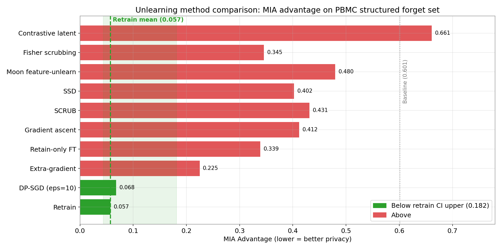
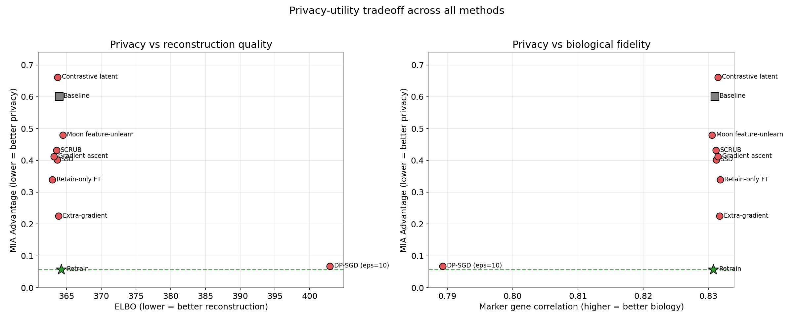
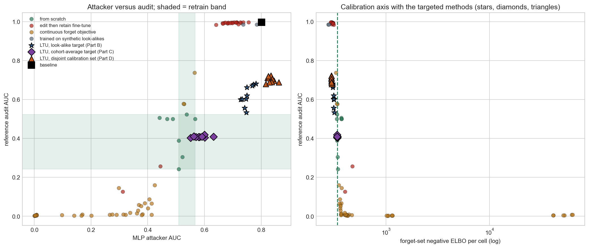
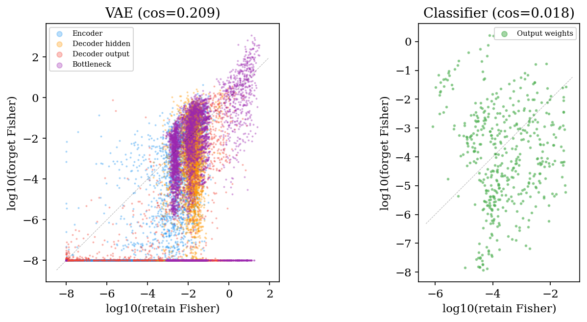

# Fishing for Privacy: Biological Confounds and the Limits of Membership Inference in Gene-Expression VAEs

**Status (2026-09-08).** Every experiment in this study was re-derived from one baseline with corrected code and a clean retrain reference. This page reports the re-derived numbers. The paper (`Writeup.tex`, PDF, and the Markdown mirror) still carries the pre-audit text and is being rewritten. The analysis behind the change is in `STAGE1_ANALYSIS.md`, the claim-by-claim verdicts in `CLAIMS_AUDIT.md`, and the bug that produced the old posterior-collapse and utility-cost results in `LOSS_WEIGHTING_BUG.md`.

David Benson, Columbia University

[View Code](https://github.com/db-d2/Machine_Unlearning) | [Writeup (Markdown, pre-audit)](./Writeup.md) | [Writeup (PDF, pre-audit)](./Writeup.pdf)

## What the re-derived evidence shows

Can a gene-expression VAE selectively forget a rare biological subpopulation without retraining and without destroying model utility? The answer is no, and the reason changed under the re-derivation.

**The measurement.** Nine post-hoc unlearning methods, two constructive approaches, DP-SGD, and a likelihood-targeted variant are scored by one membership inference attacker trained on the baseline model and by a reference-model likelihood-ratio audit, against five clean retrains that never saw the forget set or the matched negatives. On PBMC-33k cluster 13 (30 megakaryocytes) the clean retrain sits at chance under the transferred attacker, under a refit attacker, and under the audit, while the baseline is far from it, so the membership signal there is genuine. On Tabula Muris, TCGA-BRCA, and two further PBMC clusters the retrain matches or exceeds the baseline under cross-class matching, so what that protocol measures there is subtype biology, and within-subtype matching or a clean retrain removes it. For a forget set that is an entire training subpopulation, a model trained only on synthetic look-alikes of the forget cells is scored as if it had memorized them; that is the stated limit of any membership evaluation here.

**The unlearning result.** No post-hoc method lands where retraining lands, and none pays for it in utility. Methods that edit the model and then fine-tune on the retain set leave the forget cells fitted almost as well as the baseline does. Methods with a continuous forget-set objective push them past the retrain level. Every post-hoc method keeps baseline held-out ELBO and marker-gene correlation. Only models trained from scratch, the retrain and DP-SGD, land on target.

**The mechanism.** Forget and retain Fisher information overlap at every VAE layer (cosine 0.35 to 0.49, against 0.018 for a classifier's class-specific output weights). A phase audit shows what that does to an edit-then-fine-tune method. The edit damages the retain set along shared directions, and the retain fine-tune that repairs it undoes the edit. That explains the first failure mode. The second is a missing target, and notebook 41 tests it directly. A method told the retrain's level lands inside the retrain band under the audit and brings the attacker's advantage down to the paper's threshold at baseline utility; told the level of held-out look-alikes instead, the only substitute a data controller can observe, it lands 40 nats short, because a model without the subpopulation fits an unseen member of it worse than that member's nearest known-type neighbours. The target exists and is not observable without a retrain.

## Key results

PBMC-33k structured forget set (cluster 13, n = 30 megakaryocytes) against 194 matched negatives. Advantage = 2|AUC - 0.5|. One CPU attacker scores every model. The reference is five clean retrains trained on the retain split only. A method fails when its advantage exceeds the retrain nested 95% CI upper bound (0.182) and its difference from retrain has a CI that excludes zero. The audit column is the reference-model likelihood-ratio AUC (1 = forget cells still fitted better than a never-trained model fits them, 0 = fitted worse; a second retrain seed scored against the reference gives 0.24 to 0.52).

| Method | Seeds | AUC | Advantage [95% CI] | Audit | ELBO | Marker r | Status |
|---|---|---|---|---|---|---|---|
| Baseline (no unlearning) | 1 | 0.801 | 0.601 | 0.996 | 363.9 | 0.831 | anchor |
| Retain-only fine-tune | 5 | 0.669 | 0.339 [0.24, 0.44] | 0.991 | 363.0 | 0.832 | FAIL, signal intact |
| Gradient ascent | 5 | 0.706 | 0.412 [0.31, 0.51] | 0.995 | 363.2 | 0.831 | FAIL, signal intact |
| SSD | 3 | 0.701 | 0.402 [0.28, 0.53] | 0.995 | 363.6 | 0.831 | FAIL, signal intact |
| SCRUB | 3 | 0.716 | 0.431 [0.30, 0.56] | 0.991 | 363.5 | 0.831 | FAIL, signal intact |
| Moon feature unlearning | 3 | 0.740 | 0.480 [0.35, 0.60] | 0.996 | 364.5 | 0.831 | FAIL, signal intact |
| Fisher scrubbing | 3 | 0.673 | 0.345 [0.22, 0.47] | 0.991 | 363.6 | 0.832 | FAIL, signal intact |
| Extra-gradient (lambda=10) | 10 | 0.411 | 0.225 [0.15, 0.33] | 0.218 | 363.8 | 0.832 | FAIL, over-corrected |
| Extra-gradient (lambda=1) | 10 | 0.336 | 0.327 [0.20, 0.48] | 0.049 | 363.3 | 0.831 | FAIL, over-corrected |
| Contrastive latent | 3 | 0.170 | 0.661 [0.56, 0.75] | 0.004 | 363.7 | 0.831 | FAIL, over-corrected |
| Frozen critics (4 configs) | 3 each | 0.003 to 0.008 | 0.985 to 0.995 | 0.003 to 0.006 | 364 to 406 | 0.831 | FAIL, over-corrected |
| DP-SGD (epsilon=10) | 3 | 0.466 | 0.068 [0.03, 0.19] | 0.502 | 402.9 | 0.789 | retrain level (from scratch) |
| **Clean retrain** | **5** | **0.529** | **0.057 [0.04, 0.18]** | **0.24 to 0.52 (seed vs seed)** | **364.2** | **0.831** | **reference** |

Extra-gradient at lambda=10 is bimodal across seeds (seven over-correct, three keep part of the signal) and none of its ten seeds lands in the retrain band. A refit attacker trained on each model's own features puts the clean retrain at advantage 0.035 [-0.03, 0.10] while recovering 0.595 on the baseline, so the near-chance retrain score is a property of the model, not of a weak attacker. Every number traces to `outputs/p4/multiseed/nested_ci_all.json`, `utility_all.json`, and `outputs/attack_lr_reference.json`.

## Main figures

### Evaluation pipeline

*Three cohorts across two modalities, each with a structured forget set that is a rare, biologically coherent subpopulation; scVI-style VAE with shared decoder; trained MLP attacker on 70 model-internal features; the unlearning methods and DP-SGD on the privacy-utility plane.*

### MIA advantage by method

*MIA advantage by method on the PBMC-33k structured forget set. The dashed line marks the clean-retrain advantage (0.057) with the shaded nested 95% CI [0.044, 0.182]. No post-hoc method reaches the retrain CI; DP-SGD, trained from scratch, does.*

### Privacy-utility plane

*Left: advantage against held-out ELBO. Right: advantage against marker-gene correlation. Every post-hoc method sits at baseline utility; the spread is entirely on the privacy axis. Only DP-SGD pays a utility price.*

### Calibration axis and the targeted variants

*Left: attacker AUC against the reference audit for every checkpoint, with the retrain band shaded. Right: the same checkpoints on the forget-cell negative ELBO axis, with the clean retrain's level dashed. Edit-then-fine-tune methods (red) sit near the baseline, continuous-objective methods (gold) far past the retrain, and the likelihood-targeted variants land where their target puts them: on the retrain level when given it (diamonds), short of it when calibrated on look-alikes (stars, triangles).*

### Fisher information overlap

*Per-parameter Fisher magnitude (log scale) for forget and retain sets. Left: VAE parameters are correlated (log-Fisher r = 0.71). Right: classifier parameters show no correlation (cosine 0.018).*

## Key findings

1. **The membership signal on PBMC cluster 13 is genuine and large.** Baseline advantage 0.601 against a clean-retrain floor of 0.057, which sits below the estimator's own null floor (0.090). The earlier retrain reference (advantage 0.156) had trained on 159 to 170 of the 194 matched negatives; the audit reads that leak directly (0.80 against the clean reference).

2. **The biology confound holds on the other cohorts.** Tabula Muris cluster 33 baseline 0.903 against retrain 0.943; TCGA-BRCA Basal cross-subtype 0.803 against 0.830, within-subtype 0.580 against 0.572, and no baseline-to-retrain gap at patient level (n = 5, 10, 20); PBMC cluster 12 baseline advantage 0.737 against clean retrain 0.628; PBMC cluster 7 cross-cluster 0.665 to within-cluster 0.527. In each case the retrain matches or exceeds the baseline under cross-class matching, so the cross-class signal is subtype identity.

3. **No post-hoc method lands where retraining lands, and none costs utility.** Retain-only fine-tune, gradient ascent, SSD, SCRUB, Moon feature unlearning, and Fisher scrubbing leave the forget cells fitted almost as well as the baseline does (audit 0.99 against the baseline's 0.996). Extra-gradient, contrastive, frozen critics, and Fisher at larger steps push them past the retrain level (audit 0.004 to 0.26). Every post-hoc method keeps ELBO 363 to 364.5 and marker r 0.831 to 0.832; only the three-critic frozen runs (403 to 406) and DP-SGD (402.9) pay for anything. Gradient ascent's ascent phase moves the forget-set fit by one nat; the method as run is the retain fine-tune.

4. **The Fisher overlap is the mechanism of the signal-intact mode.** The Fisher scrub raises the forget-cell negative ELBO from 270 to 5,569 and the retain cells' from 363 to 1,250 (shared damage, as the overlap predicts); the retain fine-tune brings them back to 308 and 362, while a clean retrain fits the forget cells at 334 to 337. At larger scrub steps the fine-tune cannot bring the forget cells back and the model ends over-corrected. Overlap does not block the edit; it makes the repair undo it. Nothing in any post-hoc objective encodes the retrain level.

5. **Constructive approaches fail the same way.** Representation alignment unlearning matches the retrain's posterior on the forget cells (KL from 180 to below 0.25) yet over-corrects the likelihood (audit 0.007 to 0.018). Synthetic augmentation trains on retain cells plus synthetic megakaryocytes from five unseen seed cells and never on the forget cells, and is scored as if it had memorized them (attacker 0.744 and 0.795, audit 0.985 and 0.984), because it learned the subpopulation.

6. **Scattered forget sets carry nothing the attacker can find.** At every size from 10 to 500 random cells the baseline, the clean retrain, and Fisher scrubbing coincide within 0.02 AUC. The audit does see per-cell memorization of scattered cells (baseline 0.69 to 0.79 against a retrain floor near 0.5), and Fisher removes only part of it (0.44 to 0.65).

7. **Multi-cluster forget sets are confound-affected.** With per-size clean retrains, the reference itself moves (AUC 0.454 at n = 10, 0.565 at n = 50, 0.668 at n = 100), and extra-gradient over-corrects at every size.

8. **The overlap is architectural.** A deep MLP classifier (1.09M parameters) has the same near-zero class-specific output overlap (0.006) as a linear probe (0.018) and VAE-like overlap in its shared hidden layers (0.527). A z = 8 VAE has higher global overlap (0.349) than z = 32 (0.209). A cluster-conditional decoder zeroes the output-column overlap and still fails to unlearn (advantage 0.759 to 0.709) because the encoder overlap (0.617) is untouched.

9. **The missing target is not observable without a retrain.** Likelihood-targeted unlearning (notebook 41) fine-tunes on the retain set with a penalty that pulls each forget cell's negative ELBO to a target. Given the retrain's level (335 to 337), ten seeds land inside the audit's retrain band (0.41 against 0.24 to 0.52) with attacker advantage 0.166 [0.111, 0.212] against the threshold 0.182, at baseline utility. Given the level of held-out look-alikes (each forget cell's nearest never-seen neighbours, or 88 further neighbours that the evaluation never uses), the forget cells land at 296 to 309 and the attacker reads them at 0.75 to 0.83, because the clean retrain itself fits those look-alikes at 292 to 301 while fitting the forget cells at 334 to 342. A model without the subpopulation fits an unseen member of it worse than that member's nearest known-type neighbours, so no cell the model knows supplies the level.

## Fisher overlap summary

Per-sample estimator, damping 0 (`outputs/p6/fisher_overlap_results.json`).

| Layer category | Parameters | PBMC cosine |
|---|---|---|
| VAE encoder | 2,642,816 | 0.345 |
| VAE bottleneck | 8,256 | 0.428 |
| VAE decoder hidden | 598,912 | 0.351 |
| VAE decoder output | 4,100,000 | 0.493 |
| **VAE global (PBMC)** | **7,349,984** | **0.209** |
| **VAE global (TCGA-BRCA)** | **4,208,356** | **0.753** |
| **Classifier (linear, 14 classes)** | **462** | **0.018** |

Gene level: 1,453 of 2,000 genes (73%) have cosine above 0.5, median 0.857. Proposition 1's factorization predicts the shared-decoder cosine within 3% (0.498 against the measured 0.485).

## Reproducing results

Run notebooks in numerical order (01-41). Key notebooks:

- **NB01-10**: Data prep, baseline training, initial unlearning experiments
- **NB11-25**: Additional methods, cross-dataset validation, ablations, attack diversity
- **NB26**: Canonical Fisher overlap analysis (VAE vs classifier, per-sample estimator)
- **NB27**: Deep MLP classifier (fair capacity comparison)
- **NB28**: VAE z=8 (architecture generalization)
- **NB29**: Conditional VAE (cluster-specific output columns)
- **NB30**: Proposition 1 verification + conditional VAE scrubbing
- **NB31-36**: TCGA-BRCA data prep, baseline, unlearning, within-subtype evaluation, Fisher overlap, cross-domain comparison
- **NB37**: Synthetic augmentation experiments
- **NB38**: Representation alignment unlearning (RAU)
- **NB39**: Larger-cluster within-subtype evaluation (PBMC c7, TM c28)
- **NB40**: Confound fraction CIs (parametric bootstrap)
- **NB41**: Calibration axis for every checkpoint and likelihood-targeted unlearning

The canonical PBMC pipeline (clean retrains, one attacker for every checkpoint, nested bootstrap, utility, reference audit, provenance, claims audit):

```bash
for SEED in 42 43 44 45 46; do
    PYTHONPATH=src python scripts/retrain_clean.py --seed $SEED --output_dir outputs/p1/retrain_clean/seed_$SEED
done
PYTHONPATH=src python scripts/save_persample_scores.py
PYTHONPATH=src python scripts/nested_bootstrap_all.py
PYTHONPATH=src python scripts/score_utility_all.py
PYTHONPATH=src python scripts/attack_lr_reference.py
PYTHONPATH=src python scripts/checkpoint_manifest.py
PYTHONPATH=src python scripts/claims_audit.py
```

---

*Columbia University. Code: <https://github.com/db-d2/Machine_Unlearning>*
